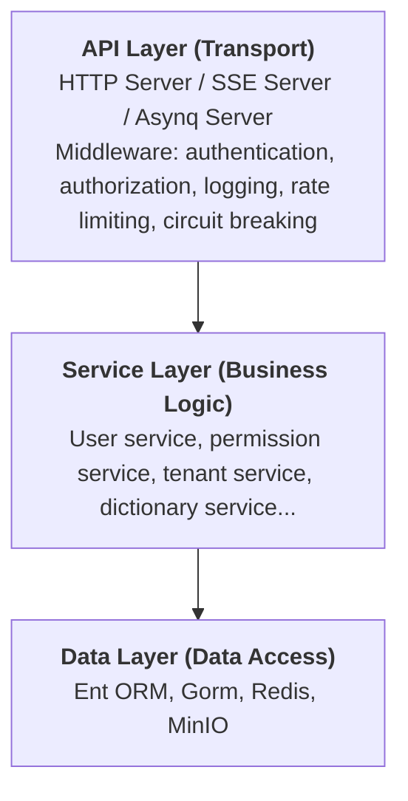

# Backend Architecture Overview

The GoWind Admin backend is written in Go and built on the [go-kratos](https://go-kratos.dev/) microservice framework, combining Ent ORM, Wire dependency injection, Protobuf API definitions, and other modern engineering practices to deliver a high-performance, easily extensible enterprise backend.

## 1. Tech Stack at a Glance

| Category     | Technology                      | Notes                                  |
|--------|-------------------------|-------------------------------------|
| Language     | Go 1.22+                | High-performance compiled language with native support for high concurrency                    |
| Microservice framework  | go-kratos v2            | The go-kratos microservice framework, providing both HTTP and gRPC support |
| Dependency injection   | Wire                    | Google's compile-time dependency injection tool, eliminating runtime reflection overhead       |
| ORM    | Ent / Gorm              | Ent for core business entities (auto-generated, type-safe); Gorm for auxiliary queries |
| Database    | PostgreSQL (default) / MySQL   | Switchable via configuration; both Ent/Gorm support multiple databases           |
| Cache     | Redis                   | Used for token caching, session management, captcha storage, etc.                  |
| Object storage   | MinIO                   | S3-compatible object storage for file upload management               |
| API definition | Protobuf + Buf          | Standardized interface definition language; auto-generates Go/TypeScript code    |
| Task scheduling   | Asynq                   | Redis-based distributed task queue supporting scheduled and asynchronous tasks       |
| Real-time push   | SSE (Server-Sent Events) | The server pushes real-time messages to clients                       |
| Permission control   | Casbin / OPA / Zanzibar | Multiple policy engines to choose from, supporting RBAC, ABAC and other permission models         |
| Containerization    | Docker + Docker Compose | One-click deployment of all dependency services and the application itself                     |

## 2. Architecture Design

### 1. Overall Layered Architecture

The backend service follows the classic **three-layer architecture** design:



- **API layer**: receives external requests and exposes RESTful interfaces via Protobuf-generated HTTP handlers. The middleware layer handles cross-cutting concerns such as authentication (JWT), authorization (Casbin/OPA), and API audit logging.
- **Service layer**: implements the core business logic; each business module corresponds to one Service, which obtains Data-layer Repo instances via dependency injection.
- **Data layer**: handles data persistence and interaction with external services, encapsulating database operations (Ent/Gorm), cache operations (Redis), file storage (MinIO), etc.

### 2. Service Composition

The Admin backend service consists of three Transport Servers:

| Server           | Port       | Description                       |
|--------------|----------|--------------------------|
| REST Server  | `:7788`  | The main HTTP API service, handling all business requests |
| SSE Server   | `:7789`  | Server push service for real-time message notifications         |
| Asynq Server | via Redis | Asynchronous task scheduling service, handling scheduled and background tasks     |

### 3. Startup Flow

The backend startup entry point is located at `app/admin/service/cmd/server/main.go`; the startup flow is as follows:

1. Create the application context (`bootstrap.Context`), containing the project name, service ID, and version
2. Automatically assemble all dependencies via Wire dependency injection (`wire.go` → `wire_gen.go`)
3. Initialize the REST Server, SSE Server, and Asynq Server
4. Register the HTTP handlers of all business Services
5. Register Swagger UI (development environment)
6. Initialize permission policies
7. Start the Kratos application and begin listening for requests

## 3. Project Directory Structure

```
backend/
├── api/                        # API definitions and code generation
│   ├── protos/                 # Raw Protobuf definition files
│   │   ├── admin/service/v1/   # Admin service interface definitions
│   │   ├── audit/              # Audit-related definitions
│   │   ├── authentication/     # Authentication-related definitions
│   │   ├── dict/               # Dictionary-related definitions
│   │   ├── identity/           # Identity management definitions
│   │   ├── internal_message/   # Internal message definitions
│   │   ├── permission/         # Permission-related definitions
│   │   ├── storage/            # Storage-related definitions
│   │   └── task/               # Task scheduling definitions
│   ├── gen/                    # Auto-generated code
│   │   └── go/                 # Generated Go code
│   ├── buf.yaml                # Buf configuration
│   └── buf.gen.yaml            # Code generation configuration
│
├── app/                        # Application service code
│   └── admin/service/          # Admin core service
│       ├── cmd/server/         # Service startup entry point
│       │   ├── main.go         # Main program entry
│       │   ├── wire.go         # Wire dependency injection definition
│       │   ├── wire_gen.go     # Wire auto-generated code
│       │   └── assets/         # Static assets (OpenAPI docs, etc.)
│       ├── configs/            # Configuration files
│       │   ├── server.yaml     # Server configuration
│       │   ├── data.yaml       # Data source configuration
│       │   ├── auth.yaml       # Authentication & authorization configuration
│       │   ├── client.yaml     # Client configuration
│       │   ├── oss.yaml        # Object storage configuration
│       │   └── logger.yaml     # Logger configuration
│       └── internal/           # Internal implementation (not exposed externally)
│           ├── data/           # Data access layer (Repo implementations)
│           ├── server/         # Server and middleware configuration
│           └── service/        # Business logic layer (Service implementations)
│
├── pkg/                        # Shared utility packages
│   ├── authorizer/             # Permission engine wrapper
│   ├── constants/              # Global constant definitions
│   ├── crypto/                 # Crypto utilities (AES-GCM)
│   ├── entgo/                  # Ent ORM extensions
│   ├── eventbus/               # Event bus
│   ├── jwt/                    # JWT token payload parsing
│   ├── lua/                    # Lua script engine
│   │   ├── api/                # Lua API modules
│   │   ├── hook/               # Lua hook mechanism
│   │   └── engine.go           # Lua engine core
│   ├── middleware/             # Custom middleware
│   │   ├── auth/               # Authentication middleware
│   │   ├── ent/                # Ent context middleware
│   │   └── logging/            # Audit log middleware
│   ├── oss/                    # Object storage client
│   ├── serviceid/              # Service identity constants
│   ├── task/                   # Task definitions
│   └── utils/                  # General utility functions
│
├── scripts/                    # Build/deployment scripts
│   ├── docker/                 # Docker deployment scripts
│   ├── deploy/                 # Production deployment scripts
│   └── env/                    # Environment initialization scripts
│
├── sql/                        # Database initialization scripts
├── Makefile                    # Automated build instructions
├── Dockerfile                  # Docker image build file
├── docker-compose.yaml         # Full-service deployment orchestration
└── docker-compose.libs.yaml    # Dependency-services-only orchestration
```

## 4. Layering Design: Service–Data Interaction Patterns

In GoWind Admin's layered design, the degree of coupling between the Service layer and the Data layer is the **make-or-break factor** of the architecture. Depending on module complexity, the framework flexibly adopts three interaction patterns, striking a dynamic balance between "shipping fast" and "scaling to enterprise grade".

### 1. Pattern 1: Service Uses the Data Repo Directly (Simple and Direct)

The Data layer directly implements a Repo struct (no interface), and the Service layer imports the Data package directly to reference the Repo instance:

```go
// Data layer: implement the Repo directly
package data

type DepartmentRepo struct {
    client *ent.Client
}

func (r *DepartmentRepo) GetByID(ctx context.Context, id uint32) (*ent.Department, error) {
    return r.client.Department.Query().Where(department.ID(id)).Only(ctx)
}
```

```go
// Service layer: depend directly on the Data layer's concrete implementation
package service

type DepartmentService struct {
    deptRepo *data.DepartmentRepo  // depend on the concrete type directly
}

func (s *DepartmentService) GetDepartmentInfo(ctx context.Context, id uint32) (*dto.DepartmentVO, error) {
    deptEnt, err := s.deptRepo.GetByID(ctx, id)  // direct call
    // ...business logic processing + data assembly
}
```

**Best for**: lightweight modules (logs, configuration, system announcements), MVP validation, small teams of 1–3

| Pros | Cons |
|------|------|
| Extremely high development efficiency; no interfaces to define | Service and Data are strongly coupled; replacing the ORM requires touching every call site |
| Minimal architecture; low onboarding barrier for newcomers | Poor testability; unit tests require a real database |
| Clear debugging path | Lacks extensibility; no multi-storage adaptation |

### 2. Pattern 2: Dependency Inversion with Interfaces (Recommended)

The Service layer defines the Repo interface (clarifying "what is needed"), the Data layer implements the interface (clarifying "how to do it"), and Wire dependency injection wires them together:

```go
// Service layer: define the abstract interface
package service

type DepartmentRepo interface {
    GetByID(ctx context.Context, id uint32) (*DepartmentEntity, error)
    ListByOrgID(ctx context.Context, orgID uint32) ([]*DepartmentEntity, error)
}

type DepartmentService struct {
    deptRepo DepartmentRepo  // depend on the abstract interface
}
```

```go
// Data layer: implement the interface defined by the Service layer
package data

type DepartmentRepoImpl struct {
    entClient *ent.Client
    cache     *redis.Client
}

func NewDepartmentRepoImpl(entClient *ent.Client, cache *redis.Client) service.DepartmentRepo {
    return &DepartmentRepoImpl{entClient: entClient, cache: cache}
}

func (r *DepartmentRepoImpl) GetByID(ctx context.Context, id uint32) (*service.DepartmentEntity, error) {
    // Freely combine Ent + Redis cache; the Service layer is unaware of it
}
```

```go
// Wire dependency injection: bind interface to implementation
var ServiceProviderSet = wire.NewSet(
    service.NewDepartmentService,
    data.NewDepartmentRepoImpl,  // binding
)
```

**Best for**: core modules such as user management, permission control, and multi-tenancy; teams of 3–10

| Pros | Cons |
|------|------|
| Fully decoupled; Data changes do not affect Service | 30%–50% more code in the early stage |
| Unit testing possible with mocking tools | Requires understanding dependency inversion and Wire |
| Supports multi-storage adaptation (MySQL/PostgreSQL/Redis) | Longer debugging path |

### 3. Pattern 3: Add a Biz Layer (Very Large Projects)

For scenarios involving multiple aggregate roots, complex state transitions, and strong transactional consistency, a Biz layer can be introduced to form a four-layer architecture:

```
API layer (protocol handling) → Service layer (service contract) → Biz layer (core business logic) → Data layer (data access)
```

```go
// Biz layer: core business orchestration
package biz

type UserBiz struct {
    userRepo    UserRepo
    roleRepo    RoleRepo
    messageRepo MessageRepo
}

func (b *UserBiz) CreateUserInTenant(ctx context.Context, tenantID uint32, req *CreateUserReq) (*User, error) {
    // 1. Validate username uniqueness
    // 2. Create the user
    // 3. Assign roles (cross-aggregate)
    // 4. Send a welcome message (degradable)
}
```

**Best for**: highly complex modules such as orders and payments; teams of 10+ with domain modeling discipline

### 4. Layering Decision Guide

| Project Profile | Recommended Pattern | Typical Modules |
|---------|---------|---------|
| MVP / single-table CRUD / internal tools | Pattern 1 (direct) | System announcements, logs, dictionaries |
| Multi-developer collaboration / unit testing needed / multiple stores | Pattern 2 (interface decoupling) | Users, permissions, tenants |
| Cross-aggregate / state machines / strong transactions | Pattern 3 (Biz layer) | Orders, payments |

> Modules generated by default in GoWind Admin mostly use **Pattern 1** (making it easy for newcomers to get started), while core modules such as users, tenants, and permissions are already implemented with **Pattern 2** — refer to the source code directly.

## 5. Dependency Injection (Wire)

The project uses Google Wire for compile-time dependency injection, automatically orchestrating the dependencies across the Data, Service, and Server layers via `ProviderSet`:

```go
// wire.go
func initApp(*bootstrap.Context) (*kratos.App, func(), error) {
    panic(wire.Build(
        serverProviders.ProviderSet,   // server layer
        serviceProviders.ProviderSet,  // business logic layer
        dataProviders.ProviderSet,     // data access layer
        newApp,
    ))
}
```

## 6. Code Generation Driven

Protobuf + Buf automatically generates:
- Go HTTP Server/Client code
- TypeScript frontend request code
- OpenAPI v3 documentation
- Error code definitions

## 7. Multi-Tenancy Support

The backend has built-in multi-tenancy and supports two user–tenant relation models:
- **One-to-one**: a user belongs to only one tenant
- **One-to-many**: a user can belong to multiple tenants

Switch via the `constants.DefaultUserTenantRelationType` configuration.

## 8. Related Documents

- [Backend Core Modules in Depth](/en/admin/backend-modules.md)
- [Backend API & Protobuf Definitions](/en/admin/backend-api.md)
- [Backend Configuration & Deployment](/en/admin/backend-config-deploy.md)
- [Backend Extension Development](/en/admin/backend-extension.md)
