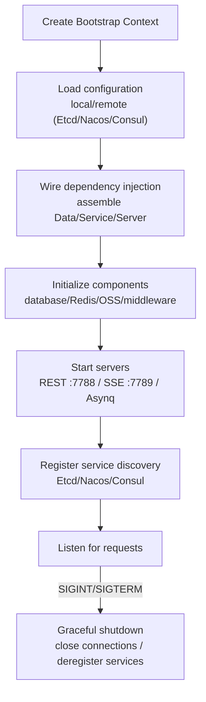

# Backend Configuration & Deployment

This document details all configuration items of the GoWind Admin backend and the deployment approaches for development/production environments.

## 1. Configuration File System

Backend configuration files are located in the `app/admin/service/configs/` directory in YAML format, split by functional domain:

```
configs/
├── server.yaml     # Server configuration (REST, Asynq, SSE)
├── data.yaml       # Data source configuration (database, Redis)
├── auth.yaml       # Authentication & authorization configuration
├── client.yaml     # Client configuration
├── oss.yaml        # Object storage configuration
└── logger.yaml     # Logger configuration
```

### 1. Server Configuration (server.yaml)

```yaml
server:
  rest:
    addr: ":7788"               # REST API listen address
    timeout: 10s                # Request timeout
    enable_swagger: true        # Enable Swagger UI
    enable_pprof: true          # Enable pprof profiling
    cors:                       # CORS configuration
      headers:
        - "X-Requested-With"
        - "X-Request-ID"
        - "Content-Type"
        - "Authorization"
      methods:
        - "GET"
        - "POST"
        - "PUT"
        - "DELETE"
      origins:
        - "*"
    middleware:                  # Middleware toggles
      enable_logging: true      # Request logging
      enable_recovery: true     # Panic recovery
      enable_tracing: true      # Distributed tracing
      enable_validate: true     # Parameter validation
      enable_circuit_breaker: true  # Circuit breaker
      enable_metadata: true     # Metadata propagation

  asynq:                        # Asynq async task configuration
    uri: "redis://:*Abcd123456@redis:6379/1"
    codec: "json"
    concurrency: 10             # Number of concurrent workers
    shutdown_timeout: 10s
    queues:                     # Queue priority configuration
      critical: 10
      default: 5
      low: 1

  sse:                          # SSE push service configuration
    addr: ":7789"
    codec: "json"
    path: "/events"
    auto_stream: true
    auto_reply: false
```

### 2. Data Source Configuration (data.yaml)

```yaml
data:
  database:
    driver: "postgres"          # Database driver: postgres / mysql
    source: "host=postgres port=5432 user=postgres password=*Abcd123456 dbname=gwa sslmode=disable"
    # MySQL configuration example:
    # driver: "mysql"
    # source: "root:*Abcd123456@tcp(localhost:3306)/gwa?parseTime=true&charset=utf8mb4&loc=Asia%2FShanghai"
    migrate: true               # Run database migrations automatically
    debug: false                # Enable SQL debug logging
    enable_trace: false         # Enable database tracing
    max_idle_connections: 25    # Max idle connections
    max_open_connections: 25    # Max open connections
    connection_max_lifetime: 300s  # Max connection lifetime

  redis:
    addr: "redis:6379"
    password: "*Abcd123456"
    dial_timeout: 10s
    read_timeout: 0.4s
    write_timeout: 0.6s
```

### 3. Authentication & Authorization Configuration (auth.yaml)

```yaml
authn:
  type: "jwt"                  # Authentication method: jwt / oidc / preshared_key
  jwt:
    method: "HS256"             # JWT signing algorithm
    key: "some_api_key"         # JWT signing key

authz:
  type: "noop"                  # Authorization engine: casbin / opa / zanzibar / noop
  casbin:                       # Casbin configuration (active when type=casbin)
  opa:                          # OPA configuration (active when type=opa)
  zanzibar:                     # Zanzibar configuration (active when type=zanzibar)
    type: "keto"                # keto / open_fga
    keto:
      write_url: "http://keto:4466"
      read_url: "http://keto:4466"
      use_grpc: true
```

### 4. Object Storage Configuration (oss.yaml)

```yaml
oss:
  minio:
    endpoint: "minio:9000"
    upload_host: "minio:9000"
    download_host: "minio:9000"
    access_key: "root"
    secret_key: "*Abcd123456"
    token: ""
    use_ssl: false
```

### 5. Logger Configuration (logger.yaml)

```yaml
logger:
  type: std                     # Logger type: std / file / fluent / zap / logrus / aliyun / tencent
  zap:
    level: "debug"
    filename: "./logs/info.log"
    max_size: 1                 # Max MB per log file
    max_age: 30                 # Days to retain logs
    max_backups: 5              # Max number of backup files
```

## 2. Startup Flow

The backend service starts on the `kratos-bootstrap` framework, following a standardized lifecycle:



### 1. Startup Entry Point

```go
// cmd/server/main.go
func runApp() error {
    ctx := bootstrap.NewContext(
        context.Background(),
        &conf.AppInfo{
            Project: service.Project,
            AppId:   service.AdminService,
            Version: version,
        },
    )
    return bootstrap.RunApp(ctx, initApp)
}
```

### 2. Command-Line Arguments

Configuration can be overridden via command-line arguments, making it easy to switch between environments:

| Argument | Short | Default | Description |
|--------|------|--------|------|
| `--conf` | `-c` | `../../configs` | Configuration file directory |
| `--env` | `-e` | `dev` | Runtime environment (dev/test/prod) |
| `--chost` | `-s` | `127.0.0.1:8500` | Remote config center address |
| `--ctype` | `-t` | `consul` | Config center type (etcd/nacos/consul) |
| `--daemon` | `-d` | `false` | Run as a daemon |

```shell
# Production startup, using the Etcd config center
go run main.go -e prod -c ./configs/prod -t etcd -s 192.168.1.100:2379
```

### 3. Configuration Precedence

Configuration is loaded with the following precedence (higher priority overrides lower):

```
Remote config center > command-line arguments > environment variables > local config files
```

### 4. Remote Configuration Center

Supports Etcd / Nacos / Consul / Apollo / Polaris and other config centers, activated by an "import-to-enable" approach:

```go
import (
    _ "github.com/tx7do/kratos-bootstrap/config/etcd"  // enable Etcd
)
```

Configuration example:

```yaml
config:
  type: "etcd"
  etcd:
    endpoints: ["127.0.0.1:2379"]
    path: "/go-wind-admin/configs"
```

## 3. Environment Variables

The `.env` file at the project root configures environment variables used by the Makefile and scripts.

## 4. Docker Deployment

### 1. Docker Compose Files

The project provides two Docker Compose files:

| File                         | Description               |
|----------------------------|------------------|
| `docker-compose.yaml`      | Full deployment (middleware + application services) |
| `docker-compose.libs.yaml` | Middleware dependencies only         |

### 2. Middleware Services

| Service         | Image                                | Port        | Description    |
|------------|-----------------------------------|-----------|-------|
| PostgreSQL | `bitnami/postgresql:latest`       | 5432      | Primary database  |
| MySQL (optional)  | `mariadb:latest`                  | 3306      | Alternative database |
| Redis      | `bitnami/redis:latest`            | 6379      | Cache/queue |
| MinIO      | `minio/minio:latest`              | 9000/9001 | Object storage  |
| Jaeger (optional) | `jaegertracing/all-in-one:latest` | 16686     | Distributed tracing  |

### 3. Deployment Scripts

All deployment scripts are located in the `scripts/` directory:

#### Environment Initialization Scripts

| Script                                    | Description                 |
|---------------------------------------|--------------------|
| `scripts/env/install_unix_dev.sh`     | Linux/macOS development environment install |
| `scripts/env/install_unix_prod.sh`    | Linux/macOS production environment install |
| `scripts/env/install_windows_dev.ps1` | Windows development environment install     |

#### Docker Deployment Scripts

| Script                               | Description                     |
|----------------------------------|------------------------|
| `scripts/docker/full_deploy.sh`  | Full Docker deployment (middleware + app) |
| `scripts/docker/full_deploy.ps1` | Full Docker deployment (Windows)  |
| `scripts/docker/libs_only.sh`    | Middleware dependencies only (recommended for development)       |
| `scripts/docker/libs_only.ps1`   | Middleware dependencies only (Windows)      |

#### Production Deployment Scripts

| Script                              | Description         |
|---------------------------------|---------|
| `scripts/deploy/pm2_service.sh` | PM2 process-managed deployment |

## 5. Development Environment Deployment

### Option 1: Middleware Only (Recommended)

Suited to day-to-day development and debugging, with the application running in a local IDE:

```shell
# Linux / macOS
./scripts/docker/libs_only.sh
gow run admin

# Windows (PowerShell as administrator)
.\scripts\docker\libs_only.ps1
gow run admin
```

### Option 2: Full Docker Startup

Suited to quick trials or CI environments:

```shell
# Linux / macOS
./scripts/docker/full_deploy.sh

# Windows
.\scripts\docker\full_deploy.ps1
```

## 6. Production Deployment

### Option 1: Full Docker Deployment

All services (middleware + application) run in Docker containers:

```shell
./scripts/docker/full_deploy.sh
```

### Option 2: Hybrid Deployment

Middleware runs in Docker, while the application runs on the host (managed by PM2):

```shell
# Start middleware
./scripts/docker/libs_only.sh

# Host the application with PM2
./scripts/deploy/pm2_service.sh
```

### Option 3: Manual Build & Deploy

```shell
# Build
make build

# Output binaries are located in the app/admin/service/ directory
# Deploy the binaries together with the configs/ directory to the server
```

## 7. Makefile Commands in Detail

GoWind Admin uses a layered Makefile design of "root Makefile + app.mk + per-service Makefile":

```
backend/
├── Makefile              # Global commands (init/build/gen/docker...)
├── app.mk                # Per-service command template (run/api/ent/wire...)
└── app/admin/service/
    └── Makefile           # include ../../../app.mk
```

### 1. Global Commands (Root Directory)

| Command | Description | When to Use |
|------|------|----------|
| `make init` | Install Protobuf plugins + CLI tools | After first cloning the project |
| `make gen` | Batch-generate all service code (Ent + Wire + API) | Full regeneration |
| `make build` | Build all service binaries | Packaging & deployment |
| `make docker` | Build Docker images for all services | Containerized deployment |
| `make test` | Run all unit tests | Pre-commit verification |
| `make lint` | golangci-lint code check | Code standards |
| `make docker-up` | Start all services + middleware | Full Docker deployment |
| `make docker-libs` | Start middleware only | Day-to-day development |
| `make docker-down` | Stop all Docker services | Environment cleanup |
| `make pm2-deploy` | Deploy microservices with PM2 | Hybrid deployment |

### 2. Service-Level Commands (app/admin/service/ Directory)

| Command | Description | When to Use |
|------|------|----------|
| `make run` | Start the current service (local debugging) | Development & debugging |
| `make api` | Generate the current service's Go API code | After API changes |
| `make ent` | Generate the current service's Ent ORM code | After schema changes |
| `make wire` | Generate the current service's dependency injection code | After dependency changes |
| `make openapi` | Generate the current service's OpenAPI documentation | Updating API docs |
| `make ts` | Generate the current service's TypeScript code | Frontend/backend sync |
| `make build` | Build the current service's binary | Single-service deployment |

### 3. Common Scenarios

```shell
# Scenario 1: first-time initialization and startup
make init && make docker-libs && make gen
make run

# Scenario 2: update after API changes
cd app/admin/service
make api && make openapi && make run

# Scenario 3: build Docker images and deploy
cd ../..
make gen && make docker && make docker-up
```

## 8. Hosts Configuration

During local development, since Docker containers communicate with each other via service names, hostname mappings need to be added to the host machine's hosts file:

```ini
# Linux/MacOS: /etc/hosts
# Windows: C:\Windows\System32\drivers\etc\hosts
127.0.0.1 postgres
127.0.0.1 redis
127.0.0.1 minio
```

## 9. Dockerfile Notes

The backend Dockerfile supports multi-stage builds:

```dockerfile
# Specify the service name via a build argument
ARG SERVICE_NAME=admin
ARG APP_VERSION=1.0.0
```

Build the image:

```shell
docker build --build-arg SERVICE_NAME=admin --build-arg APP_VERSION=1.0.0 -t go-wind-admin/admin-service .
```

## 10. Database Initialization

Database initialization scripts are located in the `sql/` directory.

When `migrate: true` is set in `data.yaml`, Ent automatically runs database migrations (creating table structures). For manual initialization, execute the SQL scripts.

## 11. Related Documents

- [Backend Architecture Overview](/en/admin/backend-architecture.md)
- [Backend Core Modules in Depth](/en/admin/backend-modules.md)
- [Backend API & Protobuf Definitions](/en/admin/backend-api.md)
- [Backend Extension Development](/en/admin/backend-extension.md)
