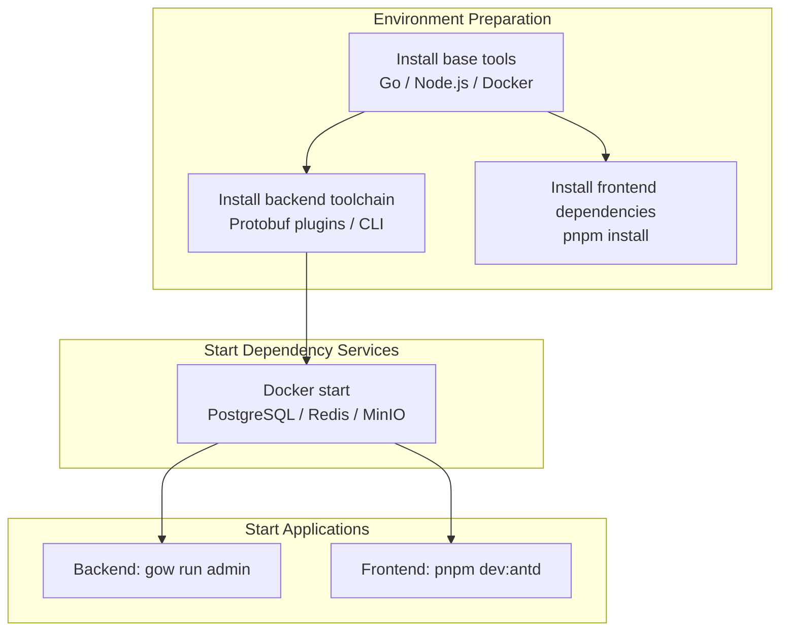
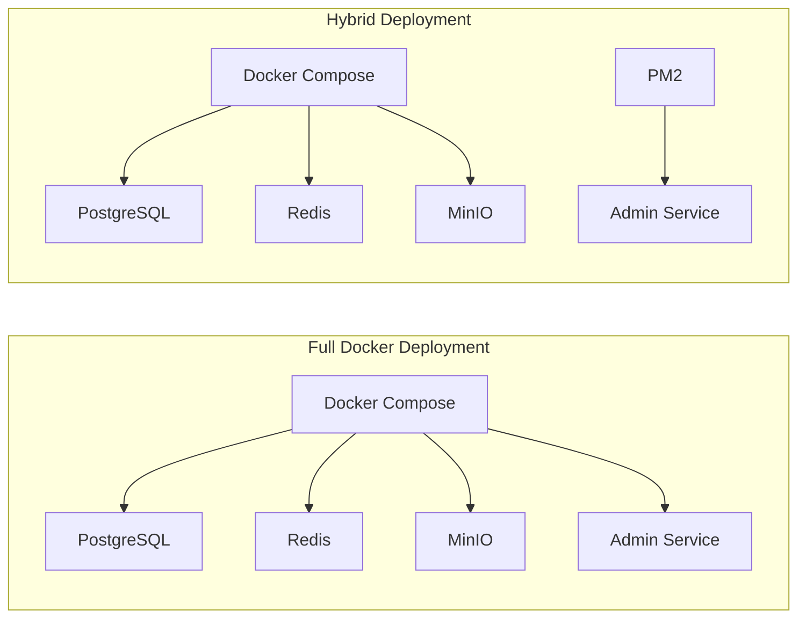

# GoWind Admin Installation Guide

This document describes the complete installation process for GoWind Admin, covering both development (local debugging) and production (online deployment) scenarios, and supporting the mainstream operating systems Windows / macOS / Linux.



## 1. Environment Preparation

### 1. Core Dependencies Overview

| Environment Type | Core Dependencies       | Minimum Version        | Purpose       |
|------|--------------------------|---------------------|--------------|
| Backend   | Go, Docker, Docker Compose | Go 1.22+            | Microservice compilation, dependency service management |
| Backend   | Buf, Protoc, Make          |                     | API code generation, build  |
| Frontend   | Node.js, pnpm             | Node.js 16+, pnpm 8+ | Frontend build, dependency installation  |

### 2. Project Directory Structure

```
go-wind-admin/
├── backend/                    # Backend project
│   ├── scripts/                # Automation scripts
│   │   ├── env/                # Environment installation scripts
│   │   ├── docker/             # Docker deployment scripts
│   │   └── deploy/             # PM2 deployment scripts
│   ├── app/admin/service/      # Admin service
│   ├── api/                    # Protobuf API definitions
│   ├── sql/                    # Database initialization scripts
│   ├── docker-compose.yaml     # Full deployment (app + dependencies)
│   ├── docker-compose.libs.yaml # Dependency services only
│   ├── Makefile                # Backend build commands
│   └── Dockerfile              # Docker image build
└── frontend/admin/             # Frontend projects
    ├── vue-vben/               # Vue Vben edition (Ant Design Vue)
    ├── vue-element/            # Vue Element edition (Element Plus)
    └── react/                  # React edition (Ant Design)
```

## 2. Development Environment Installation (Local Debugging)

### 2.1 Backend Development Environment

#### Option 1: Automated Install Script (Recommended)

The project provides automated environment installation scripts that detect the operating system and install the required tools.

##### Windows

```powershell
# Run PowerShell as administrator
cd go-wind-admin/backend

# Run the development environment installation script
powershell -ExecutionPolicy Bypass -File scripts/env/install_windows_dev.ps1
```

The script automatically does the following:
- Installs the [Scoop](https://scoop.sh/) package manager (if not already installed)
- Installs basic tools such as Git, Go, Make, and Node.js via Scoop
- Installs Docker Desktop
- Configures Go environment variables (`GOPROXY` etc.)
- Installs Protobuf plugins and CLI tools
- Configures the hosts file

##### macOS / Linux

```shell
cd go-wind-admin/backend

# Works on macOS / Ubuntu / CentOS / Rocky
bash scripts/env/install_unix_dev.sh
```

The script automatically does the following:
- Detects the operating system and package manager (brew / apt / yum / dnf)
- Installs basic tools (Git, curl, jq, etc.)
- Installs Docker
- Installs the Go runtime
- Configures Go environment variables (`GOPROXY=https://goproxy.io,direct`)
- Installs Protobuf plugins and CLI tools
- Installs the protoc compiler

#### Option 2: Manual Installation

If you prefer to control the installation process yourself, follow the steps below.

##### Step 1: Install Basic Tools

**Windows (Scoop)**

```powershell
# Install Scoop
Set-ExecutionPolicy RemoteSigned -Scope CurrentUser
irm get.scoop.sh | iex

# Install tools
scoop bucket add extras
scoop install git go make nodejs
```

**macOS (Homebrew)**

```shell
brew install git go protobuf make node
```

**Ubuntu / Debian**

```shell
sudo apt-get update
sudo apt-get install -y git make protobuf-compiler
curl -fsSL https://deb.nodesource.com/setup_22.x | sudo bash -
sudo apt-get install -y nodejs
```

**CentOS / Rocky**

```shell
sudo dnf install -y git make protobuf-compiler
```

##### Step 2: Install Docker

Refer to the [official Docker documentation](https://docs.docker.com/get-docker/) to install Docker Desktop (Windows/macOS) or Docker Engine (Linux).

##### Step 3: Install Protobuf Plugins

The backend relies on Protobuf-related plugins to generate API code; install them manually or with one Makefile command:

```shell
cd go-wind-admin/backend

# Manual install
go install google.golang.org/protobuf/cmd/protoc-gen-go@latest
go install google.golang.org/grpc/cmd/protoc-gen-go-grpc@latest
go install github.com/go-kratos/kratos/cmd/protoc-gen-go-http/v2@latest
go install github.com/go-kratos/kratos/cmd/protoc-gen-go-errors/v2@latest
go install github.com/google/gnostic/cmd/protoc-gen-openapi@latest
go install github.com/envoyproxy/protoc-gen-validate@latest
go install github.com/menta2k/protoc-gen-redact/v3@latest
go install github.com/go-kratos/protoc-gen-typescript-http@latest

# One-command install (recommended)
make plugin
```

##### Step 4: Install CLI Tools

```shell
cd go-wind-admin/backend

# Manual install
go install github.com/go-kratos/kratos/cmd/kratos/v2@latest
go install github.com/google/gnostic@latest
go install github.com/bufbuild/buf/cmd/buf@latest
go install entgo.io/ent/cmd/ent@latest
go install github.com/golangci/golangci-lint/v2/cmd/golangci-lint@latest
go install github.com/tx7do/go-wind-toolkit/gowind/cmd/gow@latest

# One-command install (recommended)
make cli
```

##### Step 5: Configure the Go Proxy (Mainland China Users)

```shell
go env -w GOPROXY=https://goproxy.io,direct
go env -w GO111MODULE=on
```

#### Initialize the Project

Before developing for the first time, install dependencies and initialize the tooling:

```shell
cd go-wind-admin/backend

# Install Go dependencies
go mod download

# One-command initialization (installs plugins + CLI tools)
make init
```

### 2.2 Frontend Development Environment

GoWind Admin provides three frontend implementations, all located under the `frontend/admin/` directory:

| Frontend Edition | Directory | UI Framework | Dev Port |
|------|------|------|------|
| Vue Vben | `vue-vben/` | Ant Design Vue | 5666 |
| Vue Element | `vue-element/` | Element Plus | 3000 |
| React | `react/` | Ant Design | 7000 |

#### Step 1: Install pnpm

```shell
# Install via npm
npm install -g pnpm

# Or via corepack (Node.js 16.13+)
corepack enable
corepack prepare pnpm@latest --activate
```

#### Step 2: Switch to a Domestic Mirror Registry (Optional)

```shell
# Manage registries with nrm
npm install -g nrm
nrm use taobao

# Or set the pnpm registry directly
pnpm config set registry https://registry.npmmirror.com
```

#### Step 3: Install Frontend Dependencies

```shell
cd go-wind-admin/frontend/admin

# Vue Vben edition (monorepo with multiple sub-packages)
cd vue-vben
pnpm install

# Vue Element edition
cd ../vue-element
pnpm install

# React edition
cd ../react
pnpm install
```

### 2.3 Start Dependency Services

The backend depends on middleware services such as PostgreSQL, Redis, and MinIO, started via Docker Compose.

> **Note**: the latest code has replaced MinIO with SeaweedFS for object storage (the MinIO community edition is no longer maintained); the migration involves zero code changes.

::: tip Two Docker Deployment Modes
The project offers two Docker deployment modes, with scripts located in the `backend/scripts/docker/` directory:

- **`full_deploy`** (`full_deploy.sh` / `full_deploy.ps1`): one-click full deployment, with the application services and middleware fully containerized — suitable for production or a quick trial
- **`libs_only`** (`libs_only.sh` / `libs_only.ps1`): starts the middleware services only while the application runs on the host — suitable for local development and debugging

Both modes ship as `.sh` (macOS / Linux) and `.ps1` (Windows) variants, and can also be invoked via the Makefile (`make docker-up` / `make docker-libs`).
:::

#### Option 1: Use the Project Scripts (Recommended)

```shell
cd go-wind-admin/backend

# Windows
make docker-libs
# or run the script directly
powershell -ExecutionPolicy Bypass -File scripts/docker/libs_only.ps1

# macOS / Linux
make docker-libs
# or run the script directly
bash scripts/docker/libs_only.sh
```

#### Option 2: Manual Docker Compose

```shell
cd go-wind-admin/backend

docker compose -f docker-compose.libs.yaml up -d
```

Services started:

| Service | Port | Description |
|------|------|------|
| PostgreSQL | 5432 | Primary database (default database name: `gwa`) |
| Redis | 6379 | Cache / message queue |
| MinIO | 9000 / 9001 | Object storage (API port 9000, console 9001) |

> **Caution**: for database passwords and other settings see `docker-compose.libs.yaml`; be sure to change the default passwords in production.

#### Configure hosts

The development environment needs hosts entries to resolve the service hostnames:

```ini
# Linux/macOS: /etc/hosts
# Windows: C:\Windows\System32\drivers\etc\hosts
127.0.0.1 postgres
127.0.0.1 redis
127.0.0.1 minio
```

> The automated install scripts configure hosts automatically. The Windows script must run as administrator; the Linux/macOS script requires `AUTO_INIT_HOSTS=true`.

### 2.4 Start the Development Services

#### Backend Startup

The gow CLI is recommended (see Step 4 above for installation, i.e. `go install github.com/tx7do/go-wind-toolkit/gowind/cmd/gow@latest`):

```shell
cd go-wind-admin/backend

# Start the Admin service
gow run admin

# Code generation subcommands
gow ent
gow api
gow generate

# For commands not covered by gow, use the Makefile directly
make run
make lint
```

#### Frontend Startup

```shell
cd go-wind-admin/frontend/admin

# Vue Vben edition (Ant Design Vue)
cd vue-vben
pnpm dev:antd

# Vue Element edition
cd ../vue-element
pnpm dev

# React edition
cd ../react
pnpm dev
```

#### Verify Access

| Service | URL |
|------|------|
| Vue Vben frontend | <http://localhost:5666> |
| Vue Element frontend | <http://localhost:3000> |
| React frontend | <http://localhost:7000> |
| Backend REST API | <http://localhost:7788> |
| Backend Swagger docs | <http://localhost:7788/docs/> |
| Backend SSE service | <http://localhost:7789/events> |
| MinIO console | <http://localhost:9001> |

::: tip Default Account
Default administrator account: `admin` / `Abcd@1234` (same as the official demo site). Please change the default password promptly after logging in.
:::

## 3. Production Deployment

### 3.1 Environment Preparation

#### Option 1: Automated Install Script (Recommended)

```shell
cd go-wind-admin/backend

# macOS / Linux (auto-detects the system and installs Docker / Node.js / PM2 / Go)
bash scripts/env/install_unix_prod.sh
```

The script automatically does the following:
- Detects the operating system and uses the matching package manager
- Installs basic tools (Git, curl, jq, etc.)
- Installs Node.js and PM2
- Installs Docker and Docker Compose
- Installs the Go runtime
- Cleans the package manager cache

> For Windows production environments, Docker deployment is recommended — no need to manually install the Go runtime.

#### Option 2: Manual Preparation

Make sure the server has:
- Docker + Docker Compose (full Docker deployment)
- or Go + PM2 (hybrid deployment)

#### Configure hosts

```ini
# Linux/macOS: /etc/hosts
# Windows: C:\Windows\System32\drivers\etc\hosts
127.0.0.1 postgres
127.0.0.1 redis
127.0.0.1 minio
127.0.0.1 jaeger
```

### 3.2 Deployment Options

GoWind Admin offers two production deployment options:



#### Option 1: Full Docker Deployment (Recommended)

Third-party middleware and the microservices all run in Docker containers:

```shell
cd go-wind-admin/backend

# Windows
make docker-up
# or
powershell -ExecutionPolicy Bypass -File scripts/docker/full_deploy.ps1

# macOS / Linux
make docker-up
# or
bash scripts/docker/full_deploy.sh
```

This command starts the following services (defined in `docker-compose.yaml`):

| Service | Image | Port |
|------|------|------|
| PostgreSQL | `bitnami/postgresql:latest` | 5432 |
| Redis | `bitnami/redis:latest` | 6379 |
| MinIO | `minio/minio:latest` | 9000 / 9001 |
| Admin Service | built locally | 7788 / 7789 |

> The Admin Service image is built automatically from the `Dockerfile` at the project root, using a multi-stage build (Go compilation + Alpine runtime).

#### Option 2: Hybrid Deployment

Third-party middleware runs in Docker, while the microservices run on the host managed by PM2:

```shell
cd go-wind-admin/backend

# Step 1: start only the Docker dependency middleware
# Windows
make docker-libs
# macOS / Linux
make docker-libs

# Step 2: build the microservice and install it on the host
# Make sure PM2 is installed first: npm install -g pm2
bash scripts/deploy/pm2_service.sh
```

The PM2 deployment script automatically:
1. Runs `make build_only` to compile the Go binary
2. Installs the binary and configuration files into the `~/app/go-wind-admin/` directory
3. Registers and starts the service via PM2

Management commands:

```shell
# Check service status
pm2 list

# View logs
pm2 logs go-wind-admin-admin

# Restart the service
pm2 restart go-wind-admin-admin

# Stop the service
pm2 stop go-wind-admin-admin
```

### 3.3 Frontend Production Deployment

#### Option 1: Docker Image Deployment (Vue Vben Edition)

```shell
cd go-wind-admin/frontend/admin/vue-vben/scripts/deploy

# Build the image
bash build-local-docker-image.sh

# Start the container
docker run -d -p 8010:8080 --name vben-admin-local vben-admin-local
```

Visit <http://服务器IP:8010>.

#### Option 2: Static Asset Deployment

```shell
cd go-wind-admin/frontend/admin

# Vue Vben edition
cd vue-vben
pnpm build:antd

# Vue Element edition
cd ../vue-element
pnpm build

# React edition
cd ../react
pnpm build
```

The build output lands in each project's `dist/` directory; deploy it to a web server such as Nginx or Apache.

#### Nginx Configuration Example

```nginx
server {
    listen 80;
    server_name admin.example.com;

    root /usr/share/nginx/html;
    index index.html;

    location / {
        try_files $uri $uri/ /index.html;
    }

    # API reverse proxy
    location /api/ {
        proxy_pass http://127.0.0.1:7788/;
        proxy_set_header Host $host;
        proxy_set_header X-Real-IP $remote_addr;
    }
}
```

## 4. Database Initialization

The project provides initialization scripts for PostgreSQL and MySQL, located in the `backend/sql/` directory:

| File | Description |
|------|------|
| `postgresql-default-data.sql` | PostgreSQL base data |
| `postgresql-demo-data.sql` | PostgreSQL demo data |
| `mysql-default-data.sql` | MySQL base data |
| `mysql-demo-data.sql` | MySQL demo data |

> When `data.database.migrate` is set to `true` in the configuration file, database migration (Ent Auto Migration) runs automatically at service startup. To import initial data manually, execute the corresponding SQL file.

## 5. Common Makefile Commands

| Command | Description |
|------|------|
| `make init` | Initialize the dev environment (installs plugins + CLI tools) |
| `make plugin` | Install Protobuf compiler plugins |
| `make cli` | Install CLI scaffolding tools |
| `make dep` | Download Go module dependencies |
| `make gen` | Generate all code (Ent + Wire + API + OpenAPI) |
| `make build` | Compile all services |
| `make api` | Generate Protobuf Go code |
| `make openapi` | Generate OpenAPI documentation |
| `make ts` | Generate TypeScript client code |
| `make docker-up` | Full Docker Compose startup |
| `make docker-libs` | Docker Compose, dependencies only |
| `make docker-down` | Stop all Docker services |
| `make install-dev` | Unix/macOS dev environment install |
| `make install-prod` | Unix/macOS production environment install |
| `make pm2-deploy` | Deploy microservices with PM2 |
| `make lint` | Run code linting |
| `make test` | Run tests |

## 6. FAQ

### Q1: Insufficient permission to run scripts (Linux/macOS)

```shell
chmod +x scripts/**/*.sh
```

### Q2: The docker compose command does not exist

Make sure Docker Compose V2 (as a Docker CLI plugin) or the standalone `docker-compose` command is installed. The project scripts auto-detect both.

### Q3: Frontend dependency installation is slow or fails

1. Switch to a domestic mirror registry (see [Step 2 in 2.2](#_2-2-frontend-development-environment))
2. Clear the cache and reinstall: `pnpm store prune && pnpm install`

### Q4: Go module download fails

Configure the Go proxy:

```shell
go env -w GOPROXY=https://goproxy.io,direct
go env -w GOSUMDB=off
```

### Q5: Port already in use

Change the configuration files of the respective services:

- Backend HTTP port: `backend/app/admin/service/configs/server.yaml` → `server.rest.addr`
- Backend SSE port: same file → `server.sse.addr`
- Frontend ports: the `.env.development` file of each frontend project
- Docker ports: the `ports` settings in `docker-compose.yaml` or `docker-compose.libs.yaml`

### Q6: Database connection fails

1. Confirm PostgreSQL in Docker is running: `docker ps | grep postgres`
2. Confirm hosts contains `127.0.0.1 postgres`
3. Check the database connection configuration: `backend/app/admin/service/configs/data.yaml`
4. The default password is `*Abcd123456`; be sure to change it in production

## 7. Related Documents

- [Project Introduction](/en/admin/intro.md)
- [Backend Architecture Design](/en/admin/backend-architecture.md)
- [Backend Configuration & Deployment](/en/admin/backend-config-deploy.md)
