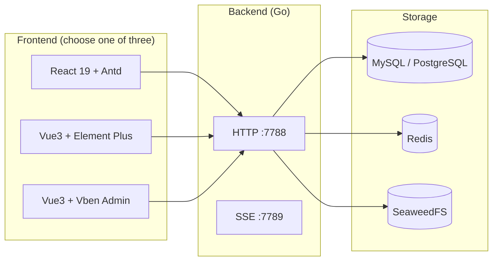

# GoWind Admin Product Introduction

GoWind Admin is an **out-of-the-box, enterprise-grade full-stack admin scaffold**: a Go backend plus a choice of three frontends, open-sourced under the MIT license. High-frequency enterprise capabilities such as organization & permissions, notifications, logs, AI, BI dashboards, and print templates are all built in as ready-to-enable modules, helping teams skip the long process of building an admin console from scratch and focus on real business development.

## 1. Three Frontend Stacks to Choose From, Not a Three-in-One

There is one key takeaway for understanding GoWind Admin: **three frontend stacks to choose from, not a three-in-one**.

Vue3 Vben (Ant Design Vue), Vue3 Element Plus, and React19 Antd are **three parallel implementations of the same backend**, rather than "one codebase compatible with three frameworks at once". All three frontends connect to the same backend service, with fully identical API protocols, permission models, and menu data:

| Implementation | Tech Stack | Best For |
|------|---------|---------|
| React Edition | React 19 + Ant Design V6 + ProComponents | Teams on the React stack |
| Vue Element Edition | Vue3 + Element Plus + vxe-table | Teams in the Element Plus ecosystem |
| Vue Vben Edition | Vue3 + Vben Admin 5.x (Ant Design Vue) | Teams in the Vben ecosystem |

- Each team / project only needs to **adopt one of them** for integration — there is no need to maintain all three
- The repository includes a trimming guide, `docs/adopt-one-frontend.md`, explaining how to safely remove the other two frontends and their dependencies

::: tip
Not sure which one to pick? All three implementations can be tried online on the official demo sites (see "Quick Trial" below). Their layouts and features are aligned — just choose based on your team's preferred tech stack.
:::

## 2. Feature Panorama

The built-in modules of GoWind Admin are grouped by domain as follows:

| Group | Feature Modules |
|------|---------|
| **Organization & Permissions** | User management, tenant management, plan quotas, role permissions (five data scope levels + field-level permissions), permission groups, org structure, position management (Excel import), menu management (synced across the three frontend stacks) |
| **System Features** | API sync, dictionary management, task scheduling, file OSS, login policy, MFA TOTP, notification channels (39 extended channels + SMS), notification rules, delivery ledger, service monitoring, online users, script system (Lua + JS), parameter configuration, machine credentials AK/SK, language management, print templates (document designer + server-side PDF), BI dashboards (designer + large-screen views) |
| **Messaging & Logs** | Message categories, internal messages, six log types, Redis cache monitoring |
| **Personal Center** | Basic personal entry points available after login |

::: tip List Export
All list pages uniformly support aggregated CSV / XLSX export with a default limit of 10,000 rows; audit logs use server-side streaming export, which can exceed this limit.
:::

## 3. UI Preview

The following screenshots come from the official demo environment and give a direct feel for the overall UI style.

**Login Page / Console Workbench**

| Login Page | Console Workbench |
| --- | --- |
|  |  |

**Organization & Permissions**

| User Management | Role Management |
| --- | --- |
|  |  |

**System Features / API Docs**

| Menu Management | Internal Messages |
| --- | --- |
|  |  |

| Swagger API Docs |
| --- |
|  |

## 4. Version Highlights

The project iterates at a pace of roughly one release per week, evolving rapidly from v1.0.0 (09-24) to v1.5.0 (10-29). See [Release Notes](/en/admin/release-notes.md) for the full list.

- **v1.0.0**: script system (Lua + JS), design language specification, online user session management
- **v1.1.0**: full-stack AI module (SSE chat + quotas), knowledge base RAG (pgvector), intelligent data Q&A, AI content generation, global semantic search
- **v1.2.0**: enterprise OIDC SSO (verified with Keycloak), notification domain Phase 3 wrap-up, audit log streaming export, hard enforcement of plan quotas, tenant white-labeling, AI Function Call
- **v1.3.0**: workbench aggregation page isomorphic across the three frontend stacks
- **v1.4.0**: full-stack AI Agent orchestration (graph DSL with five node types + visual canvas + SSE trial runs), notification channels expanded to 39, Alibaba Cloud / Tencent Cloud SMS, password recovery via phone number
- **v1.5.0**: full-stack BI dashboards (drag-and-drop canvas / cross-chart linking / drill-down / 9 themes), print template module (visual drag-and-drop design / line printing + batch printing / server-side PDF via chromedp / built-in A4, A5 and employee badge seed templates)
- **Unreleased**: object storage MinIO → SeaweedFS (community edition maintenance discontinued, migration with zero code changes), second major round of backend unit tests (~200 tests + 8 production defects fixed)

## 5. Tech Stack

### 1. Backend

| Dimension | Core Technologies |
|------|---------|
| Language & Framework | Go 1.26+ · go-kratos v2 |
| ORM | Ent (default) or GORM |
| Database | MySQL / PostgreSQL |
| Cache | Redis |
| Object Storage | SeaweedFS |
| Authentication & Authorization | JWT RS256 + Casbin / OPA |
| Push & Async | SSE + Asynq |
| Script Engine | go-scripts (Lua + JavaScript) |

### 2. Frontend (Choose One of Three)

| Implementation | Core Technologies |
|------|---------|
| React Edition | React 19 · Ant Design V6 · ProComponents |
| Vue Element Edition | Vue3 · Element Plus · vxe-table |
| Vue Vben Edition | Vue3 · Vben Admin 5.x (Ant Design Vue) |

All three frontends are built on **Vite + TypeScript + Tailwind** with consistent engineering standards.

### 3. Deployment

- **Two Docker modes**: `full_deploy` for one-click full deployment (application + middleware fully containerized); `libs_only` starts the middleware only, ideal for local development and debugging
- **PM2**: process-managed deployment on the host machine
- **Swagger UI**: online API documentation
- **Service ports**: backend HTTP `:7788`, SSE `:7789`

## 6. Quick Trial

No local deployment needed — visit the demo sites for the three frontend stacks to experience the full feature set:

| Demo | URL |
|--------|------|
| React Edition | <https://react.admin.gowind.cloud> |
| Vue Element Edition | <https://ele.admin.gowind.cloud> |
| Vue Vben Edition | <https://vben.admin.gowind.cloud> |
| Swagger API Docs | <https://api.demo.admin.gowind.cloud/docs/> |

::: tip Demo Account
Username `admin` / Password `Abcd@1234`
:::

## 7. Open Source & Contact

GoWind Admin is open-sourced under the MIT license and free to use in commercial projects. The source repository is mirrored on three platforms (`tx7do/go-wind-admin`):

- GitHub: <https://github.com/tx7do/go-wind-admin>
- Gitee: <https://gitee.com/tx7do/go-wind-admin>
- AtomGit: <https://atomgit.com/tx7do/go-wind-admin>

Community & support: WeChat `yang_lin_bo` | Email <yanglinbo@gmail.com>.

## 8. Related Documents

- [Installation Guide](/en/admin/installation.md)
- [Release Notes](/en/admin/release-notes.md)
- [Backend Architecture Design](/en/admin/backend-architecture.md)
- [Frontend Architecture Design](/en/admin/frontend-architecture.md)
- [Backend Feature Modules](/en/admin/backend-modules.md)
- [Frontend Feature Modules](/en/admin/frontend-modules.md)
