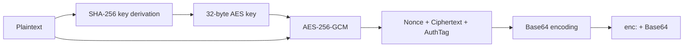

# Encryption Toolkit in Practice

GoWind Admin provides the `pkg/crypto` encryption toolkit, based on the **AES-256-GCM** algorithm, for scenarios such as encrypted storage of sensitive data and task configuration encryption. This chapter describes the toolkit's design, usage, and customization practices in detail.

## 1. Encryption Toolkit Architecture

### 1.1 Core Features

| Feature | Description |
|------|------|
| Encryption algorithm | AES-256-GCM (authenticated encryption) |
| Key derivation | SHA-256 (arbitrary-length input → 32-byte key) |
| Encoding format | Base64 + the `enc:` prefix |
| Backward compatibility | Automatically recognizes unencrypted data and handles it transparently |
| Global instance | Singleton pattern with an enable/disable switch |
| Payload encryption | Supports encrypting and storing an entire Map |

### 1.2 Package Structure

```
pkg/crypto/
├── aes_gcm.go          # AES-256-GCM 加密/解密核心实现
├── encryptor.go        # 全局加密器实例管理
├── payload.go          # Map Payload 加密/解密（用于任务配置等）
├── aes_gcm_test.go     # 单元测试
├── payload_test.go     # Payload 测试
├── example_test.go     # 使用示例
└── README.md           # 包说明文档
```

### 1.3 Applicable Scenarios

- Encrypted storage of sensitive fields in the database (phone numbers, ID card numbers, etc.)
- Asynq task configuration encryption (database passwords, API keys, etc.)
- Any sensitive configuration that needs to be stored securely on the server side

## 2. Core API

### 2.1 Encryptor — The Encryptor

`Encryptor` is the core struct of the encryption toolkit:

```go
type Encryptor struct {
    key []byte
}
```

**Creating an encryptor**:

```go
// 使用密钥字符串创建加密器
// 内部通过 SHA-256 将任意长度密钥转换为 32 字节
encryptor, err := crypto.NewEncryptor("my-secret-key")
if err != nil {
    log.Fatal(err)
}
```

**Encryption**:

```go
// 加密明文，返回带 "enc:" 前缀的 Base64 字符串
encrypted, err := encryptor.Encrypt("敏感数据")
// 结果示例: "enc:YWJjZGVmZ2hpamtsbW5vcA=="
```

**Decryption**:

```go
// 解密密文，自动识别 "enc:" 前缀
decrypted, err := encryptor.Decrypt(encrypted)
// 结果: "敏感数据"
```

**Checking whether data is encrypted**:

```go
crypto.IsEncrypted("enc:abc123")      // true
crypto.IsEncrypted("plain text")      // false
```

### 2.2 The Global Encryptor

`encryptor.go` provides a global singleton encryptor, suitable for initialization at application startup:

```go
// 初始化全局加密器（通常在 main 或 wire 中调用）
err := crypto.InitGlobalEncryptor("production-secret-key", true)
// 参数二: enabled — false 时创建无操作加密器（加密/解密直接返回原文）

// 使用全局函数（无需持有 Encryptor 实例）
encrypted, err := crypto.EncryptIfNeeded("敏感数据")
decrypted, err := crypto.DecryptIfNeeded(encrypted)
```

**The enable/disable switch**:

```go
// 禁用加密（开发环境或不需要加密的场景）
crypto.InitGlobalEncryptor("", false)

// 此时 EncryptIfNeeded 直接返回原文
encrypted, _ := crypto.EncryptIfNeeded("hello")  // "hello"（未加密）
```

### 2.3 Payload Encryption

`payload.go` provides encryption of an entire `map[string]interface{}`, commonly used for secure storage of Asynq task configurations:

```go
// 任务配置（包含敏感信息）
taskConfig := map[string]interface{}{
    "task_id":   "task-001",
    "task_type": "email_sync",
    "host":      "imap.gmail.com",
    "port":      993,
    "username":  "user@example.com",
    "password":  "super-secret-password",
}

// 加密整个 Payload
encryptedPayload, err := crypto.EncryptPayload(taskConfig)
// 结果:
// {
//   "_encrypted_config": "enc:...",     // 加密后的完整 JSON
//   "_is_encrypted": true,
//   "task_id": "task-001",              // 保留路由字段
//   "task_type": "email_sync"           // 保留路由字段
// }

// 解密 Payload
decryptedPayload, err := crypto.DecryptPayload(encryptedPayload)
// 恢复为原始 map
```

**The payload encryption strategy**:

- `task_id` and `task_type` are not encrypted (used for Asynq routing and scheduling)
- All remaining fields are encrypted together into one `_encrypted_config`
- The `_is_encrypted` flag provides compatibility with old unencrypted data

### 2.4 Utility Functions

```go
// 强制加密/解密（出错时 panic，适合测试）
encrypted := encryptor.MustEncrypt("test data")
decrypted := encryptor.MustDecrypt(encrypted)

// 强制 Payload 加密/解密
encryptedPayload := crypto.MustEncryptPayload(payload)
decryptedPayload := crypto.MustDecryptPayload(encryptedPayload)

// 检查 Payload 是否加密
isEncrypted := crypto.HasEncryptedPayload(payload)
```

## 3. The Encryption Flow in Detail

### 3.1 The Encryption Flow



**Detailed steps**:

1. **Key derivation**: SHA-256 converts a key of arbitrary length into 32 bytes
2. **Create the AES block**: create the AES-256 cipher block with the 32-byte key
3. **Create the GCM**: create the GCM mode based on the cipher block
4. **Generate the nonce**: generate a random 12-byte nonce using `crypto/rand`
5. **Encrypt**: `gcm.Seal(nonce, nonce, plaintext, nil)` — the output format is `Nonce || Ciphertext || AuthTag`
6. **Encode**: Base64 encoding + the `enc:` prefix

### 3.2 The Decryption Flow

```go
func (e *Encryptor) Decrypt(ciphertext string) (string, error) {
    // 1. 空字符串直接返回
    if ciphertext == "" { return "", nil }

    // 2. 检查 "enc:" 前缀（向后兼容）
    if !strings.HasPrefix(ciphertext, EncryptedPrefix) {
        return ciphertext, nil  // 未加密数据直接返回
    }

    // 3. 去除前缀，Base64 解码
    data, _ := base64.StdEncoding.DecodeString(encoded)

    // 4. 分离 Nonce 和密文
    nonce, cipherData := data[:nonceSize], data[nonceSize:]

    // 5. GCM 解密（同时验证认证标签）
    plaintext, _ := gcm.Open(nil, nonce, cipherData, nil)

    return string(plaintext), nil
}
```

## 4. Customization Practice

### 4.1 Scenario 1: Encrypted Storage of Sensitive Fields

**Requirement**: the phone number field in the user table needs to be stored encrypted.

**Step 1: Initialize the encryptor**

Initialize the global encryptor at application startup (`cmd/server/wire.go` or `main.go`):

```go
func main() {
    // 从配置读取密钥
    encryptKey := cfg.Encryption.Key      // 例如从 server.yaml 中读取
    encryptEnabled := cfg.Encryption.Enabled

    // 初始化全局加密器
    if err := crypto.InitGlobalEncryptor(encryptKey, encryptEnabled); err != nil {
        log.Fatalf("初始化加密器失败: %v", err)
    }

    // 启动应用...
}
```

**Step 2: Encrypt/decrypt in the service layer**

```go
func (s *UserService) CreateUser(ctx context.Context, req *identityV1.CreateUserRequest) (*identityV1.User, error) {
    // 加密手机号
    if req.Data.Phone != nil {
        encrypted, err := crypto.EncryptIfNeeded(req.Data.GetPhone())
        if err != nil {
            return nil, err
        }
        req.Data.Phone = trans.Ptr(encrypted)
    }
    return s.userRepo.Create(ctx, req)
}

func (s *UserService) GetUser(ctx context.Context, req *identityV1.GetUserRequest) (*identityV1.User, error) {
    user, err := s.userRepo.Get(ctx, req)
    if err != nil {
        return nil, err
    }

    // 解密手机号（如果已加密）
    if user.Phone != nil && crypto.IsEncrypted(user.GetPhone()) {
        decrypted, err := crypto.DecryptIfNeeded(user.GetPhone())
        if err != nil {
            return nil, err
        }
        user.Phone = trans.Ptr(decrypted)
    }
    return user, nil
}
```

**Step 3: Masked display**

```go
// 脱敏函数：138****8000
func maskPhone(phone string) string {
    if len(phone) < 7 {
        return "****"
    }
    return phone[:3] + "****" + phone[len(phone)-4:]
}

// 在 API 返回时脱敏
user.Phone = trans.Ptr(maskPhone(user.GetPhone()))
```

### 4.2 Scenario 2: Task Configuration Encryption

**Requirement**: an Asynq task contains a database connection password that must be stored encrypted in Redis.

**Encrypt on write**:

```go
func (s *TaskService) CreateEmailSyncTask(ctx context.Context, req *CreateEmailSyncRequest) error {
    taskConfig := map[string]interface{}{
        "task_id":   id.NewGUIDv4(false),
        "task_type": "email_sync",
        "host":      req.Host,
        "port":      req.Port,
        "username":  req.Username,
        "password":  req.Password,    // 敏感信息
        "tls":       req.TLS,
    }

    // 加密 Payload
    encryptedConfig, err := crypto.EncryptPayload(taskConfig)
    if err != nil {
        return err
    }

    // 投递到 Asynq 队列
    payload, _ := json.Marshal(encryptedConfig)
    task := asynq.NewTask("email_sync", payload)
    _, err = s.asynqClient.Enqueue(task)
    return err
}
```

**Decrypt on read**:

```go
func HandleEmailSyncTask(ctx context.Context, t *asynq.Task) error {
    var encryptedPayload map[string]interface{}
    json.Unmarshal(t.Payload(), &encryptedPayload)

    // 解密 Payload
    config, err := crypto.DecryptPayload(encryptedPayload)
    if err != nil {
        return fmt.Errorf("解密任务配置失败: %w", err)
    }

    // 使用解密后的配置
    host := config["host"].(string)
    password := config["password"].(string)
    // ... 执行邮件同步

    return nil
}
```

### 4.3 Scenario 3: Using Encryption in Lua Scripts

In the Lua script engine, encryption can be used by pre-registering Go functions:

```go
// 注册加密函数到 Lua VM
func registerCryptoFunctions(L *lua.LState) {
    // 加密函数
    L.SetGlobal("encrypt", L.NewFunction(func(L *lua.LState) int {
        plaintext := L.CheckString(1)
        encrypted, err := crypto.EncryptIfNeeded(plaintext)
        if err != nil {
            L.RaiseError(err.Error())
        }
        L.Push(lua.LString(encrypted))
        return 1
    }))

    // 解密函数
    L.SetGlobal("decrypt", L.NewFunction(func(L *lua.LState) int {
        ciphertext := L.CheckString(1)
        decrypted, err := crypto.DecryptIfNeeded(ciphertext)
        if err != nil {
            L.RaiseError(err.Error())
        }
        L.Push(lua.LString(decrypted))
        return 1
    }))
}
```

Using it in a Lua script:

```lua
local encrypted = encrypt("敏感数据")
logger.info("加密结果: %s", encrypted)

local decrypted = decrypt(encrypted)
logger.info("解密结果: %s", decrypted)
```

## 5. Backward-Compatible Design

The encryption toolkit is designed with backward compatibility fully in mind:

### 5.1 Data Format Recognition

Encrypted and unencrypted data are distinguished by the `enc:` prefix:

```go
func IsEncrypted(data string) bool {
    return strings.HasPrefix(data, EncryptedPrefix)
}
```

### 5.2 Transparent Decryption

The `Decrypt` method returns unencrypted data as-is:

```go
func (e *Encryptor) Decrypt(ciphertext string) (string, error) {
    if !strings.HasPrefix(ciphertext, EncryptedPrefix) {
        return ciphertext, nil  // 未加密数据，直接返回
    }
    // ... 正常解密流程
}
```

### 5.3 The Toggleable Switch

`InitGlobalEncryptor(key, enabled)` controls whether encryption is enabled:

```go
// 开发环境：禁用加密
crypto.InitGlobalEncryptor("", false)
// EncryptIfNeeded → 返回原文
// DecryptIfNeeded → 返回原文

// 生产环境：启用加密
crypto.InitGlobalEncryptor("strong-key", true)
// EncryptIfNeeded → 返回密文
// DecryptIfNeeded → 返回明文
```

This means:
- Existing unencrypted data in the database does not need to be migrated
- Encryption can be enabled at any time; old and new data can coexist
- Encryption can be disabled in the development environment for easier debugging

## 6. Security Recommendations

### 6.1 Key Management

- The key must be at least 32 bytes long
- Do not hardcode keys in code; use environment variables or a key management service
- Use different keys for different environments (development/testing/production)
- Rotate keys regularly (note: old data must be re-encrypted after rotation)

### 6.2 Advantages of AES-256-GCM

| Feature | Description |
|------|------|
| Authenticated encryption | Provides both encryption and integrity verification |
| Tamper-proof | Any modification of the ciphertext is detected at decryption time |
| No IV management needed | GCM manages the counter internally |
| Performance | Hardware acceleration support (AES-NI); excellent performance |

### 6.3 Production Environment Checklist

- [ ] Change the default encryption key
- [ ] Inject the key through environment variables; do not write it into configuration files
- [ ] Enable encryption (`enabled: true`)
- [ ] Use SSL/TLS for database connections
- [ ] Use password authentication for Redis connections
- [ ] Back up the encryption key regularly

---

**Related documentation**:

- [Backend Extension](/en/admin/backend-extension.md)
- [Task Scheduling](/en/admin/tutorial-task-scheduling.md)
- [Lua Script Extension](/en/admin/tutorial-lua-extension.md)
- [Login Policies and Security](/en/admin/tutorial-login-security.md)
