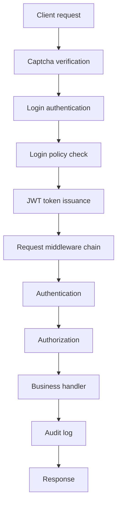
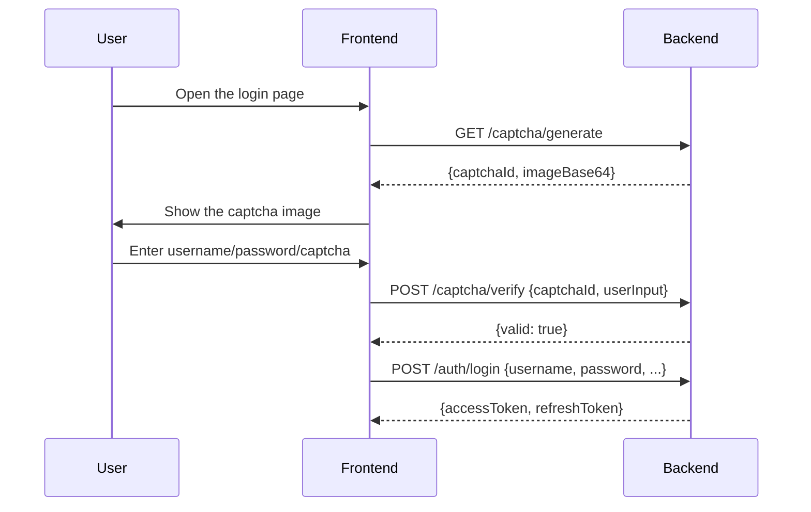

# Login Policies and Security Hardening

GoWind Admin provides a complete identity authentication and security control system, covering login policies, token management, captcha, audit logs, and other security layers. This chapter describes the design and usage of each security mechanism in detail.

## 1. Security Architecture Overview

### 1.1 Security Layers

The security system of GoWind Admin adopts a multi-layer defense design:



### 1.2 Security Components at a Glance

| Component | Path | Responsibility |
|------|------|------|
| AuthenticationService | `internal/service/authentication_service.go` | Login/logout/refresh/captcha |
| Authenticator | `internal/data/authenticator.go` | Token creation/verification/revocation/blocking |
| UserTokenCache | `internal/data/user_token_cache.go` | Token caching and blacklist management |
| LoginPolicyRepo | `internal/data/login_policy_repo.go` | Login policy persistence |
| LoginPolicyService | `internal/service/login_policy_service.go` | Login policy CRUD |
| Auth Middleware | `pkg/middleware/auth/` | Request-level authentication |
| Authorizer | `pkg/authorizer/` | Authorization engine |

## 2. The Login Authentication Flow

### 2.1 Supported Grant Types

GoWind Admin supports the following OAuth 2.0 style grant types:

| Grant Type | Description | Use Case |
|------------|------|----------|
| `password` | Username/password login | Admin console login |
| `refresh_token` | Refresh token | Seamless refresh after a token expires |
| `client_credentials` | Client credentials | Reserved, not yet implemented |

### 2.2 The Password Login Flow

```go
func (s *AuthenticationService) doGrantTypePassword(
    ctx context.Context, req *authenticationV1.LoginRequest,
) (*authenticationV1.LoginResponse, error) {
    // 1. 重置上下文（绕过隐私保护和权限检查）
    ctx = s.resetContextForLogin(ctx)

    // 2. 验证用户凭证
    _, err := s.userCredentialRepo.VerifyCredential(ctx, &authenticationV1.VerifyCredentialRequest{
        IdentityType: authenticationV1.UserCredential_USERNAME,
        Identifier:   req.GetUsername(),
        Credential:   req.GetPassword(),
        NeedDecrypt:  true,
    })

    // 3. 获取用户信息
    user, err := s.userRepo.Get(ctx, &identityV1.GetUserRequest{
        QueryBy: &identityV1.GetUserRequest_Username{Username: req.GetUsername()},
    })

    // 4. 构造 Token Payload
    tokenPayload := &authenticationV1.UserTokenPayload{
        UserId:   user.GetId(),
        TenantId: user.TenantId,
        Username: user.Username,
        ClientId: req.ClientId,
        DeviceId: req.DeviceId,
    }

    // 5. 解析用户权限信息
    err = s.resolveUserAuthority(ctx, user, tokenPayload)

    // 6. 生成令牌对
    accessToken, refreshToken, err := s.authenticator.CreateUserToken(ctx, req.GetClientType(), tokenPayload)

    return &authenticationV1.LoginResponse{
        TokenType:        authenticationV1.TokenType_bearer,
        AccessToken:      accessToken,
        RefreshToken:     trans.Ptr(refreshToken),
        ExpiresIn:        int64(s.authenticator.GetAccessTokenExpires(req.GetClientType()).Seconds()),
        RefreshExpiresIn: trans.Ptr(int64(s.authenticator.GetRefreshTokenExpires(req.GetClientType()).Seconds())),
    }, nil
}
```

**Key steps explained**:

1. **Reset the context**: at login there is no user identity information, so Ent's privacy protection middleware and the Viewer mechanism must be bypassed
2. **Credential verification**: username/password validation is supported, with the password compared by hash
3. **Permission resolution**: roles and permissions are collected according to the user-tenant relation model (one-to-one/one-to-many)
4. **Token issuance**: generates an access token (JWT) + refresh token

### 2.3 The Token Refresh Flow

```go
func (s *AuthenticationService) doGrantTypeRefreshToken(ctx context.Context, req *authenticationV1.LoginRequest) (*authenticationV1.LoginResponse, error) {
    // 1. 从当前 Token 中获取操作人信息
    operator, _ := auth.FromContext(ctx)

    // 2. 获取用户信息并重新解析权限
    user, _ := s.userRepo.Get(ctx, ...)
    tokenPayload := ...
    s.resolveUserAuthority(ctx, user, tokenPayload)

    // 3. 验证 Refresh Token
    s.authenticator.VerifyRefreshToken(ctx, req.GetClientType(), req.GetUserId(), operator.GetJti(), req.GetRefreshToken())

    // 4. 签发新的令牌对
    accessToken, refreshToken, _ := s.authenticator.CreateUserToken(ctx, req.GetClientType(), tokenPayload)

    return &authenticationV1.LoginResponse{...}, nil
}
```

**Refresh mechanism**:
- The refresh token becomes invalid immediately after use (single use)
- When a new token pair is issued, user permissions are re-resolved (permission changes take effect in real time)
- The old access token is revoked through its JTI association

## 3. Token Management

### 3.1 Token Types and Expiration Times

| Token Type | Expiration | Storage |
|------------|----------|----------|
| Access token | 15 minutes | Redis |
| Refresh token | 7 days | Redis |
| Token blacklist | Configurable duration | Redis |

The expiration times are defined in `internal/data/authenticator.go`:

```go
const (
    DefaultAccessTokenExpires  = time.Minute * 15
    DefaultRefreshTokenExpires = time.Hour * 24 * 7
)
```

### 3.2 The Token Verification Flow

Every API request goes through the following token verification chain:

```go
func (a *Authenticator) Authenticate(ctx context.Context, req *authenticationV1.ValidateTokenRequest) (*authenticationV1.ValidateTokenResponse, error) {
    // 1. JWT 签名验证
    claims, err := authenticator.AuthenticateToken(req.GetToken())

    // 2. 过期时间检查
    if jwt.IsTokenExpired(claims) { ... }

    // 3. 解析 Token Payload
    payload, err := jwt.NewUserTokenPayloadWithClaims(claims)

    // 4. Redis 缓存验证（Token 是否存在且匹配）
    valid, err := a.userTokenCache.IsValidAccessToken(ctx, ...)

    // 5. 黑名单检查
    if a.userTokenCache.IsBlockedAccessToken(ctx, payload.GetJti()) { ... }

    return &authenticationV1.ValidateTokenResponse{IsValid: true, Payload: payload}, nil
}
```

**Five-fold verification**:
1. JWT signature verification (anti-tampering)
2. Expiration time check (timeliness)
3. Payload parsing (data integrity)
4. Redis cache matching (anti-forgery)
5. Blacklist check (instant blocking)

### 3.3 Token Blocking and Unblocking

Administrators can block the tokens of a specified user:

```go
// 封禁 Token
func (a *Authenticator) BlockToken(ctx context.Context, req *authenticationV1.BlockTokenRequest) error {
    // 支持两种定位方式：
    // - 通过 Token 值定位
    // - 通过 JTI (JWT ID) 定位

    // 添加到黑名单，支持设置封禁时长
    return a.userTokenCache.AddBlockedAccessToken(ctx, jti, req.GetReason(), req.GetDuration().AsDuration())
}

// 解封 Token
func (a *Authenticator) UnblockToken(ctx context.Context, req *authenticationV1.UnblockTokenRequest) error {
    return a.userTokenCache.RevokeTokenByJti(ctx, req.GetClientType(), req.GetUserId(), jti)
}
```

### 3.4 Multi-Device Login

The system supports simultaneous login from multiple devices, managing the user's multiple tokens through Redis:

```go
// 获取用户所有在线的 Access Token（用于 SSE 推送等场景）
func (a *Authenticator) GetAccessTokens(ctx context.Context, clientType authenticationV1.ClientType, userId uint32) []string {
    return a.userTokenCache.GetAccessTokens(ctx, clientType, userId)
}
```

### 3.5 The Logout Flow

```go
func (s *AuthenticationService) Logout(ctx context.Context, _ *emptypb.Empty) (*emptypb.Empty, error) {
    operator, _ := auth.FromContext(ctx)
    // 撤销该用户的所有 Token
    s.authenticator.RevokeUserToken(ctx, s.clientType, operator.GetUserId())
    return &emptypb.Empty{}, nil
}
```

## 4. Login Policies

### 4.1 The Policy Model

LoginPolicy controls users' login behavior. The data model contains the following fields:

| Field | Type | Description |
|------|------|------|
| `tenant_id` | uint32 | Tenant ID (multi-tenancy isolation) |
| `target_id` | uint32 | Target ID (user ID or IP address) |
| `type` | enum | Policy type |
| `method` | enum | Policy method (allow/deny) |
| `value` | string | Policy value |
| `reason` | string | Reason description |

### 4.2 Policy Types and Methods

**Policy types (Type)**:
- IP-address based access control
- User based access control
- Time-window based access control

**Policy methods (Method)**:
- **Allow**: whitelist mode
- **Deny**: blacklist mode

### 4.3 Policy CRUD

LoginPolicyService provides standard CRUD APIs:

```go
type LoginPolicyService struct {
    adminV1.LoginPolicyServiceHTTPServer
    log  *log.Helper
    repo *data.LoginPolicyRepo
}

// 创建策略
func (s *LoginPolicyService) Create(ctx context.Context, req *authenticationV1.CreateLoginPolicyRequest) (*emptypb.Empty, error) {
    // 自动填充操作人信息
    operator, _ := auth.FromContext(ctx)
    req.Data.CreatedBy = trans.Ptr(operator.UserId)
    return &emptypb.Empty{}, s.repo.Create(ctx, req)
}

// 更新策略（支持 Upsert）
func (s *LoginPolicyService) Update(ctx context.Context, req *authenticationV1.UpdateLoginPolicyRequest) (*emptypb.Empty, error)) {
    // 如果设置了 AllowMissing 且记录不存在，则自动创建
    if req.GetAllowMissing() {
        exist, _ := r.IsExist(ctx, req.GetId())
        if !exist {
            return r.Create(ctx, &authenticationV1.CreateLoginPolicyRequest{Data: req.Data})
        }
    }
    // ...
}
```

### 4.4 Usage Scenario Examples

**Scenario 1: IP blacklist**

Block a specific IP address from logging in to the admin console:

```json
{
  "target_id": 0,
  "type": "IP_BLACKLIST",
  "method": "DENY",
  "value": "192.168.1.100",
  "reason": "疑似恶意登录"
}
```

**Scenario 2: IP whitelist**

Only allow the company's intranet IPs to log in:

```json
{
  "target_id": 0,
  "type": "IP_WHITELIST",
  "method": "ALLOW",
  "value": "10.0.0.0/8",
  "reason": "仅允许内网访问"
}
```

**Scenario 3: Banning a user**

Ban a specific user:

```json
{
  "target_id": 12345,
  "type": "USER_BAN",
  "method": "DENY",
  "value": "永久封禁",
  "reason": "违反平台使用规范"
}
```

## 5. The Captcha Mechanism

### 5.1 Captcha Generation

```go
func (s *AuthenticationService) GenerateCaptcha(_ context.Context, _ *emptypb.Empty) (*authenticationV1.GenerateCaptchaResponse, error) {
    captchaId, captchaValue, _, err := s.captchaClient.Generate()
    return &authenticationV1.GenerateCaptchaResponse{
        CaptchaId:   captchaId,
        ImageBase64: captchaValue,
    }, nil
}
```

### 5.2 Captcha Verification

```go
func (s *AuthenticationService) VerifyCaptcha(ctx context.Context, req *authenticationV1.VerifyCaptchaRequest) (*authenticationV1.VerifyCaptchaResponse, error) {
    ok, err := s.captchaClient.Verify(ctx, req.GetCaptchaId(), req.GetUserInput())
    return &authenticationV1.VerifyCaptchaResponse{Valid: ok}, nil
}
```

### 5.3 The Frontend Integration Flow



::: tip
Captcha verification and login are two separate API calls. The frontend first calls the captcha verification API, and only after it passes does it send the login request.
:::

## 6. Audit Logs

### 6.1 Audit Log Types

GoWind Admin records multiple types of audit logs:

| Log Type | Service | Description |
|----------|---------|------|
| API audit logs | `ApiAuditLogService` | Records all API requests |
| Login audit logs | `LoginAuditLogService` | Records login/logout events |
| Operation audit logs | `OperationAuditLogService` | Records data change operations |
| Permission audit logs | `PermissionAuditLogService` | Records permission policy changes |
| Data access audits | `DataAccessAuditLogService` | Records sensitive data access |
| Policy evaluation logs | `PolicyEvaluationLogService` | Records authorization evaluation results |

### 6.2 Writing Audit Logs

Audit logs are written automatically through middleware, configured in `rest_server.go`:

```go
func NewRestMiddleware(
    ctx *bootstrap.Context,
    accessTokenChecker auth.AccessTokenChecker,
    authorizer *authorizer.Authorizer,
    apiAuditLogRepo *data.ApiAuditLogRepo,
    loginLogRepo *data.LoginAuditLogRepo,
) []middleware.Middleware {
    ms = append(ms, applogging.Server(
        applogging.WithWriteApiLogFunc(func(ctx context.Context, data *auditV1.ApiAuditLog) error {
            return apiAuditLogRepo.Create(ctx, &auditV1.CreateApiAuditLogRequest{Data: data})
        }),
        applogging.WithWriteLoginLogFunc(func(ctx context.Context, data *auditV1.LoginAuditLog) error {
            return loginLogRepo.Create(ctx, &auditV1.CreateLoginAuditLogRequest{Data: data})
        }),
    ))
    // ...
}
```

::: tip
Audit logs are currently written to the database synchronously. If the system load is heavy, it is recommended to switch to an asynchronous approach (delivered through the Asynq task queue).
:::

## 7. The Middleware Security Chain

### 7.1 REST Middleware Order

```go
// 1. Kratos 内置日志中间件
ms = append(ms, logging.Server(ctx.GetLogger()))

// 2. 自定义审计日志中间件（API 日志 + 登录日志）
ms = append(ms, applogging.Server(...))

// 3. 身份认证 + 权限授权（白名单机制）
ms = append(ms, selector.Server(
    auth.Server(                           // JWT Token 验证
        auth.WithAccessTokenChecker(accessTokenChecker),
        auth.WithInjectMetadata(false),
        auth.WithInjectEnt(true),
    ),
    authz.Server(authorizer.Engine()),    // Casbin/OPA 权限检查
).Match(rpc.NewRestWhiteListMatcher()).Build())
```

### 7.2 The Whitelist Mechanism

APIs such as login and captcha do not require token authentication, via the whitelist configuration:

```go
rpc.AddWhiteList(
    adminV1.OperationAuthenticationServiceLogin,            // 登录
    adminV1.OperationAuthenticationServiceGenerateCaptcha,  // 生成验证码
    adminV1.OperationAuthenticationServiceVerifyCaptcha,    // 校验验证码
)
```

### 7.3 Privacy Protection

The login flow needs to bypass Ent's privacy protection middleware:

```go
func (s *AuthenticationService) resetContextForLogin(ctx context.Context) context.Context {
    // 使用空的 NoopContext（无 Viewer 信息）
    ctx = viewer.WithContext(ctx, viewer.NewNoopContext())
    // 绕过隐私保护
    ctx = privacy.DecisionContext(ctx, privacy.Allow)
    return ctx
}
```

## 8. Best Practices

### 8.1 Token Security

- **Short-lived tokens**: the access token is valid for only 15 minutes, reducing the window of risk if stolen
- **Single-use refresh tokens**: the old refresh token becomes invalid immediately after each refresh
- **Multi-dimensional verification**: JWT signature + Redis cache + blacklist, triple protection
- **Instant blocking**: `BlockToken` can immediately block the tokens of a specified user

### 8.2 Password Security

- Passwords are stored as hashes (`CredentialType: PASSWORD_HASH`)
- Transmission is encrypted with HTTPS
- The `NeedDecrypt` parameter controls whether the password sent from the frontend needs to be decrypted

### 8.3 Production Environment Recommendations

- Change the JWT key (`authn.jwt.key`) to a high-strength random key
- Adjust the token expiration times according to actual needs
- Enable the captcha to prevent brute-force attacks
- Configure login policies to limit the IP access range
- Review audit logs regularly

---

**Related documentation**:

- [Permission System](/en/admin/tutorial-permission-system.md)
- [Multi-Tenancy](/en/admin/tutorial-multi-tenancy.md)
- [Backend Architecture](/en/admin/backend-architecture.md)
- [SSE Real-Time Push](/en/admin/tutorial-sse-push.md)
