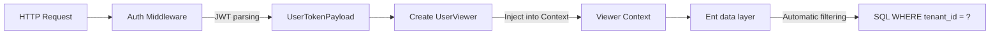

# Multi-Tenancy Architecture Tutorial

GoWind Admin has built-in multi-tenancy support, suitable for SaaS platform development. This tutorial explains the multi-tenancy architecture design, data isolation strategies, and practical scenarios in depth.

## 1. The Multi-Tenancy Model

### 1.1 Two User-Tenant Relationship Models

GoWind Admin supports two user-tenant relationships:

| Model | Description | Applicable Scenarios | Constant |
|---------|--------------|-------------------|------|
| **Disabled** | Multi-tenancy not enabled | Single-tenant mode, standalone deployments | `UserTenantRelationNone` |
| **One-to-one** | A user belongs to only one tenant | Enterprise internal systems, independent SaaS customers | `UserTenantRelationOneToOne` |
| **One-to-many** | A user can belong to multiple tenants | Cross-organization collaboration, consultants, multi-company management | `UserTenantRelationOneToMany` |

Configured in `pkg/constants/tenant.go`:

```go
// UserTenantRelationType 用户-租户关系类型
type UserTenantRelationType int

const (
    UserTenantRelationNone     UserTenantRelationType = iota // 未启用多租户
    UserTenantRelationOneToOne                                 // 一对一
    UserTenantRelationOneToMany                                // 一对多
)

const (
    // 默认一对一模式
    DefaultUserTenantRelationType = UserTenantRelationOneToOne
    // 是否启用租户模式（None 时为 false）
    IsTenantModeEnabled = DefaultUserTenantRelationType == UserTenantRelationOneToOne ||
                          DefaultUserTenantRelationType == UserTenantRelationOneToMany
)
```

### 1.2 Database Table Structure

> **Note**: the following are the core fields defined in the Ent schemas. The actual table names have a `sys_` prefix (e.g. `sys_tenants`, `sys_users`, `sys_memberships`), specified by Ent's `entsql.Annotation`.

```sql
-- Tenant table (sys_tenants)
-- Core fields:
--   id, name(unique), code(unique), logo_url, domain, industry,
--   admin_user_id, status(ON/OFF/EXPIRED/FREEZE),
--   type(TRIAL/PAID/INTERNAL/PARTNER/CUSTOM),
--   audit_status(PENDING/APPROVED/REJECTED),
--   subscription_at, unsubscribe_at, subscription_plan, expired_at

-- User table (sys_users)
-- Core fields:
--   id, username, nickname, realname, email, mobile,
--   avatar, gender, status(NORMAL/DISABLED/PENDING/LOCKED/EXPIRED/CLOSED)
-- Note: tenant_id is injected automatically via mixin.TenantID; username is unique within the tenant scope

-- Membership association table (sys_memberships) — the core of the one-to-many model
-- Core fields:
--   id, user_id, tenant_id(injected via mixin),
--   org_unit_id, position_id, role_id (redundant single-scenario fields,
--   mutually exclusive with the dedicated association tables membership_role/membership_org_unit/membership_position),
--   is_primary(whether this is the primary identity),
--   start_at, end_at, assigned_at, assigned_by, joined_at,
--   status(ACTIVE/DISABLED/PENDING/INVITED/EXPIRED/REJECTED)
-- Note: tenant_id + user_id is jointly unique
```

> **About role associations**: the one-to-one model associates roles through the `user_role` table, while the one-to-many model uses the `membership_role` table. Role codes follow a prefix convention: platform roles use `platform:xxx`, tenant roles use `tenant:xxx`, and template roles use `template:xxx`.

## 2. The One-to-One Tenant Model

### 2.1 Configuration

Set the following in `pkg/constants/tenant.go`:

```go
const DefaultUserTenantRelationType = UserTenantRelationOneToOne
```

### 2.2 Login Flow

The login authorization logic of the one-to-one model is in the `authorizeAndEnrichUserTokenPayloadUserTenantRelationOneToOne` method:

```go
func (s *AuthenticationService) authorizeAndEnrichUserTokenPayloadUserTenantRelationOneToOne(
    ctx context.Context, userID, tenantID uint32,
    tokenPayload *authenticationV1.UserTokenPayload,
) error {
    // 1. Check the tenant status (only when tenantID > 0)
    if tenantID > 0 {
        tenant, _ := s.tenantRepo.Get(ctx, &identityV1.GetTenantRequest{
            QueryBy: &identityV1.GetTenantRequest_Id{Id: tenantID},
        })
        if tenant == nil || tenant.GetStatus() != identityV1.Tenant_ON {
            return authenticationV1.ErrorForbidden("insufficient authority")
        }
    }

    // 2. Get the role ID list via the user_role table
    roleIDs, err := s.userRepo.ListRoleIDsByUserID(ctx, userID)
    if err != nil || len(roleIDs) == 0 {
        return authenticationV1.ErrorForbidden("insufficient authority")
    }

    // 3. Get the permission ID list via the role_permission table
    permissionIDs, err := s.roleRepo.ListPermissionIDsByRoleIDs(ctx, roleIDs)
    // ...get the permission code list
    permissionCodes, _ := s.permissionRepo.GetPermissionCodesByIDs(ctx, permissionIDs)

    // 4. Check for backend access permission (sys:access_backend)
    if !containsPermission(permissionCodes, constants.SystemAccessBackendPermissionCode) {
        return authenticationV1.ErrorForbidden("insufficient authority")
    }

    // 5. Get the role code list and write it into the Token
    roleCodes, _ := s.roleRepo.ListRoleCodesByRoleIds(ctx, roleIDs)
    tokenPayload.Roles = roleCodes

    return nil
}
```

The complete flow of the actual login entry point `doGrantTypePassword`:

```go
func (s *AuthenticationService) doGrantTypePassword(
    ctx context.Context, req *authenticationV1.LoginRequest,
) (*authenticationV1.LoginResponse, error) {
    // 1. Reset the Context (bypassing privacy protection and the Viewer)
    ctx = s.resetContextForLogin(ctx)

    // 2. Verify the user credentials (username + password)
    _, err := s.userCredentialRepo.VerifyCredential(ctx, &authenticationV1.VerifyCredentialRequest{
        IdentityType: authenticationV1.UserCredential_USERNAME,
        Identifier:   req.GetUsername(),
        Credential:   req.GetPassword(),
        NeedDecrypt:  true,
    })

    // 3. Get the user information
    user, _ := s.userRepo.Get(ctx, &identityV1.GetUserRequest{
        QueryBy: &identityV1.GetUserRequest_Username{Username: req.GetUsername()},
    })

    // 4. Build the token payload
    tokenPayload := &authenticationV1.UserTokenPayload{
        UserId:   user.GetId(),
        TenantId: user.TenantId,
        Username: user.Username,
        ClientId: req.ClientId,
        DeviceId: req.DeviceId,
    }

    // 5. Resolve the user's permission information (dispatched by tenant relation type)
    s.resolveUserAuthority(ctx, user, tokenPayload)

    // 6. Generate the access token and refresh token
    accessToken, refreshToken, _ := s.authenticator.CreateUserToken(ctx, req.GetClientType(), tokenPayload)

    return &authenticationV1.LoginResponse{
        TokenType:    authenticationV1.TokenType_bearer,
        AccessToken:  accessToken,
        RefreshToken: &refreshToken,
    }, nil
}
```

### 2.3 Data Isolation

Data isolation is implemented through the **Ent Viewer mechanism**, not by manually adding `Where` conditions:

**Middleware layer**: the Auth middleware automatically injects the `UserViewer` into the Context on every request:

```go
// pkg/middleware/auth/auth.go
// After successful authentication, create a UserViewer and inject it into the Context
userViewer := appViewer.NewUserViewer(
    uint64(tokenPayload.GetUserId()),
    uint64(tokenPayload.GetTenantId()),  // The tenant ID comes from the JWT token
    uint64(tokenPayload.GetOrgUnitId()),
    traceID,
    tokenPayload.GetDataScope(),         // Data permission scope
)
ctx = viewer.WithContext(ctx, userViewer)
```

**Viewer layer**: the `UserViewer` provides the tenant ID and the data permission scope:

```go
// pkg/entgo/viewer/user_viewer.go
type UserViewer struct {
    uid        uint64              // 用户 ID
    tid        uint64              // 租户 ID
    ouid       uint64              // 组织单元 ID
    dataScopes []viewer.DataScope  // 数据权限范围
}

// IsPlatformContext 平台视图（tenant_id == 0）
func (v UserViewer) IsPlatformContext() bool { return v.tid == 0 }

// IsTenantContext 租户视图（tenant_id > 0）
func (v UserViewer) IsTenantContext() bool { return v.tid > 0 }
```

**Data permission scopes (DataScope)**:

| Value | Description |
|------|------|
| `SELF` | Only the user's own data |
| `UNIT_ONLY` | Own department |
| `UNIT_AND_CHILD` | Own department and its sub-departments |
| `SELECTED_UNITS` | Selected departments |
| `ALL` | All data |

The Ent integration layer of go-crud extracts the `tenant_id` from the Viewer automatically and adds the tenant filter to all queries and writes.

## 3. The One-to-Many Tenant Model

### 3.1 Configuration

```go
const DefaultUserTenantRelationType = UserTenantRelationOneToMany
```

### 3.2 Membership Table Design

The `sys_memberships` table is central: it records the user's identity within each tenant:

```go
// Ent Schema 定义（仅核心字段）
func (Membership) Fields() []ent.Field {
    return []ent.Field{
        field.Uint32("user_id"),           // 用户 ID
        // tenant_id 通过 mixin.TenantID[uint32]{} 自动注入

        // 冗余单一场景字段（与独立关联表互斥，二选一）
        field.Uint32("org_unit_id").Optional().Nillable(),    // 组织架构 ID
        field.Uint32("position_id").Optional().Nillable(),   // 职位 ID
        field.Uint32("role_id").Optional().Nillable(),        // 角色 ID

        field.Bool("is_primary").Default(false).Nillable(),  // 是否主身份
        field.Enum("status").Default("ACTIVE").               // 状态
            NamedValues("Active", "ACTIVE", "Disabled", "DISABLED",
                       "Pending", "PENDING", "Invited", "INVITED",
                       "Expired", "EXPIRED", "Rejected", "REJECTED"),
    }
}

// 联合唯一索引
index.Fields("tenant_id", "user_id").Unique()
// 每个租户内用户只有一个主身份
index.Fields("tenant_id", "user_id", "is_primary").Unique()
```

> **Note**: `org_unit_id`/`position_id`/`role_id` are redundant single-scenario fields. For complex scenarios with multiple roles/departments, use the dedicated association tables `membership_role`, `membership_org_unit`, and `membership_position`.

### 3.3 Login Flow

The authorization logic of the one-to-many model is in the `authorizeAndEnrichUserTokenPayloadUserTenantRelationOneToMany` method:

```go
func (s *AuthenticationService) authorizeAndEnrichUserTokenPayloadUserTenantRelationOneToMany(
    ctx context.Context, userID, tenantID uint32,
    tokenPayload *authenticationV1.UserTokenPayload,
) error {
    // 1. Get the memberships
    var memberships []*identityV1.Membership
    if tenantID > 0 {
        // Log in to the specified tenant
        membership, err := s.membershipRepo.GetMembershipByUserTenant(ctx, userID)
        memberships = []*identityV1.Membership{membership}
    } else {
        // Get all active memberships
        memberships, err = s.membershipRepo.GetUserActiveMemberships(ctx, userID)
    }

    // 2. Iterate over the memberships and collect valid roles and permissions
    hasBackendAccess := false
    var validRoleIDs []uint32
    for _, m := range memberships {
        // Check the tenant status
        tenant, _ := s.tenantRepo.Get(ctx, ...)
        if tenant == nil || tenant.GetStatus() != identityV1.Tenant_ON {
            continue
        }

        // Get the roles via membership_role
        roleIDs, _ := s.membershipRepo.GetRoleIDsByMembership(ctx, m.GetId())
        // Get the permissions via role_permission
        permissionIDs, _ := s.roleRepo.ListPermissionIDsByRoleIDs(ctx, roleIDs)
        permissionCodes, _ := s.permissionRepo.GetPermissionCodesByIDs(ctx, permissionIDs)

        // Check for backend access permission
        if containsPermission(permissionCodes, constants.SystemAccessBackendPermissionCode) {
            hasBackendAccess = true
            validRoleIDs = append(validRoleIDs, roleIDs...)
        }
    }

    // 3. Authorization decision
    if !hasBackendAccess {
        return authenticationV1.ErrorForbidden("insufficient authority")
    }

    // 4. Write the role codes into the Token
    roleCodes, _ := s.roleRepo.ListRoleCodesByRoleIds(ctx, validRoleIDs)
    tokenPayload.Roles = roleCodes
    return nil
}
```

### 3.4 Switching Tenants

Under the one-to-many model, users need to be able to switch between multiple tenants. The switching flow:

1. The frontend calls the backend API with the target `tenant_id`
2. The backend verifies that the user has a Membership in that tenant
3. A new JWT token is generated (containing the new `tenant_id` and the corresponding role permissions)
4. The frontend refreshes the data with the new token

## 4. Data Isolation Strategies

### 4.1 The Viewer Mechanism (Core Isolation Solution)

GoWind Admin achieves application-level data isolation through the **go-crud Ent Viewer + Privacy** mechanism, not by manually adding `Where` conditions.

**How it works**:



**Automatic injection in the middleware** (`pkg/middleware/auth/auth.go`):

```go
// The Auth middleware creates the UserViewer automatically after successful authentication
userViewer := appViewer.NewUserViewer(
    uint64(tokenPayload.GetUserId()),
    uint64(tokenPayload.GetTenantId()),  // The tenant ID is obtained from the JWT token
    uint64(tokenPayload.GetOrgUnitId()),
    traceID,
    tokenPayload.GetDataScope(),
)
ctx = viewer.WithContext(ctx, userViewer)
```

**Ent Privacy policies**: tenant access rules are defined through Ent's Privacy framework, ensuring data is isolated automatically at the ORM level.

**Platform view vs tenant view**:

```go
// UserViewer 提供上下文判断
func (v UserViewer) IsPlatformContext() bool { return v.tid == 0 }  // 平台管理员
func (v UserViewer) IsTenantContext() bool   { return v.tid > 0 }  // 租户用户
```

### 4.2 The Schema Level

All Ent schemas requiring multi-tenant isolation mix in the `tenant_id` field via `mixin.TenantID[uint32]{}`:

```go
// 例如 User Schema
func (User) Mixin() []ent.Mixin {
    return []ent.Mixin{
        mixin.AutoIncrementId{},
        mixin.TimeAt{},
        mixin.OperatorID{},
        mixin.TenantID[uint32]{},  // 自动添加 tenant_id 字段
    }
}

// 索引也在租户范围内：
index.Fields("tenant_id", "username").Unique()  // 租户内用户名唯一
```

Likewise, tables such as `Membership`, `Role`, and `Permission` also mix in `TenantID`.

### 4.3 Database-Level Isolation

If stronger physical isolation is needed, PostgreSQL schemas can be used for database-level isolation:

```sql
-- Create a separate schema for each tenant
CREATE SCHEMA tenant_1;
CREATE SCHEMA tenant_2;

-- Switch the schema
SET search_path TO tenant_1;
```

**Advantages**: complete isolation with high security
**Disadvantages**: high maintenance cost, difficult cross-tenant queries, complex schema migrations

> The current version of GoWind Admin uses application-level isolation (the Viewer mechanism). Database-level isolation requires extending Ent's database connection layer yourself.

## 5. Tenant Initialization

### 5.1 The Complete Tenant Creation Flow

The `TenantService.CreateTenantWithAdminUser` method creates a tenant and its administrator in one go; the whole process runs inside a transaction:

```go
func (s *TenantService) CreateTenantWithAdminUser(
    ctx context.Context,
    req *identityV1.CreateTenantWithAdminUserRequest,
) (*emptypb.Empty, error) {
    // 1. Check whether the tenant code/name already exists
    s.tenantRepo.TenantExists(ctx, &identityV1.TenantExistsRequest{
        Code: req.GetTenant().GetCode(),
        Name: req.GetTenant().GetName(),
    })

    // 2. Check whether the admin username already exists
    s.userRepo.UserExists(ctx, &identityV1.UserExistsRequest{
        QueryBy: &identityV1.UserExistsRequest_Username{
            Username: req.GetUser().GetUsername(),
        },
    })

    // 3. Begin the transaction
    tx, cleanup, _ := s.tenantRepo.BeginTx(ctx)
    defer func() {
        cleanup()
        if err == nil {
            s.authorizer.ResetPolicies(ctx)  // 重置权限策略缓存
        }
    }()

    // 4. Create the tenant record
    tenant, _ := s.tenantRepo.CreateWithTx(ctx, tx, req.Tenant)
    req.User.TenantId = tenant.Id

    // 5. Create the tenant administrator role from the template role
    role, _ := s.roleRepo.CreateTenantRoleFromTemplate(
        ctx, tx, tenant.GetId(), operator.GetUserId(),
    )

    // 6. Create the admin user (with the role ID)
    req.User.RoleId = role.Id
    adminUser, _ := s.userRepo.CreateWithTx(ctx, tx, req.User)

    // 7. Create the user credential (password)
    s.userCredentialsRepo.CreateWithTx(ctx, tx, &authenticationV1.UserCredential{
        UserId:         adminUser.Id,
        TenantId:       tenant.Id,
        IdentityType:   authenticationV1.UserCredential_USERNAME.Enum(),
        Identifier:     adminUser.Username,
        CredentialType: authenticationV1.UserCredential_PASSWORD_HASH.Enum(),
        Credential:     trans.Ptr(req.GetPassword()),
        IsPrimary:      trans.Ptr(true),
        Status:         authenticationV1.UserCredential_ENABLED.Enum(),
    })

    // 8. Bind the admin user ID to the tenant
    s.tenantRepo.AssignTenantAdmin(ctx, tx, *tenant.Id, *adminUser.Id)

    return &emptypb.Empty{}, nil
}
```

**Key design points**:
- The transaction guarantees atomicity: the tenant, role, user, and credential either all succeed or all roll back
- Copying from a template role: `CreateTenantRoleFromTemplate` copies permissions from the `template:tenant:manager` template role to the new tenant
- Permission policy refresh: the Casbin permission policy cache is reset automatically after the transaction succeeds

### 5.2 The Permission System

The tenant-related system permission codes are defined in `pkg/constants/permission.go`:

```go
const (
    // 系统权限前缀
    SystemPermissionCodePrefix = "sys:"

    // 访问后台权限
    SystemAccessBackendPermissionCode = "sys:access_backend"
    // 管理租户权限
    SystemManageTenantsPermissionCode = "sys:manage_tenants"
    // 审计日志权限
    SystemAuditLogsPermissionCode     = "sys:audit_logs"
    // 平台管理员权限
    SystemPlatformAdminPermissionCode = "sys:platform_admin"
    // 租户管理员权限
    SystemTenantManagerPermissionCode = "sys:tenant_manager"
)
```

Role code prefix conventions:

```go
const (
    PlatformRoleCodePrefix = "platform:"    // 平台角色
    TenantRoleCodePrefix   = "tenant:"      // 租户角色
    TemplateRoleCodePrefix = "template:"    // 模板角色（用于初始化）

    PlatformAdminRoleCode = "platform:admin"          // 平台管理员
    TenantAdminRoleCode   = "tenant:manager"           // 租户管理员
)
```

## 6. Cross-Tenant Data Sharing

### 6.1 Scenarios

Some scenarios require sharing data across tenants, for example:
- Platform administrators viewing all tenant data (with the `sys:manage_tenants` permission)
- Public dictionary data

### 6.2 Implementation Options

**Option 1: The platform view (recommended)**

When `tenant_id == 0`, it is the platform view; `UserViewer.IsPlatformContext()` returns `true`, and the Viewer does not add tenant filter conditions:

```go
// 平台管理员登录后 tenant_id = 0
// Viewer 不添加租户过滤，可以查看所有数据
if userViewer.IsPlatformContext() {
    // 不添加 WHERE tenant_id = ? 条件
}
```

**Option 2: A shared flag**

Add an `is_shared` field to tables that need sharing:

```sql
ALTER TABLE dict_entries ADD COLUMN is_shared BOOLEAN DEFAULT FALSE;

-- At query time
SELECT * FROM dict_entries
WHERE (tenant_id = :current_tenant OR is_shared = TRUE);
```

**Option 3: An association table**

```sql
CREATE TABLE shared_resources (
    resource_type VARCHAR(50),
    resource_id INTEGER,
    from_tenant_id INTEGER,
    to_tenant_id INTEGER,
    permission_level VARCHAR(20),  -- READ/WRITE
    ...
);
```

## 7. Frontend Multi-Tenancy Adaptation

### 7.1 Tenant Selector

Show tenant selection at login (one-to-many model):

```vue
<template>
  <Select v-model:value="selectedTenant" placeholder="选择租户">
    <Select.Option
      v-for="tenant in availableTenants"
      :key="tenant.id"
      :value="tenant.id"
    >
      {{ tenant.name }}
    </Select.Option>
  </Select>
</template>
```

### 7.2 Tenant Information Display

Show the current tenant in the top navigation bar:

```vue
<template>
  <div class="tenant-info">
    <span>当前租户：{{ currentTenant.name }}</span>
    <Dropdown @click="handleSwitchTenant">
      <Icon icon="mdi:swap-horizontal" />
    </Dropdown>
  </div>
</template>
```

### 7.3 Tenant Information Transmission Mechanism

> **Important**: GoWind Admin does **not** transmit tenant information through HTTP headers; it is **embedded in the JWT token**.

The actual flow:
1. At login, the backend writes `tenant_id` into the `UserTokenPayload`
2. `authenticator.CreateUserToken()` encodes it into the JWT token
3. Every request carries `Authorization: Bearer <token>`
4. The Auth middleware parses the token and extracts `tenant_id`
5. A `UserViewer` is created and injected into the Context

```go
// JWT Token 中的 UserTokenPayload 包含以下字段：
type UserTokenPayload struct {
    UserId    uint32
    TenantId  uint32    // 租户 ID
    Username  string
    Roles     []string  // 角色代码列表
    OrgUnitId uint32    // 组织单元 ID
    DataScope DataScope // 数据权限范围
    ClientId  string
    DeviceId  string
}
```

## 8. Performance Optimization

### 8.1 Caching Tenant Configuration

Use Redis to cache tenant information and permission policies:

```go
// Casbin 权限策略在租户创建/更新后自动重置
s.authorizer.ResetPolicies(ctx)
```

### 8.2 Index Optimization

The Ent schemas already include multi-tenancy related indexes:

```go
// User Schema 索引
index.Fields("tenant_id", "username").Unique()          // 租户内用户名唯一
index.Fields("tenant_id", "email").Unique()             // 租户内邮箱唯一
index.Fields("tenant_id", "mobile")                     // 租户+手机号查询
index.Fields("tenant_id", "created_at")                 // 租户范围分页

// Membership Schema 索引
index.Fields("tenant_id", "user_id").Unique()           // 租户+用户唯一
index.Fields("tenant_id", "user_id", "is_primary").Unique() // 租户内单主身份

// Tenant Schema 索引
index.Fields("name").Unique()                           // 租户名唯一
index.Fields("code").Unique()                           // 租户编码唯一
index.Fields("status", "audit_status")                  // 状态联合过滤
```

### 8.3 Batch Operations

Avoid loop queries; use batch operations:

```go
// ❌ 错误做法
for _, tenantID := range tenantIDs {
    users := queryUsersByTenant(tenantID)
}

// ✅ 正确做法
users := queryUsersByTenants(tenantIDs)  // WHERE tenant_id IN (...)
```

### 8.4 DataScope Optimization

At login, the DataScopes of multiple roles are merged, taking the maximum permission to avoid repeated computation at runtime:

```go
// mergeDataScopes 合并角色数据权限，取最高优先级
func (s *AuthenticationService) mergeDataScopes(
    dataScopes []identityV1.DataScope,
) identityV1.DataScope {
    // DataScope_ALL > UNIT_AND_CHILD > UNIT_ONLY > SELF
    // 优先级从高到低，遇到 ALL 直接返回
}
```

## 9. Common Issues

### Q1: How do I choose between the one-to-one and one-to-many models?

- **One-to-one (default)**: suitable for enterprise internal systems and independent SaaS customers; simple to implement, with roles associated via `user_role`
- **One-to-many**: suitable for cross-organization collaboration, consultants, and multi-company management; roles are associated via `membership_role`
- **Disabled (None)**: single-tenant mode with no tenant isolation

### Q2: How do I handle tenant deletion?

Soft deletion is implemented by updating the tenant status:

```go
// 将租户状态设置为 OFF
s.tenantRepo.Update(ctx, &identityV1.UpdateTenantRequest{
    Data: &identityV1.Tenant{Status: identityV1.Tenant_OFF.Enum()},
})
```

After a tenant is disabled, all users under that tenant can no longer log in (the tenant status is checked at login).

### Q3: How do I add custom permissions?

The permission code format is `<module>:<action>`; system permissions use the `sys:` prefix and business permissions use the `biz:` prefix:

```go
const (
    SystemPermissionModule = "sys"          // 系统模块
    DefaultBizPermissionModule = "biz"      // 业务模块
)
```

### Q4: How is internationalization handled under multi-tenancy?

GoWind Admin has built-in language management (the `sys_languages` table) and supports multi-language dictionaries. Each tenant can use independent dictionary data.

## 10. Related Documentation

- [Backend Architecture Design](/en/admin/backend-architecture.md)
- [Permission System in Depth](/en/admin/tutorial-permission-system.md)
- [Backend Core Modules in Detail](/en/admin/backend-modules.md)
