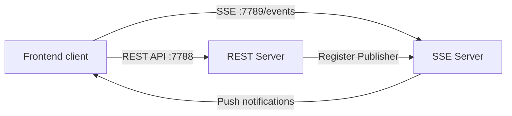

# SSE Real-Time Push

GoWind Admin has a built-in real-time push service based on **Server-Sent Events (SSE)**, used for scenarios such as instant notification of internal messages. This chapter describes the SSE service architecture, configuration, and customization practices in detail.

## 1. SSE Architecture Overview

### 1.1 What Is SSE

Server-Sent Events (SSE) is an HTTP-based server push technology. Compared with WebSocket:

| Feature | SSE | WebSocket |
|------|---------------|---------------|
| Protocol | HTTP/1.1+ | Standalone protocol (ws/wss) |
| Direction | Server → client (one-way) | Bidirectional |
| Reconnection | Automatic by the browser | Must be implemented manually |
| Data format | Plain text | Text/binary |
| Compatibility | All modern browsers | All modern browsers |

SSE is well suited for scenarios where **the server pushes notifications to the client proactively**, and it is simple to implement with built-in disconnect reconnection support.

### 1.2 The SSE Service in GoWind Admin

The GoWind Admin backend runs two HTTP servers:



- **REST Server** (`:7788`): handles all CRUD requests
- **SSE Server** (`:7789`): a standalone SSE push server

### 1.3 Core Components

The SSE service involves the following core components:

| Component | Path | Responsibility |
|------------------------|------------------------------------------------|---------------------|
| SSE Server | `internal/server/sse_server.go` | Creates and configures the SSE server |
| InternalMessageService | `internal/service/internal_message_service.go` | Message management + SSE subscription/authorization/push |
| kratos-transport SSE | Third-party library `github.com/tx7do/kratos-transport` | SSE transport implementation |

## 2. Server-Side Implementation

### 2.1 Creating the SSE Server

In `internal/server/sse_server.go`, the SSE server is injected via Wire:

```go
func NewSseServer(
    ctx *bootstrap.Context,
    internalMessageService *service.InternalMessageService,
) *sseServer.Server {
    cfg := ctx.GetConfig()

    if cfg == nil || cfg.Server == nil || cfg.Server.Sse == nil {
        return nil
    }

    srv := sse.NewSseServer(cfg.Server.Sse,
        sseServer.WithSubscriberFunction(internalMessageService.HandleSubscribe),
        sseServer.WithAuthorizeFunc(internalMessageService.HandleAuthorize),
    )

    internalMessageService.RegisterInternalMessagePublisher(srv)

    return srv
}
```

**Key design points**:

- When SSE is not enabled in the configuration (`cfg.Server.Sse == nil`), `nil` is returned and the server is not created
- The SSE Server registers only two callbacks: the **authorize function** and the **subscribe function**
- `RegisterInternalMessagePublisher` injects the SSE publishing capability into the message service

### 2.2 Client Authorization

SSE connections are authorized with a JWT token, implemented in `HandleAuthorize`:

```go
func (s *InternalMessageService) HandleAuthorize(_ *http.Request, token string) error {
    resp, err := s.authenticator.Authenticate(context.Background(), &authenticationV1.ValidateTokenRequest{
        ClientType:    s.clientType,
        Token:         token,
        TokenCategory: authenticationV1.TokenCategory_ACCESS,
    })
    if err != nil {
        return err
    }

    if resp.GetIsBlocked() {
        return authenticationV1.ErrorForbidden("token is blocked")
    }
    if !resp.GetIsValid() {
        return authenticationV1.ErrorUnauthorized("invalid token")
    }

    return nil
}
```

**Authorization flow**:
1. Extract the access token from the request
2. Call `Authenticator.Authenticate` to verify the token's validity
3. Check whether the token is blocked (`IsBlocked`)
4. Check whether the token is valid (`IsValid`)
5. Once all checks pass, the SSE connection is allowed

### 2.3 Message Subscription

The `HandleSubscribe` callback is triggered when a client establishes a connection:

```go
func (s *InternalMessageService) HandleSubscribe(streamID sse.StreamID, _ *sse.Subscriber) {
    s.log.Infof("subscriber [%s] connected", streamID)
}
```

The SSE service uses `streamID` to identify each client connection, usually corresponding to the user's access token value.

### 2.4 Message Push

The core push logic is in the `sendNotification` method:

```go
func (s *InternalMessageService) sendNotification(
    ctx context.Context, messageId uint32, recipientUserId uint32,
    senderUserId uint32, now *time.Time, title, content string,
) error {
    // 1. 创建收件记录
    recipient := &internalMessageV1.InternalMessageRecipient{
        MessageId:       trans.Ptr(messageId),
        RecipientUserId: trans.Ptr(recipientUserId),
        Status:          trans.Ptr(internalMessageV1.InternalMessageRecipient_SENT),
        Title:           trans.Ptr(title),
        Content:         trans.Ptr(content),
        // ...
    }

    entity, err := s.internalMessageRecipientRepo.Create(ctx, recipient)
    if err != nil {
        return err
    }

    // 2. 序列化消息为 JSON
    recipientJson, _ := json.Marshal(recipient)

    // 3. 查找该用户的所有在线 SSE 连接
    recipientStreamIds := s.authenticator.GetAccessTokens(ctx, s.clientType, recipientUserId)

    // 4. 向所有连接推送通知
    for _, streamId := range recipientStreamIds {
        s.internalMessagePublisher.Publish(ctx, sse.StreamID(streamId), &sse.Event{
            ID:    []byte(id.NewGUIDv4(false)),
            Data:  recipientJson,
            Event: []byte("notification"),
        })
    }

    return nil
}
```

**Push flow**:

1. Create the recipient record in the database (`InternalMessageRecipient`)
2. Serialize the recipient information into JSON
3. Find all of the user's online connections via `GetAccessTokens` (multi-device login supported)
4. Iterate over all connections and push the `notification` event via SSE

### 2.5 The Message Sending Entry Point

`SendMessage` is the API entry point for sending internal messages:

```go
func (s *InternalMessageService) SendMessage(
    ctx context.Context, req *internalMessageV1.SendMessageRequest,
) (*internalMessageV1.SendMessageResponse, error) {
    // 创建消息记录
    msg, err := s.internalMessageRepo.Create(ctx, &internalMessageV1.CreateInternalMessageRequest{
        Data: &internalMessageV1.InternalMessage{
            Title:      req.Title,
            Content:    trans.Ptr(req.GetContent()),
            Status:     trans.Ptr(internalMessageV1.InternalMessage_PUBLISHED),
            Type:       trans.Ptr(req.GetType()),
            CategoryId: req.CategoryId,
            // ...
        },
    })

    // 根据目标类型推送
    if req.GetTargetAll() {
        // 全员推送
        users, _ := s.userRepo.List(ctx, &paginationV1.PagingRequest{NoPaging: trans.Ptr(true)})
        for _, user := range users.Items {
            s.sendNotification(ctx, msg.GetId(), user.GetId(), ...)
        }
    } else if req.RecipientUserId != nil {
        // 单人推送
        s.sendNotification(ctx, msg.GetId(), req.GetRecipientUserId(), ...)
    } else if len(req.TargetUserIds) != 0 {
        // 多人推送
        for _, uid := range req.TargetUserIds {
            s.sendNotification(ctx, msg.GetId(), uid, ...)
        }
    }

    return &internalMessageV1.SendMessageResponse{MessageId: msg.GetId()}, nil
}
```

Three push modes are supported:
- **Push to all** (`TargetAll`): send to all users
- **Push to one** (`RecipientUserId`): send to a specified user
- **Push to many** (`TargetUserIds`): send to multiple users

## 3. Configuration

### 3.1 SSE Configuration Options

Configure the SSE service in `configs/server.yaml`:

```yaml
server:
  sse:
    addr: ":7789"        # SSE 监听地址
    codec: "json"        # 编解码格式
    path: "/events"      # SSE 端点路径
    auto_stream: true    # 自动创建 Stream
    auto_reply: false    # 自动回复（调试用）
```

| Option | Description | Default |
|---------------|-------------------|-----------|
| `addr` | The address the SSE service listens on | `:7789` |
| `codec` | The message encoding/decoding format | `json` |
| `path` | The SSE subscription endpoint path | `/events` |
| `auto_stream` | Automatically create a stream for each subscriber | `true` |
| `auto_reply` | Automatically reply with an acknowledgment after receiving a message | `false` |

### 3.2 Disabling SSE

If you do not use the SSE feature, simply delete or comment out the `sse` node in `server.yaml`:

```yaml
server:
  rest:
    addr: ":7788"
    # ...
  # sse:                    # 注释掉 SSE 配置
  #   addr: ":7789"
  #   ...
```

In that case `NewSseServer` returns `nil` and the SSE server is not started.

### 3.3 CORS Notes

Since the SSE Server runs on a separate port (`:7789`), cross-origin configuration must be considered when the frontend accesses it. In the frontend development environment this is usually solved through the Vite proxy configuration.

## 4. Frontend Integration

### 4.1 Connecting to the SSE Service

The frontend connects to SSE using the browser-native `EventSource` API:

```typescript
// 建立 SSE 连接（需要携带 Access Token）
const token = localStorage.getItem('access_token')
const eventSource = new EventSource(`http://localhost:7789/events?token=${token}`)

// 监听 notification 事件
eventSource.addEventListener('notification', (event) => {
  const message = JSON.parse(event.data)
  console.log('收到新通知:', message)

  // 更新 UI 通知气泡
  notificationStore.addNotification(message)
})

// 监听连接状态
eventSource.onopen = () => {
  console.log('SSE 连接已建立')
}

eventSource.onerror = (error) => {
  console.error('SSE 连接错误:', error)
  // 浏览器会自动重连
}
```

### 4.2 EventSource Wrapper Recommendation

In production, it is recommended to wrap SSE in a client class:

```typescript
class SseClient {
  private eventSource: EventSource | null = null
  private reconnectTimer: number | null = null

  connect(url: string, token: string) {
    this.disconnect()

    this.eventSource = new EventSource(`${url}?token=${token}`)

    this.eventSource.addEventListener('notification', (event) => {
      const data = JSON.parse(event.data)
      this.onMessage(data)
    })

    this.eventSource.onerror = () => {
      // SSE 自动重连失败后，手动延迟重连
      this.eventSource?.close()
      this.reconnectTimer = window.setTimeout(() => {
        this.connect(url, token)
      }, 5000)
    }
  }

  disconnect() {
    if (this.reconnectTimer) {
      clearTimeout(this.reconnectTimer)
    }
    this.eventSource?.close()
    this.eventSource = null
  }

  private onMessage(data: any) {
    // 处理消息，更新状态管理
  }
}
```

### 4.3 Vite Proxy Configuration

In the development environment, configure a proxy in `vite.config.ts` to solve cross-origin issues:

```typescript
export default defineConfig({
  server: {
    proxy: {
      '/events': {
        target: 'http://localhost:7789',
        changeOrigin: true,
        ws: false,  // SSE 不是 WebSocket
      },
    },
  },
})
```

## 5. Data Model

### 5.1 Internal Message Tables

Internal messages pushed via SSE involve the following tables:

| Table | Description |
|-------------------------------|-------------------|
| `internal_messages` | The main message table (title, content, type, status) |
| `internal_message_categories` | Message categories |
| `internal_message_recipients` | Recipient records (associating users and messages) |

### 5.2 The SSE Event Data Structure

The SSE event data the frontend receives is the JSON of `InternalMessageRecipient`:

```json
{
  "id": 123,
  "messageId": 456,
  "recipientUserId": 1,
  "status": "SENT",
  "title": "系统通知",
  "content": "您有一条新消息",
  "createdBy": 2,
  "createdAt": "2026-01-15T10:30:00Z"
}
```

## 6. Customization Practice: Custom SSE Event Types

### 6.1 Scenario

Suppose you need to push a notification to administrators via SSE after a task finishes.

### 6.2 Backend Implementation

First create a service method that pushes the custom event:

```go
// 在 TaskService 中添加 SSE 推送能力
type TaskService struct {
    // ...
    publisher InternalMessagePublisher  // 复用现有 Publisher 接口
    authenticator *data.Authenticator
    clientType authenticationV1.ClientType
}

// PushTaskCompleteNotification 推送任务完成通知
func (s *TaskService) PushTaskCompleteNotification(
    ctx context.Context,
    taskName string,
    result string,
    adminUserIDs []uint32,
) error {
    notification := map[string]interface{}{
        "type":    "task_complete",
        "taskName": taskName,
        "result":  result,
        "time":    time.Now().Format(time.RFC3339),
    }
    notificationJson, _ := json.Marshal(notification)

    for _, uid := range adminUserIDs {
        // 获取该用户的所有在线连接
        streamIds := s.authenticator.GetAccessTokens(ctx, s.clientType, uid)
        for _, streamId := range streamIds {
            s.publisher.Publish(ctx, sse.StreamID(streamId), &sse.Event{
                ID:    []byte(id.NewGUIDv4(false)),
                Data:  notificationJson,
                Event: []byte("task_complete"),
            })
        }
    }
    return nil
}
```

### 6.3 Listening on the Frontend

```typescript
eventSource.addEventListener('task_complete', (event) => {
  const data = JSON.parse(event.data)
  ElNotification({
    title: '任务完成',
    message: `${data.taskName} 已完成: ${data.result}`,
    type: 'success',
  })
})
```

## 7. Best Practices

### 7.1 Connection Management

- **Token refresh**: after the access token is refreshed, the old SSE connection must be disconnected and a new one established
- **Page visibility**: use `document.visibilityState` to pause processing when the page goes to the background and resume when it returns to the foreground
- **Multiple tabs**: browsers limit the number of SSE connections per domain (usually 6); watch out for the multi-tab scenario

### 7.2 Message Reliability

- SSE push only guarantees that **online users** receive messages; offline users should proactively fetch unread messages after coming back online
- It is recommended to push only the **notification summary** via SSE; the frontend then fetches the full data through the REST API
- The `Last-Event-ID` mechanism can be used to re-deliver lost events after reconnection

### 7.3 Performance Considerations

- SSE is a long-lived connection; pay attention to the server-side connection limits and memory usage
- `GetAccessTokens` can find all of a user's online connections, supporting multi-device push
- If there are many online users, consider using Redis Pub/Sub for distributed push

---

**Related documentation**:

- [Backend Architecture](/en/admin/backend-architecture.md)
- [Backend Modules](/en/admin/backend-modules.md)
- [Event Bus Architecture](/en/admin/tutorial-eventbus-architecture.md)
