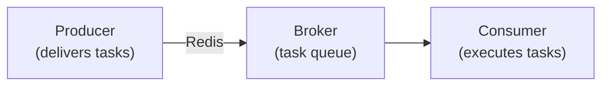

# Task Scheduling and Asynchronous Processing

GoWind Admin implements a distributed task queue based on Asynq, supporting scheduled, delayed, and asynchronous tasks. This tutorial explains the task scheduling architecture, configuration methods, and practical scenarios in depth.

## 1. Asynq Architecture

### 1.1 Core Components



- **Producer**: the task producer, responsible for delivering tasks to the queue
- **Broker**: the message broker (Redis), which stores the task queue
- **Consumer**: the task consumer, which takes tasks from the queue and executes them

### 1.2 Queue Priorities

Asynq supports multi-queue priority configuration (`server.yaml`):

```yaml
asynq:
  uri: "redis://:*Abcd123456@redis:6379/1"
  concurrency: 10              # 并发 worker 数量
  queues:
    critical: 10               # 高优先级队列（权重 10）
    default: 5                 # 默认队列（权重 5）
    low: 1                     # 低优先级队列（权重 1）
```

**How it works**: workers take tasks from higher-weight queues first.

### 1.3 Task Types

| Type | Description | Examples |
|----------|---------|-------------------|
| **Immediate task** | Executes immediately | Sending emails, sending SMS |
| **Delayed task** | Executes after a specified time | Retry after 10 minutes, reminder after 30 minutes |
| **Scheduled task** | Executes periodically | Daily backup at midnight, hourly statistics |

## 2. Task Definitions

### 2.1 Define Task Types

Define the task type constants under the `pkg/task/` directory:

```go
package task

const (
    TypeSendEmail           = "email:send"
    TypeSendSMS             = "sms:send"
    TypeCleanupTempFiles    = "file:cleanup_temp"
    TypeGenerateReport      = "report:generate"
    TypeSyncData            = "data:sync"
)
```

**Naming convention**: use the `module:action` format, separated by colons, all lowercase. Task names must be globally unique and semantically clear (avoid vague names like `task1`).

> **Special feature**: after registering `email:send`, variants such as `email:send:1` are also handled by the handler of `email:send`, which can be used for task grouping.

### 2.2 Define Task Payloads

Each task carries a JSON payload:

```go
type SendEmailPayload struct {
    To      string `json:"to"`
    Subject string `json:"subject"`
    Body    string `json:"body"`
}

type CleanupTempFilesPayload struct {
    Directory string `json:"directory"`
    OlderThan int64  `json:"older_than"`  // 秒
}
```

## 3. Task Handlers

### 3.1 Register Task Handlers

Register them in `app/admin/service/internal/server/asynq_server.go`:

```go
func NewAsynqServer(ctx *bootstrap.Context, logger log.Logger) *asynq.Server {
    cfg := ctx.GetConfig().GetServer().GetAsynq()
    
    srv := asynq.NewServer(
        asynq.RedisClientOpt{Addr: cfg.Uri},
        asynq.Config{
            Concurrency: int(cfg.Concurrency),
            Queues:      parseQueues(cfg.Queues),
        },
    )
    
    // 注册任务处理器
    mux := asynq.NewServeMux()
    mux.HandleFunc(task.TypeSendEmail, handleSendEmail)
    mux.HandleFunc(task.TypeSendSMS, handleSendSMS)
    mux.HandleFunc(task.TypeCleanupTempFiles, handleCleanupTempFiles)
    mux.HandleFunc(task.TypeGenerateReport, handleGenerateReport)
    
    go func() {
        if err := srv.Run(mux); err != nil {
            log.Errorf("asynq server error: %v", err)
        }
    }()
    
    return srv
}
```

### 3.2 Implement Task Handlers

```go
func handleSendEmail(ctx context.Context, t *asynq.Task) error {
    var payload task.SendEmailPayload
    if err := json.Unmarshal(t.Payload(), &payload); err != nil {
        return fmt.Errorf("unmarshal payload failed: %v", err)
    }
    
    log.Infof("sending email to %s: %s", payload.To, payload.Subject)
    
    // 调用邮件服务
    err := emailService.Send(&email.SendRequest{
        To:      payload.To,
        Subject: payload.Subject,
        Body:    payload.Body,
    })
    
    if err != nil {
        log.Errorf("send email failed: %v", err)
        return err  // 返回错误会触发重试
    }
    
    log.Infof("email sent successfully to %s", payload.To)
    return nil
}

func handleCleanupTempFiles(ctx context.Context, t *asynq.Task) error {
    var payload task.CleanupTempFilesPayload
    json.Unmarshal(t.Payload(), &payload)
    
    log.Infof("cleaning temp files in %s older than %d seconds", 
        payload.Directory, payload.OlderThan)
    
    // 清理逻辑
    cutoffTime := time.Now().Add(-time.Duration(payload.OlderThan) * time.Second)
    files, _ := ioutil.ReadDir(payload.Directory)
    
    for _, file := range files {
        if file.ModTime().Before(cutoffTime) {
            os.Remove(filepath.Join(payload.Directory, file.Name()))
            log.Infof("deleted file: %s", file.Name())
        }
    }
    
    return nil
}
```

## 4. Delivering Tasks

### 4.1 Immediate Tasks

```go
import "github.com/hibiken/asynq"

// 投递立即执行的任务
func EnqueueSendEmail(to, subject, body string) error {
    payload := task.SendEmailPayload{
        To:      to,
        Subject: subject,
        Body:    body,
    }
    
    data, _ := json.Marshal(payload)
    
    _, err := asynqClient.Enqueue(asynq.NewTask(task.TypeSendEmail, data))
    return err
}

// 使用
EnqueueSendEmail("user@example.com", "欢迎", "欢迎使用 GoWind Admin")
```

### 4.2 Delayed Tasks

```go
// 10 分钟后执行
func EnqueueDelayedTask() error {
    payload := task.SendEmailPayload{...}
    data, _ := json.Marshal(payload)
    
    task := asynq.NewTask(task.TypeSendEmail, data)
    
    _, err := asynqClient.EnqueueIn(10*time.Minute, task)
    return err
}

// 指定时间点执行
func EnqueueAtSpecificTime() error {
    payload := task.SendEmailPayload{...}
    data, _ := json.Marshal(payload)
    
    task := asynq.NewTask(task.TypeSendEmail, data)
    
    executeAt := time.Now().Add(1 * time.Hour)
    _, err := asynqClient.EnqueueAt(executeAt, task)
    return err
}
```

### 4.3 Scheduled Tasks

```go
// 每天凌晨 2 点执行
func RegisterPeriodicTask() {
    payload := task.CleanupTempFilesPayload{
        Directory: "/tmp/uploads",
        OlderThan: 86400,  // 24 小时
    }
    data, _ := json.Marshal(payload)
    
    opts := []asynq.Option{
        asynq.Queue("default"),
        asynq.MaxRetry(3),
        asynq.Timeout(10 * time.Minute),
    }
    
    // Cron 表达式：秒 分 时 日 月 周
    // "0 2 * * *" = 每天凌晨 2 点
    scheduler.RegisterPeriodicTask(
        "cleanup_temp_files_daily",
        "0 2 * * *",
        asynq.NewTask(task.TypeCleanupTempFiles, data),
        opts...,
    )
}
```

### 4.4 Specifying the Queue and Priority

```go
// 投递到高优先级队列
func EnqueueCriticalTask() error {
    payload := task.SendEmailPayload{...}
    data, _ := json.Marshal(payload)
    
    task := asynq.NewTask(task.TypeSendEmail, data)
    
    _, err := asynqClient.Enqueue(task, asynq.Queue("critical"))
    return err
}
```

## 5. Task Retries and Error Handling

### 5.1 Automatic Retries

Asynq supports automatic retries. Configure the retry policy:

```go
_, err := asynqClient.Enqueue(task, 
    asynq.MaxRetry(3),              // 最多重试 3 次
    asynq.Timeout(5*time.Minute),   // 超时时间
    asynq.RetryIn(1*time.Minute),   // 重试间隔
)
```

**Retry interval policy**:
- 1st failure: retry after 1 minute
- 2nd failure: retry after 2 minutes
- 3rd failure: retry after 4 minutes (exponential backoff)

### 5.2 Custom Retry Logic

```go
func handleSendEmail(ctx context.Context, t *asynq.Task) error {
    var payload task.SendEmailPayload
    json.Unmarshal(t.Payload(), &payload)
    
    err := emailService.Send(&email.SendRequest{...})
    
    if err != nil {
        // 判断是否应该重试
        if isTemporaryError(err) {
            // 返回错误，触发重试
            return err
        } else {
            // 永久性错误，不重试
            log.Errorf("permanent error, won't retry: %v", err)
            return nil
        }
    }
    
    return nil
}

func isTemporaryError(err error) bool {
    // 判断是否为临时错误（如网络超时）
    return strings.Contains(err.Error(), "timeout") ||
           strings.Contains(err.Error(), "connection refused")
}
```

### 5.3 Dead Letter Queue

After retries are exhausted, the task enters the dead letter queue:

```go
// 监控死信队列
func MonitorDeadLetterQueue() {
    deadLetters, _ := asynqClient.ListDeadLetters()
    
    for _, dl := range deadLetters {
        log.Errorf("dead letter task: type=%s, error=%s", 
            dl.Type, dl.Error)
        
        // 可以手动重新入队或记录告警
    }
}
```

## 6. Task Monitoring

### 6.1 Asynqmon Web UI

[Asynqmon](https://github.com/hibiken/asynqmon) is the official standalone web monitoring tool for Asynq, used to monitor and manage task queues. Installation via Docker is recommended:

```shell
# 拉取镜像
docker pull hibiken/asynqmon:latest

# 启动 Asynqmon
docker run -d \
    --name asynqmon \
    -p 8080:8080 \
    hibiken/asynqmon:latest \
    --redis-url=redis://:*Abcd123456@host.docker.internal:6379/1
```

> **Tip**: replace `--redis-url` with your actual Redis connection address. If Redis also runs in Docker, you can use the container name instead of `host.docker.internal`.

Once started, visit <http://localhost:8080> to open the monitoring UI, where you can view:

- **Dashboard**: queue overview, task processing rate, error statistics
- **Task views**: active tasks, queued tasks, completed tasks, failed tasks, scheduled tasks
- **Performance metrics**: task processing latency, throughput, and other metrics

### 6.2 The CLI Tool

Asynq also provides a command-line tool for checking task status in the terminal:

```shell
# 安装 CLI 工具
go install github.com/hibiken/asynq/tools/asynq@latest

# 查看队列状态
asynq stats

# 查看任务详情
asynq task info <task-id>

# 启动监控面板
asynq dash
```

### 6.3 Task Logs

Log in detail inside the task handlers:

```go
func handleGenerateReport(ctx context.Context, t *asynq.Task) error {
    taskID := t.ID()
    log.Infof("[task:%s] starting report generation", taskID)
    
    startTime := time.Now()
    
    // 执行任务
    err := generateReport()
    
    elapsed := time.Since(startTime)
    if err != nil {
        log.Errorf("[task:%s] failed after %v: %v", taskID, elapsed, err)
        return err
    }
    
    log.Infof("[task:%s] completed in %v", taskID, elapsed)
    return nil
}
```

### 6.4 Task Audit Logs

Record task execution results to the database:

```go
func handleSendEmail(ctx context.Context, t *asynq.Task) error {
    var payload task.SendEmailPayload
    json.Unmarshal(t.Payload(), &payload)
    
    // 创建审计记录
    auditLog := &TaskAuditLog{
        TaskType:   task.TypeSendEmail,
        Payload:    string(t.Payload()),
        Status:     "pending",
        StartedAt:  time.Now(),
    }
    auditLogRepo.Create(ctx, auditLog)
    
    // 执行任务
    err := emailService.Send(...)
    
    // 更新审计记录
    if err != nil {
        auditLog.Status = "failed"
        auditLog.Error = err.Error()
    } else {
        auditLog.Status = "success"
    }
    auditLog.CompletedAt = time.Now()
    auditLogRepo.Update(ctx, auditLog)
    
    return err
}
```

## 7. Practical Scenarios

### 7.1 Scenario 1: Send a Welcome Email After User Registration

```go
// 在用户注册成功后投递任务
func (s *UserService) Register(ctx context.Context, req *RegisterRequest) error {
    // 1. 创建用户
    user, err := s.userRepo.Create(ctx, req)
    if err != nil {
        return err
    }
    
    // 2. 异步发送欢迎邮件
    task.EnqueueSendEmail(user.Email, "欢迎加入", "欢迎使用 GoWind Admin！")
    
    return nil
}
```

### 7.2 Scenario 2: Automatically Cancel Timed-Out Orders

```go
// 创建订单时投递延迟任务
func (s *OrderService) CreateOrder(ctx context.Context, req *CreateOrderRequest) error {
    order, _ := s.orderRepo.Create(ctx, req)
    
    // 30 分钟后自动取消未支付订单
    payload := task.CancelOrderPayload{
        OrderID: order.ID,
    }
    data, _ := json.Marshal(payload)
    
    asynqClient.EnqueueIn(30*time.Minute, 
        asynq.NewTask(task.TypeCancelOrder, data))
    
    return nil
}

// 任务处理器
func handleCancelOrder(ctx context.Context, t *asynq.Task) error {
    var payload task.CancelOrderPayload
    json.Unmarshal(t.Payload(), &payload)
    
    order, _ := orderRepo.Get(ctx, payload.OrderID)
    
    if order.Status == Order_UNPAID {
        orderRepo.UpdateStatus(ctx, payload.OrderID, Order_CANCELLED)
        log.Infof("order %d auto-cancelled due to timeout", payload.OrderID)
    }
    
    return nil
}
```

### 7.3 Scenario 3: Daily Report Generation

```go
// 注册定时任务
func RegisterDailyReportTask() {
    payload := task.GenerateReportPayload{
        ReportType: "daily_sales",
        Date:       time.Now().Format("2006-01-02"),
    }
    data, _ := json.Marshal(payload)
    
    scheduler.RegisterPeriodicTask(
        "daily_sales_report",
        "0 8 * * *",  // 每天早上 8 点
        asynq.NewTask(task.TypeGenerateReport, data),
        asynq.Queue("low"),
        asynq.MaxRetry(2),
    )
}

// 任务处理器
func handleGenerateReport(ctx context.Context, t *asynq.Task) error {
    var payload task.GenerateReportPayload
    json.Unmarshal(t.Payload(), &payload)
    
    log.Infof("generating %s report for %s", 
        payload.ReportType, payload.Date)
    
    // 查询数据
    data := queryReportData(payload.ReportType, payload.Date)
    
    // 生成 Excel
    excelFile := generateExcel(data)
    
    // 上传到 OSS
    url := oss.UploadFile("reports", 
        fmt.Sprintf("%s_%s.xlsx", payload.ReportType, payload.Date), 
        excelFile)
    
    // 发送邮件通知
    task.EnqueueSendEmail(
        "manager@example.com",
        fmt.Sprintf("%s 报表已生成", payload.ReportType),
        fmt.Sprintf("下载链接：%s", url),
    )
    
    return nil
}
```

### 7.4 Scenario 4: Batch Data Synchronization

```go
// 从外部 API 同步数据
func EnqueueDataSyncTask(source string) error {
    payload := task.SyncDataPayload{
        Source: source,
    }
    data, _ := json.Marshal(payload)
    
    _, err := asynqClient.Enqueue(
        asynq.NewTask(task.TypeSyncData, data),
        asynq.Queue("default"),
        asynq.MaxRetry(5),
        asynq.Timeout(30*time.Minute),  // 允许长时间运行
    )
    
    return err
}

func handleSyncData(ctx context.Context, t *asynq.Task) error {
    var payload task.SyncDataPayload
    json.Unmarshal(t.Payload(), &payload)
    
    log.Infof("syncing data from %s", payload.Source)
    
    // 分页同步
    page := 1
    for {
        records, hasMore := fetchDataFromSource(payload.Source, page)
        
        for _, record := range records {
            // 插入或更新数据库
            upsertRecord(record)
        }
        
        if !hasMore {
            break
        }
        page++
    }
    
    log.Infof("data sync completed from %s", payload.Source)
    return nil
}
```

## 8. Delivering Tasks from Lua Scripts

Tasks can be delivered conveniently from Lua scripts:

```lua
-- scripts/on_user_registered.lua

eventbus.subscribe("user.created", function(event)
    local user_id = event.user_id
    local email = event.email
    
    -- 投递异步任务
    task.enqueue("send_welcome_email", {
        user_id = user_id,
        email = email
    })
    
    -- 投递延迟任务（1 天后发送提醒）
    task.enqueue_in("send_onboarding_reminder", 86400, {
        user_id = user_id
    })
end)
```

## 9. Performance Optimization

### 9.1 Batch Delivery

Avoid delivering single tasks in a loop; use the batch API:

```go
// ❌ 错误做法
for _, user := range users {
    EnqueueSendEmail(user.Email, ...)
}

// ✅ 正确做法
var tasks []*asynq.Task
for _, user := range users {
    payload := task.SendEmailPayload{...}
    data, _ := json.Marshal(payload)
    tasks = append(tasks, asynq.NewTask(task.TypeSendEmail, data))
}

asynqClient.EnqueueBatch(tasks)
```

### 9.2 Adjusting Concurrency

Adjust the number of concurrent workers according to server resources and task duration:

```yaml
asynq:
  concurrency: 20  # CPU 密集型任务调小，I/O 密集型任务调大
```

### 9.3 Task Grouping

Group related tasks into separate queues to avoid blocking each other:

```go
// 邮件任务独立队列
asynqClient.Enqueue(task, asynq.Queue("email"))

// 报表任务独立队列
asynqClient.Enqueue(task, asynq.Queue("report"))
```

## 10. Common Issues

### Q1: What if a task fails to execute?

1. Check the failed tasks in the Asynq Monitor UI
2. Check the error messages in the logs
3. Re-enqueue manually, or fix the issue and retry

### Q2: How do I make sure tasks are not lost?

Asynq is based on Redis. Make sure that:
1. Redis persistence is configured (AOF + RDB)
2. You return only after tasks are delivered successfully
3. Audit logs are recorded for important tasks

### Q3: How do I handle long-running tasks?

1. Increase the timeout: `asynq.Timeout(1*time.Hour)`
2. Check the context cancellation signal periodically
3. Split large tasks into several smaller ones

### Q4: How do I debug tasks in the development environment?

Start Redis and the Asynq server locally:

```shell
# 启动 Redis
docker run -d -p 6379:6379 redis

# 启动后端服务（包含 Asynq Server）
gow run admin
```

Visit Asynqmon (see [6.1 Asynqmon Web UI](#_6-1-asynqmon-web-ui)) to check the task status.

## 11. Related Documentation

- [Backend Configuration and Deployment](/en/admin/backend-config-deploy.md)
- [Lua Script Extension Tutorial](/en/admin/tutorial-lua-extension.md)
- [Event Bus and Decoupled Architecture](/en/admin/tutorial-eventbus-architecture.md)
