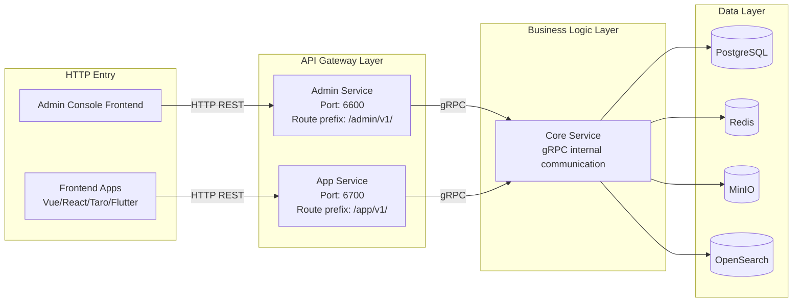
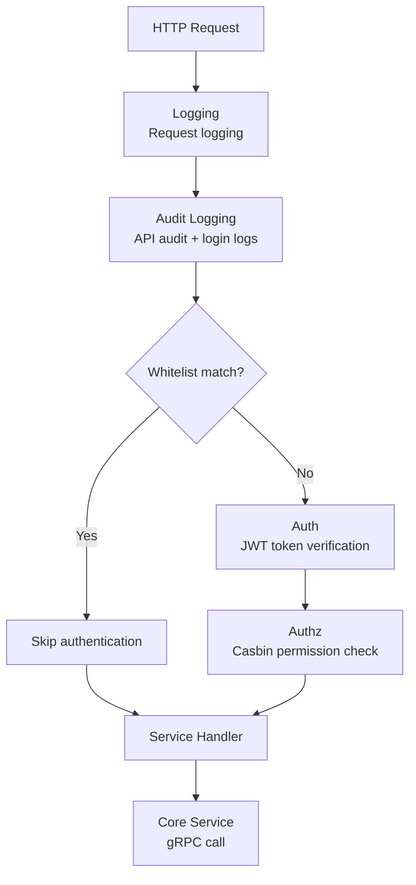
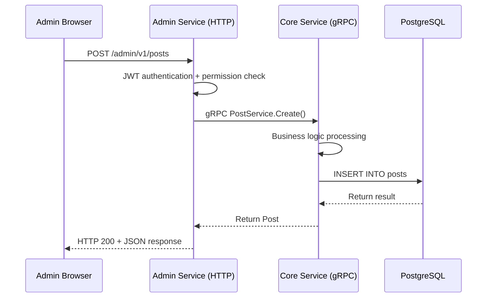

# CMS Backend Architecture Overview

The GoWind CMS backend is built on the go-kratos microservice framework and adopts a **three-service architecture** (Admin Service / App Service / Core Service), achieving layered decoupling of admin interfaces, frontend interfaces, and core business logic.

## 1. Three-Service Architecture

The defining feature of the CMS backend is the **separation into three service layers**, unlike the single-service architecture of GoWind Admin:



### Why Three Services?

| Problem | Admin Single-Service Approach | CMS Three-Service Approach |
|------|-----------------|---------------|
| Frontends sharing interfaces with the admin console? | High security risk; frontend users could trigger admin operations | Frontend and backend APIs physically isolated |
| Business logic reuse? | Code duplication or circular dependencies | Provided centrally by the Core Service via gRPC |
| Different permission models? | Frontend users and admins mixed in the same whitelist | Separate authentication whitelists for each |
| Independent scaling? | Cannot scale frontend or backend separately | Admin/App deployed and scaled independently |

### Service Responsibilities

| Service | Directory | Protocol | Port | Responsibilities |
|------|------|------|------|------|
| **Admin Service** | `app/admin/service/` | HTTP REST + SSE | REST: 6600, SSE: 6601 | Admin console API, 40+ Services, serving the admin frontend |
| **App Service** | `app/app/service/` | HTTP REST + SSE | REST: 6700, SSE: 6701 | Frontend application API, 9 Services, serving all client frontends |
| **Core Service** | `app/core/service/` | gRPC (internal only) | dynamic | Core business logic + data layer, not exposed externally |

## 2. Admin Service in Detail

The Admin Service is the API gateway layer of the admin console; it receives HTTP requests and calls the Core Service via gRPC.

### Architecture Layers

```
app/admin/service/
├── cmd/server/              # Startup entry
│   ├── assets/              # Embedded static assets (OpenAPI docs)
│   ├── configs/             # Configuration files
│   └── main.go              # Program entry
└── internal/
    ├── server/              # Server layer — registers HTTP routes and middleware
    │   ├── rest_server.go   # REST server (registers all Service Handlers)
    │   ├── grpc_server.go   # gRPC client (connects to the Core Service)
    │   └── sse_server.go    # SSE server (real-time push)
    ├── service/             # Service layer — forwards requests to the Core Service
    │   ├── post_service.go  # Post service (forwards to coreService)
    │   ├── user_service.go  # User service
    │   └── ...              # 40+ Services
    └── data/                # Data layer (the Admin layer usually does not access the database directly)
```

### The Admin Service Forwarding Pattern

Each Service in the Admin Service is essentially a **gRPC client proxy** that forwards HTTP requests to the Core Service:

```go
// app/admin/service/internal/service/post_service.go
type PostService struct {
    adminV1.PostServiceHTTPServer       // Implements the generated HTTP interface

    postClient contentV1.PostServiceClient // gRPC client, calls the Core Service
    log       *log.Helper
}

// List forwards directly to the Core Service
func (s *PostService) List(ctx context.Context, req *paginationV1.PagingRequest) (*contentV1.ListPostResponse, error) {
    return s.postClient.List(ctx, req)
}
```

### Middleware Chain

Middleware configuration of the Admin Service (`rest_server.go`):



The authentication whitelist (login-free endpoints) currently contains only the login endpoint: `OperationAuthenticationServiceLogin`.

## 3. App Service in Detail

The App Service is the API gateway layer for the frontend applications; compared to the Admin Service its interfaces are leaner and its authentication whitelist is looser.

### Architecture Layers

```
app/app/service/
├── cmd/server/
│   ├── assets/
│   ├── configs/
│   └── main.go
└── internal/
    ├── server/
    │   ├── rest_server.go       # REST server
    │   └── sse_server.go        # SSE server
    └── service/                  # 9 Services (lean edition)
        ├── authentication_service.go
        ├── post_service.go
        ├── category_service.go
        ├── tag_service.go
        ├── comment_service.go
        ├── page_service.go
        ├── navigation_service.go
        ├── user_profile_service.go
        └── file_transfer_service.go
```

### Frontend Public Endpoint Whitelist

The App Service's authentication whitelist is looser; content-browsing endpoints require no login:

```go
// app/app/service/internal/server/rest_server.go
rpc.AddWhiteList(
    appV1.OperationAuthenticationServiceLogin,

    // The following endpoints are accessible without login
    appV1.OperationNavigationServiceList,
    appV1.OperationPageServiceList,
    appV1.OperationPostServiceList,
    appV1.OperationCategoryServiceList,
    appV1.OperationCommentServiceList,
    appV1.OperationTagServiceList,

    appV1.OperationPageServiceGet,
    appV1.OperationPostServiceGet,
    appV1.OperationCategoryServiceGet,
    appV1.OperationCommentServiceGet,
    appV1.OperationTagServiceGet,
)
```

### Frontend Authentication Differences

The App Service's login service automatically sets `ClientType = app` to distinguish token types from the admin console:

```go
// app/app/service/internal/service/authentication_service.go
func (s *AuthenticationService) Login(ctx context.Context, req *authenticationV1.LoginRequest) (*authenticationV1.LoginResponse, error) {
    req.ClientType = trans.Ptr(authenticationV1.ClientType_app) // Marked as a frontend user
    return s.authenticationServiceClient.Login(ctx, req)
}
```

## 4. Core Service in Detail

The Core Service is the **business logic core** of the entire system, containing all data access and business rules.

### Architecture Layers

```
app/core/service/
├── cmd/server/
│   ├── configs/
│   └── main.go
└── internal/
    ├── server/
    │   └── grpc_server.go         # gRPC server (registers all Services)
    ├── service/                    # Business logic layer (39 Services)
    │   ├── post_service.go         # Post business logic
    │   ├── user_service.go         # User business logic
    │   ├── authentication_service.go
    │   └── ...
    └── data/                       # Data access layer (60+ Repositories)
        ├── ent/                    # Ent ORM generated code (343 files)
        ├── post_repo.go            # Post repository
        ├── post_translation_repo.go # Post translation repository
        ├── user_repo.go            # User repository
        └── ...
```

### Business Logic of the Core Service

Unlike the pure forwarding in Admin/App Services, the Core Service contains the actual business logic:

```go
// app/core/service/internal/service/post_service.go
func (s *PostService) Create(ctx context.Context, req *contentV1.CreatePostRequest) (*contentV1.Post, error) {
    // Business rule: new posts default to "published" status
    if req.Data.Status == nil {
        req.Data.Status = trans.Ptr(contentV1.Post_POST_STATUS_PUBLISHED)
    }
    return s.postRepo.Create(ctx, req)
}

// Complete business logic related to translations
func (s *PostService) TranslationExists(ctx context.Context, req *contentV1.PostTranslationExistsRequest) (*contentV1.PostTranslationExistsResponse, error) {
    exists, err := s.postRepo.TranslationExists(ctx, req.GetPostId(), req.GetLanguageCode())
    ...
}
```

### Task Scheduling in the Core Service

The Core Service also integrates Asynq-based asynchronous task scheduling:

```yaml
# app/core/service/configs/server.yaml
server:
  asynq:
    uri: "redis://:*Abcd123456@redis:6379/1"
    enable_gracefully_shutdown: true
    shutdown_timeout: 3s
    codec: "json"
```

## 5. Inter-Service Communication

### gRPC Call Chain



### Service Registry and Discovery

The three services register and discover each other via Etcd:

```yaml
# registry.yaml
registry:
  type: "etcd"
  etcd:
    endpoints:
      - "localhost:2379"
```

- The **Core Service** registers itself with Etcd at startup
- The **Admin Service** and **App Service** discover the Core Service's gRPC address from Etcd at startup
- Multi-instance load balancing of the Core Service is supported automatically

## 6. Data Access Layer

The Core Service's data layer uses the **Ent ORM** framework and provides an independent Repository for each business entity.

### Repository Pattern

```go
// app/core/service/internal/data/post_repo.go
type PostRepo struct {
    data *Data  // Ent database client
    log  *log.Helper
}

func (r *PostRepo) List(ctx context.Context, req *paginationV1.PagingRequest) (*contentV1.ListPostResponse, error) {
    // Query using the Ent client
    // Supports pagination, sorting, and field filtering
}

func (r *PostRepo) Create(ctx context.Context, req *contentV1.CreatePostRequest) (*contentV1.Post, error) {
    // Create using the Ent client
    // Automatically handles category and tag associations
}
```

### Content Translation Repositories

CMS-specific translation repositories provide independent translation data access for each content entity:

| Repository | Description |
|------------|------|
| `post_translation_repo.go` | Post multilingual translations |
| `category_translation_repo.go` | Category multilingual translations |
| `tag_translation_repo.go` | Tag multilingual translations |
| `page_translations_repo.go` | Page multilingual translations |
| `dict_entry_i18n_repo.go` | Dictionary i18n |

## 7. Comparison with the GoWind Admin Architecture

| Aspect | GoWind Admin | GoWind CMS |
|--------|-------------|------------|
| Number of services | 1 (Admin Service) | 3 (Admin + App + Core) |
| Frontend API | None | Dedicated App Service |
| Business logic layer | In the same service as the HTTP handlers | Separate Core Service |
| Inter-service communication | In-process calls | gRPC cross-service calls |
| Content translation | None | Complete translation repository system |
| Task scheduling | Asynq (within the same service) | Asynq (separate Core Service) |
| Ent entities | System administration | System administration + content management |

## 8. Related Documentation

- [CMS Protobuf API Definitions](./backend-api.md)
- [CMS Frontend Architecture](./frontend-architecture.md)
- [CMS Installation Guide](./installation.md)
- [GoWind Admin Backend Architecture](/en/admin/backend-architecture.md) — shared technical foundation
