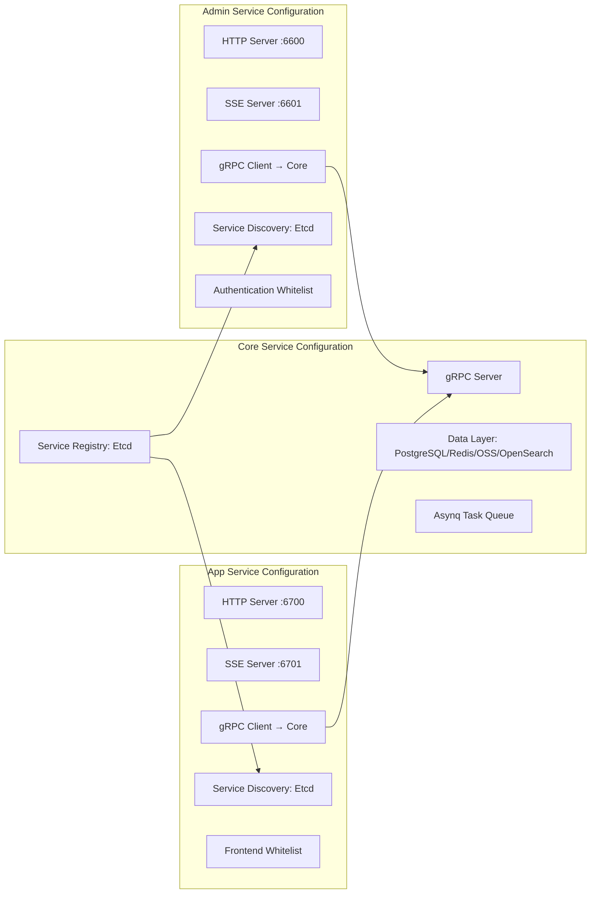
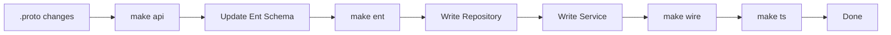
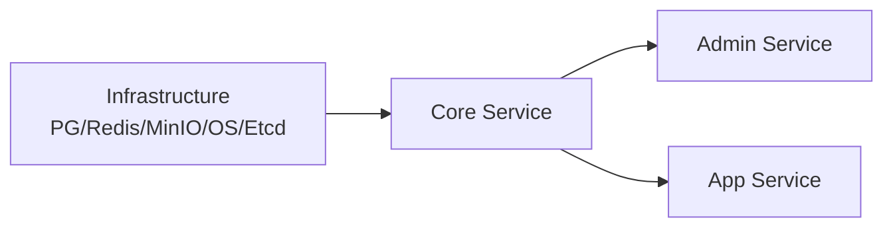

# CMS Configuration and Deployment Guide

GoWind CMS adopts a three-service architecture (Admin / App / Core), making configuration management more complex than single-service systems. This document details the configuration files, environment variables, code generation, and service management for each service.

## 1. Configuration File Organization

### 1.1 Directory Structure

```
app/
├── core/service/configs/
│   ├── server.yaml          # Core Service config (gRPC + Asynq + data layer)
│   └── registry.yaml        # Service registry (Etcd)
├── admin/service/configs/
│   ├── server.yaml          # Admin Service config (HTTP + gRPC client)
│   └── registry.yaml
└── app/service/configs/
    ├── server.yaml           # App Service config (HTTP + gRPC client)
    └── registry.yaml
```

### 1.2 Three-Service Configuration Relationships



## 2. Core Service Configuration

### 2.1 server.yaml

```yaml
# app/core/service/configs/server.yaml
server:
  # gRPC server (internal communication)
  grpc:
    addr: "0.0.0.0:0"              # Port assigned dynamically via Etcd
    timeout: 60s

  # Asynq async tasks
  asynq:
    uri: "redis://:*Abcd123456@redis:6379/1"
    enable_gracefully_shutdown: true
    shutdown_timeout: 3s
    codec: "json"
    concurrency: 10
    queues:
      critical: 10
      default: 5
      low: 1

# Data layer configuration
data:
  database:
    driver: postgres
    source: "host=postgres port=5432 user=postgres password=*Abcd123456 dbname=cms sslmode=disable"

  redis:
    addr: "redis:6379"
    password: "*Abcd123456"
    db: 0
    read_timeout: 0.2s
    write_timeout: 0.2s

  # Object storage
  oss:
    type: "minio"                    # minio / local / s3
    endpoint: "minio:9000"
    access_key: "minioadmin"
    secret_key: "minioadmin"
    bucket: "cms"
    use_ssl: false

  # Search engine
  search:
    type: "opensearch"
    endpoint: "http://opensearch:9200"
    username: "admin"
    password: "admin"

# Distributed tracing
tracer:
  enabled: true
  provider: jaeger
  endpoint: "http://jaeger:14268/api/traces"
```

### 2.2 registry.yaml

```yaml
# app/core/service/configs/registry.yaml
registry:
  type: "etcd"
  etcd:
    endpoints:
      - "etcd:2379"
    timeout: 5s
    ttl: 10                           # Registration TTL
```

## 3. Admin Service Configuration

### 3.1 server.yaml

```yaml
# app/admin/service/configs/server.yaml
server:
  # REST HTTP server
  rest:
    addr: "0.0.0.0:6600"
    timeout: 5s

  # SSE server
  sse:
    addr: "0.0.0.0:6601"

# gRPC client (connects to the Core Service)
client:
  grpc:
    core:
      target: "discovery:///cms-core-service"   # Discovered via Etcd
      timeout: 5s

# Service discovery
registry:
  type: "etcd"
  etcd:
    endpoints:
      - "etcd:2379"

# JWT configuration
auth:
  jwt:
    secret: "your-jwt-secret-key"
    issuer: "cms-admin"
    expire: 86400                        # Token validity (seconds)

# Permission engine
authorizer:
  type: "casbin"
  model: "configs/rbac_model.conf"

# CORS
cors:
  enabled: true
  allow_origins:
    - "http://localhost:5666"
    - "https://admin.cms.gowind.cloud"
```

### 3.2 Authentication Whitelist

```go
// app/admin/service/internal/server/rest_server.go
// Admin whitelist: only the login endpoint is unauthenticated
rpc.AddWhiteList(
    adminV1.OperationAuthenticationServiceLogin,
)
```

## 4. App Service Configuration

### 4.1 server.yaml

```yaml
# app/app/service/configs/server.yaml
server:
  rest:
    addr: "0.0.0.0:6700"
    timeout: 5s

  sse:
    addr: "0.0.0.0:6701"

client:
  grpc:
    core:
      target: "discovery:///cms-core-service"
      timeout: 5s

registry:
  type: "etcd"
  etcd:
    endpoints:
      - "etcd:2379"

auth:
  jwt:
    secret: "your-jwt-secret-key"
    issuer: "cms-app"
    expire: 604800                      # Frontend tokens valid for 7 days

# CORS (frontends need looser cross-origin rules)
cors:
  enabled: true
  allow_origins:
    - "*"
  allow_methods: [GET, POST, PUT, DELETE, OPTIONS]
  allow_headers: [Authorization, Content-Type, Accept-Language]
```

### 4.2 Frontend Whitelist

```go
// app/app/service/internal/server/rest_server.go
// App whitelist: content-browsing endpoints require no authentication
rpc.AddWhiteList(
    appV1.OperationAuthenticationServiceLogin,

    // Content browsing (login-free)
    appV1.OperationPostServiceList,
    appV1.OperationPostServiceGet,
    appV1.OperationCategoryServiceList,
    appV1.OperationCategoryServiceGet,
    appV1.OperationTagServiceList,
    appV1.OperationTagServiceGet,
    appV1.OperationPageServiceList,
    appV1.OperationPageServiceGet,
    appV1.OperationCommentServiceList,
    appV1.OperationCommentServiceGet,
    appV1.OperationNavigationServiceList,
)
```

## 5. Code Generation

### 5.1 Make Commands

```makefile
# Makefile
.PHONY: gen api ent wire ts openapi

# Generate all code at once
gen: api ent wire ts openapi

# Generate Protobuf Go code
api:
	buf generate

# Generate Ent ORM code
ent:
	go generate ./app/core/service/internal/data/ent

# Generate Wire dependency injection code
wire:
	cd app/core/service/cmd/server && wire
	cd app/admin/service/cmd/server && wire
	cd app/app/service/cmd/server && wire

# Generate TypeScript client code
ts:
	buf generate --path api/protos/admin
	buf generate --path api/protos/app

# Generate OpenAPI documents
openapi:
	buf generate --template buf.openapi.gen.yaml
```

### 5.2 Development Workflow



## 6. Service Management

### 6.1 gow CLI

```bash
# Start a single service
gow run core
gow run admin
gow run app

# Specify the config directory
gow run admin -conf ./configs

# With environment variables
DB_HOST=localhost gow run core
```

### 6.2 Startup Order



The Core Service must start first and register with Etcd; the Admin and App Services discover Core through Etcd.

## 7. Environment Variables

| Environment Variable | Default | Description |
|---------|--------|------|
| `DB_HOST` | postgres | Database address |
| `DB_PASSWORD` | - | Database password |
| `REDIS_HOST` | redis | Redis address |
| `REDIS_PASSWORD` | - | Redis password |
| `OSS_ENDPOINT` | minio:9000 | Object storage address |
| `OS_HOST` | opensearch | Search engine address |
| `ETCD_ENDPOINTS` | etcd:2379 | Etcd address |
| `JWT_SECRET` | - | JWT key |

## 8. Related Documentation

- [CMS Installation Guide](./installation.md)
- [CMS Backend Architecture Overview](./backend-architecture.md)
- [Three-Service Deployment in Practice](./tutorial-deploy.md)
- [GoWind Admin Configuration and Deployment Guide](/en/admin/backend-config-deploy.md)
