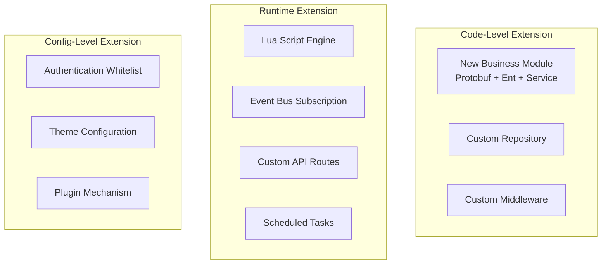
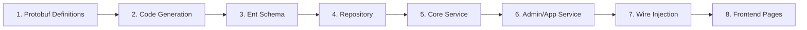
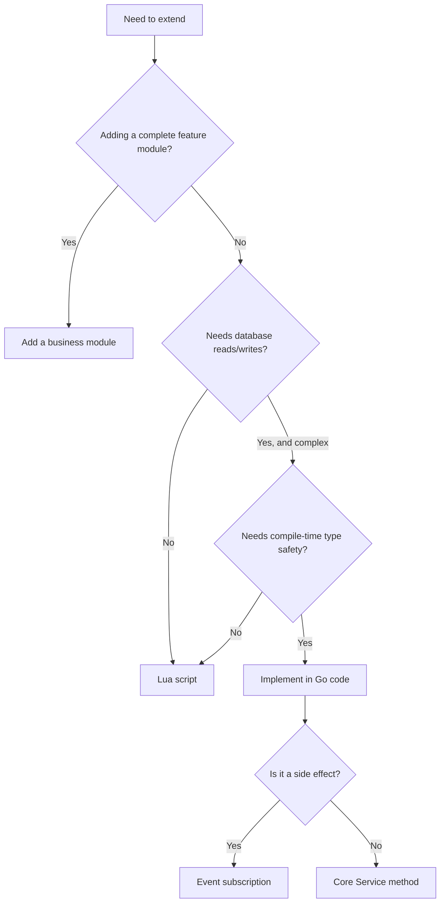

# Backend Extension Mechanisms Guide

GoWind CMS provides multiple backend extension approaches, allowing custom business logic without modifying core code. This document introduces all extension mechanisms and their applicable scenarios.

## 1. Extension Approaches Overview



## 2. Extension Approaches Compared

| Approach | Development Cost | Runtime Flexibility | Performance | Applicable Scenarios |
|------|---------|-----------|------|---------|
| New business module | High | No (requires compilation) | Best | Brand-new feature modules |
| Lua script | Low | Yes | Medium | Lightweight logic extensions |
| Event subscription | Low | Yes | High | Side-effect handling |
| Custom API | Medium | Yes | Medium | Aggregate endpoints/adapters |
| Scheduled tasks | Low | Yes | High | Periodic tasks |
| Middleware | Medium | No | High | Global request processing |

## 3. Adding a Business Module

For the complete module addition workflow, see [Full-Stack Practice: Adding a Content Type](./tutorial-new-content.md). Core steps:



## 4. Lua Script Extension

For details, see [Lua Script Extension in Practice](./tutorial-lua-extension.md).

### 4.1 Quick Example

```lua
-- Register a custom API
api.register("GET", "/app/v1/posts/popular", function(ctx)
    local posts = db.query("SELECT * FROM posts WHERE status = 1 ORDER BY view_count DESC LIMIT 10")
    return json.encode({ items = posts })
end)

-- Event subscription
eventbus.subscribe("post.published", function(event)
    log.info("Post published: " .. event.PostId)
end)
```

## 5. Event Bus Extension

For details, see [Event Bus Architecture](./tutorial-eventbus-architecture.md).

### 5.1 Go Subscription

```go
// Register a subscriber
bus.Subscribe("post.published", func(ctx context.Context, event interface{}) {
    e := event.(*eventbus.PostPublishedEvent)
    // Custom handling logic
})
```

### 5.2 Lua Subscription

```lua
eventbus.subscribe("post.published", function(event)
    -- Lua handling logic
end)
```

## 6. Custom Middleware

### 6.1 Middleware Example

```go
// pkg/middleware/tenant_context.go
func TenantContext() middleware.Middleware {
    return func(handler middleware.Handler) middleware.Handler {
        return func(ctx context.Context, req interface{}) (interface{}, error) {
            // Extract the tenant ID from the JWT
            tenantId := ctx.Value(middleware.TenantIDKey{}).(uint32)

            // Inject it into the context
            ctx = context.WithValue(ctx, entgo.TenantKey{}, tenantId)

            return handler(ctx, req)
        }
    }
}
```

### 6.2 Registering Middleware

```go
// app/admin/service/internal/server/rest_server.go
srv.Use(
    middleware.Logging(),
    middleware.Audit(),
    middleware.Auth(),           // JWT authentication
    middleware.TenantContext(),  // Tenant context
    middleware.Authz(authorizer),// Permission verification
)
```

## 7. Scheduled Task Extension

### 7.1 Asynq Scheduled Tasks

```go
// app/core/service/internal/server/asynq_server.go
func RegisterScheduledTasks(scheduler *asynq.Scheduler) {
    scheduler.Register("0 3 * * *", asynq.NewTask(
        task.TypeCleanupExpiredData,
        jsonMustMarshal(task.CleanupExpiredDataPayload{
            EntityType: "posts",
            OlderThan:  time.Now().AddDate(0, 0, -30).Unix(),
        }),
    ))
}
```

### 7.2 Lua Scheduled Tasks

```lua
cron.register("0 2 * * *", function()
    -- Daily data statistics
    local stats = db.query("SELECT ...")
    redis.set("daily:stats", json.encode(stats))
end)
```

## 8. Extension Best Practices

### 8.1 Choosing an Extension Approach



### 8.2 Extension Security

| Rule | Description |
|------|------|
| Lua sandbox | Restricts file system/network access |
| Event isolation | Subscriber panics do not affect the main flow |
| Permission checks | Extension APIs require authentication |

## 9. Related Documentation

- [Full-Stack Practice: Adding a Content Type](./tutorial-new-content.md)
- [Lua Script Extension in Practice](./tutorial-lua-extension.md)
- [Event Bus Architecture](./tutorial-eventbus-architecture.md)
- [GoWind Admin Backend Extension Mechanisms](/en/admin/backend-extension.md)
