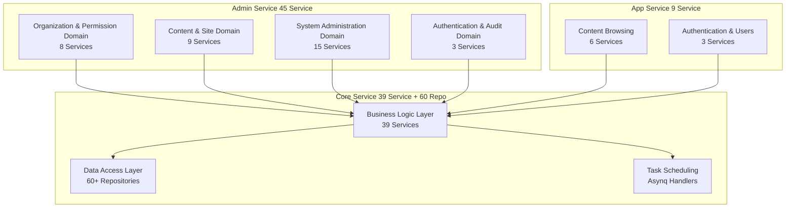
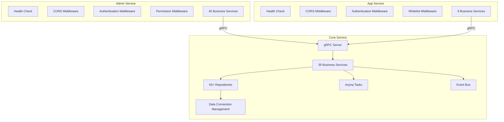

# CMS Backend Modules Overview

The GoWind CMS backend consists of three services with 80+ Services and 60+ Repositories in total. This document organizes all modules by functional domain, covering responsibilities, directory locations, and API routes.

## 1. Services and Modules Overview



## 2. Organization and Permission Domain

### Admin Service Interfaces

| Service | Route | Description |
|---------|------|------|
| UserService | `/admin/v1/users` | User management CRUD |
| RoleService | `/admin/v1/roles` | Role management |
| TenantService | `/admin/v1/tenants` | Tenant management |
| OrgUnitService | `/admin/v1/org-units` | Department management |
| PositionService | `/admin/v1/positions` | Position management |
| PermissionService | `/admin/v1/permissions` | Permission management |
| MenuService | `/admin/v1/menus` | Menu management |
| ApiService | `/admin/v1/apis` | API endpoint management |

### Core Service Business Logic

| Service | Directory | Description |
|---------|------|------|
| UserService | `service/user_service.go` | User business logic + password verification |
| RoleService | `service/role_service.go` | Roles + permission assignment |
| TenantService | `service/tenant_service.go` | Tenant initialization + plans |
| OrgUnitService | `service/org_unit_service.go` | Department tree management |
| PermissionService | `service/permission_service.go` | Permission verification |
| MenuService | `service/menu_service.go` | Menu tree + permission filtering |

### Data Repositories

| Repository | Description |
|------------|------|
| `user_repo.go` | User repository |
| `user_role_repo.go` | User-role association |
| `role_repo.go` | Role repository |
| `tenant_repo.go` | Tenant repository |
| `membership_repo.go` | Tenant membership |
| `org_unit_repo.go` | Department repository |
| `permission_repo.go` | Permission repository |
| `menu_repo.go` | Menu repository |

## 3. Content and Site Domain

### Admin Service Interfaces

| Service | Route | Description |
|---------|------|------|
| PostService | `/admin/v1/posts` | Post management + publishing workflow |
| CategoryService | `/admin/v1/categories` | Category tree management |
| TagService | `/admin/v1/tags` | Tag management |
| CommentService | `/admin/v1/comments` | Comment moderation |
| PageService | `/admin/v1/pages` | Page management |
| SiteService | `/admin/v1/sites` | Site management |
| SiteSettingService | `/admin/v1/site-settings` | Site settings |
| NavigationService | `/admin/v1/navigations` | Navigation management |
| MediaAssetService | `/admin/v1/media-assets` | Media asset management |

### App Service Interfaces (Lean Edition)

| Service | Route | Description |
|---------|------|------|
| PostService | `/app/v1/posts` | Post browsing + user posting |
| CategoryService | `/app/v1/categories` | Category browsing |
| TagService | `/app/v1/tags` | Tag browsing |
| CommentService | `/app/v1/comments` | Comment browsing + posting |
| PageService | `/app/v1/pages` | Page display |
| NavigationService | `/app/v1/navigations` | Navigation retrieval |

### Data Repositories

| Repository | Description |
|------------|------|
| `post_repo.go` | Post repository (with pagination, sorting, translation associations) |
| `post_translation_repo.go` | Post multilingual translations |
| `category_repo.go` | Category repository (tree structure) |
| `category_translation_repo.go` | Category translations |
| `tag_repo.go` | Tag repository |
| `tag_translation_repo.go` | Tag translations |
| `comment_repo.go` | Comment repository (with threaded replies) |
| `page_repo.go` | Page repository |
| `page_translations_repo.go` | Page translations |
| `site_repo.go` | Site repository |
| `site_setting_repo.go` | Site settings |
| `navigation_repo.go` | Navigation repository |
| `media_asset_repo.go` | Media asset repository |

## 4. System Administration Domain

### Admin Service Interfaces

| Service | Route | Description |
|---------|------|------|
| DictTypeService | `/admin/v1/dict-types` | Dictionary types |
| DictEntryService | `/admin/v1/dict-entries` | Dictionary entries |
| TaskService | `/admin/v1/tasks` | Task scheduling management |
| FileService | `/admin/v1/files` | File management |
| FileTransferService | `/admin/v1/files/transfer` | File transfer |
| LanguageService | `/admin/v1/languages` | Language management |
| TranslatorService | `/admin/v1/translators` | Translation management |
| InternalMessageService | `/admin/v1/internal-messages` | Internal messages |
| CacheService | `/admin/v1/caches` | Cache management |

### Logs and Audit

| Service | Route | Description |
|---------|------|------|
| LoginLogService | `/admin/v1/login-logs` | Login logs |
| OperationLogService | `/admin/v1/operation-logs` | Operation logs |
| ApiAuditLogService | `/admin/v1/api-audit-logs` | API audit logs |

## 5. Authentication Domain

| Service | Route | Description |
|---------|------|------|
| AdminAuthService | `/admin/v1/login`, `/admin/v1/logout` | Admin console authentication |
| AppAuthService | `/app/v1/login`, `/app/v1/register` | Frontend authentication |
| UserProfileService | `/app/v1/user-profile` | Frontend user profile |

## 6. Core Service in Detail

### 6.1 Service Layer

The Core Service is the business logic core, invoked via gRPC by the Admin/App Services:

```go
// The Core Service gRPC server registers all business Services
func NewGRPCServer(
    postSvc *service.PostService,
    userSvc *service.UserService,
    commentSvc *service.CommentService,
    // ... 39 Services
) *grpc.Server {
    srv := grpc.NewServer(...)
    contentV1.RegisterPostServiceServer(srv, postSvc)
    identityV1.RegisterUserServiceServer(srv, userSvc)
    // ...
    return srv
}
```

### 6.2 Data Access Layer

```go
// Core Service Data Provider
var ProviderSet = wire.NewSet(
    NewData,                    // Database connection management
    // 60+ Repositories
    data.NewPostRepo,
    data.NewPostTranslationRepo,
    data.NewUserRepo,
    data.NewCommentRepo,
    data.NewSiteRepo,
    data.NewNavigationRepo,
    data.NewMediaAssetRepo,
    // ...
)
```

### 6.3 Task Scheduling

| Handler | Task Type | Description |
|---------|---------|------|
| HandleIndexPost | `post:index` | Content index synchronization |
| HandlePublishPost | `post:publish` | Scheduled publishing |
| HandleSendNotification | `notification:send` | Notification push |
| HandleCleanupExpiredData | `cleanup:expired_data` | Data cleanup |
| HandleSyncTranslations | `translation:sync` | Translation synchronization |
| HandleUpdateViewCount | `stats:update_view_count` | View count updates |

## 7. Module Dependency Diagram



## 8. Related Documentation

- [CMS Backend Architecture Overview](./backend-architecture.md)
- [CMS Protobuf API Definitions](./backend-api.md)
- [Configuration and Deployment Guide](./backend-config-deploy.md)
- [CMS Frontend Modules Overview](./frontend-modules.md)
