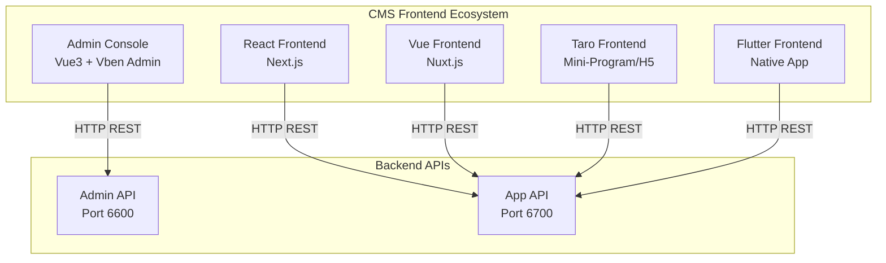
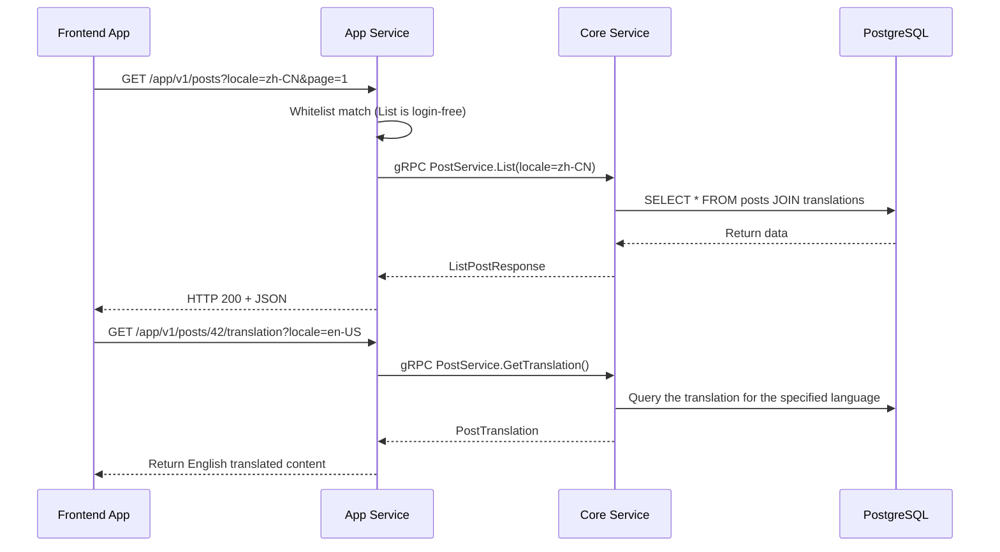

# CMS Frontend Architecture

The GoWind CMS frontend consists of **1 admin console + 4 frontend applications**. The admin console is based on Vue Vben Admin and shares the technical foundation with GoWind Admin; the four frontends use different tech stacks to consume the same Headless App API, achieving true "one backend, multiple clients".

## 1. Frontend Panorama



## 2. Admin Console

### Tech Stack

| Technology | Version | Description |
|------|------|------|
| Vue 3 | 3.x | Composition API |
| Vben Admin | latest | Enterprise admin framework |
| Ant Design Vue | 4.x | UI component library |
| Vue Query | latest | Server state management |
| Pinia | 2.x | Client state management |
| Vite | 5.x | Build tool |
| TypeScript | 5.x | Type safety |

### Directory Structure

```
frontend/admin/
├── apps/
│   └── admin/                  # CMS admin console app
│       ├── src/
│       │   ├── api/            # API layer
│       │   │   ├── client.ts   # ApiClient singleton
│       │   │   ├── index.ts    # Unified exports
│       │   │   ├── composables/ # Vue Query hooks
│       │   │   └── generated/  # Protobuf auto-generated code
│       │   ├── views/          # Page views
│       │   │   ├── content/    # Content management (posts/categories/tags/pages)
│       │   │   ├── site/       # Site management
│       │   │   ├── media/      # Media resources
│       │   │   ├── system/     # System administration (users/roles/permissions/dictionaries)
│       │   │   └── ...         # Other modules
│       │   ├── router/         # Router configuration
│       │   ├── store/          # Pinia state management
│       │   └── locales/        # i18n
│       └── ...
├── packages/                   # Monorepo shared packages
│   ├── @core/                  # Core utilities
│   ├── effects/                # Common effects
│   ├── preferences/            # Preferences
│   └── types/                  # Type definitions
├── pnpm-workspace.yaml
└── turbo.json
```

### API Calling Pattern

The admin console uses the same **Vue Query hooks** pattern as GoWind Admin:

```typescript
// api/composables/post.ts
import { apiClient } from '#/api/client';
import { makeUpdateMask, type PaginationQuery } from '#/transport/rest';

// List query hook
export function useListPosts(query: PaginationQuery) {
  return useQuery({
    queryKey: ['listPosts', query],
    queryFn: () => apiClient.postService.List(query.toRawParams()),
  });
}

// Create mutation
export function useCreatePost() {
  const queryClient = useQueryClient();
  return useMutation({
    mutationFn: (data: Post) => apiClient.postService.Create({ data }),
    onSuccess: () => queryClient.invalidateQueries({ queryKey: ['listPosts'] }),
  });
}
```

### Core Feature Modules

| Module | Directory | Description |
|------|------|------|
| Post management | `views/content/post/` | Post CRUD + translation editing + section/block editor |
| Category management | `views/content/category/` | Category tree + translations |
| Tag management | `views/content/tag/` | Tag CRUD + translations |
| Page management | `views/content/page/` | Custom pages + translations |
| Site management | `views/site/` | Multi-site configuration |
| Media resources | `views/media/` | Image/video/document management |
| System administration | `views/system/` | Users/roles/permissions/dictionaries |

## 3. Comparison of the Four Frontends

### Tech Stack Comparison

| Aspect | React (Next.js) | Vue (Nuxt.js) | Taro | Flutter |
|--------|-----------------|---------------|------|---------|
| Language | TypeScript | TypeScript | TypeScript | Dart |
| Framework | Next.js | Nuxt.js | Taro 4 | Flutter |
| UI library | shadcn/ui | — | Taro UI | Material |
| Rendering | SSR + SSG | SSR | CSR | Native rendering |
| State management | Zustand / Context | Pinia | Taro state | BLoC / Cubit |
| Routing | App Router | Nuxt Router | Taro Router | go_router |
| API generation | OpenAPI Generator | OpenAPI Generator | OpenAPI Generator | swagger_parser + retrofit |
| i18n | next-intl | @nuxtjs/i18n | Taro i18n | flutter_localizations |
| Target platforms | PC Web | PC Web | Mini-Program + H5 | Android/iOS/Web/Desktop |

### Applicable Scenarios

| Scenario | Recommended Version | Reason |
|------|---------|------|
| Corporate website / blog | React (Next.js) | SSR benefits SEO; rich ecosystem |
| Rapid prototyping | Vue (Nuxt.js) | Great developer experience; convention over configuration |
| WeChat Mini-Program | Taro | One codebase, multiple clients |
| Native mobile app | Flutter | True native experience, cross-platform |

## 4. React Frontend in Detail (Next.js)

### Directory Structure

```
frontend/app/react/
├── src/
│   ├── app/                    # Next.js App Router
│   │   ├── [locale]/           # i18n routes (/zh-CN, /en-US)
│   │   │   ├── page.tsx        # Home page
│   │   │   ├── posts/          # Post list + detail
│   │   │   ├── categories/     # Category list
│   │   │   ├── tags/           # Tag list
│   │   │   ├── about/          # About page
│   │   │   └── settings/       # Settings
│   │   └── layout.tsx          # Root layout
│   ├── components/             # React components
│   ├── lib/                    # Utility libraries
│   │   └── api/                # API client
│   ├── messages/               # i18n message files
│   │   ├── zh-CN.json
│   │   └── en-US.json
│   └── stores/                 # Zustand state management
├── messages/                   # Global i18n
├── .env.development            # Development environment variables
├── next.config.ts              # Next.js configuration
└── package.json
```

### Environment Configuration

```bash
# .env.development
NEXT_PUBLIC_API_BASE_URL=http://localhost:6700/app/v1
NEXT_PUBLIC_DEFAULT_LOCALE=zh-CN
```

### API Calling Example

```typescript
// src/lib/api/post.ts
import { apiClient } from './client';

export async function getPosts(locale: string, page = 1, pageSize = 10) {
  const { data } = await apiClient.get('/posts', {
    params: { locale, page, pageSize },
  });
  return data;
}

export async function getPostBySlug(slug: string, locale: string) {
  const { data } = await apiClient.get(`/posts/${slug}`, {
    params: { locale },
  });
  return data;
}
```

### Page Component Example

```tsx
// src/app/[locale]/posts/[slug]/page.tsx
export default async function PostDetail({
  params: { locale, slug },
}: {
  params: { locale: string; slug: string };
}) {
  const post = await getPostBySlug(slug, locale);

  return (
    <article>
      <h1>{post.title}</h1>
      <div>{post.summary}</div>
      <div dangerouslySetInnerHTML={{ __html: post.content }} />
    </article>
  );
}
```

## 5. Flutter Frontend in Detail

The Flutter version has the most polished architecture design and is worth referencing for all versions.

### Architecture: Feature-First + BLoC

```
frontend/app/flutter_app/lib/
├── core/                       # Core layer
│   ├── constants/              # Constants
│   ├── network/                # Network layer (dio + retrofit)
│   ├── storage/                # Local storage (sqflite)
│   ├── router/                 # Router configuration (go_router)
│   ├── theme/                  # Theme (light/dark)
│   └── l10n/                   # i18n
├── features/                   # Feature modules (Feature-First)
│   ├── home/                   # Home
│   │   ├── data/               # Data layer (API + Model)
│   │   ├── domain/             # Domain layer (Repository + Entity)
│   │   └── presentation/       # Presentation layer (BLoC + Widget)
│   ├── explore/                # Explore
│   ├── post_detail/            # Post detail
│   ├── post_list/              # Post list
│   ├── category/               # Categories
│   ├── tag/                    # Tags
│   ├── search/                 # Search
│   ├── bookmark/               # Bookmarks
│   ├── profile/                # Profile
│   └── settings/               # Settings
└── main.dart                   # App entry point
```

### BLoC State Management

```dart
// features/post_detail/presentation/bloc/post_detail_bloc.dart
class PostDetailBloc extends Bloc<PostDetailEvent, PostDetailState> {
  final PostRepository repository;

  PostDetailBloc(this.repository) : super(PostDetailInitial()) {
    on<FetchPostDetail>(_onFetchPostDetail);
  }

  Future<void> _onFetchPostDetail(
    FetchPostDetail event,
    Emitter<PostDetailState> emit,
  ) async {
    emit(PostDetailLoading());
    try {
      final post = await repository.getPost(
        id: event.postId,
        locale: event.locale,
      );
      emit(PostDetailLoaded(post));
    } catch (e) {
      emit(PostDetailError(e.toString()));
    }
  }
}
```

### Retrofit API Generation

The Flutter version auto-generates the API client from the OpenAPI documents via `swagger_parser`:

```dart
// Auto-generated API client
@RestApi(baseUrl: '/app/v1')
abstract class PostApi {
  factory PostApi(Dio dio, {String baseUrl}) = _PostApi;

  @GET('/posts')
  Future<ListPostResponse> listPosts({
    @Query('locale') String? locale,
    @Query('page') int? page,
    @Query('pageSize') int? pageSize,
  });

  @GET('/posts/{id}')
  Future<Post> getPost(
    @Path('id') int id, {
    @Query('locale') String? locale,
  });
}
```

## 6. Frontend API Integration

All four frontends consume the same App API and follow the same calling conventions:

### Unified API Calling Conventions



### Pagination Parameters

All list endpoints use the unified pagination protocol:

```http
GET /app/v1/posts?page=1&pageSize=10&orderBy=createdAt&orderDesc=true&search=keyword
```

### Multilingual Handling

Frontends specify the language via the `locale` parameter or the URL path:

| Method | Example | Applicable Scenario |
|------|------|---------|
| Query parameter | `/posts?locale=zh-CN` | API calls |
| URL path | `/zh-CN/posts/hello-world` | React/Vue frontend routes |
| Header | `Accept-Language: en-US` | Taro / Flutter |

## 7. i18n Architecture

### Admin Console

The admin console uses the built-in i18n system of Vben Admin, supporting Chinese and English:

```
src/locales/
├── zh-CN/          # Chinese
│   ├── content.json
│   ├── site.json
│   └── system.json
└── en-US/          # English
    ├── content.json
    ├── site.json
    └── system.json
```

### Frontend Applications

| Version | i18n Solution | Message File Location |
|------|----------|-------------|
| React | `next-intl` | `src/messages/zh-CN.json`, `en-US.json` |
| Vue | `@nuxtjs/i18n` | `locales/zh-CN.json`, `en-US.json` |
| Taro | Taro i18n | `src/i18n/zh-CN.ts`, `en-US.ts` |
| Flutter | flutter_localizations | `lib/l10n/app_zh.arb`, `app_en.arb` |

## 8. Reuse Relationship with the GoWind Admin Frontend

The admin console frontend reuses GoWind Admin heavily:

| Shared Parts | Description |
|---------|------|
| Monorepo architecture | Also uses pnpm workspace + turbo |
| Vben Admin framework | Fully shared |
| API layer architecture | Vue Query hooks pattern |
| System administration modules | Users/roles/permissions/dictionaries/menus etc. fully reused |
| Theme and i18n | Shared light/dark themes, i18n |

| CMS-Specific Parts | Description |
|-------------|------|
| Content management modules | Posts/categories/tags/pages (unique to the Admin) |
| Site management modules | Multi-site/navigation/site settings |
| Media resource modules | Image/video/document management |
| Section/block editor | SectionType-based content building |

## 9. Related Documentation

- [CMS Backend Architecture Overview](./backend-architecture.md)
- [CMS Protobuf API Definitions](./backend-api.md)
- [Frontend Application Development in Practice](./tutorial-frontend-app.md)
- [Headless API Multi-Client Integration in Practice](./tutorial-headless-api.md)
- [GoWind Admin Frontend Architecture](/en/admin/frontend-architecture.md) — shared admin console foundation
