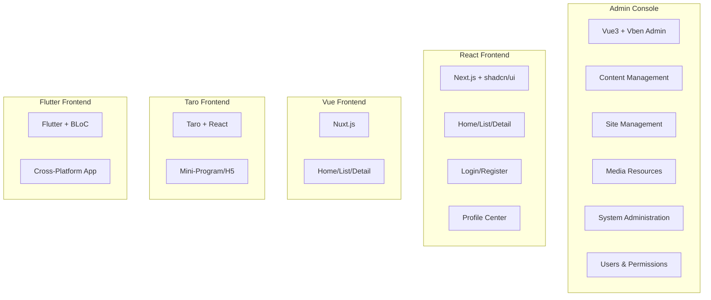

# CMS Frontend Modules Overview

The GoWind CMS frontend consists of 1 admin console + 4 frontend applications. This document organizes the responsibilities, tech stacks, and directory structures of all frontend modules.

## 1. Frontend Panorama



## 2. Admin Console Modules

### 2.1 Tech Stack

| Technology | Description |
|------|------|
| Vue 3 + TypeScript | Core framework |
| Vben Admin (Monorepo) | Admin framework |
| Ant Design Vue 4 | UI component library |
| Vue Query (TanStack Query) | Data fetching and caching |
| Pinia | State management |
| Vite 5 | Build tool |

### 2.2 Feature Modules

| Module | Directory | Features |
|------|------|------|
| **Content Management** | `views/content/` | |
| - Post management | `views/content/post/` | Post CRUD + section/block editor + translations |
| - Category management | `views/content/category/` | Category tree + translations |
| - Tag management | `views/content/tag/` | Tags + translations |
| - Page management | `views/content/page/` | Custom pages |
| - Comment management | `views/content/comment/` | Comment moderation + replies |
| **Site Management** | `views/site/` | |
| - Site list | `views/site/list/` | Multi-site CRUD |
| - Site settings | `views/site/setting/` | SEO / upload / cache |
| - Navigation management | `views/site/navigation/` | Navigation bars + items |
| **Media Resources** | `views/media/` | Media library + image picker |
| **System Administration** | `views/system/` | |
| - User management | `views/system/user/` | User CRUD + login-as |
| - Role management | `views/system/role/` | Roles + permission assignment |
| - Permission management | `views/system/permission/` | Permission points + menus |
| - Department management | `views/system/dept/` | Department tree |
| - Dictionary management | `views/system/dict/` | Dictionary types + entries |
| - Task scheduling | `views/system/task/` | Scheduled tasks + logs |
| - Cache management | `views/system/cache/` | Cache query + cleanup |
| - API management | `views/system/api/` | API sync + tree view |
| **Logs and Audit** | `views/log/` | Login logs / operation logs / API audit |
| **Profile Center** | `views/profile/` | Profile / avatar / password / login history |
| **i18n** | `views/i18n/` | Language management + translation editing |

### 2.3 API Layer

```
src/api/
├── client.ts                    # ApiClient singleton
├── index.ts                     # Unified exports
├── composables/                 # Vue Query Hooks
│   ├── post.ts                  # Post-related hooks
│   ├── category.ts
│   ├── tag.ts
│   ├── comment.ts
│   ├── user.ts
│   ├── site.ts
│   ├── media.ts
│   └── ...
├── generated/                   # Protobuf auto-generated
└── types.ts                     # Type definitions
```

### 2.4 Core Components

| Component | Description |
|------|------|
| `SectionEditor` | Section-based content editor |
| `RichTextEditor` | TipTap rich text |
| `MediaPicker` | Image picker |
| `TranslationTabs` | Multilingual translation editing |
| `CategoryTree` | Category tree component |
| `AccessControl` | Button-level permission control |

## 3. React Frontend (Next.js)

### 3.1 Feature Modules

| Page | Route | Description |
|------|------|------|
| Home | `/[locale]` | Latest posts list |
| Post list | `/[locale]/posts` | Paginated posts |
| Post detail | `/[locale]/posts/[slug]` | SSR rendering + comments |
| Categories | `/[locale]/categories/[slug]` | Posts by category |
| Tags | `/[locale]/tags/[slug]` | Posts by tag |
| Search | `/[locale]/search` | Full-text search |
| About | `/[locale]/about` | About page |
| Login | `/[locale]/login` | User login |
| Register | `/[locale]/register` | User registration |
| Profile center | `/[locale]/profile` | Profile editing |

### 3.2 Components

| Component | Description |
|------|------|
| `PostCard` | Post card |
| `SectionRenderer` | Section content rendering |
| `CommentSection` | Comment area |
| `SearchBar` | Search bar + suggestion dropdown |
| `LanguageSwitcher` | Language switcher |
| `NotificationBell` | Notification badge |
| `SSEProvider` | SSE connection management |

## 4. Vue Frontend (Nuxt.js)

| Page | Route | Description |
|------|------|------|
| Home | `/` | Latest content |
| Posts | `/posts/[slug]` | Post detail |
| Categories | `/categories/[slug]` | Posts by category |
| About | `/about` | About page |

## 5. Taro Frontend (Mini-Program/H5)

| Page | Route | Description |
|------|------|------|
| Home | `pages/index/index` | Tab page |
| Post list | `pages/posts/index` | Post list |
| Post detail | `pages/posts/detail` | Post detail |
| Categories | `pages/category/index` | Tab page |
| Profile center | `pages/profile/index` | Tab page |

## 6. Flutter Frontend

### 6.1 Feature-First Architecture

| Feature | Description |
|---------|------|
| `home` | Home + recommended content |
| `explore` | Explore + search |
| `post_detail` | Post detail + comments |
| `post_list` | Post list |
| `category` | Category browsing |
| `tag` | Tag browsing |
| `search` | Search functionality |
| `bookmark` | Saved bookmarks |
| `profile` | User profile |
| `settings` | App settings |

### 6.2 Three Layers per Feature

```
features/home/
├── data/           # Data layer (API + Model)
├── domain/         # Domain layer (Repository + Entity)
└── presentation/   # Presentation layer (BLoC + Widget)
```

## 7. Shared Conventions

### 7.1 Unified API Calling

| Convention | Description |
|------|------|
| Pagination parameters | `page` / `pageSize` / `orderBy` / `orderDesc` |
| Language parameter | `locale` query parameter |
| Authentication header | `Authorization: Bearer {token}` |
| Error format | `{ code, reason, message }` |

### 7.2 i18n

| Version | Solution | Message Files |
|------|------|---------|
| Admin console | Vben i18n | `src/locales/zh-CN/*.json` |
| React | next-intl | `src/messages/*.json` |
| Vue | @nuxtjs/i18n | `locales/*.json` |
| Taro | Taro i18n | `src/i18n/*.ts` |
| Flutter | flutter_localizations | `lib/l10n/app_*.arb` |

## 8. Related Documentation

- [CMS Frontend Architecture](./frontend-architecture.md)
- [Frontend Application Development in Practice](./tutorial-frontend-app.md)
- [Section/Block Editor in Practice](./tutorial-section-editor.md)
- [CMS Backend Modules Overview](./backend-modules.md)
