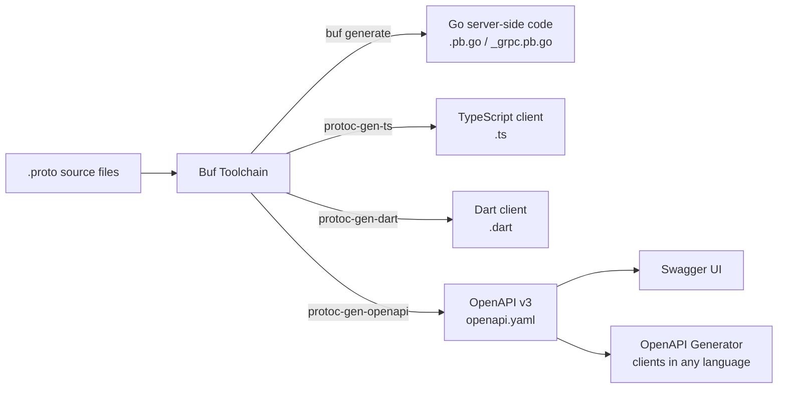
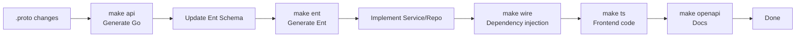

# Multi-Client API Client Code Generation Tutorial

GoWind CMS adopts the Protobuf First development model and auto-generates API client code for multiple clients through the Buf toolchain. This tutorial explains how to generate API clients for the admin console (TypeScript) and the frontend applications (TypeScript/Dart).

## Prerequisites

- Have read [CMS Protobuf API Definitions](./backend-api.md)
- Understand basic Protobuf / Buf concepts

## 1. Code Generation Architecture

### 1.1 Generation Flow



### 1.2 Purpose of Generated Code

| Output | Language | Directory | Purpose |
|------|------|------|------|
| Go code | Go | `api/gen/go/` | Backend server |
| TypeScript | TS | `api/gen/ts/admin/` | Admin console frontend |
| TypeScript | TS | `api/gen/ts/app/` | React/Vue frontends |
| Dart | Dart | `api/gen/dart/` | Flutter frontend |
| OpenAPI | YAML | `api/gen/openapi/` | API docs + code generation |

## 2. Buf Configuration

### 2.1 buf.gen.yaml

```yaml
# buf.gen.yaml - Go code generation
version: v1
plugins:
  - plugin: go
    out: api/gen/go
    opt: paths=source_relative

  - plugin: go-grpc
    out: api/gen/go
    opt:
      - paths=source_relative
      - require_unimplemented_servers=false

  - plugin: go-http
    out: api/gen/go
    opt: paths=source_relative
```

### 2.2 TypeScript Code Generation

```yaml
# buf.gen.ts.yaml
version: v1
plugins:
  - plugin: ts
    out: api/gen/ts/admin
    opt:
      - paths=source_relative
      - target=admin
    path: protoc-gen-ts

  - plugin: ts
    out: api/gen/ts/app
    opt:
      - paths=source_relative
      - target=app
    path: protoc-gen-ts
```

### 2.3 OpenAPI Generation

```yaml
# buf.gen.openapi.yaml
version: v1
plugins:
  - plugin: openapiv2
    out: api/gen/openapi
    opt:
      - logtostderr=true
      - simple_operation_ids=true
```

### 2.4 Dart Code Generation

```yaml
# buf.gen.dart.yaml
version: v1
plugins:
  - plugin: dart
    out: api/gen/dart
```

## 3. Generation Commands

### 3.1 Makefile

```makefile
# Generate all code (Go + TS + Dart + OpenAPI)
gen: api ent wire ts openapi dart

# Go Protobuf code
api:
	buf generate

# TypeScript code
ts:
	buf generate --template buf.gen.ts.yaml

# OpenAPI documents
openapi:
	buf generate --template buf.gen.openapi.yaml

# Dart code
dart:
	buf generate --template buf.gen.dart.yaml

# Ent ORM code
ent:
	go generate ./app/core/service/internal/data/ent

# Wire dependency injection
wire:
	cd app/core/service/cmd/server && wire
	cd app/admin/service/cmd/server && wire
	cd app/app/service/cmd/server && wire
```

### 3.2 Execution

```bash
cd backend

# Generate everything at once
make gen

# Generate TypeScript only
make ts

# Generate OpenAPI only
make openapi
```

## 4. TypeScript Client

### 4.1 Generated API Client

The generated TypeScript code provides type-safe API calls:

```typescript
// api/gen/ts/admin/service/v1/PostService.ts (auto-generated)
export class PostServiceClient {
  async List(params: PagingRequest): Promise<ListPostResponse> {
    return httpClient.get('/admin/v1/posts', { params });
  }

  async Get(id: number, locale?: string): Promise<Post> {
    return httpClient.get(`/admin/v1/posts/${id}`, { params: { locale } });
  }

  async Create(data: CreatePostRequest): Promise<Post> {
    return httpClient.post('/admin/v1/posts', { data });
  }

  async Update(id: number, data: UpdatePostRequest): Promise<Post> {
    return httpClient.put(`/admin/v1/posts/${id}`, { data });
  }

  async Delete(id: number): Promise<void> {
    return httpClient.delete(`/admin/v1/posts/${id}`);
  }
}
```

### 4.2 Usage in the Admin Console

```typescript
// frontend/admin/src/api/client.ts
import { PostServiceClient } from '@/api/generated';

export const apiClient = {
  postService: new PostServiceClient(),
  categoryService: new CategoryServiceClient(),
  // ... other Services
};
```

### 4.3 Vue Query Wrappers

```typescript
// frontend/admin/src/api/composables/post.ts
export function useListPosts(query: Ref<PaginationQuery>) {
  return useQuery({
    queryKey: ['listPosts', query],
    queryFn: () => apiClient.postService.List(query.value.toRawParams()),
  });
}
```

## 5. Flutter Client Generation

### 5.1 The swagger_parser Approach

For Flutter, `swagger_parser` is recommended to generate Dart code from the OpenAPI documents:

```yaml
# flutter_app/build.yaml
targets:
  $default:
    builders:
      swagger_parser:
        options:
          output_dir: 'lib/core/network/generated'
          input_path: '../../../backend/api/gen/openapi/admin.swagger.json'
          api_base_url: 'http://localhost:6700/app/v1'
          use_path_for_request: true
```

```shell
# Generate the Dart API client
cd frontend/app/flutter_app
dart run build_runner build
```

### 5.2 Generated Retrofit API

```dart
// lib/core/network/generated/api/post_api.dart (auto-generated)
@RestApi(baseUrl: '/app/v1')
abstract class PostApi {
  factory PostApi(Dio dio, {String? baseUrl}) = _PostApi;

  @GET('/posts')
  Future<ListPostResponse> listPosts({
    @Query('locale') String? locale,
    @Query('page') int? page,
    @Query('pageSize') int? pageSize,
  });

  @GET('/posts/{id}')
  Future<Post> getPost(
    @Path('id') int id, {
    @Query('locale') String? locale,
  });
}
```

### 5.3 Repository Wrappers

```dart
// features/post_detail/domain/repository/post_repository.dart
class PostRepositoryImpl implements PostRepository {
  final PostApi _api;

  PostRepositoryImpl(this._api);

  @override
  Future<Post> getPost({required int id, required String locale}) async {
    return await _api.getPost(id, locale: locale);
  }

  @override
  Future<ListPostResponse> getPosts({
    required String locale,
    int page = 1,
    int pageSize = 10,
  }) async {
    return await _api.listPosts(
      locale: locale,
      page: page,
      pageSize: pageSize,
    );
  }
}
```

## 6. OpenAPI Documents

### 6.1 Accessing Swagger UI

All three services have built-in Swagger documentation:

```bash
# Admin API Swagger
http://localhost:6600/docs/

# App API Swagger
http://localhost:6700/docs/
```

### 6.2 Generating Other Languages from OpenAPI

```shell
# Generate a Python client
openapi-generator-cli generate \
  -i http://localhost:6700/docs/openapi.yaml \
  -g python \
  -o ./clients/python

# Generate a Java client
openapi-generator-cli generate \
  -i http://localhost:6700/docs/openapi.yaml \
  -g java \
  -o ./clients/java
```

## 7. Development Workflow

### 7.1 API Change Flow



### 7.2 Example of Adding an Endpoint

```protobuf
// 1. Update the proto
// admin/service/v1/i_post.proto
service PostService {
  // ... existing endpoints

  // New: fetch featured posts
  rpc GetFeatured(GetFeaturedRequest) returns (ListPostResponse) {
    option (google.api.http) = { get: "/admin/v1/posts/featured" };
  }
}

message GetFeaturedRequest {
  optional string locale = 1;
  optional uint32 limit = 2;
}
```

```bash
# 2. Generate the code
make api    # Go code
make ts     # TypeScript code
make openapi  # OpenAPI documents

# 3. Implement the Service
# 4. The frontend directly uses the generated API client
```

## 8. Checklist

| Item | Description |
|--------|------|
| buf configuration | buf.gen.yaml / buf.gen.ts.yaml / buf.gen.openapi.yaml |
| Go code generation | make api |
| TS code generation | make ts |
| Dart code generation | swagger_parser |
| OpenAPI documents | make openapi + Swagger UI |
| API client | The frontend uses the generated type-safe client |
| Development flow | proto → gen → implement |

## Related Documentation

- [CMS Protobuf API Definitions](./backend-api.md)
- [CMS Backend Architecture Overview](./backend-architecture.md)
- [Headless API Multi-Client Integration in Practice](./tutorial-headless-api.md)
- [Frontend Application Development in Practice](./tutorial-frontend-app.md)
