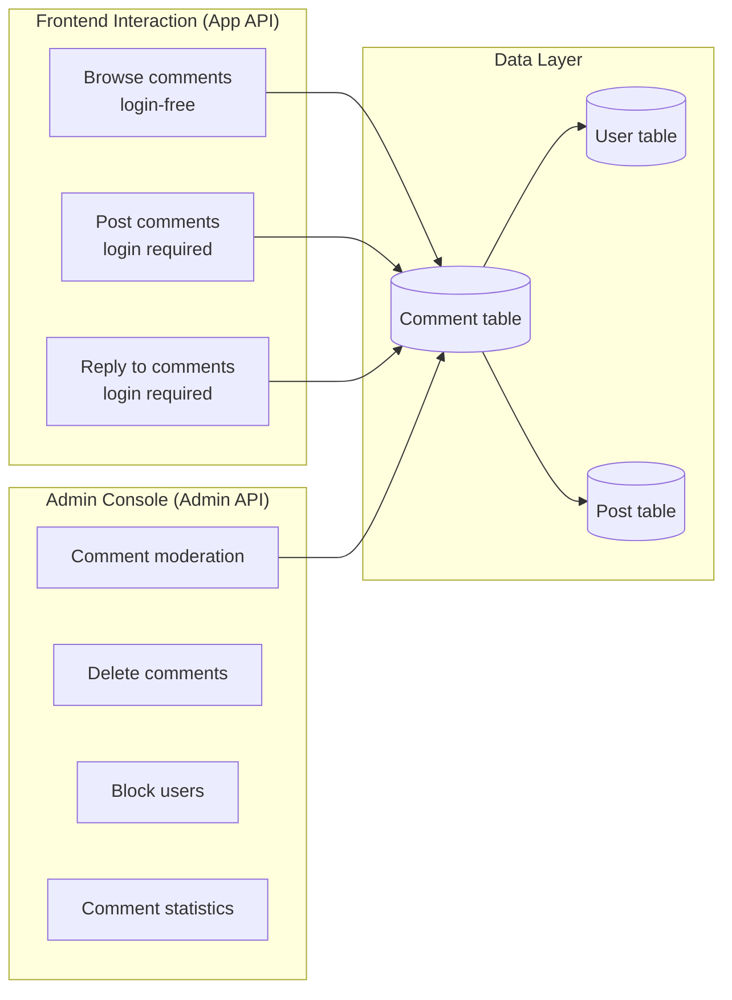
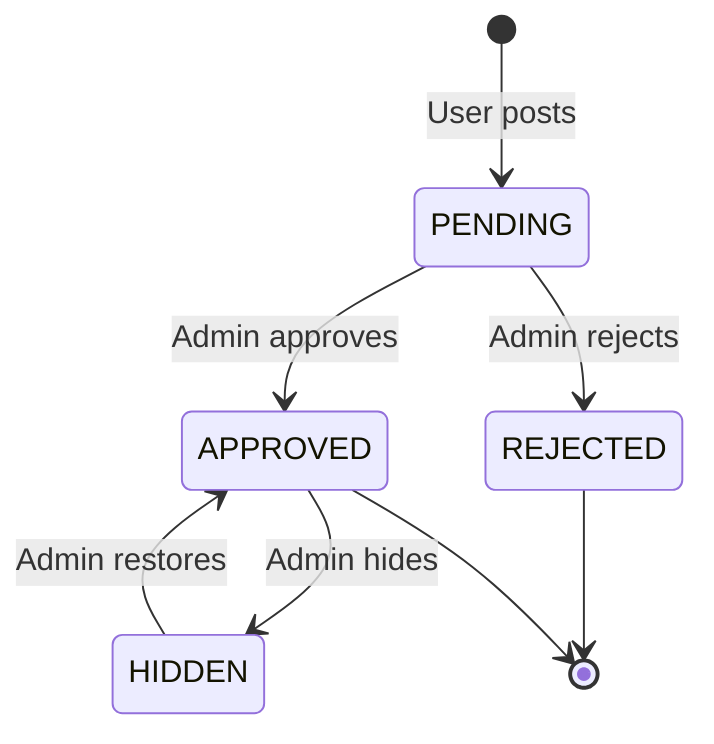

# Comment System Tutorial

GoWind CMS ships with a complete comment system supporting comment moderation, threaded replies, blocking, and management. This tutorial covers the architecture design, data model, and the full implementation of frontend interaction and admin console moderation.

## Prerequisites

- Have read [CMS Backend Architecture Overview](./backend-architecture.md)
- Understand the App API whitelist mechanism (see [Headless API Multi-Client Integration in Practice](./tutorial-headless-api.md))

## 1. Comment System Architecture

### 1.1 Feature Overview



### 1.2 Comment Status Flow



| Status | Visible on Frontend | Visible in Admin | Description |
|------|---------|---------|------|
| PENDING (pending review) | No | Yes | Default status of new comments |
| APPROVED (approved) | Yes | Yes | Approved and displayed on the frontend |
| REJECTED (rejected) | No | Yes | Rejected during moderation |
| HIDDEN (hidden) | No | Yes | Temporarily hidden |

> If the site configuration disables moderation, new comments go straight to the APPROVED status.

## 2. Data Model

### 2.1 Comment Entity

```protobuf
// comment/service/v1/comment.proto

message Comment {
  optional uint32 id = 1;
  optional uint32 post_id = 2 [json_name = "postId"];       // Associated post
  optional uint32 user_id = 3 [json_name = "userId"];       // Commenting user
  optional string content = 4;                               // Comment content
  optional uint32 parent_id = 5 [json_name = "parentId"];   // Parent comment ID (threaded replies)
  optional Status status = 6;
  enum Status {
    COMMENT_STATUS_PENDING = 0;
    COMMENT_STATUS_APPROVED = 1;
    COMMENT_STATUS_REJECTED = 2;
    COMMENT_STATUS_HIDDEN = 3;
  }

  // Extended fields (joined and filled during queries)
  optional string user_name = 10 [json_name = "userName"];
  optional string user_avatar = 11 [json_name = "userAvatar"];
  optional uint32 reply_count = 12 [json_name = "replyCount"];
  repeated Comment replies = 13 [json_name = "replies"];    // Child replies

  optional google.protobuf.Timestamp created_at = 100;
  optional google.protobuf.Timestamp updated_at = 101;
}
```

### 2.2 Ent Schema

```go
// app/core/service/internal/data/ent/schema/comment.go
type Comment struct{ ent.Schema }

func (Comment) Mixin() []ent.Mixin {
    return []ent.Mixin{mixin.Time{}}
}

func (Comment) Fields() []ent.Field {
    return []ent.Field{
        field.Uint32("post_id"),
        field.Uint32("user_id"),
        field.Text("content"),
        field.Uint32("parent_id").Optional(),  // Self-reference (parent comment)
        field.Int("status").Default(0),         // PENDING
    }
}

func (Comment) Edges() []ent.Edge {
    return []ent.Edge{
        edge.From("post", Post.Type).Ref("comments").Unique().Required().Field("post_id"),
        edge.From("user", User.Type).Ref("comments").Unique().Field("user_id"),
    }
}
```

### 2.3 Comment Tree Structure

```
Post #42
├── Comment #1 (top-level comment, user=Alice)
│   ├── Comment #3 (reply to #1, user=Bob)
│   │   └── Comment #5 (reply to #3, user=Alice)
│   └── Comment #4 (reply to #1, user=Carol)
├── Comment #2 (top-level comment, user=Dave)
│   └── Comment #6 (reply to #2, user=Alice)
```

## 3. Admin API Endpoints

### 3.1 Comment Management Endpoints

```protobuf
// admin/service/v1/i_comment.proto
service CommentService {
  rpc List(pagination.PagingRequest) returns (ListCommentResponse) {
    option (google.api.http) = { get: "/admin/v1/comments" };
  }
  rpc Get(GetCommentRequest) returns (Comment) {
    option (google.api.http) = { get: "/admin/v1/comments/{id}" };
  }
  rpc Delete(DeleteCommentRequest) returns (google.protobuf.Empty) {
    option (google.api.http) = { delete: "/admin/v1/comments/{id}" };
  }
  rpc Approve(ApproveCommentRequest) returns (Comment) {
    option (google.api.http) = { put: "/admin/v1/comments/{id}/approve" };
  }
  rpc Reject(RejectCommentRequest) returns (Comment) {
    option (google.api.http) = { put: "/admin/v1/comments/{id}/reject" };
  }
  rpc Hide(HideCommentRequest) returns (Comment) {
    option (google.api.http) = { put: "/admin/v1/comments/{id}/hide" };
  }
}
```

### 3.2 Admin Console Filtering

```http
# Filter comments by status
GET /admin/v1/comments?status=PENDING&page=1&pageSize=20

# Filter by post
GET /admin/v1/comments?postId=42

# Filter by user
GET /admin/v1/comments?userId=10

# Filter by time range
GET /admin/v1/comments?startTime=2025-01-01&endTime=2025-01-31
```

## 4. App API Endpoints

### 4.1 Frontend Comment Endpoints

```protobuf
// app/service/v1/i_comment.proto
service CommentService {
  // Browse comments (login-free)
  rpc List(pagination.PagingRequest) returns (ListCommentResponse) {
    option (google.api.http) = { get: "/app/v1/comments" };
  }

  // Post a comment (login required)
  rpc Create(CreateCommentRequest) returns (Comment) {
    option (google.api.http) = { post: "/app/v1/comments" body: "*" };
  }
}
```

### 4.2 Posting a Comment from the Frontend

```http
POST /app/v1/comments
Authorization: Bearer {user_token}

{
  "postId": 42,
  "content": "This article is very well written!",
  "parentId": null
}
```

Replying to a comment:

```http
POST /app/v1/comments
Authorization: Bearer {user_token}

{
  "postId": 42,
  "content": "Thanks for the support!",
  "parentId": 1
}
```

## 5. Repository Implementation

### 5.1 Comment Tree Queries

```go
// app/core/service/internal/data/comment_repo.go
func (r *CommentRepo) ListByPost(
    ctx context.Context, postId uint32, page, pageSize int,
) (*commentV1.ListCommentResponse, error) {
    // 1. Query top-level comments (parent_id is empty)
    query := r.data.db.Comment.Query().
        Where(
            comment.PostIDEQ(postId),
            comment.StatusEQ(int(commentV1.Comment_COMMENT_STATUS_APPROVED)),
            comment.Not(comment.HasParent()),
        ).
        Order(ent.Desc("created_at"))

    total, err := query.Count(ctx)
    if err != nil {
        return nil, err
    }

    entities, err := query.
        Offset((page - 1) * pageSize).
        Limit(pageSize).
        WithUser().           // Preload commenting users
        WithReplies().        // Preload first-level replies
        All(ctx)

    // 2. Convert to Protobuf and build the comment tree
    items := make([]*commentV1.Comment, len(entities))
    for i, entity := range entities {
        items[i] = entity2Proto(entity)
        // Recursively load child replies
        items[i].Replies = r.loadReplies(ctx, entity.ID)
    }

    return &commentV1.ListCommentResponse{
        Items: items,
        Total: uint64(total),
    }, nil
}

func (r *CommentRepo) loadReplies(ctx context.Context, parentId uint32) []*commentV1.Comment {
    replies, err := r.data.db.Comment.Query().
        Where(
            comment.ParentIDEQ(parentId),
            comment.StatusEQ(int(commentV1.Comment_COMMENT_STATUS_APPROVED)),
        ).
        Order(ent.Asc("created_at")).
        WithUser().
        All(ctx)
    if err != nil {
        return nil
    }

    result := make([]*commentV1.Comment, len(replies))
    for i, reply := range replies {
        result[i] = entity2Proto(reply)
        // Recursively load child replies
        result[i].Replies = r.loadReplies(ctx, reply.ID)
    }
    return result
}
```

### 5.2 Creating a Comment

```go
func (r *CommentRepo) Create(
    ctx context.Context, req *commentV1.CreateCommentRequest,
) (*commentV1.Comment, error) {
    builder := r.data.db.Comment.Create().
        SetPostID(req.Data.GetPostId()).
        SetUserID(req.Data.GetUserId()).
        SetContent(req.Data.GetContent()).
        SetStatus(int(commentV1.Comment_COMMENT_STATUS_PENDING))  // Defaults to pending review

    if parentId := req.Data.GetParentId(); parentId > 0 {
        builder.SetParentID(parentId)
    }

    entity, err := builder.Save(ctx)
    if err != nil {
        return nil, err
    }
    return entity2Proto(entity), nil
}
```

## 6. Admin Console Implementation

### 6.1 Comment Moderation Page

```vue
<!-- views/content/comment/audit.vue -->
<script setup lang="ts">
import { useListComments, useApproveComment, useRejectComment } from '#/api/composables/comment';

const filterStatus = ref('PENDING');
const pagination = reactive(new PaginationQuery());
const { data, isLoading, refetch } = useListComments({
  ...pagination,
  status: filterStatus,
});
const approveMutation = useApproveComment();
const rejectMutation = useRejectComment();

const handleApprove = (id: number) => {
  approveMutation.mutate(id, {
    onSuccess: () => refetch(),
  });
};

const handleReject = (id: number) => {
  rejectMutation.mutate(id, {
    onSuccess: () => refetch(),
  });
};
</script>

<template>
  <Page title="Comment Moderation">
    <RadioGroup v-model:value="filterStatus" button-style="solid">
      <RadioButton value="PENDING">Pending</RadioButton>
      <RadioButton value="APPROVED">Approved</RadioButton>
      <RadioButton value="REJECTED">Rejected</RadioButton>
      <RadioButton value="HIDDEN">Hidden</RadioButton>
      <RadioButton value="">All</RadioButton>
    </RadioGroup>

    <List :loading="isLoading" :data-source="data?.items">
      <template #renderItem="{ item }">
        <List.Item>
          <List.Item.Meta>
            <template #avatar><Avatar :src="item.userAvatar" /></template>
            <template #title>{{ item.userName }}</template>
            <template #description>
              <div>{{ item.content }}</div>
              <small>{{ formatTime(item.createdAt) }}</small>
            </template>
          </List.Item.Meta>
          <template #actions>
            <Button v-if="item.status === 'PENDING'" type="primary" size="small" @click="handleApprove(item.id)">Approve</Button>
            <Button v-if="item.status === 'PENDING'" danger size="small" @click="handleReject(item.id)">Reject</Button>
            <Button danger size="small" @click="handleDelete(item.id)">Delete</Button>
          </template>
        </List.Item>
      </template>
    </List>
  </Page>
</template>
```

## 7. Frontend Comment Component

### 7.1 React Comment Component

```tsx
// src/components/post/CommentSection.tsx
'use client';

import { useState, useEffect } from 'react';
import { useAuthStore } from '@/stores/auth';
import { apiClient } from '@/lib/api/client';

interface Comment {
  id: number;
  content: string;
  userName: string;
  userAvatar: string;
  createdAt: string;
  replies?: Comment[];
  parentId?: number;
}

export function CommentSection({ postId }: { postId: number }) {
  const [comments, setComments] = useState<Comment[]>([]);
  const [content, setContent] = useState('');
  const [replyTo, setReplyTo] = useState<number | null>(null);
  const { isAuthenticated } = useAuthStore();

  useEffect(() => {
    apiClient.get('/comments', { params: { postId } }).then((res) => {
      setComments(res.items);
    });
  }, [postId]);

  const handleSubmit = async () => {
    if (!content.trim()) return;

    try {
      const newComment = await apiClient.post('/comments', {
        postId,
        content,
        parentId: replyTo,
      });
      setComments([...comments, newComment]);
      setContent('');
      setReplyTo(null);
    } catch (error) {
      alert('Failed to post the comment. Please log in first.');
    }
  };

  return (
    <section className="mt-12">
      <h2 className="text-2xl font-bold mb-6">Comments ({comments.length})</h2>

      {/* Comment input */}
      <div className="mb-8">
        {replyTo && (
          <div className="text-sm text-gray-500 mb-2">
            Replying to comment #{replyTo}
            <button onClick={() => setReplyTo(null)} className="ml-2 text-red-500">Cancel</button>
          </div>
        )}
        <textarea
          value={content}
          onChange={(e) => setContent(e.target.value)}
          placeholder={isAuthenticated ? 'Write your comment...' : 'Please log in first'}
          className="w-full p-3 border rounded"
          rows={3}
        />
        <button
          onClick={handleSubmit}
          disabled={!isAuthenticated}
          className="mt-2 px-4 py-2 bg-blue-600 text-white rounded disabled:opacity-50"
        >
          Post Comment
        </button>
      </div>

      {/* Comment list */}
      <div className="space-y-6">
        {comments.map((comment) => (
          <CommentItem
            key={comment.id}
            comment={comment}
            onReply={(id) => { setReplyTo(id); setContent(''); }}
          />
        ))}
      </div>
    </section>
  );
}

function CommentItem({
  comment,
  onReply,
}: {
  comment: Comment;
  onReply: (id: number) => void;
}) {
  return (
    <div>
      <div className="flex gap-3">
        
        <div className="flex-1">
          <div className="flex items-center gap-2">
            <span className="font-medium">{comment.userName}</span>
            <time className="text-sm text-gray-400">{comment.createdAt}</time>
          </div>
          <p className="mt-1">{comment.content}</p>
          <button onClick={() => onReply(comment.id)} className="text-sm text-blue-500 mt-1">Reply</button>

          {/* Child replies */}
          {comment.replies && comment.replies.length > 0 && (
            <div className="mt-4 pl-4 border-l-2 space-y-4">
              {comment.replies.map((reply) => (
                <CommentItem key={reply.id} comment={reply} onReply={onReply} />
              ))}
            </div>
          )}
        </div>
      </div>
    </div>
  );
}
```

## 8. Best Practices

### 8.1 Anti-Spam

| Strategy | Implementation |
|------|------|
| Rate limiting | Max 5 comments per user per minute |
| Sensitive-word filtering | Check sensitive words before publishing |
| IP restrictions | Throttle IPs posting large volumes in a short time |
| Moderation mechanism | Force moderation for a new user's first comment |
| CAPTCHA | Optionally integrate graphic/behavioral CAPTCHA |

### 8.2 Notification Mechanism

When a new comment arrives, administrators are notified via SSE push:

```go
// Core Service: publish an event after a comment is created
func (s *CommentService) Create(ctx context.Context, req *commentV1.CreateCommentRequest) (*commentV1.Comment, error) {
    result, err := s.commentRepo.Create(ctx, req)
    if err != nil {
        return nil, err
    }
    // Publish the comment.created event
    s.eventbus.Publish(ctx, "comment.created", result)
    return result, nil
}
```

## 9. Checklist

| Item | Description |
|--------|------|
| Comment schema definition | Fields + edge relations |
| Status flow | PENDING → APPROVED / REJECTED |
| Comment tree queries | Top-level comments + recursive replies |
| Admin API | List + moderation + delete |
| App API | Browsing (login-free) + posting (login required) |
| Admin moderation page | Status filtering + batch moderation |
| Frontend comment component | Posting + replying + threaded display |
| Anti-spam | Rate limiting + sensitive words |

## Related Documentation

- [CMS Backend Architecture Overview](./backend-architecture.md)
- [Headless API Multi-Client Integration in Practice](./tutorial-headless-api.md)
- [Real-Time Message Push in Practice](./tutorial-sse-push.md)
- [Frontend Application Development in Practice](./tutorial-frontend-app.md)
