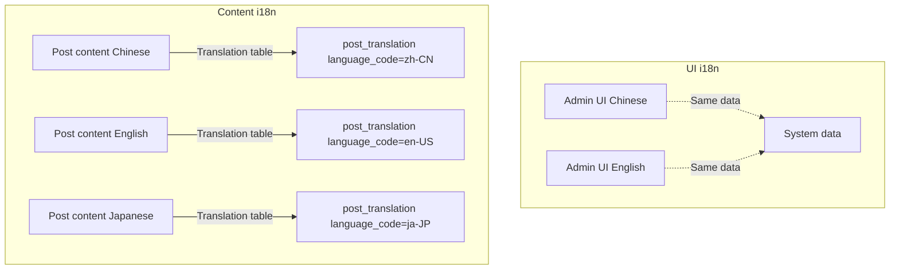
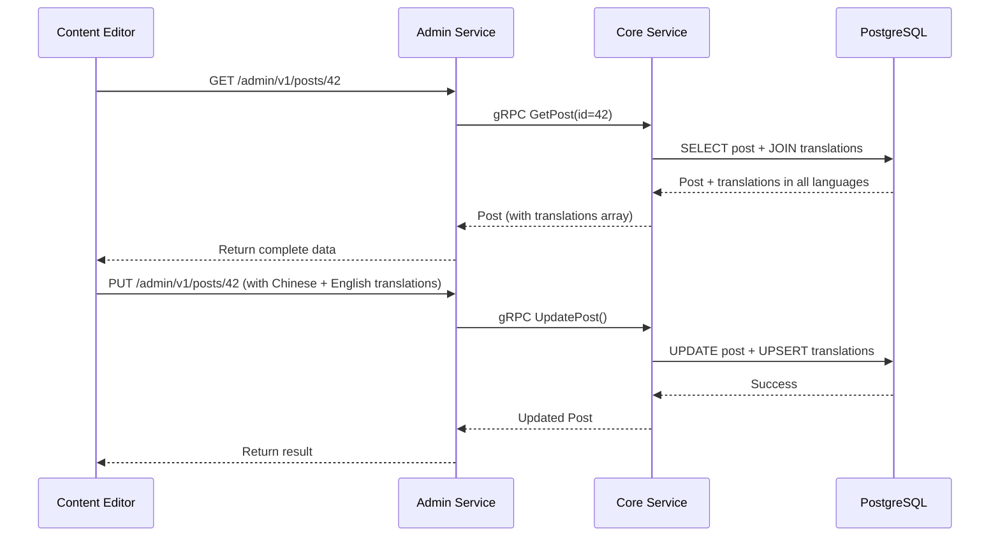

# Content Multilingual Translation Tutorial

GoWind CMS natively supports content-level multilingual translation. Unlike GoWind Admin, which only supports UI i18n for the admin console, the CMS provides an independent translation data model for every content entity (Post, Category, Tag, Page). This tutorial dives into the architecture design, data model, API calls, and frontend implementation of content translation.

## Prerequisites

- Have read [CMS Backend Architecture Overview](./backend-architecture.md) and [CMS API Definitions](./backend-api.md)
- Understand basic Protobuf and Ent ORM concepts
- Local development environment set up (see [Installation Guide](./installation.md))

## 1. Translation Architecture Overview

### 1.1 UI i18n vs Content i18n



| Aspect | UI i18n | Content i18n (translation) |
|--------|------------------|-----------------|
| Target | Admin/frontend UI copy | Business content such as posts, categories, tags |
| Implementation | Frontend JSON language packs | Backend translation tables + API parameters |
| Data | Static resource files | Dynamic storage in the database |
| Management | Maintained by developers | Maintained by content editors |

### 1.2 Translatable Entities

| Entity | Translation Table | Protobuf Message | Description |
|------|--------|--------------|------|
| Post | `post_translations` | `PostTranslation` | Title, summary, body, SEO |
| Category | `category_translations` | `CategoryTranslation` | Category name, description |
| Tag | `tag_translations` | `TagTranslation` | Tag name |
| Page | `page_translations` | `PageTranslation` | Page title, content |
| DictEntry | `dict_entry_i18n` | `DictEntryI18n` | Dictionary text |

### 1.3 Translation Data Flow



## 2. Data Model

### 2.1 Post Translation Table Structure

Taking the post translation as an example, every content entity has a corresponding translation table:

```go
// app/core/service/internal/data/ent/schema/post_translation.go
type PostTranslation struct{ ent.Schema }

func (PostTranslation) Fields() []ent.Field {
    return []ent.Field{
        field.String("language_code").Comment("Language code, e.g. zh-CN, en-US"),
        field.String("title").Optional().Comment("Translated title"),
        field.String("slug").Optional().Comment("Translated URL alias"),
        field.Text("summary").Optional().Comment("Translated summary"),
        field.JSON("content", &[]byte{}).Optional().Comment("Translated body (section/block JSON)"),
        field.JSON("seo", map[string]any{}).Optional().Comment("SEO metadata"),
    }
}

func (PostTranslation) Edges() []ent.Edge {
    return []ent.Edge{
        edge.From("post", Post.Type).Ref("translations").Unique(),
    }
}
```

### 2.2 Relationship Between Main Table and Translation Table

```
posts (main table)
├── id: 42
├── status: PUBLISHED
├── author_id: 1
├── created_at: 2025-01-15
│
└── post_translations (translation table, one-to-many)
    ├── { post_id: 42, language_code: "zh-CN", title: "GoWind 入门指南", slug: "gowind-intro-zh" }
    ├── { post_id: 42, language_code: "en-US", title: "GoWind Getting Started", slug: "gowind-intro-en" }
    └── { post_id: 42, language_code: "ja-JP", title: "GoWind入門ガイド", slug: "gowind-intro-ja" }
```

**Design points**:
- The main table stores language-independent fields (status, author, timestamps)
- The translation table stores all translatable fields (title, body, SEO)
- `language_code` distinguishes different language versions
- One main record can correspond to multiple translation records (one-to-many relationship)

### 2.3 Ent Schema Association Definitions

The main table's Ent Schema associates with the translation table via edges:

```go
// app/core/service/internal/data/ent/schema/post.go
func (Post) Edges() []ent.Edge {
    return []ent.Edge{
        // One-to-many: one Post has multiple translations
        edge.To("translations", PostTranslation.Type),
        // ...
    }
}
```

## 3. Protobuf API Design

### 3.1 Translation Message Definitions

```protobuf
// content/service/v1/post.proto

// Post translation
message PostTranslation {
  optional uint32 id = 1;
  optional uint32 post_id = 2 [json_name = "postId"];
  optional string language_code = 3 [json_name = "languageCode"];
  optional string title = 10;
  optional string slug = 11;
  optional string summary = 12;
  optional string content = 13;
  optional SeoMeta seo = 20 [json_name = "seo"];
}

// Post main message (embedded translations array)
message Post {
  optional uint32 id = 1;
  optional Status status = 5;
  // ... other language-independent fields

  // Multilingual translations
  repeated PostTranslation translations = 40 [json_name = "translations"];
  repeated string available_languages = 41 [json_name = "availableLanguages"];
}
```

### 3.2 Translation Query Endpoint

The Admin Service provides a dedicated endpoint to check whether a translation exists:

```protobuf
// admin/service/v1/i_post.proto
service PostService {
  // ... CRUD endpoints

  // Check whether a translation exists for the specified language
  rpc TranslationExists(PostTranslationExistsRequest) returns (PostTranslationExistsResponse) {
    option (google.api.http) = {
      get: "/admin/v1/posts/{post_id}/translations/{language_code}"
    };
  }
}

message PostTranslationExistsRequest {
  uint32 post_id = 1 [json_name = "postId"];
  string language_code = 2 [json_name = "languageCode"];
}

message PostTranslationExistsResponse {
  bool exists = 1;
}
```

### 3.3 Frontend Fetching Translations by Language

The App Service fetches content in a specified language via the `locale` parameter:

```protobuf
// app/service/v1/i_post.proto
message GetPostRequest {
  oneof query_by {
    uint32 id = 1;
    string code = 2;  // slug
  }
  optional string locale = 10 [json_name = "locale"];  // Specify the language
}
```

## 4. Repository Layer Implementation

### 4.1 Translation Repositories

The translations of every content entity have an independent Repository:

```go
// app/core/service/internal/data/post_translation_repo.go
type PostTranslationRepo struct {
    data *Data
    log  *log.Helper
}

func NewPostTranslationRepo(ctx *bootstrap.Context, data *Data) *PostTranslationRepo {
    return &PostTranslationRepo{
        data: data,
        log:  ctx.NewLoggerHelper("post-translation/repo"),
    }
}

// Check whether a translation exists
func (r *PostTranslationRepo) TranslationExists(
    ctx context.Context, postId uint32, languageCode string,
) (bool, error) {
    count, err := r.data.db.PostTranslation.Query()
        .Where(
            posttranslation.HasPostWith(post.IDEQ(postId)),
            posttranslation.LanguageCodeEQ(languageCode),
        )
        .Count(ctx)
    if err != nil {
        return false, err
    }
    return count > 0, nil
}

// Fetch a translation by language
func (r *PostTranslationRepo) GetByLanguage(
    ctx context.Context, postId uint32, languageCode string,
) (*contentV1.PostTranslation, error) {
    entity, err := r.data.db.PostTranslation.Query()
        .Where(
            posttranslation.HasPostWith(post.IDEQ(postId)),
            posttranslation.LanguageCodeEQ(languageCode),
        )
        .Only(ctx)
    if err != nil {
        return nil, err
    }
    return entity2Proto(entity), nil
}
```

### 4.2 Translation Handling in the Main Table Repository

When creating/updating a main record, translation data is handled automatically:

```go
// app/core/service/internal/data/post_repo.go (simplified example)
func (r *PostRepo) Create(ctx context.Context, req *contentV1.CreatePostRequest) (*contentV1.Post, error) {
    builder := r.data.db.Post.Create().
        SetTitle(req.Data.GetTitle()).
        SetStatus(req.Data.GetStatus())

    // Handle translation data
    for _, tr := range req.Data.GetTranslations() {
        builder.AddTranslationIDs(r.createTranslation(ctx, tr))
    }

    entity, err := builder.Save(ctx)
    if err != nil {
        return nil, err
    }
    return entity2Proto(entity), nil
}

// Translations are loaded automatically during queries
func (r *PostRepo) Get(ctx context.Context, req *contentV1.GetPostRequest) (*contentV1.Post, error) {
    query := r.data.db.Post.Query()

    // Query by ID or slug
    if req.GetId() > 0 {
        query = query.Where(post.IDEQ(req.GetId()))
    } else if req.GetCode() != "" {
        query = query.Where(post.SlugEQ(req.GetCode()))
    }

    // Preload translation data
    entity, err := query.WithTranslations().Only(ctx)
    if err != nil {
        return nil, err
    }

    result := entity2Proto(entity)

    // If a locale is specified, return only the translation for that language
    if locale := req.GetLocale(); locale != "" {
        for _, tr := range entity.Edges.Translations {
            if tr.LanguageCode == locale {
                // Override main fields with the translation data
                applyTranslation(result, tr)
                break
            }
        }
    }

    return result, nil
}
```

## 5. Service Business Logic

### 5.1 Translation Logic in the Core Service

```go
// app/core/service/internal/service/post_service.go
func (s *PostService) TranslationExists(
    ctx context.Context, req *contentV1.PostTranslationExistsRequest,
) (*contentV1.PostTranslationExistsResponse, error) {
    exists, err := s.postRepo.TranslationExists(ctx, req.GetPostId(), req.GetLanguageCode())
    if err != nil {
        return nil, err
    }
    return &contentV1.PostTranslationExistsResponse{Exists: exists}, nil
}
```

### 5.2 Admin Service Forwarding

As a proxy layer, the Admin Service forwards directly to the Core Service:

```go
// app/admin/service/internal/service/post_service.go
func (s *PostService) TranslationExists(
    ctx context.Context, req *contentV1.PostTranslationExistsRequest,
) (*contentV1.PostTranslationExistsResponse, error) {
    return s.postClient.TranslationExists(ctx, req)
}
```

## 6. Admin Console Frontend Implementation

### 6.1 Translation Editor Component

The post editing page in the admin console must support switching between languages while editing:

```vue
<!-- views/content/post/form.vue -->
<script setup lang="ts">
import { useGetPost, useUpdatePost } from '#/api/composables/post';
import { useLanguageStore } from '#/store/language';

const route = useRoute();
const editId = computed(() => Number(route.params.id));
const { data: postData } = useGetPost(editId.value);
const updateMutation = useUpdatePost();

// Language currently being edited
const currentLocale = ref('zh-CN');
const languageStore = useLanguageStore();
const supportedLanguages = computed(() => languageStore.supportedLanguages);

// Translation data for the current language
const currentTranslation = computed(() => {
  if (!postData.value?.translations) return null;
  return postData.value.translations.find(
    (t) => t.languageCode === currentLocale.value,
  );
});

// Translation form data
const translationForm = reactive({
  title: '',
  slug: '',
  summary: '',
  content: '',
});

// Load the corresponding translation when switching languages
watchEffect(() => {
  if (currentTranslation.value) {
    Object.assign(translationForm, currentTranslation.value);
  } else {
    // No translation for this language yet; clear the form
    Object.keys(translationForm).forEach((k) => (translationForm[k] = ''));
  }
});

const handleSaveTranslation = async () => {
  const translations = [...(postData.value?.translations || [])];
  const idx = translations.findIndex(
    (t) => t.languageCode === currentLocale.value,
  );
  if (idx >= 0) {
    translations[idx] = { ...translations[idx], ...translationForm };
  } else {
    translations.push({
      languageCode: currentLocale.value,
      ...translationForm,
    });
  }
  await updateMutation.mutateAsync({
    id: editId.value,
    data: { translations },
  });
};
</script>

<template>
  <Page title="Edit Post">
    <!-- Language switch tabs -->
    <Tabs v-model:activeKey="currentLocale">
      <TabPane
        v-for="lang in supportedLanguages"
        :key="lang.code"
        :tab="lang.name"
      >
        <Form :model="translationForm" layout="vertical">
          <FormItem label="Title">
            <Input v-model:value="translationForm.title" />
          </FormItem>
          <FormItem label="URL Alias (Slug)">
            <Input v-model:value="translationForm.slug" />
          </FormItem>
          <FormItem label="Summary">
            <Textarea v-model:value="translationForm.summary" :rows="3" />
          </FormItem>
          <FormItem label="Body">
            <RichTextEditor v-model:value="translationForm.content" />
          </FormItem>
          <Button type="primary" @click="handleSaveTranslation">
            Save {{ lang.name }} Translation
          </Button>
        </Form>
      </TabPane>
    </Tabs>
  </Page>
</template>
```

### 6.2 Translation Status Indicators

Show translated language badges in the post list:

```vue
<!-- views/content/post/index.vue -->
<template>
  <Table :data="data?.items">
    <TableColumn title="Title" data-index="title" />
    <TableColumn title="Language Versions">
      <template #default="{ record }">
        <Tag
          v-for="lang in record.availableLanguages"
          :key="lang"
          color="blue"
        >
          {{ lang }}
        </Tag>
      </template>
    </TableColumn>
  </Table>
</template>
```

## 7. Frontend Consumption by Language

### 7.1 React Frontend (Next.js)

```tsx
// src/app/[locale]/posts/[slug]/page.tsx
export default async function PostDetail({
  params: { locale, slug },
}: {
  params: { locale: string; slug: string };
}) {
  // Fetch the translation for the corresponding language via the locale parameter
  const post = await getPostBySlug(slug, locale);

  return (
    <article>
      <h1>{post.title}</h1>
      <div>{post.summary}</div>
      {/* content is already the translation for the locale */}
      <div dangerouslySetInnerHTML={{ __html: post.content }} />
    </article>
  );
}
```

### 7.2 Flutter Frontend

```dart
// features/post_detail/domain/repository/post_repository.dart
abstract class PostRepository {
  Future<Post> getPost({required int id, required String locale});
}

class PostRepositoryImpl implements PostRepository {
  final PostApi api;

  @override
  Future<Post> getPost({required int id, required String locale}) async {
    // The API already returns the translation for the locale
    return await api.getPost(id, locale: locale);
  }
}
```

### 7.3 Language Switching

Language switching in the frontend applications only requires changing the locale parameter:

```tsx
// React language switcher component
function LanguageSwitcher() {
  const { locale, push } = useRouter();
  const { pathname, query } = useRouter();

  const changeLanguage = (newLocale: string) => {
    // URL path replacement: /zh-CN/posts/xxx -> /en-US/posts/xxx
    push(`/${newLocale}${pathname.replace(`/${locale}`, '')}?${new URLSearchParams(query)}`);
  };

  return (
    <select value={locale} onChange={(e) => changeLanguage(e.target.value)}>
      <option value="zh-CN">中文</option>
      <option value="en-US">English</option>
      <option value="ja-JP">日本語</option>
    </select>
  );
}
```

## 8. Language Management

### 8.1 System Language Management

The CMS provides an independent language management API for administering the list of supported languages:

```http
# Get all languages
GET /admin/v1/languages

# Add a language
POST /admin/v1/languages
{
  "code": "ko-KR",
  "name": "한국어",
  "sort": 4
}
```

### 8.2 Translation Management

Translations of system prompt text are managed through the Translator Service:

```http
# Get translations
GET /admin/v1/translators?languageCode=en-US

# Update a translation
PUT /admin/v1/translators/1
{
  "languageCode": "en-US",
  "key": "post.published",
  "value": "Published"
}
```

## 9. Best Practices

### 9.1 Translation Data Strategies

| Strategy | Description | Applicable Scenario |
|------|------|---------|
| Full translation | All fields are translated | Officially published content |
| Partial translation | Only title and summary translated | Quick preview, draft stage |
| Fallback strategy | Fall back to the default language when no translation exists | Frontend display fault tolerance |

### 9.2 Fallback Mechanism Implementation

```go
// Translation fallback logic in the Core Service
func (r *PostRepo) GetWithFallback(
    ctx context.Context, postId uint32, locale string, fallbackLocale string,
) (*contentV1.Post, error) {
    post, err := r.Get(ctx, &contentV1.GetPostRequest{
        QueryBy: &contentV1.GetPostRequest_Id{Id: postId},
        Locale:  locale,
    })
    if err != nil {
        return nil, err
    }

    // If no translation exists for the specified language, fall back to the default language
    if post.GetTitle() == "" && fallbackLocale != "" && fallbackLocale != locale {
        return r.Get(ctx, &contentV1.GetPostRequest{
            QueryBy: &contentV1.GetPostRequest_Id{Id: postId},
            Locale:  fallbackLocale,
        })
    }
    return post, nil
}
```

### 9.3 SEO and Multilingual

```html
<!-- Mark multilingual versions in the frontend HTML head -->
<link rel="alternate" hreflang="zh-CN" href="https://example.com/zh-CN/posts/hello" />
<link rel="alternate" hreflang="en-US" href="https://example.com/en-US/posts/hello" />
<link rel="alternate" hreflang="ja-JP" href="https://example.com/ja-JP/posts/hello" />
<link rel="alternate" hreflang="x-default" href="https://example.com/zh-CN/posts/hello" />
```

## 10. Checklist

| Item | Description |
|--------|------|
| Translation table schema definition | Ent schemas and edge associations of the main table + translation table |
| Protobuf message definitions | Translation message + embedded translations array in the main message |
| Repository translation methods | TranslationExists / GetByLanguage / Create / Update |
| Core Service business logic | Translation checks, queries by language, fallback strategies |
| Admin Service endpoints | Forwarding translation-related RPCs |
| App API frontend endpoints | locale parameter support |
| Admin translation editor | Language switch tabs + translation form |
| Frontend language adaptation | URL routing / locale parameter |

## Related Documentation

- [CMS Backend Architecture Overview](./backend-architecture.md)
- [CMS Protobuf API Definitions](./backend-api.md)
- [Full-Stack Practice: Adding a Content Type](./tutorial-new-content.md)
- [Headless API Multi-Client Integration in Practice](./tutorial-headless-api.md)
- [GoWind Admin i18n and Theme Tutorial](/en/admin/tutorial-theme-i18n.md)
