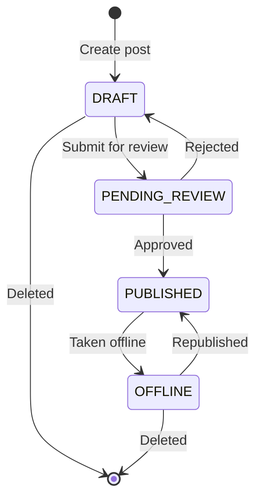
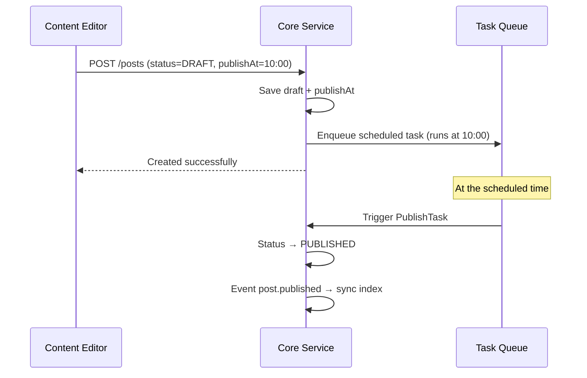

# Content Publishing Workflow Tutorial

GoWind CMS provides a complete publishing workflow for content management, covering the entire content lifecycle from drafting, review and approval, scheduled publishing, to offline archiving. This tutorial explains the content state machine, the review flow, scheduled publishing, and workflow extensions.

## Prerequisites

- Have read [CMS Backend Architecture Overview](./backend-architecture.md)
- Understand the CMS content model (Post / Page)

## 1. Content State Machine

### 1.1 Status Definitions



| Status | Protobuf Enum | Visible on Frontend | Editable | Description |
|------|--------------|---------|--------|------|
| Draft | `POST_STATUS_DRAFT` (0) | No | Yes | Initial status, visible only to the author |
| Pending review | `POST_STATUS_PENDING_REVIEW` (3) | No | No | Waiting for admin review |
| Published | `POST_STATUS_PUBLISHED` (1) | Yes | Yes | Officially published, visible on the frontend |
| Offline | `POST_STATUS_OFFLINE` (2) | No | Yes | Temporarily offline, can be republished |

### 1.2 Protobuf Definitions

```protobuf
// content/service/v1/post.proto
message Post {
  optional Status status = 5;
  enum Status {
    POST_STATUS_DRAFT = 0;
    POST_STATUS_PUBLISHED = 1;
    POST_STATUS_OFFLINE = 2;
    POST_STATUS_PENDING_REVIEW = 3;
  }

  // Publishing controls
  optional google.protobuf.Timestamp publish_at = 30 [json_name = "publishAt"];
  optional google.protobuf.Timestamp offline_at = 31 [json_name = "offlineAt"];
  optional bool pinned = 32 [json_name = "pinned"];
  optional uint32 sort_order = 33 [json_name = "sortOrder"];
}
```

## 2. Status Transitions

### 2.1 Status Control in the Core Service

```go
// app/core/service/internal/service/post_service.go

// SubmitReview submits for review
func (s *PostService) SubmitReview(ctx context.Context, req *contentV1.SubmitReviewRequest) (*contentV1.Post, error) {
    post, err := s.postRepo.Get(ctx, &contentV1.GetPostRequest{
        QueryBy: &contentV1.GetPostRequest_Id{Id: req.GetId()},
    })
    if err != nil {
        return nil, err
    }

    // Status check: only drafts can be submitted for review
    if post.GetStatus() != contentV1.Post_POST_STATUS_DRAFT {
        return nil, errors.BadRequest("INVALID_STATUS", "Only drafts can be submitted for review")
    }

    return s.postRepo.UpdateStatus(ctx, req.GetId(), contentV1.Post_POST_STATUS_PENDING_REVIEW)
}

// Approve approves → auto-publish
func (s *PostService) Approve(ctx context.Context, req *contentV1.ApprovePostRequest) (*contentV1.Post, error) {
    post, err := s.postRepo.Get(ctx, &contentV1.GetPostRequest{
        QueryBy: &contentV1.GetPostRequest_Id{Id: req.GetId()},
    })
    if err != nil {
        return nil, err
    }

    if post.GetStatus() != contentV1.Post_POST_STATUS_PENDING_REVIEW {
        return nil, errors.BadRequest("INVALID_STATUS", "Only posts pending review can be approved")
    }

    published, err := s.postRepo.UpdateStatus(ctx, req.GetId(), contentV1.Post_POST_STATUS_PUBLISHED)
    if err != nil {
        return nil, err
    }

    // Publish event → triggers index sync and notification push
    s.eventbus.Publish(ctx, "post.published", published)
    return published, nil
}

// Reject rejects → back to draft
func (s *PostService) Reject(ctx context.Context, req *contentV1.RejectPostRequest) (*contentV1.Post, error) {
    return s.postRepo.UpdateStatus(ctx, req.GetId(), contentV1.Post_POST_STATUS_DRAFT)
}
```

### 2.2 Frontend Filtering

The App API query returns only published content:

```go
// app/core/service/internal/data/post_repo.go
func (r *PostRepo) ListForApp(ctx context.Context, req *paginationV1.PagingRequest) (*contentV1.ListPostResponse, error) {
    query := r.data.db.Post.Query()

    // Mandatory frontend filter: return published posts only
    query = query.Where(post.StatusEQ(int(contentV1.Post_POST_STATUS_PUBLISHED)))

    // Publish-time filter: posts not yet due are hidden
    query = query.Where(
        post.Or(
            post.PublishAtIsNil(),
            post.PublishAtLTE(time.Now()),
        ),
    )
    // ...
}
```

## 3. Scheduled Publishing

### 3.1 Scheduled Publishing Mechanism



### 3.2 Scheduled Publishing Implementation

```go
func (s *PostService) Create(ctx context.Context, req *contentV1.CreatePostRequest) (*contentV1.Post, error) {
    if req.Data.Status == nil {
        req.Data.Status = trans.Ptr(contentV1.Post_POST_STATUS_PUBLISHED)
    }

    post, err := s.postRepo.Create(ctx, req)
    if err != nil {
        return nil, err
    }

    // Scheduled publishing
    if publishAt := post.GetPublishAt(); publishAt != nil && publishAt.AsTime().After(time.Now()) {
        s.postRepo.UpdateStatus(ctx, post.GetId(), contentV1.Post_POST_STATUS_DRAFT)

        payload, _ := json.Marshal(task.PublishPostPayload{PostId: post.GetId()})
        s.asynqClient.Enqueue(
            asynq.NewTask(task.TypePublishPost, payload),
            asynq.ProcessAt(publishAt.AsTime()),
            asynq.Queue("default"),
        )
    }
    return post, nil
}
```

## 4. Admin Console Frontend

### 4.1 Status Actions

```vue
<!-- views/content/post/form.vue -->
<script setup lang="ts">
const formData = reactive({ status: 0, publishAt: null, pinned: false });

// The current status determines available actions
const canSubmitReview = computed(() => formData.status === 0);
const canPublish = computed(() => [0, 3].includes(formData.status));
const canOffline = computed(() => formData.status === 1);
const canEdit = computed(() => [0, 2].includes(formData.status));
</script>

<template>
  <Page title="Edit Post">
    <Form :model="formData">
      <FormItem label="Title">
        <Input v-model:value="formData.title" :disabled="!canEdit" />
      </FormItem>
      <FormItem label="Scheduled Publishing">
        <DatePicker v-model:value="formData.publishAt" show-time :disabled="!canEdit" />
      </FormItem>

      <Space>
        <Button v-if="canEdit" type="primary">Save Draft</Button>
        <Button v-if="canSubmitReview">Submit for Review</Button>
        <Button v-if="canPublish" type="primary">Publish Now</Button>
        <Button v-if="canOffline" danger>Take Offline</Button>
      </Space>
    </Form>
  </Page>
</template>
```

### 4.2 List Status Filtering

```vue
<template>
  <Tabs v-model:activeKey="filterStatus">
    <TabPane key="" tab="All" />
    <TabPane key="0" tab="Drafts" />
    <TabPane key="3" tab="Pending Review" />
    <TabPane key="1" tab="Published" />
    <TabPane key="2" tab="Offline" />
  </Tabs>
</template>
```

## 5. Pinning and Sorting

```go
// Frontend query: pinned first, then by publish time descending
func (r *PostRepo) ListForApp(ctx context.Context, req *paginationV1.PagingRequest) {
    query := r.data.db.Post.Query().
        Where(post.StatusEQ(int(contentV1.Post_POST_STATUS_PUBLISHED))).
        Order(
            ent.Desc("pinned"),      // Pinned first
            ent.Desc("sort_order"),  // Custom sort
            ent.Desc("publish_at"),  // Publish time descending
        )
}
```

## 6. Recycle Bin

### 6.1 Soft Delete and Restore

```http
# Soft delete (moves to the recycle bin)
DELETE /admin/v1/posts/{id}

# View the recycle bin
GET /admin/v1/posts?deleted=true

# Restore a post
PUT /admin/v1/posts/{id}/restore

# Permanent delete
DELETE /admin/v1/posts/{id}/permanent
```

## 7. Checklist

| Item | Description |
|--------|------|
| Status enum definitions | DRAFT / PENDING_REVIEW / PUBLISHED / OFFLINE |
| Status transition endpoints | SubmitReview / Approve / Reject / Publish / Offline |
| Scheduled publishing | Asynq scheduled tasks |
| Frontend filtering | Mandatory PUBLISHED status filter |
| Admin UI | Status tabs + action buttons |
| Pinning and sorting | pinned + sortOrder + publishAt |
| Recycle bin | Soft delete + restore + permanent delete |

## Related Documentation

- [CMS Backend Architecture Overview](./backend-architecture.md)
- [Section/Block Editor in Practice](./tutorial-section-editor.md)
- [Task Scheduling in Practice](./tutorial-task-scheduling.md)
- [Event Bus Architecture](./tutorial-eventbus-architecture.md)
