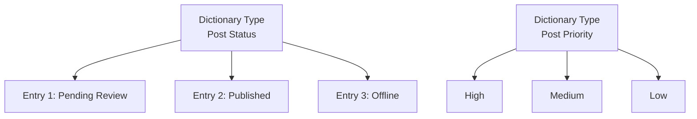

# Dictionary Management System Tutorial

GoWind CMS ships with complete data dictionary management, supporting hierarchical management of dictionary types and entries, usable for unified maintenance of enumerations such as content statuses, post types, and priorities. This tutorial explains the architecture and usage of the dictionary system.

## Prerequisites

- Have read [CMS Backend Architecture Overview](./backend-architecture.md)

## 1. Dictionary System Architecture

### 1.1 What Is a Data Dictionary

A data dictionary manages enumeration values and constant configurations in the system, avoiding hard-coding in code:



### 1.2 Dictionary vs Enum

| Aspect | Enum | Data Dictionary |
|--------|------|---------|
| Defined in | Code | Database |
| Change cost | Requires compilation | Runtime |
| i18n | Hard-coded | Supports translation |
| Ordering | Fixed | Adjustable |
| Extension | Requires code changes | Added directly in the admin console |

## 2. Data Model

### 2.1 DictType (Dictionary Type)

```protobuf
// dict/service/v1/dict_type.proto
message DictType {
  optional uint32 id = 1;
  optional string name = 2 [json_name = "name"];         // Dictionary name
  optional string code = 3 [json_name = "code"];         // Dictionary code (unique)
  optional string description = 4 [json_name = "description"];
  optional Status status = 5;
  enum Status {
    DICT_TYPE_STATUS_ACTIVE = 0;
    DICT_TYPE_STATUS_INACTIVE = 1;
  }
  optional google.protobuf.Timestamp created_at = 100;
}
```

### 2.2 DictEntry (Dictionary Entry)

```protobuf
// dict/service/v1/dict_entry.proto
message DictEntry {
  optional uint32 id = 1;
  optional uint32 dict_type_id = 2 [json_name = "dictTypeId"];
  optional string label = 3;           // Display name
  optional string value = 4;           // Dictionary value
  optional uint32 sort = 5;            // Sort order
  optional string css_class = 6 [json_name = "cssClass"]; // CSS style
  optional bool is_default = 7 [json_name = "isDefault"]; // Whether it is the default value
  optional Status status = 8;
  repeated DictEntryI18n i18n = 20 [json_name = "i18n"];  // i18n
}

// Dictionary entry i18n
message DictEntryI18n {
  optional uint32 id = 1;
  optional uint32 dict_entry_id = 2 [json_name = "dictEntryId"];
  optional string language_code = 3 [json_name = "languageCode"];
  optional string label = 4;           // Translated display name
}
```

## 3. Admin API

### 3.1 Dictionary Type Endpoints

```http
# Get the dictionary type list
GET /admin/v1/dict-types?page=1&pageSize=20

# Create a dictionary type
POST /admin/v1/dict-types
{
  "name": "Post Status",
  "code": "post_status",
  "description": "Post publishing status"
}

# Update
PUT /admin/v1/dict-types/1

# Delete
DELETE /admin/v1/dict-types/1
```

### 3.2 Dictionary Entry Endpoints

```http
# Get the entry list (filtered by type)
GET /admin/v1/dict-entries?dictTypeId=1

# Create an entry
POST /admin/v1/dict-entries
{
  "dictTypeId": 1,
  "label": "Pending Review",
  "value": "3",
  "sort": 1,
  "isDefault": false,
  "i18n": [
    { "languageCode": "zh-CN", "label": "待审核" },
    { "languageCode": "en-US", "label": "Pending Review" }
  ]
}
```

## 4. Common CMS Dictionaries

| Dictionary Code | Description | Entry Examples |
|---------|------|---------|
| `post_status` | Post status | Draft/Pending Review/Published/Offline |
| `comment_status` | Comment status | Pending/Approved/Rejected |
| `media_type` | Media type | Image/Video/Audio/Document |
| `site_theme` | Site theme | Light/Dark/Minimal/Magazine |
| `nav_type` | Navigation type | Top navigation/Footer/Sidebar |
| `priority` | Priority | High/Medium/Low |

## 5. Admin Console

### 5.1 Dictionary Management Page

```vue
<!-- views/system/dict/index.vue -->
<script setup lang="ts">
const activeTab = ref('types');
const selectedType = ref(null);
</script>

<template>
  <Page title="Dictionary Management">
    <Tabs v-model:activeKey="activeTab">
      <!-- Dictionary type management -->
      <TabPane key="types" tab="Dictionary Types">
        <Table :data="dictTypes">
          <TableColumn title="Name" data-index="name" />
          <TableColumn title="Code" data-index="code" />
          <TableColumn title="Description" data-index="description" />
          <TableColumn title="Actions">
            <template #default="{ record }">
              <Button @click="selectedType = record; activeTab = 'entries'">Manage Entries</Button>
            </template>
          </TableColumn>
        </Table>
      </TabPane>

      <!-- Dictionary entry management -->
      <TabPane key="entries" tab="Dictionary Entries" :disabled="!selectedType">
        <DictEntryManager :dict-type="selectedType" />
      </TabPane>
    </Tabs>
  </Page>
</template>
```

### 5.2 Using Dictionaries in the Frontend

```typescript
// Composable: fetch a dictionary
export function useDict(code: string, locale?: string) {
  return useQuery({
    queryKey: ['dict', code, locale],
    queryFn: () => apiClient.dictService.GetByCode({ code, locale }),
    staleTime: 5 * 60 * 1000, // 5-minute cache
  });
}

// Usage in a component
const { data: postStatusDict } = useDict('post_status', 'zh-CN');
// postStatusDict.items = [{ label: 'Draft', value: '0' }, ...]
```

## 6. Cache Optimization

```go
// Dictionary data changes infrequently; use Redis caching
func (s *DictService) GetByCode(ctx context.Context, code string) ([]*dictV1.DictEntry, error) {
    cacheKey := fmt.Sprintf("dict:%s", code)

    // Try the cache first
    if cached, err := s.redis.Get(ctx, cacheKey).Result(); err == nil {
        var entries []*dictV1.DictEntry
        json.Unmarshal([]byte(cached), &entries)
        return entries, nil
    }

    // Query the database
    entries, err := s.dictRepo.GetByCode(ctx, code)
    if err != nil {
        return nil, err
    }

    // Write to the cache
    data, _ := json.Marshal(entries)
    s.redis.Set(ctx, cacheKey, data, 30*time.Minute)

    return entries, nil
}

// Clear the cache when a dictionary is updated
func (s *DictService) UpdateEntry(ctx context.Context, req *dictV1.UpdateDictEntryRequest) error {
    if err := s.dictRepo.UpdateEntry(ctx, req); err != nil {
        return err
    }
    s.redis.Del(ctx, fmt.Sprintf("dict:%s", req.DictTypeCode))
    return nil
}
```

## 7. Checklist

| Item | Description |
|--------|------|
| DictType schema | Dictionary types |
| DictEntry schema | Dictionary entries + i18n |
| Admin API | Type + entry CRUD |
| Admin page | Type management + entry management |
| Dictionary usage | useDict composable |
| Caching | Redis cache |

## Related Documentation

- [CMS Backend Architecture Overview](./backend-architecture.md)
- [CMS Backend Modules Overview](./backend-modules.md)
- [Content Multilingual Translation in Practice](./tutorial-content-i18n.md)
