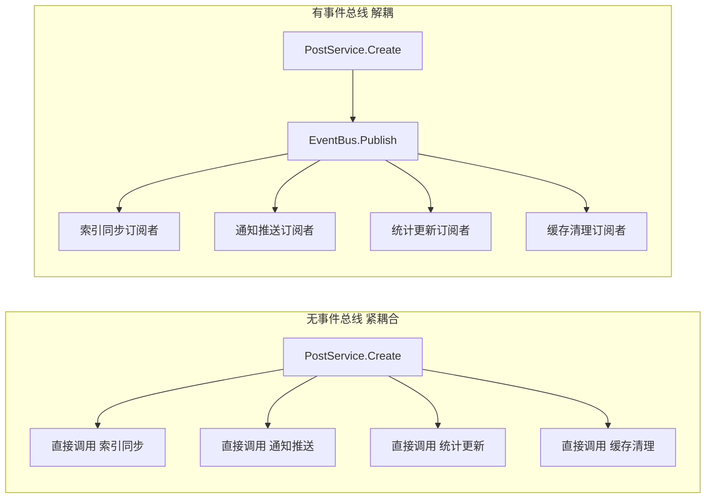
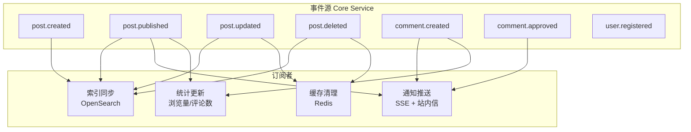
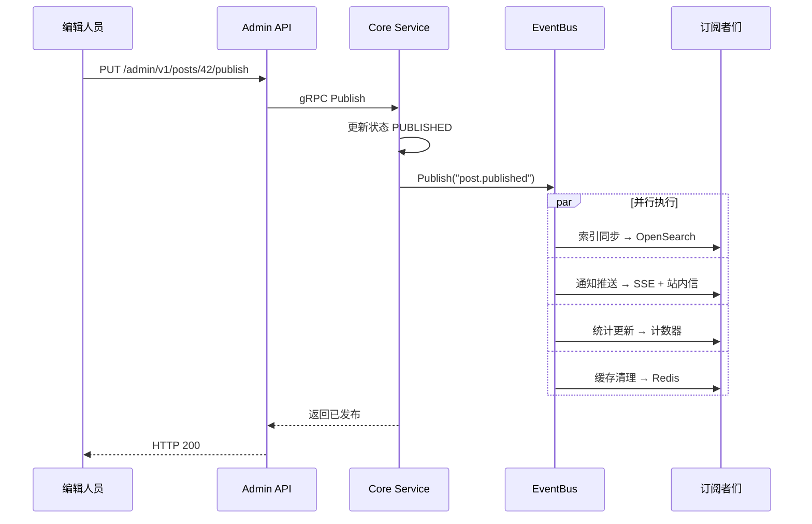

# Event Bus Architecture in Practice

GoWind CMS integrates an EventBus (event bus) in the Core Service to decouple business logic. Core events such as content publishing, comment creation, and user operations are dispatched through the event bus, triggering asynchronous operations such as index synchronization, notification push (SSE), and data statistics. This tutorial explains the design principles of the event bus and how to use it.

## Prerequisites

- You have read [CMS Backend Architecture Overview](./backend-architecture.md)
- It is recommended to first read the [GoWind Admin Event Bus Tutorial](/en/admin/tutorial-eventbus-architecture.md)

## 1. Event Bus Architecture

### 1.1 Why an Event Bus Is Needed



**Problems without an event bus**:
- Business logic is tightly coupled with side effects
- Adding a side effect requires modifying core code
- Hard to test and maintain

**Advantages of the event bus**:
- Publishers do not need to know who is listening
- Subscribers register independently without affecting each other
- New features only require adding subscribers

### 1.2 CMS Event Flow



## 2. Core Events

### 2.1 Event List

| Event Name | Trigger | Data Payload |
|--------|---------|---------|
| `post.created` | Post created | Post object |
| `post.updated` | Post updated | Post object |
| `post.published` | Post published | Post object |
| `post.offlined` | Post taken offline | Post object |
| `post.deleted` | Post deleted | PostId |
| `comment.created` | Comment created | Comment object |
| `comment.approved` | Comment approved | Comment object |
| `comment.replied` | Comment replied to | Comment object |
| `user.registered` | User registered | User object |
| `media.uploaded` | Media uploaded | MediaAsset object |
| `translation.created` | Translation created | Translation object |

### 2.2 Event Payload Definitions

```go
// pkg/eventbus/events.go
package eventbus

import "go-wind-cms/api/gen/go/content/service/v1"

type PostPublishedEvent struct {
    PostId      uint32
    Title       string
    Slug        string
    AuthorId    uint32
    AuthorName  string
    SiteId      uint32
    PublishedAt int64
}

type CommentCreatedEvent struct {
    CommentId  uint32
    PostId     uint32
    PostTitle  string
    UserId     uint32
    UserName   string
    Content    string
    ParentId   uint32  // Reply target (0 = top-level comment)
}

type MediaUploadedEvent struct {
    AssetId   uint32
    FileName  string
    FileType  string
    FileSize  uint64
    Url       string
    UploadBy  uint32
}
```

## 3. Event Bus Implementation

### 3.1 EventBus Core

```go
// pkg/eventbus/eventbus.go
package eventbus

import (
    "context"
    "sync"
)

type Handler func(ctx context.Context, event interface{})

type EventBus struct {
    subscribers map[string][]Handler
    mu          sync.RWMutex
}

func New() *EventBus {
    return &EventBus{
        subscribers: make(map[string][]Handler),
    }
}

// Subscribe subscribes to an event
func (b *EventBus) Subscribe(event string, handler Handler) {
    b.mu.Lock()
    defer b.mu.Unlock()
    b.subscribers[event] = append(b.subscribers[event], handler)
}

// Publish publishes an event (runs all subscribers synchronously)
func (b *EventBus) Publish(ctx context.Context, event string, data interface{}) {
    b.mu.RLock()
    handlers := make([]Handler, len(b.subscribers[event]))
    copy(handlers, b.subscribers[event])
    b.mu.RUnlock()

    for _, handler := range handlers {
        // Each handler recovers from panics independently, so one failure does not affect the others
        func() {
            defer func() {
                if r := recover(); r != nil {
                    log.Errorf("事件处理器异常: event=%s, error=%v", event, r)
                }
            }()
            handler(ctx, data)
        }()
    }
}

// PublishAsync publishes asynchronously (via the task queue)
func (b *EventBus) PublishAsync(ctx context.Context, event string, data interface{}) {
    payload, _ := json.Marshal(data)
    asynqClient.Enqueue(
        asynq.NewTask("event:"+event, payload),
        asynq.Queue("default"),
    )
}
```

### 3.2 Dependency Injection

```go
// app/core/service/cmd/server/wire.go
var CoreProviderSet = wire.NewSet(
    eventbus.New,           // EventBus singleton
    service.NewEventHandler,
    service.NewPostService,
    // ...
)
```

## 4. Publishing Events

### 4.1 Publishing Events in Business Logic

```go
// app/core/service/internal/service/post_service.go
type PostService struct {
    contentV1.UnimplementedPostServiceServer

    postRepo *data.PostRepo
    eventbus *eventbus.EventBus
    log      *log.Helper
}

func (s *PostService) Create(ctx context.Context, req *contentV1.CreatePostRequest) (*contentV1.Post, error) {
    if req.Data.Status == nil {
        req.Data.Status = trans.Ptr(contentV1.Post_POST_STATUS_PUBLISHED)
    }

    post, err := s.postRepo.Create(ctx, req)
    if err != nil {
        return nil, err
    }

    // Publish events
    if post.GetStatus() == contentV1.Post_POST_STATUS_PUBLISHED {
        s.eventbus.Publish(ctx, "post.published", &eventbus.PostPublishedEvent{
            PostId:      post.GetId(),
            Title:       post.GetTitle(),
            Slug:        post.GetSlug(),
            AuthorId:    post.GetCreatedBy(),
            SiteId:      post.GetSiteId(),
            PublishedAt: time.Now().Unix(),
        })
    } else {
        s.eventbus.Publish(ctx, "post.created", post)
    }

    return post, nil
}
```

## 5. Subscribing to Events

### 5.1 Subscriber Registration

```go
// app/core/service/internal/service/event_handler.go
type EventHandler struct {
    searchClient  *search.Client
    sseServer     *sse.Server
    statsRepo     *data.StatsRepo
    cacheClient   *redis.Client
    log           *log.Helper
}

func NewEventHandler(
    bus *eventbus.EventBus,
    searchClient *search.Client,
    sseServer *sse.Server,
    statsRepo *data.StatsRepo,
    cacheClient *redis.Client,
    ctx *bootstrap.Context,
) *EventHandler {
    h := &EventHandler{
        searchClient: searchClient,
        sseServer:    sseServer,
        statsRepo:    statsRepo,
        cacheClient:  cacheClient,
        log:          ctx.NewLoggerHelper("event-handler"),
    }

    // Register all event subscriptions
    h.registerHandlers(bus)
    return h
}

func (h *EventHandler) registerHandlers(bus *eventbus.EventBus) {
    // Post events
    bus.Subscribe("post.created", h.OnPostCreated)
    bus.Subscribe("post.published", h.OnPostPublished)
    bus.Subscribe("post.updated", h.OnPostUpdated)
    bus.Subscribe("post.deleted", h.OnPostDeleted)

    // Comment events
    bus.Subscribe("comment.created", h.OnCommentCreated)
    bus.Subscribe("comment.approved", h.OnCommentApproved)

    // Media events
    bus.Subscribe("media.uploaded", h.OnMediaUploaded)
}
```

### 5.2 Index Sync Subscriber

```go
func (h *EventHandler) OnPostPublished(ctx context.Context, event interface{}) {
    e := event.(*eventbus.PostPublishedEvent)
    h.log.Infof("同步文章索引: postId=%d", e.PostId)

    // Fetch the full post data
    post, err := h.postRepo.Get(ctx, e.PostId)
    if err != nil {
        h.log.Errorf("获取文章失败: %v", err)
        return
    }

    // Index into OpenSearch
    if err := h.searchClient.Index(ctx, "cms_posts", post); err != nil {
        h.log.Errorf("索引同步失败: %v", err)
    }
}
```

### 5.3 Notification Push Subscriber

```go
func (h *EventHandler) OnCommentCreated(ctx context.Context, event interface{}) {
    e := event.(*eventbus.CommentCreatedEvent)

    // 1. Admin console notification: new comment pending review
    h.sseServer.BroadcastToRole("admin", "comment:pending", map[string]any{
        "commentId": e.CommentId,
        "postId":    e.PostId,
        "userName":  e.UserName,
        "content":   e.Content,
    })

    // 2. If it is a reply, notify the user who was replied to
    if e.ParentId > 0 {
        parentComment, _ := h.commentRepo.Get(ctx, e.ParentId)
        if parentComment != nil && parentComment.UserId != e.UserId {
            h.sseServer.Push(parentComment.UserId, "comment:reply", map[string]any{
                "postId":      e.PostId,
                "postTitle":   e.PostTitle,
                "replyByUser": e.UserName,
                "content":     e.Content,
            })

            // Create an internal message
            h.internalMessageRepo.Create(ctx, &internalMessageV1.InternalMessage{
                UserId:  parentComment.UserId,
                Title:   "收到新回复",
                Content: fmt.Sprintf("%s 回复了你的评论", e.UserName),
                Type:    "comment",
            })
        }
    }
}
```

### 5.4 Cache Invalidation Subscriber

```go
func (h *EventHandler) OnPostUpdated(ctx context.Context, event interface{}) {
    e := event.(*eventbus.PostPublishedEvent)

    // Invalidate the post cache
    cacheKey := fmt.Sprintf("post:detail:%d", e.PostId)
    h.cacheClient.Del(ctx, cacheKey)

    // Invalidate list caches
    h.cacheClient.Del(ctx, "post:list:latest")
    h.cacheClient.Del(ctx, fmt.Sprintf("post:list:category:%d", e.SiteId))
}
```

### 5.5 Statistics Update Subscriber

```go
func (h *EventHandler) OnPostPublished(ctx context.Context, event interface{}) {
    e := event.(*eventbus.PostPublishedEvent)

    // Update the site post counter
    h.statsRepo.IncrementPostCount(ctx, e.SiteId)

    // Update the author post counter
    h.statsRepo.IncrementUserPostCount(ctx, e.AuthorId)
}
```

## 6. Lua Script Subscriptions

### 6.1 Subscribing to Events via Lua

The CMS supports dynamically subscribing to events through Lua scripts, with no compilation required:

```lua
-- Listen for the post published event and automatically push to a third-party system
eventbus.subscribe("post.published", function(event)
    local post_id = event.PostId
    local title = event.Title

    -- Call an HTTP API to push the event
    local response = http.post("https://api.your-service.com/webhook", {
        headers = {
            ["Content-Type"] = "application/json",
            ["Authorization"] = "Bearer your-token"
        },
        body = json.encode({
            event = "post.published",
            postId = post_id,
            title = title,
            timestamp = os.time()
        })
    })

    if response.status ~= 200 then
        log.error("Webhook 推送失败: " .. response.body)
    end
end)
```

### 6.2 Common Lua Subscription Scenarios

```lua
-- Automatically generate social media shares after a post is published
eventbus.subscribe("post.published", function(event)
    -- Generate a short link
    local short_url = api.call("POST", "/admin/v1/short-links", {
        url = "https://example.com/posts/" .. event.PostId
    })

    -- Push to social media
    twitter.post("新文章发布: " .. event.Title .. " " .. short_url)
end)

-- Sensitive word detection after a comment is created
eventbus.subscribe("comment.created", function(event)
    local is_sensitive = sensitive_words.check(event.Content)
    if is_sensitive then
        api.call("PUT", "/admin/v1/comments/" .. event.CommentId .. "/reject", {
            reason = "包含敏感内容"
        })
    end
end)
```

## 7. Event Flow Visualization

### 7.1 Complete Post Publishing Flow



## 8. Best Practices

### 8.1 Event Design Principles

| Principle | Description | Example |
|------|------|------|
| Semantic naming | Use past tense to describe what happened | `post.published` instead of `publish.post` |
| Complete data | Event payloads should contain all data needed for processing | Include PostId, Title, AuthorId |
| Idempotent processing | Subscribers should safely handle duplicate processing | Index sync: Upsert instead of Insert |
| No ordering dependency | Execution order of multiple subscribers should not matter | Index sync does not depend on notification push |

### 8.2 Synchronous vs. Asynchronous

```go
// Synchronous publishing: for events that must take effect immediately
eventbus.Publish(ctx, "post.updated", post)

// Asynchronous publishing: for side effects that can be deferred
eventbus.PublishAsync(ctx, "analytics.track", analyticsData)
```

| Pattern | Use Case | Advantage | Drawback |
|------|---------|------|------|
| Synchronous | Strong data consistency requirements | Takes effect immediately | Blocks the main flow |
| Asynchronous | Non-critical side effects | Non-blocking | Delayed |

## 9. Checklist

| Check Item | Description |
|--------|------|
| EventBus initialization | Wire dependency injection |
| Event definitions | Event name + payload struct |
| Subscriber registration | Register all subscriptions at startup |
| Index sync | Post changes synced to OpenSearch |
| Notification push | Comments/publishing trigger SSE |
| Cache invalidation | Content updates invalidate Redis |
| Lua script subscriptions | Dynamic extensibility supported |
| Error recovery | Panics do not affect other subscribers |

## Related Documents

- [CMS Backend Architecture Overview](./backend-architecture.md)
- [Content Publishing Workflow in Practice](./tutorial-content-workflow.md)
- [Full-Text Search in Practice](./tutorial-search.md)
- [Real-Time Message Push (SSE) in Practice](./tutorial-sse-push.md)
- [Lua Script Extensions in Practice](./tutorial-lua-extension.md)
- [GoWind Admin Event Bus Tutorial](/en/admin/tutorial-eventbus-architecture.md)
