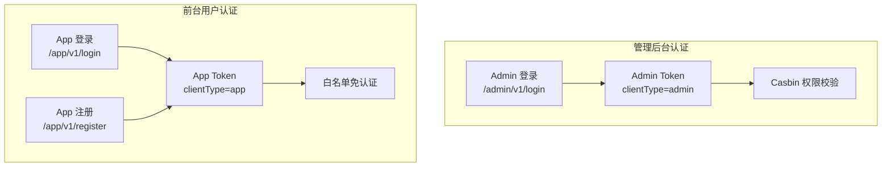
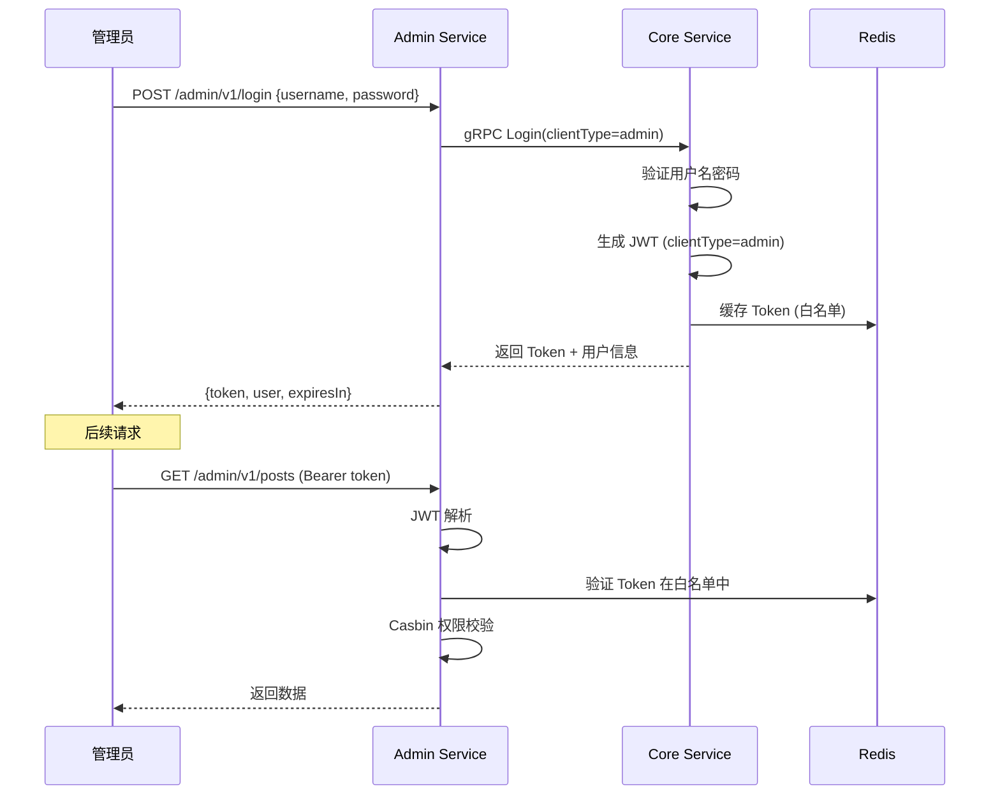

# Dual-Client Login Security in Practice

GoWind CMS has two independent authentication systems, one for the admin console and one for frontend applications, making its security model more complex than the single-application GoWind Admin. This tutorial explains the dual-token mechanism, frontend user registration and login, admin console authentication security, password policies, and protection measures.

## Prerequisites

- You have read [CMS Backend Architecture Overview](./backend-architecture.md)
- You have read [Permission System in Practice](./tutorial-permission-system.md)
- It is recommended to first read the [GoWind Admin Login Security Tutorial](/en/admin/tutorial-login-security.md)

## 1. Dual Authentication Systems

### 1.1 Architecture Comparison



| Comparison | Admin Console | Frontend Application |
|--------|---------|---------|
| Login endpoint | `/admin/v1/login` | `/app/v1/login` |
| Registration endpoint | Created by admins | `/app/v1/register` self-service registration |
| Token type | `admin` | `app` |
| Permission model | Casbin RBAC | Simplified roles |
| Whitelist | Login only | Content browsing login-free |
| Password policy | Strong password required | Medium requirements |

## 2. Admin Console Authentication

### 2.1 Login Flow



### 2.2 JWT Generation

```go
// pkg/jwt/jwt.go
func GenerateToken(claims *CustomClaims) (string, error) {
    claims.ExpiresAt = time.Now().Add(24 * time.Hour).Unix()
    claims.IssuedAt = time.Now().Unix()
    claims.NotBefore = time.Now().Unix()

    token := jwt.NewWithClaims(jwt.SigningMethodHS256, claims)
    return token.SignedString([]byte(secretKey))
}

type CustomClaims struct {
    UserID     uint32 `json:"user_id"`
    TenantID   uint32 `json:"tenant_id"`
    UserName   string `json:"user_name"`
    Roles      []string `json:"roles"`
    ClientType string `json:"client_type"`  // admin / app
    jwt.RegisteredClaims
}
```

### 2.3 Token Whitelist

To support proactive logout, tokens are also stored in the Redis whitelist:

```go
// app/core/service/internal/service/authentication_service.go
func (s *AuthenticationService) Login(ctx context.Context, req *authV1.LoginRequest) (*authV1.LoginResponse, error) {
    // 验证用户名密码
    user, err := s.userService.VerifyPassword(ctx, req.GetUserName(), req.GetPassword())
    if err != nil {
        // 记录失败日志
        s.loginLogService.RecordFailed(ctx, req.GetUserName(), getClientIP(ctx))
        return nil, errors.Unauthorized("LOGIN_FAILED", "用户名或密码错误")
    }

    // 生成 Token
    claims := &jwt.CustomClaims{
        UserID:     user.Id,
        TenantID:   user.TenantId,
        UserName:   user.UserName,
        Roles:      user.Roles,
        ClientType: req.GetClientType().String(),
    }
    token, _ := jwt.GenerateToken(claims)

    // 存入 Redis 白名单
    tokenKey := fmt.Sprintf("token:%s:%d", req.GetClientType(), user.Id)
    s.redis.Set(ctx, tokenKey, token, 24*time.Hour)

    // 记录成功日志
    s.loginLogService.RecordSuccess(ctx, user.Id, getClientIP(ctx), req.GetClientType())

    return &authV1.LoginResponse{
        Token:     token,
        ExpiresIn: 86400,
        User:      user,
    }, nil
}

func (s *AuthenticationService) Logout(ctx context.Context, req *authV1.LogoutRequest) (*emptypb.Empty, error) {
    // 从 Redis 删除 Token
    userId := ctx.Value(middleware.UserIDKey{}).(uint32)
    clientType := ctx.Value(middleware.ClientTypeKey{}).(string)
    tokenKey := fmt.Sprintf("token:%s:%d", clientType, userId)
    s.redis.Del(ctx, tokenKey)

    return &emptypb.Empty{}, nil
}
```

## 3. Frontend User Authentication

### 3.1 Frontend Registration

```protobuf
// app/service/v1/i_authentication.proto
service AuthenticationService {
  rpc Login(LoginRequest) returns (LoginResponse) {
    option (google.api.http) = { post: "/app/v1/login" body: "*" };
  }
  rpc Register(RegisterRequest) returns (RegisterResponse) {
    option (google.api.http) = { post: "/app/v1/register" body: "*" };
  }
  rpc RefreshToken(RefreshTokenRequest) returns (LoginResponse) {
    option (google.api.http) = { post: "/app/v1/refresh-token" body: "*" };
  }
}

message RegisterRequest {
  string username = 1;
  string email = 2;
  string password = 3;
  string phone = 4 [json_name = "phone"];
  string verify_code = 5 [json_name = "verifyCode"];  // 验证码
}
```

### 3.2 Registration Implementation

```go
// app/core/service/internal/service/authentication_service.go
func (s *AuthenticationService) Register(ctx context.Context, req *authV1.RegisterRequest) (*authV1.RegisterResponse, error) {
    // 1. 检查用户名是否已存在
    exists, err := s.userService.UserNameExists(ctx, req.GetUsername())
    if err != nil {
        return nil, err
    }
    if exists {
        return nil, errors.BadRequest("USERNAME_EXISTS", "用户名已被注册")
    }

    // 2. 检查邮箱是否已存在
    if req.GetEmail() != "" {
        exists, _ = s.userService.EmailExists(ctx, req.GetEmail())
        if exists {
            return nil, errors.BadRequest("EMAIL_EXISTS", "邮箱已被注册")
        }
    }

    // 3. 验证码校验（如启用）
    if req.GetVerifyCode() != "" {
        if !s.verifyCode(ctx, req.GetPhone(), req.GetVerifyCode()) {
            return nil, errors.BadRequest("INVALID_CODE", "验证码错误")
        }
    }

    // 4. 密码加密
    hashedPassword, err := bcrypt.GenerateFromPassword(
        []byte(req.GetPassword()), bcrypt.DefaultCost,
    )
    if err != nil {
        return nil, err
    }

    // 5. 创建用户（默认角色=前台用户）
    user, err := s.userService.Create(ctx, &identityV1.CreateUserRequest{
        Data: &identityV1.User{
            UserName: req.GetUsername(),
            Email:    req.GetEmail(),
            Phone:    req.GetPhone(),
            Password: string(hashedPassword),
            Status:   identityV1.User_USER_STATUS_ACTIVE,
        },
    })

    // 6. 自动登录，返回 Token
    claims := &jwt.CustomClaims{
        UserID:     user.Id,
        UserName:   user.UserName,
        ClientType: "app",
    }
    token, _ := jwt.GenerateToken(claims)

    return &authV1.RegisterResponse{
        Token: token,
        User:  user,
    }, nil
}
```

### 3.3 Frontend Login Marking

App Service login automatically sets `clientType=app`:

```go
// app/app/service/internal/service/authentication_service.go
func (s *AuthenticationService) Login(ctx context.Context, req *authV1.LoginRequest) (*authV1.LoginResponse, error) {
    // 强制标记为前台用户
    req.ClientType = trans.Ptr(authV1.ClientType_app)
    return s.authenticationServiceClient.Login(ctx, req)
}
```

## 4. Password Security

### 4.1 Password Hashing

```go
// 使用 bcrypt 加密（自适应成本因子）
func HashPassword(password string) (string, error) {
    bytes, err := bcrypt.GenerateFromPassword([]byte(password), bcrypt.DefaultCost)
    return string(bytes), err
}

func CheckPassword(password, hash string) bool {
    err := bcrypt.CompareHashAndPassword([]byte(hash), []byte(password))
    return err == nil
}
```

### 4.2 Password Policy

```protobuf
message PasswordPolicy {
  optional uint32 min_length = 1 [json_name = "minLength"];           // 最小长度
  optional bool require_uppercase = 2 [json_name = "requireUppercase"]; // 大写字母
  optional bool require_lowercase = 3 [json_name = "requireLowercase"]; // 小写字母
  optional bool require_digit = 4 [json_name = "requireDigit"];        // 数字
  optional bool require_special = 5 [json_name = "requireSpecial"];    // 特殊字符
  optional uint32 expire_days = 6 [json_name = "expireDays"];          // 过期天数
}
```

### 4.3 Password Strength Validation

```go
func ValidatePassword(password string, policy *authV1.PasswordPolicy) error {
    if policy == nil {
        policy = &authV1.PasswordPolicy{
            MinLength:         8,
            RequireUppercase:  true,
            RequireLowercase:  true,
            RequireDigit:      true,
            RequireSpecial:    false,
        }
    }

    if uint32(len(password)) < policy.GetMinLength() {
        return errors.BadRequest("WEAK_PASSWORD", fmt.Sprintf("密码至少%d位", policy.GetMinLength()))
    }
    if policy.GetRequireUppercase() && !hasUppercase(password) {
        return errors.BadRequest("WEAK_PASSWORD", "密码需包含大写字母")
    }
    if policy.GetRequireLowercase() && !hasLowercase(password) {
        return errors.BadRequest("WEAK_PASSWORD", "密码需包含小写字母")
    }
    if policy.GetRequireDigit() && !hasDigit(password) {
        return errors.BadRequest("WEAK_PASSWORD", "密码需包含数字")
    }
    return nil
}
```

## 5. Security Protection

### 5.1 Login Rate Limiting

```go
// pkg/middleware/rate_limit.go
func LoginRateLimit(redis *redis.Client) middleware.Middleware {
    return func(handler middleware.Handler) middleware.Handler {
        return func(ctx context.Context, req interface{}) (interface{}, error) {
            ip := getClientIP(ctx)
            key := fmt.Sprintf("rate:login:%s", ip)

            // 1 分钟最多 5 次尝试
            count, _ := redis.Incr(ctx, key).Result()
            if count == 1 {
                redis.Expire(ctx, key, time.Minute)
            }
            if count > 5 {
                return nil, errors.ResourceExhausted("RATE_LIMIT", "登录尝试过于频繁，请稍后再试")
            }

            return handler(ctx, req)
        }
    }
}
```

### 5.2 Account Locking

```go
func (s *AuthenticationService) Login(ctx context.Context, req *authV1.LoginRequest) (*authV1.LoginResponse, error) {
    // 检查账号是否被锁定
    lockKey := fmt.Sprintf("lock:user:%s", req.GetUserName())
    locked, _ := s.redis.Get(ctx, lockKey).Bool()
    if locked {
        ttl, _ := s.redis.TTL(ctx, lockKey).Result()
        return nil, errors.Forbidden("ACCOUNT_LOCKED",
            fmt.Sprintf("账号已锁定，请%d分钟后重试", int(ttl.Minutes())))
    }

    user, err := s.userService.VerifyPassword(ctx, req.GetUserName(), req.GetPassword())
    if err != nil {
        // 记录失败次数
        failKey := fmt.Sprintf("fail:user:%s", req.GetUserName())
        fails, _ := s.redis.Incr(ctx, failKey).Result()
        if fails == 1 {
            s.redis.Expire(ctx, failKey, 30*time.Minute)
        }

        // 连续失败 5 次锁定 30 分钟
        if fails >= 5 {
            s.redis.Set(ctx, lockKey, true, 30*time.Minute)
            return nil, errors.Forbidden("ACCOUNT_LOCKED", "账号已锁定30分钟")
        }

        return nil, errors.Unauthorized("LOGIN_FAILED",
            fmt.Sprintf("用户名或密码错误，还剩%d次尝试", 5-fails))
    }

    // 登录成功，清除失败计数
    s.redis.Del(ctx, fmt.Sprintf("fail:user:%s", req.GetUserName()))
    return s.generateLoginResponse(ctx, user, req.GetClientType())
}
```

### 5.3 Login Logs

```go
// 登录日志记录
message LoginLog {
  optional uint32 id = 1;
  optional string username = 2;
  optional bool success = 3;
  optional string ip = 4;
  optional string location = 5 [json_name = "location"];  // IP 归属地
  optional string user_agent = 6 [json_name = "userAgent"];
  optional string device = 7;   // 设备类型
  optional string client_type = 8 [json_name = "clientType"];
  optional google.protobuf.Timestamp login_at = 100;
}
```

## 6. Token Refresh

### 6.1 Token Expiration and Refresh

```go
func (s *AuthenticationService) RefreshToken(ctx context.Context, req *authV1.RefreshTokenRequest) (*authV1.LoginResponse, error) {
    // 解析旧 Token
    claims, err := jwt.ParseToken(req.GetRefreshToken())
    if err != nil {
        return nil, errors.Unauthorized("INVALID_TOKEN", "刷新令牌无效")
    }

    // 生成新 Token
    newClaims := &jwt.CustomClaims{
        UserID:     claims.UserID,
        TenantID:   claims.TenantID,
        UserName:   claims.UserName,
        Roles:      claims.Roles,
        ClientType: claims.ClientType,
    }
    token, _ := jwt.GenerateToken(newClaims)

    // 更新 Redis 白名单
    tokenKey := fmt.Sprintf("token:%s:%d", claims.ClientType, claims.UserID)
    s.redis.Set(ctx, tokenKey, token, 24*time.Hour)

    return &authV1.LoginResponse{
        Token:     token,
        ExpiresIn: 86400,
    }, nil
}
```

## 7. Admin Console Security Configuration

### 7.1 Security Configuration

```yaml
# configs/security.yaml
security:
  # 管理后台安全策略
  admin:
    max_login_attempts: 5        # 最大登录尝试次数
    lock_duration: 30m           # 锁定时长
    session_timeout: 24h         # 会话超时
    password_policy:
      min_length: 12             # 管理员密码最小 12 位
      require_uppercase: true
      require_lowercase: true
      require_digit: true
      require_special: true
      expire_days: 90            # 90天强制改密

  # 前台用户安全策略
  app:
    max_login_attempts: 10
    lock_duration: 15m
    session_timeout: 168h        # 前台 7 天
    password_policy:
      min_length: 8
      require_uppercase: false
      require_lowercase: true
      require_digit: true
      require_special: false
```

## 8. Checklist

| Check Item | Description |
|--------|------|
| Dual-token mechanism | admin / app token distinction |
| Admin console login | JWT + Redis whitelist |
| Frontend registration | Username/email/phone registration |
| Frontend login | Automatically sets clientType=app |
| Password hashing | bcrypt |
| Password policy | Length/complexity requirements |
| Login rate limiting | Dual rate limiting by IP + account |
| Account locking | Automatic locking after consecutive failures |
| Login logs | Success/failure logging |
| Token refresh | Seamless renewal |

## Related Documents

- [CMS Backend Architecture Overview](./backend-architecture.md)
- [Permission System in Practice](./tutorial-permission-system.md)
- [Headless API Multi-Client Integration in Practice](./tutorial-headless-api.md)
- [GoWind Admin Login Security Tutorial](/en/admin/tutorial-login-security.md)
