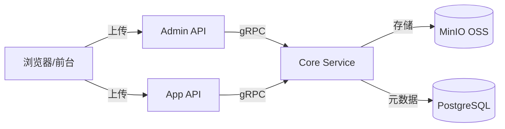

# Media Asset Management in Practice

GoWind CMS provides complete media asset management capabilities, supporting unified storage and management of images, documents, and videos, with MinIO object storage (S3-compatible) integrated underneath. This tutorial explains the architecture design of media assets, uploading and downloading, and the implementation of content association.

## Prerequisites

- You have read [CMS Backend Architecture Overview](./backend-architecture.md)
- The MinIO service is running locally (default ports 9000/9001)

## 1. Media Asset Architecture

### 1.1 Overall Architecture



### 1.2 Media Asset Types

| Type | Supported Formats | Use Case |
|------|---------|------|
| Image | JPG, PNG, GIF, WebP, SVG | Article images, thumbnails, logos |
| Document | PDF, DOC, DOCX, XLS, PPT | Attachment downloads |
| Video | MP4, WebM, MOV | Video content |
| Audio | MP3, WAV, AAC | Podcasts, audio content |

### 1.3 Storage Solution Comparison

| Solution | Implementation | Use Case |
|------|------|---------|
| Local storage | File system | Development and testing |
| MinIO | Object storage (S3-compatible) | Production environments |
| Cloud storage | AWS S3 / Alibaba Cloud OSS | Large-scale production |

## 2. Data Model

### 2.1 The MediaAsset Entity

```protobuf
// media/service/v1/media_asset.proto

message MediaAsset {
  optional uint32 id = 1;
  optional string name = 2 [json_name = "name"];           // 原始文件名
  optional string file_name = 3 [json_name = "fileName"];   // 存储文件名（UUID）
  optional string url = 4 [json_name = "url"];              // 访问 URL
  optional string mime_type = 5 [json_name = "mimeType"];   // MIME 类型
  optional uint64 file_size = 6 [json_name = "fileSize"];   // 文件大小（字节）
  optional string storage_path = 7 [json_name = "storagePath"]; // 存储路径
  optional MediaType type = 8;                               // 媒体类型
  enum MediaType {
    MEDIA_TYPE_IMAGE = 0;
    MEDIA_TYPE_VIDEO = 1;
    MEDIA_TYPE_AUDIO = 2;
    MEDIA_TYPE_DOCUMENT = 3;
    MEDIA_TYPE_OTHER = 4;
  }

  // 图片特有属性
  optional uint32 width = 10 [json_name = "width"];
  optional uint32 height = 11 [json_name = "height"];

  // 视频特有属性
  optional uint32 duration = 12 [json_name = "duration"];  // 时长（秒）

  // 缩略图
  optional string thumbnail_url = 20 [json_name = "thumbnailUrl"];

  optional uint32 uploaded_by = 100 [json_name = "uploadedBy"];
  optional google.protobuf.Timestamp created_at = 200;
}
```

### 2.2 Ent Schema

```go
// app/core/service/internal/data/ent/schema/media_asset.go
type MediaAsset struct{ ent.Schema }

func (MediaAsset) Mixin() []ent.Mixin {
    return []ent.Mixin{mixin.Time{}}
}

func (MediaAsset) Fields() []ent.Field {
    return []ent.Field{
        field.String("name"),
        field.String("file_name").Unique(),
        field.String("url"),
        field.String("mime_type"),
        field.Uint64("file_size").Default(0),
        field.String("storage_path"),
        field.Int("type").Default(0),
        field.Uint32("width").Optional(),
        field.Uint32("height").Optional(),
        field.Uint32("duration").Optional(),
        field.String("thumbnail_url").Optional(),
        field.Uint32("uploaded_by").Optional(),
    }
}
```

## 3. File Upload and Download

### 3.1 The FileTransfer Service

The CMS provides a unified file transfer service (FileTransferService), registered in both the Admin API and the App API:

```protobuf
// admin/service/v1/i_file.proto
service FileService {
  rpc UploadFile(UploadFileRequest) returns (FileInfo) {
    option (google.api.http) = {
      post: "/admin/v1/files/upload"
      body: "*"
    };
  }
  rpc DownloadFile(DownloadFileRequest) returns (stream FileChunk) {
    option (google.api.http) = {
      get: "/admin/v1/files/{path}"
    };
  }
  rpc DeleteFile(DeleteFileRequest) returns (google.protobuf.Empty) {
    option (google.api.http) = {
      delete: "/admin/v1/files/{path}"
    };
  }
}

message UploadFileRequest {
  string file_name = 1 [json_name = "fileName"];
  bytes chunk_data = 2 [json_name = "chunkData"];  // 分块数据
  uint32 chunk_index = 3 [json_name = "chunkIndex"];
  uint32 total_chunks = 4 [json_name = "totalChunks"];
  string mime_type = 5 [json_name = "mimeType"];
}
```

### 3.2 Chunked Upload

Chunked upload of large files is supported:

```go
// app/core/service/internal/service/file_transfer_service.go
func (s *FileTransferService) UploadFile(
    ctx context.Context, req *storageV1.UploadFileRequest,
) (*storageV1.FileInfo, error) {
    // 1. 将分块写入临时文件
    tempPath := fmt.Sprintf("/tmp/%s_%d", req.GetFileName(), req.GetChunkIndex())
    if err := os.WriteFile(tempPath, req.GetChunkData(), 0644); err != nil {
        return nil, err
    }

    // 2. 所有分块上传完毕后合并
    if req.GetChunkIndex() == req.GetTotalChunks()-1 {
        finalPath, err := s.mergeChunks(req.GetFileName(), req.GetTotalChunks())
        if err != nil {
            return nil, err
        }

        // 3. 上传到 MinIO
        url, err := s.ossClient.Upload(ctx, finalPath, req.GetFileName())
        if err != nil {
            return nil, err
        }

        // 4. 创建媒体资源记录
        mediaAsset := s.createMediaAsset(ctx, finalPath, url, req)

        // 5. 清理临时文件
        s.cleanupTempFiles(req.GetFileName(), req.GetTotalChunks())

        return mediaAsset, nil
    }

    return &storageV1.FileInfo{FileName: req.GetFileName()}, nil
}
```

### 3.3 MinIO Integration

```go
// pkg/oss/minio_client.go
type MinIOClient struct {
    client *minio.Client
    bucket string
}

func NewMinIOClient(endpoint, accessKey, secretKey, bucket string) (*MinIOClient, error) {
    client, err := minio.New(endpoint, &minio.Options{
        Creds: credentials.NewStaticV4(accessKey, secretKey, ""),
        Secure: false,
    })
    if err != nil {
        return nil, err
    }
    // 自动创建 bucket
    ctx := context.Background()
    exists, err := client.BucketExists(ctx, bucket)
    if err != nil {
        return nil, err
    }
    if !exists {
        if err := client.MakeBucket(ctx, bucket, minio.MakeBucketOptions{}); err != nil {
            return nil, err
        }
    }
    return &MinIOClient{client: client, bucket: bucket}, nil
}

func (c *MinIOClient) Upload(ctx context.Context, localPath, objectName string) (string, error) {
    _, err := c.client.FPutObject(ctx, c.bucket, objectName, localPath, minio.PutObjectOptions{
        ContentType: "application/octet-stream",
    })
    if err != nil {
        return "", err
    }
    return fmt.Sprintf("/%s/%s", c.bucket, objectName), nil
}
```

## 4. Admin Console Media Library

### 4.1 Media Library Page

```vue
<!-- views/media/index.vue -->
<script setup lang="ts">
import { useListMediaAssets, useDeleteMediaAsset } from '#/api/composables/media';
import { Upload } from 'ant-design-vue';

const pagination = reactive(new PaginationQuery());
const { data, isLoading } = useListMediaAssets(pagination);
const deleteMutation = useDeleteMediaAsset();
const previewVisible = ref(false);
const previewUrl = ref('');

const handleUpload = (info) => {
  // 上传成功后刷新列表
  if (info.file.status === 'done') {
    queryClient.invalidateQueries({ queryKey: ['listMediaAssets'] });
  }
};

const handleDelete = (id: number) => {
  Modal.confirm({
    title: '确认删除？',
    onOk: () => deleteMutation.mutate(id),
  });
};
</script>

<template>
  <Page title="媒体资源">
    <!-- 上传区域 -->
    <Upload
      action="/api/admin/v1/files/upload"
      :headers="{ Authorization: `Bearer ${token}` }"
      multiple
      @change="handleUpload"
    >
      <Button type="primary">上传文件</Button>
    </Upload>

    <!-- 媒体网格 -->
    <div class="grid grid-cols-6 gap-4 mt-4">
      <div v-for="asset in data?.items" :key="asset.id" class="media-item">
        <div class="thumbnail" @click="previewUrl = asset.url; previewVisible = true">
          
          <video v-else-if="asset.type === 1" :src="asset.url" />
          <div v-else class="file-icon">{{ asset.mimeType }}</div>
        </div>
        <div class="info">
          <span class="name">{{ asset.name }}</span>
          <span class="size">{{ formatSize(asset.fileSize) }}</span>
        </div>
        <Button danger size="small" @click="handleDelete(asset.id)">删除</Button>
      </div>
    </div>
  </Page>
</template>
```

### 4.2 Image Picker Component

An image picker is integrated into the content editor:

```vue
<!-- components/MediaPicker.vue -->
<script setup lang="ts">
const props = defineProps<{ modelValue: string }>();
const emit = defineEmits<{ 'update:modelValue': [value: string] }>();

const open = ref(false);
const { data } = useListMediaAssets({ pageSize: 24 });

const handleSelect = (url: string) => {
  emit('update:modelValue', url);
  open.value = false;
};
</script>

<template>
  <div>
    <div v-if="modelValue" class="preview">
      
    </div>
    <Button @click="open = true">选择图片</Button>
    <Modal v-model:open="open" title="选择媒体" width="800px">
      <div class="grid grid-cols-6 gap-2">
        <div
          v-for="asset in data?.items?.filter(a => a.type === 0)"
          :key="asset.id"
          @click="handleSelect(asset.url)"
          class="cursor-pointer border-2 hover:border-blue-500"
        >
          
        </div>
      </div>
    </Modal>
  </div>
</template>
```

## 5. Frontend File Upload

### 5.1 Frontend Upload (Login Required)

```tsx
// React 前台：用户头像上传
async function uploadAvatar(file: File): Promise<string> {
  const formData = new FormData();
  formData.append('file', file);

  const response = await fetch(`${API_BASE}/files/upload`, {
    method: 'POST',
    headers: {
      Authorization: `Bearer ${getToken()}`,
    },
    body: formData,
  });

  const data = await response.json();
  return data.url;
}
```

### 5.2 Flutter Frontend Upload

```dart
Future<String> uploadFile(File file, {String? mimeType}) async {
  final formData = FormData.fromMap({
    'file': await MultipartFile.fromFile(
      file.path,
      contentType: MediaType.parse(mimeType ?? 'application/octet-stream'),
    ),
  });

  final response = await dio.post('/files/upload', data: formData);
  return response.data['url'];
}
```

## 6. Associating Content with Media

### 6.1 Post Thumbnails

```http
POST /admin/v1/posts
{
  "title": "新产品发布",
  "thumbnail": "https://oss.example.com/images/product-launch.jpg",
  ...
}
```

### 6.2 Images in the Rich Text Editor

The TipTap editor embeds image URLs directly:

```typescript
// 编辑器中插入图片
editor.commands.setImage({
  src: selectedImageUrl,
  alt: '图片描述',
  title: '图片标题',
});
```

## 7. Image Processing

### 7.1 Thumbnail Generation

```go
// pkg/oss/thumbnail.go
func GenerateThumbnail(srcPath, dstPath string, maxWidth, maxHeight int) error {
    src, err := imaging.Open(srcPath)
    if err != nil {
        return err
    }
    thumb := imaging.Fit(src, maxWidth, maxHeight, imaging.Lanczos)
    return imaging.Save(thumb, dstPath)
}
```

### 7.2 Image Format Conversion

The WebP format is automatically generated on upload to optimize loading:

```go
func OptimizeAndUpload(ctx context.Context, ossClient *MinIOClient, localPath string) (string, error) {
    // 生成 WebP 版本
    webpPath := strings.Replace(localPath, filepath.Ext(localPath), ".webp", 1)
    if err := ConvertToWebP(localPath, webpPath); err == nil {
        // 上传 WebP 版本
        ossClient.Upload(ctx, webpPath, generateObjectName(webpPath))
    }

    // 上传原始版本
    url, err := ossClient.Upload(ctx, localPath, generateObjectName(localPath))
    return url, err
}
```

## 8. Security and Permissions

### 8.1 Upload Security

| Security Check | Implementation |
|---------|------|
| File type whitelist | Server-side MIME type validation |
| File size limit | Site setting `maxUploadSize` |
| File name safety | UUID renaming to prevent path traversal |
| Virus scanning | Optional ClamAV integration |

### 8.2 Access Control

```yaml
# MinIO 桶策略：公开读取
# 公开 bucket 用于 CDN 加速
# 私有 bucket 用于需要授权的文件
oss:
  public_bucket: "cms-public"
  private_bucket: "cms-private"
```

## 9. Checklist

| Check Item | Description |
|--------|------|
| MinIO service startup | Start dependencies with Docker Compose |
| OSS client configuration | endpoint / bucket / credentials |
| MediaAsset Schema | Complete fields |
| FileTransfer service | Upload / download / delete |
| Admin console media library | Grid display + upload + picker |
| Frontend upload | Token authentication + FormData |
| Content association | Thumbnails / rich text images |
| Security checks | Type whitelist + size limits |

## Related Documents

- [CMS Backend Architecture Overview](./backend-architecture.md)
- [Frontend Application Development in Practice](./tutorial-frontend-app.md)
- [Multi-Site Management in Practice](./tutorial-multi-site.md)
- [GoWind Admin File Storage Tutorial](/en/admin/tutorial-file-storage.md)
