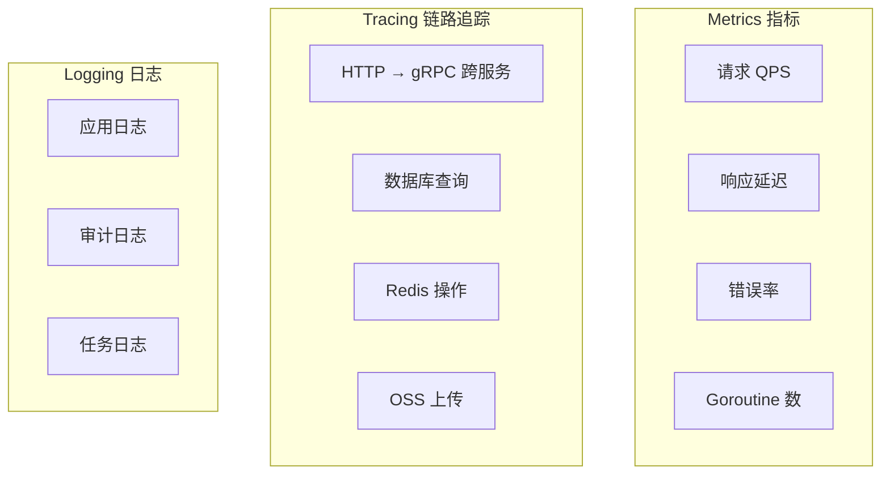
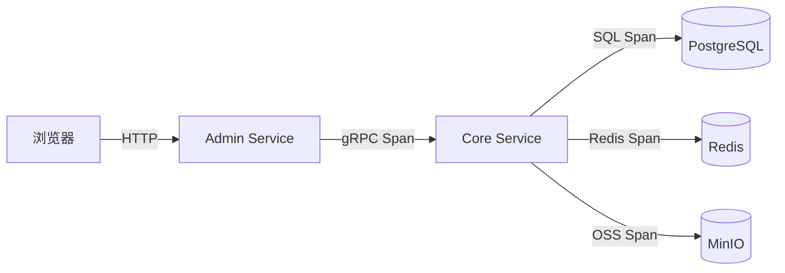
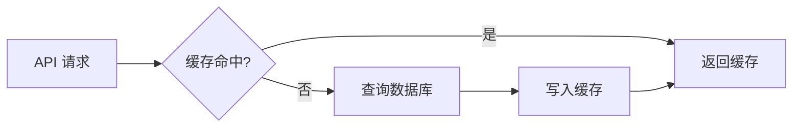

# Performance Monitoring in Practice

GoWind CMS integrates a complete observability system, including Jaeger distributed tracing, Redis cache monitoring, database slow query analysis, and application performance metric collection. This tutorial explains the performance monitoring solution under the CMS three-service architecture.

## Prerequisites

- You have read [CMS Backend Architecture Overview](./backend-architecture.md)
- The Jaeger service is running locally

## 1. Observability Architecture

### 1.1 Three Dimensions of Monitoring



### 1.2 CMS Cross-Service Tracing



## 2. Jaeger Distributed Tracing

### 2.1 Configuration

```yaml
# server.yaml
server:
  tracer:
    enabled: true
    provider: jaeger
    endpoint: "http://jaeger:14268/api/traces"
    sampler:
      type: const          # 全量采样（生产用 probabilistic）
      param: 1
```

### 2.2 Cross-Service Trace Propagation

```go
// Admin Service → Core Service 的 gRPC 调用会自动传递 Trace 上下文
// Kratos 框架内置 OpenTelemetry 中间件，自动注入/提取 Span

// 手动添加自定义 Span
func (s *PostService) Create(ctx context.Context, req *contentV1.CreatePostRequest) (*contentV1.Post, error) {
    ctx, span := tracer.Start(ctx, "PostService.Create")
    defer span.End()

    span.SetAttributes(
        attribute.String("post.title", req.Data.GetTitle()),
        attribute.Int("post.author_id", int(req.Data.GetCreatedBy())),
    )

    post, err := s.postRepo.Create(ctx, req)
    if err != nil {
        span.RecordError(err)
        return nil, err
    }

    span.SetAttributes(attribute.Int("post.id", int(post.GetId())))
    return post, nil
}
```

### 2.3 Analyzing in the Jaeger UI

Visit `http://localhost:16686`:

| Feature | Description |
|------|------|
| Find Traces | Search traces by service/time/tags |
| Compare | Compare two traces |
| Dependencies | Service dependency graph |
| Service Map | Service topology |

### 2.4 Slow Request Analysis

```go
// 为慢请求添加标记
func (r *PostRepo) List(ctx context.Context, req *paginationV1.PagingRequest) (*contentV1.ListPostResponse, error) {
    ctx, span := tracer.Start(ctx, "PostRepo.List")
    defer span.End()

    start := time.Now()

    // 查询
    result, err := r.query(ctx, req)

    duration := time.Since(start)
    span.SetAttributes(
        attribute.Int64("db.duration_ms", duration.Milliseconds()),
        attribute.Int("result.count", len(result.Items)),
    )

    // 慢查询标记
    if duration > 200*time.Millisecond {
        span.SetAttributes(attribute.Bool("db.slow_query", true))
        log.Warnf("慢查询: PostRepo.List 耗时 %v", duration)
    }

    return result, err
}
```

## 3. Redis Cache Monitoring

### 3.1 Caching Strategy



### 3.2 Cache Implementation

```go
// pkg/cache/cache.go
type Cache struct {
    client *redis.Client
    log    *log.Helper
}

func (c *Cache) GetOrSet(ctx context.Context, key string, ttl time.Duration, fn func() (interface{}, error)) (interface{}, error) {
    // 1. 尝试从缓存读取
    val, err := c.client.Get(ctx, key).Result()
    if err == nil {
        c.log.Debugf("缓存命中: %s", key)
        return val, nil
    }

    // 2. 缓存未命中，执行函数
    result, err := fn()
    if err != nil {
        return nil, err
    }

    // 3. 写入缓存
    data, _ := json.Marshal(result)
    c.client.Set(ctx, key, data, ttl)
    c.log.Debugf("缓存写入: %s, TTL=%v", key, ttl)

    return result, nil
}
```

### 3.3 Using the Cache

```go
func (s *PostService) Get(ctx context.Context, req *contentV1.GetPostRequest) (*contentV1.Post, error) {
    cacheKey := fmt.Sprintf("post:detail:%d:%s", req.GetId(), req.GetLocale())

    return s.cache.GetOrSet(ctx, cacheKey, 10*time.Minute, func() (*contentV1.Post, error) {
        return s.postRepo.Get(ctx, req)
    })
}
```

### 3.4 Cache Invalidation

Related caches are automatically cleared when content is updated:

```go
func (s *PostService) Update(ctx context.Context, req *contentV1.UpdatePostRequest) (*contentV1.Post, error) {
    post, err := s.postRepo.Update(ctx, req)
    if err != nil {
        return nil, err
    }

    // 清除详情缓存
    s.cache.Del(ctx, fmt.Sprintf("post:detail:%d", post.GetId()))
    // 清除列表缓存
    s.cache.DelPattern(ctx, "post:list:*")

    return post, nil
}
```

## 4. Database Optimization

### 4.1 Slow Query Log

```yaml
# PostgreSQL 配置 postgresql.conf
log_min_duration_statement = 200   # 200ms 以上记录
log_line_prefix = '%t [%p] %u@%d '
```

### 4.2 Index Optimization

```sql
-- 帖子常用查询索引
CREATE INDEX idx_posts_status_published_at ON posts (status, published_at DESC);
CREATE INDEX idx_posts_site_id ON posts (site_id);
CREATE INDEX idx_posts_slug ON posts (slug);
CREATE INDEX idx_posts_author_id ON posts (created_by);

-- 评论索引
CREATE INDEX idx_comments_post_id_status ON comments (post_id, status);
CREATE INDEX idx_comments_parent_id ON comments (parent_id);

-- 翻译索引
CREATE INDEX idx_post_translations_post_lang ON post_translations (post_id, language_code);
```

### 4.3 Connection Pool Configuration

```yaml
# server.yaml
data:
  database:
    driver: postgres
    source: "host=postgres port=5432 ..."
    max_open_conns: 25          # 最大连接数
    max_idle_conns: 10          # 最大空闲连接
    conn_max_lifetime: 300s     # 连接最大生命周期
    conn_max_idle_time: 60s     # 空闲连接最大存活时间
```

## 5. Performance Metrics

### 5.1 Key Metrics

| Metric | Description | Alert Threshold |
|------|------|---------|
| HTTP QPS | Requests per second | > 5000/s |
| HTTP P99 latency | 99th percentile response time | > 500ms |
| gRPC latency | Core Service call duration | > 200ms |
| Database queries | Slow query ratio | > 5% |
| Cache hit rate | Redis cache efficiency | < 80% |
| Error rate | HTTP 5xx ratio | > 1% |
| Goroutines | Active goroutine count | > 10000 |

### 5.2 Application Metric Collection

```go
// pkg/metrics/metrics.go
var (
    httpRequestDuration = prometheus.NewHistogramVec(
        prometheus.HistogramOpts{
            Name: "http_request_duration_seconds",
            Help: "HTTP request duration",
        },
        []string{"method", "path", "status"},
    )

    grpcRequestDuration = prometheus.NewHistogramVec(
        prometheus.HistogramOpts{
            Name: "grpc_request_duration_seconds",
            Help: "gRPC request duration",
        },
        []string{"service", "method"},
    )

    cacheHitRate = prometheus.NewGaugeVec(
        prometheus.GaugeOpts{
            Name: "cache_hit_rate",
            Help: "Cache hit rate",
        },
        []string{"cache_type"},
    )
)
```

## 6. Load Testing

### 6.1 Using wrk

```bash
# 测试前台 API
wrk -t4 -c100 -d30s http://localhost:6700/app/v1/posts

# 带认证的测试
wrk -t4 -c100 -d30s -H "Authorization: Bearer xxx" http://localhost:6600/admin/v1/posts
```

### 6.2 Using Vegeta

```bash
# 持续 60 秒压力测试
echo "GET http://localhost:6700/app/v1/posts" | vegeta attack -duration=60s -rate=100 | vegeta report

# 输出报告
vegeta report -type=json results.bin | jq
```

## 7. Performance Optimization Checklist

| Optimization | Method | Expected Gain |
|--------|------|---------|
| Database indexes | Analyze slow queries and add indexes | 50-90% |
| Redis cache | Cache hot data | 70-95% |
| Connection pool | Reasonable configuration | 20% |
| N+1 queries | Ent eager loading | 50-80% |
| Pagination | Cursor-based pagination | Significant with large data volumes |
| CDN static assets | Images/JS/CSS | 80% on the frontend |
| Gzip compression | Compress HTTP responses | 70% of bandwidth |

## 8. Checklist

| Check Item | Description |
|--------|------|
| Jaeger integration | Distributed tracing configuration |
| Redis cache | Hot data caching |
| Database indexes | Slow query analysis |
| Connection pool configuration | Reasonable connection counts |
| Performance metrics | Prometheus collection |
| Load testing | wrk / Vegeta |
| Slow query monitoring | PostgreSQL logs |

## Related Documents

- [CMS Backend Architecture Overview](./backend-architecture.md)
- [Configuration and Deployment Guide](./backend-config-deploy.md)
- [Three-Service Deployment in Practice](./tutorial-deploy.md)
- [GoWind Admin Performance Monitoring Tutorial](/en/admin/tutorial-performance-monitoring.md)
