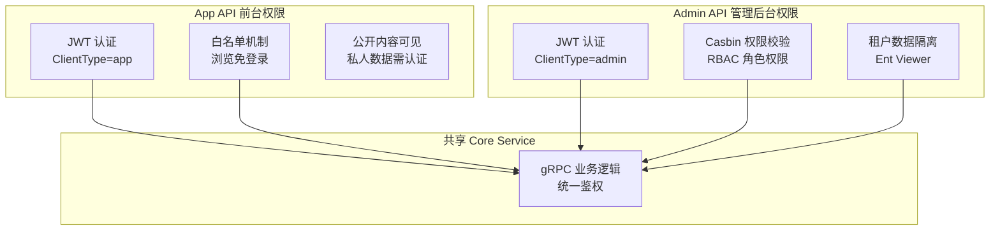
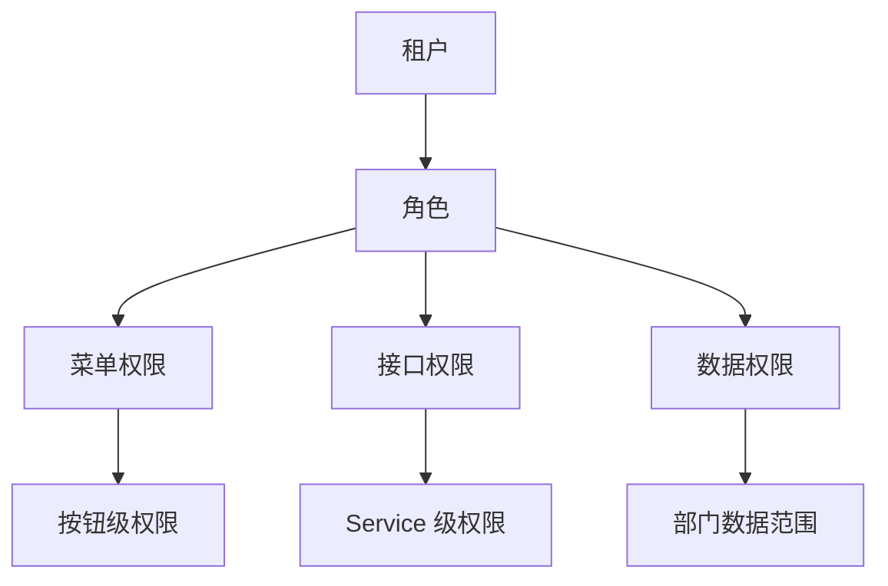
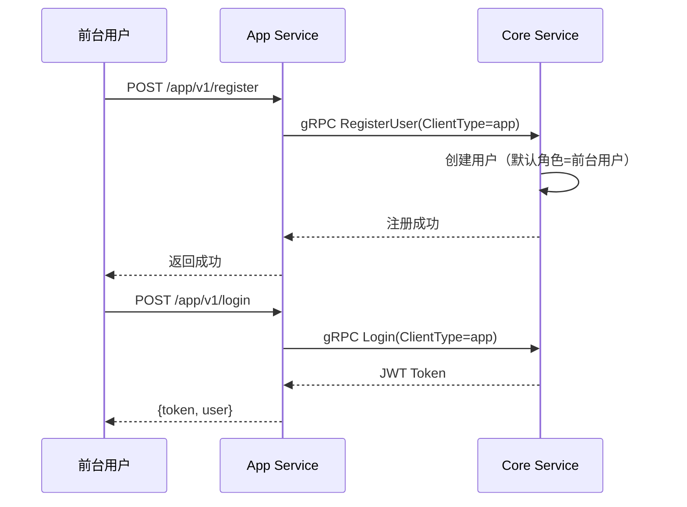

# Permission System in Practice

GoWind CMS shares the same technical foundation as GoWind Admin (Casbin + JWT), but its permission model has a unique design due to the Headless dual-API architecture. This tutorial takes a deep dive into the CMS's dual front-/back-office permission model, the authentication whitelist, data isolation, and frontend permission control.

## Prerequisites

- You have read [CMS Backend Architecture Overview](./backend-architecture.md)
- It is recommended to first read [GoWind Admin Permission System Deep Dive](/en/admin/tutorial-permission-system.md)

## 1. CMS Permission Architecture

### 1.1 Dual-API Permission Comparison



### 1.2 CMS vs. Admin Permission Differences

| Comparison | GoWind Admin | GoWind CMS |
|--------|-------------|------------|
| API layering | Single Admin API | Dual-layer Admin API + App API |
| User types | Administrators | Administrators + frontend users |
| Auth whitelist | Login endpoint only | Login + content browsing endpoints |
| Permission model | RBAC | RBAC (admin side) + whitelist (frontend) |
| Token type | admin | admin + app |
| Data isolation | Tenant isolation | Tenant isolation + public/private layering |

## 2. Authentication System

### 2.1 Dual-Token Mechanism

```go
// authentication/service/v1/types.proto
enum ClientType {
  CLIENT_TYPE_UNSPECIFIED = 0;
  CLIENT_TYPE_ADMIN = 1;   // 管理后台
  CLIENT_TYPE_APP = 2;     // 前台应用
}
```

The JWT token contains a `clientType` field that distinguishes where the token comes from:

```json
{
  "user_id": 1,
  "tenant_id": 1,
  "roles": ["admin"],
  "client_type": "admin",
  "exp": 1735689600
}
```

### 2.2 Login Authentication Flow

**Admin console login**:

```http
POST /admin/v1/login
{
  "username": "admin",
  "password": "xxx",
  "clientType": 1
}
```

**Frontend application login**:

```http
POST /app/v1/login
{
  "username": "user@example.com",
  "password": "xxx"
}
# 后端自动设置 clientType=2
```

### 2.3 Token Validation Middleware

```go
// pkg/middleware/auth.go
func Auth() middleware.Middleware {
    return func(handler middleware.Handler) middleware.Handler {
        return func(ctx context.Context, req interface{}) (interface{}, error) {
            if header, ok := transport.FromServerContext(ctx); ok {
                token := header.RequestHeader().Get("Authorization")
                token = strings.TrimPrefix(token, "Bearer ")

                claims, err := jwt.ParseToken(token)
                if err != nil {
                    return nil, errors.Unauthorized("TOKEN_INVALID", "token无效")
                }

                // 注入用户信息到 context
                ctx = context.WithValue(ctx, UserIDKey{}, claims.UserID)
                ctx = context.WithValue(ctx, TenantIDKey{}, claims.TenantID)
                ctx = context.WithValue(ctx, ClientTypeKey{}, claims.ClientType)
            }
            return handler(ctx, req)
        }
    }
}
```

## 3. Whitelist Mechanism

### 3.1 Admin Service Whitelist

The Admin API is strictly controlled; only the login endpoint is authentication-free:

```go
// app/admin/service/internal/server/rest_server.go
rpc.AddWhiteList(
    adminV1.OperationAuthenticationServiceLogin,  // 只有登录接口免认证
)
```

### 3.2 App Service Whitelist

The App API whitelist is loose; all browsing endpoints are authentication-free:

```go
// app/app/service/internal/server/rest_server.go
rpc.AddWhiteList(
    // 认证接口
    appV1.OperationAuthenticationServiceLogin,

    // 内容浏览（免登录，利于 SEO）
    appV1.OperationPostServiceList,
    appV1.OperationPostServiceGet,
    appV1.OperationCategoryServiceList,
    appV1.OperationCategoryServiceGet,
    appV1.OperationTagServiceList,
    appV1.OperationTagServiceGet,
    appV1.OperationPageServiceList,
    appV1.OperationPageServiceGet,
    appV1.OperationCommentServiceList,
    appV1.OperationCommentServiceGet,
    appV1.OperationNavigationServiceList,
)
```

### 3.3 Extending the Whitelist

When adding new frontend endpoints, they need to be added to the whitelist:

```go
// 新增视频接口（免登录浏览）
rpc.AddWhiteList(
    appV1.OperationVideoServiceList,
    appV1.OperationVideoServiceGet,
)
```

## 4. RBAC Permission Model

### 4.1 Permission Hierarchy



### 4.2 Casbin Policies

The CMS uses the Casbin RBAC model, identical to Admin:

```ini
# model.conf
[request_definition]
r = sub, obj, act

[policy_definition]
p = sub, obj, act

[role_definition]
g = _, _

[policy_effect]
e = some(where, p.eft == allow)

[matchers]
m = g(r.sub, p.sub) && keyMatch2(r.obj, p.obj) && (r.act == p.act || p.act == "*")
```

### 4.3 Admin Console Permission Checks

```go
// app/admin/service/internal/server/rest_server.go
func NewRestServer(..., authorizer *authorizer.CasbinAuthorizer) *http.Server {
    srv := http.NewServer(...)

    // 中间件链
    srv.Use(
        middleware.Logging(),
        middleware.Audit(),
        authMiddleware,       // JWT 认证（跳过白名单）
        authzMiddleware(authorizer),  // Casbin 权限校验
    )

    return srv
}
```

## 5. Data Permissions

### 5.1 Tenant Data Isolation

Tenant filtering is automatically injected through the Ent Viewer mechanism:

```go
// pkg/middleware/ent_viewer.go
func EntViewer() middleware.Middleware {
    return func(handler middleware.Handler) middleware.Handler {
        return func(ctx context.Context, req interface{}) (interface{}, error) {
            tenantId := ctx.Value(TenantIDKey{}).(uint32)

            // 注入租户上下文，Ent 会自动过滤
            ctx = context.WithValue(ctx, entgo.TenantKey{}, tenantId)
            return handler(ctx, req)
        }
    }
}
```

### 5.2 Department Data Scope

```go
// 数据权限范围
enum DataScope {
  DATA_SCOPE_ALL = 0;        // 全部数据
  DATA_SCOPE_DEPT = 1;       // 本部门
  DATA_SCOPE_DEPT_AND_SUB = 2; // 本部门及子部门
  DATA_SCOPE_SELF = 3;       // 仅本人
}
```

## 6. Frontend Permission Control

### 6.1 Route Guards

Route-level permissions in the admin console (Vben Admin):

```typescript
// frontend/admin/apps/admin/src/router/guard.ts
async function registerAccessGuard(router) {
  router.beforeEach(async (to, from, next) => {
    // 白名单路由
    if (WHITE_LIST.includes(to.path)) {
      next();
      return;
    }

    const token = getToken();
    if (!token) {
      next({ path: '/auth/login' });
      return;
    }

    // 检查路由权限
    const { hasAccessByRoles } = useAccess();
    if (!hasAccessByRoles(to.meta.authority)) {
      next({ path: '/403' });
      return;
    }

    next();
  });
}
```

### 6.2 Button-Level Permissions

```vue
<template>
  <!-- 有删除权限才显示按钮 -->
  <AccessControl :access="['post:delete']">
    <Button danger @click="handleDelete">删除</Button>
  </AccessControl>
</template>
```

### 6.3 Menu Permissions

Menus are rendered dynamically based on user roles:

```typescript
// 根据权限过滤菜单
function filterMenusByPermission(menus: Menu[], permissions: string[]): Menu[] {
  return menus.filter((menu) => {
    if (menu.children) {
      menu.children = filterMenusByPermission(menu.children, permissions);
    }
    return !menu.permission || permissions.includes(menu.permission);
  });
}
```

## 7. Frontend User Permissions

### 7.1 Frontend vs. Backend Users

| Comparison | Admin Console User | Frontend User |
|--------|------------|---------|
| Login endpoint | `/admin/v1/login` | `/app/v1/login` |
| Token type | `admin` | `app` |
| Permission model | Casbin RBAC | Simplified roles (regular user/VIP) |
| Accessible endpoints | All admin endpoints | Comments, posting, file upload |

### 7.2 Frontend User Registration Flow



## 8. Checklist

| Check Item | Description |
|--------|------|
| Dual-token mechanism | admin / app token distinction |
| Admin API whitelist | Login endpoint only |
| App API whitelist | Browsing endpoints are login-free |
| Casbin permission configuration | RBAC model + policies |
| Tenant data isolation | Automatic filtering via Ent Viewer |
| Frontend route guards | Login state + permission checks |
| Button-level permissions | AccessControl component |
| Frontend user registration | App Service registration endpoint |

## Related Documents

- [CMS Backend Architecture Overview](./backend-architecture.md)
- [GoWind Admin Permission System Deep Dive](/en/admin/tutorial-permission-system.md)
- [GoWind Admin Login Security Tutorial](/en/admin/tutorial-login-security.md)
- [Headless API Multi-Client Integration in Practice](./tutorial-headless-api.md)
