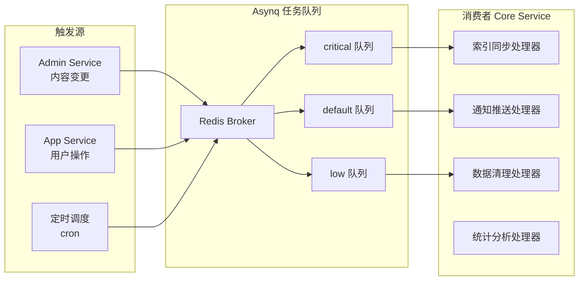

# Task Scheduling in Practice

GoWind CMS integrates an Asynq-based distributed task queue in the Core Service to handle asynchronous operations such as index synchronization, notification push (SSE), and data cleanup. This tutorial explains the configuration, definition, and management of task scheduling in the CMS.

## Prerequisites

- You have read [CMS Backend Architecture Overview](./backend-architecture.md)
- It is recommended to first read the [GoWind Admin Task Scheduling Tutorial](/en/admin/tutorial-task-scheduling.md) (they share the same technical foundation)

## 1. CMS Task Architecture

### 1.1 Task Scheduling in the Core Service



### 1.2 Differences from Admin Task Scheduling

| Comparison | Admin | CMS |
|--------|-------|-----|
| Deployment location | Inside the Admin Service | Inside the Core Service |
| Task types | System-level (email/cleanup) | Content-level (index/sync/push) |
| Task sources | Backend operations | Backend + frontend user operations |

## 2. Configuration

### 2.1 Core Service Task Configuration

```yaml
# app/core/service/configs/server.yaml
server:
  asynq:
    uri: "redis://:*Abcd123456@redis:6379/1"
    enable_gracefully_shutdown: true
    shutdown_timeout: 3s
    codec: "json"
    concurrency: 10
    queues:
      critical: 10
      default: 5
      low: 1
```

### 2.2 Asynq Server Initialization

```go
// app/core/service/internal/server/asynq_server.go
func NewAsynqServer(ctx *bootstrap.Context, logger log.Logger) *asynq.Server {
    cfg := ctx.GetConfig().GetServer().GetAsynq()

    srv := asynq.NewServer(
        asynq.RedisClientOpt{Addr: cfg.Uri},
        asynq.Config{
            Concurrency: int(cfg.Concurrency),
            Queues:      parseQueues(cfg.Queues),
        },
    )

    mux := asynq.NewServeMux()

    // 注册任务处理器
    mux.HandleFunc(task.TypeIndexPost, HandleIndexPost)
    mux.HandleFunc(task.TypeSendNotification, HandleSendNotification)
    mux.HandleFunc(task.TypeCleanupExpiredData, HandleCleanupExpiredData)
    mux.HandleFunc(task.TypeGenerateReport, HandleGenerateReport)
    mux.HandleFunc(task.TypeSyncTranslations, HandleSyncTranslations)

    return srv
}
```

## 3. Task Definitions

### 3.1 Task Type Constants

```go
// pkg/task/task_types.go
const (
    // 内容索引任务
    TypeIndexPost        = "post:index"
    TypeIndexPage        = "page:index"
    TypeRebuildIndex     = "search:rebuild_index"

    // 通知任务
    TypeSendNotification = "notification:send"
    TypeSendEmail        = "email:send"

    // 维护任务
    TypeCleanupExpiredData  = "cleanup:expired_data"
    TypeCleanupTempFiles    = "cleanup:temp_files"
    TypeSyncTranslations    = "translation:sync"

    // 统计任务
    TypeGenerateReport   = "report:generate"
    TypeUpdateViewCount  = "stats:update_view_count"
)
```

### 3.2 Task Payloads

```go
// pkg/task/payloads.go

// 内容索引任务
type IndexPostPayload struct {
    PostId uint32 `json:"postId"`
    Action string `json:"action"` // create / update / delete
}

// 通知推送任务
type SendNotificationPayload struct {
    UserId  uint32 `json:"userId"`
    Title   string `json:"title"`
    Content string `json:"content"`
    Type    string `json:"type"` // comment / system / mention
}

// 数据清理任务
type CleanupExpiredDataPayload struct {
    EntityType string `json:"entityType"` // posts / comments / files
    OlderThan  int64  `json:"olderThan"`  // unix timestamp
}

// 统计任务
type UpdateViewCountPayload struct {
    PostId    uint32 `json:"postId"`
    Increment uint32 `json:"increment"`
}
```

## 4. Task Handlers

### 4.1 Index Sync Handler

```go
func HandleIndexPost(ctx context.Context, t *asynq.Task) error {
    var payload task.IndexPostPayload
    if err := json.Unmarshal(t.Payload(), &payload); err != nil {
        return fmt.Errorf("解析载荷失败: %w", err)
    }

    switch payload.Action {
    case "create", "update":
        post, err := postRepo.Get(ctx, &contentV1.GetPostRequest{
            QueryBy: &contentV1.GetPostRequest_Id{Id: payload.PostId},
        })
        if err != nil {
            return err
        }
        return searchClient.Index(ctx, "cms_posts", post)

    case "delete":
        return searchClient.Delete(ctx, "cms_posts", fmt.Sprint(payload.PostId))
    }

    return nil
}
```

### 4.2 Notification Push Handler

```go
func HandleSendNotification(ctx context.Context, t *asynq.Task) error {
    var payload task.SendNotificationPayload
    if err := json.Unmarshal(t.Payload(), &payload); err != nil {
        return err
    }

    // 1. 创建站内信
    _, err := internalMessageRepo.Create(ctx, &internalMessageV1.CreateInternalMessageRequest{
        Data: &internalMessageV1.InternalMessage{
            UserId:  payload.UserId,
            Title:   payload.Title,
            Content: payload.Content,
            Type:    payload.Type,
        },
    })
    if err != nil {
        return err
    }

    // 2. 通过 SSE 推送实时通知
    sseServer.Broadcast(ctx, payload.UserId, map[string]any{
        "event":   "notification",
        "title":   payload.Title,
        "content": payload.Content,
    })

    return nil
}
```

### 4.3 Data Cleanup Handler

```go
func HandleCleanupExpiredData(ctx context.Context, t *asynq.Task) error {
    var payload task.CleanupExpiredDataPayload
    if err := json.Unmarshal(t.Payload(), &payload); err != nil {
        return err
    }

    switch payload.EntityType {
    case "posts":
        // 清理回收站中超过 30 天的帖子
        _, err := postRepo.PermanentlyDelete(ctx, payload.OlderThan)
        return err

    case "comments":
        // 清理被拒绝的评论
        _, err := commentRepo.CleanupRejected(ctx, payload.OlderThan)
        return err

    case "files":
        // 清理临时上传文件
        return cleanupTempFiles(payload.OlderThan)
    }

    return nil
}
```

### 4.4 View Count Handler

```go
func HandleUpdateViewCount(ctx context.Context, t *asynq.Task) error {
    var payload task.UpdateViewCountPayload
    if err := json.Unmarshal(t.Payload(), &payload); err != nil {
        return err
    }

    // 异步更新浏览量（Redis 缓存 + 定期刷入数据库）
    cacheKey := fmt.Sprintf("post:view:%d", payload.PostId)
    count, err := redisClient.IncrBy(ctx, cacheKey, int64(payload.Increment)).Result()
    if err != nil {
        return err
    }

    // 每积累 100 次浏览刷入数据库
    if count%100 == 0 {
        return postRepo.UpdateViewCount(ctx, payload.PostId, count)
    }

    return nil
}
```

## 5. Task Enqueueing

### 5.1 Triggered by Content Changes

```go
// app/core/service/internal/service/post_service.go
func (s *PostService) Create(ctx context.Context, req *contentV1.CreatePostRequest) (*contentV1.Post, error) {
    post, err := s.postRepo.Create(ctx, req)
    if err != nil {
        return nil, err
    }

    // 投递索引任务（default 队列）
    payload, _ := json.Marshal(task.IndexPostPayload{
        PostId: post.Id,
        Action: "create",
    })
    s.asynqClient.Enqueue(
        asynq.NewTask(task.TypeIndexPost, payload),
        asynq.Queue("default"),
    )

    return post, nil
}
```

### 5.2 Triggered by User Operations

```go
// 评论创建后通知文章作者
func (s *CommentService) Create(ctx context.Context, req *commentV1.CreateCommentRequest) (*commentV1.Comment, error) {
    comment, err := s.commentRepo.Create(ctx, req)
    if err != nil {
        return nil, err
    }

    // 异步通知文章作者
    payload, _ := json.Marshal(task.SendNotificationPayload{
        UserId:  post.AuthorId,
        Title:   "新评论通知",
        Content: fmt.Sprintf("您的文章收到了新评论"),
        Type:    "comment",
    })
    s.asynqClient.Enqueue(
        asynq.NewTask(task.TypeSendNotification, payload),
        asynn.Queue("critical"),  // 通知类任务高优先级
    )

    return comment, nil
}
```

## 6. Scheduled Tasks

### 6.1 Scheduled Cleanup

```go
// app/core/service/internal/server/asynq_server.go
func RegisterScheduledTasks(scheduler *asynq.Scheduler) {
    // 每天凌晨 3 点清理过期数据
    scheduler.Register("0 3 * * *", asynq.NewTask(
        task.TypeCleanupExpiredData,
        jsonMustMarshal(task.CleanupExpiredDataPayload{
            EntityType: "posts",
            OlderThan:  time.Now().AddDate(0, 0, -30).Unix(),  // 30 天前
        }),
    ))

    // 每小时同步翻译缓存
    scheduler.Register("0 * * * *", asynq.NewTask(
        task.TypeSyncTranslations,
        nil,
    ))

    // 每周一生成周报
    scheduler.Register("0 9 * * 1", asynq.NewTask(
        task.TypeGenerateReport,
        jsonMustMarshal(task.GenerateReportPayload{
            Type: "weekly",
        }),
    ))
}
```

## 7. Admin Console Task Management

### 7.1 The Task Service Interface

The CMS provides a visual task management interface:

```http
# 查看任务列表
GET /admin/v1/tasks?page=1&pageSize=20

# 立即执行任务
POST /admin/v1/tasks/1/run

# 暂停定时任务
PUT /admin/v1/tasks/1/pause

# 查看任务执行日志
GET /admin/v1/tasks/1/logs?page=1
```

### 7.2 Asynqmon Monitoring

Asynq provides a Web UI for monitoring task status:

```shell
# 启动 Asynqmon
asynqmon --port=8080 --redis-addr=localhost:6379
```

| Monitoring Item | Description |
|--------|------|
| Active Tasks | Tasks currently executing |
| Pending Tasks | Tasks waiting to execute |
| Retry Tasks | Tasks being retried |
| Dead Tasks | Failed tasks |
| Scheduled Tasks | Scheduled tasks |
| Processed/Failed | Statistics |

## 8. Best Practices

### 8.1 Task Design Principles

| Principle | Description |
|------|------|
| Idempotency | Repeated task execution should not produce side effects |
| Timeout control | Set reasonable timeout values |
| Retry strategy | Exponential backoff retries |
| Priority | Critical tasks get high priority |

### 8.2 Retry Configuration

```go
s.asynqClient.Enqueue(
    asynq.NewTask(task.TypeIndexPost, payload),
    asynq.Queue("default"),
    asynq.MaxRetry(5),                    // 最多重试 5 次
    asynq.RetryDelay(30*time.Second),     // 初始延迟 30 秒
    asynq.Timeout(2*time.Minute),         // 超时 2 分钟
)
```

## 9. Checklist

| Check Item | Description |
|--------|------|
| Asynq configuration | Redis connection + queue priorities |
| Task handler registration | All task types registered in the ServeMux |
| Task enqueueing | Tasks correctly enqueued in business logic |
| Scheduled tasks | cron expression configuration |
| Task monitoring | Asynqmon Web UI |
| Retry strategy | Exponential backoff + max retries |
| Idempotency | Tasks can be safely retried |

## Related Documents

- [CMS Backend Architecture Overview](./backend-architecture.md)
- [Full-Text Search in Practice](./tutorial-search.md)
- [Real-Time Message Push (SSE) in Practice](./tutorial-sse-push.md)
- [GoWind Admin Task Scheduling Tutorial](/en/admin/tutorial-task-scheduling.md)
