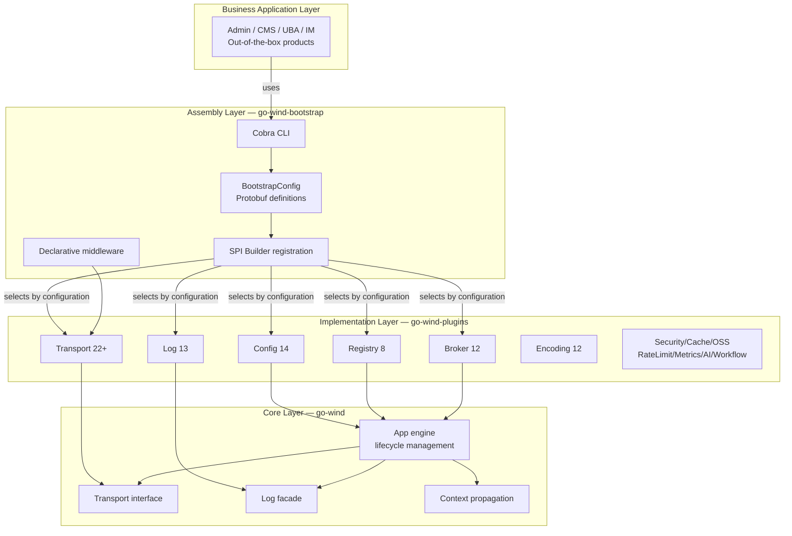
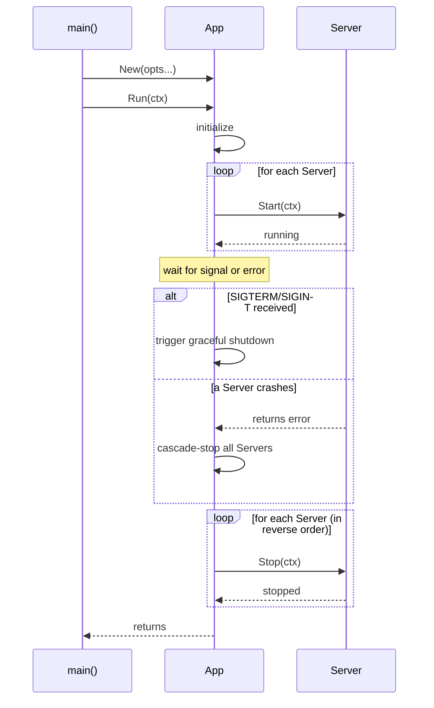
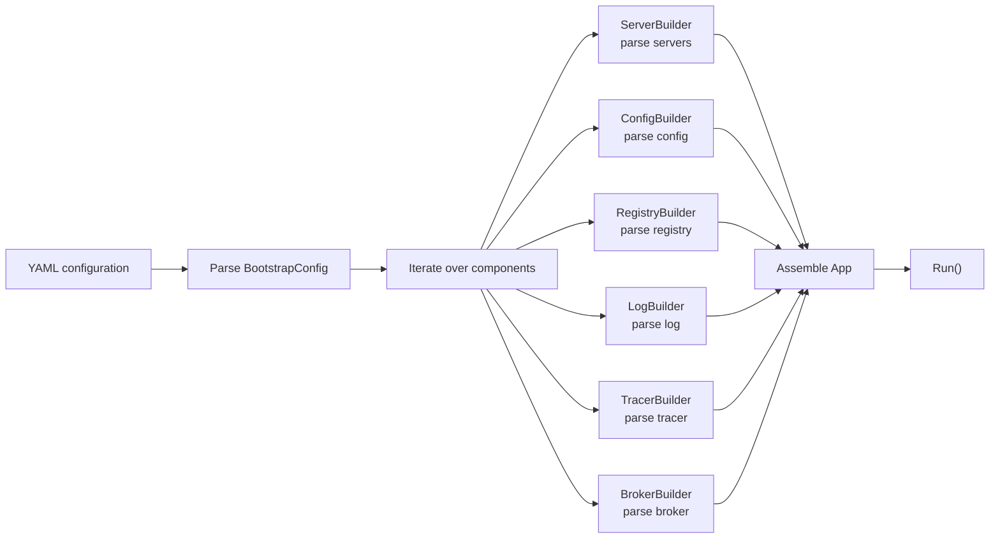
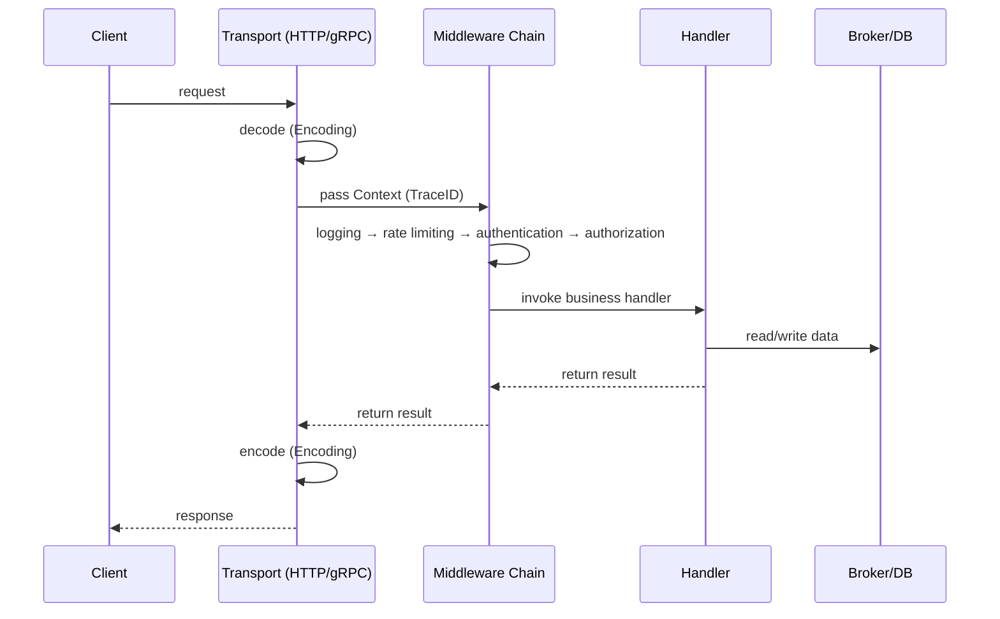
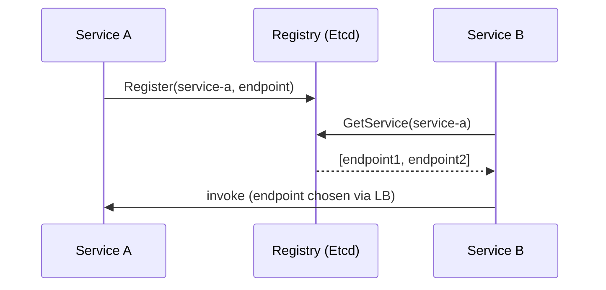

# Framework Architecture

This document describes the layered architecture, module relationships, and data flow of the three GoWind framework projects.

## 1. Three-Layer Architecture



## 2. Core Layer (go-wind)

### 2.1 Responsibilities

| Module | File | Responsibility |
|------|------|------|
| App | `app.go` | Engine core: lifecycle management, graceful start/stop |
| Transport | `transport/` | Transport abstraction: Server interface definition |
| Log | `log/` | Logging facade: Logger interface + Level + global registry |
| Context | `context.go` | Request-scoped metadata propagation: TraceID / UserID / Metadata |
| Instance | `instance.go` | Service instance model |
| Errors | `errors.go` | Unified error definitions |

### 2.2 Core Interfaces

```go
// Transport Server interface
type Server interface {
    Start(context.Context) error
    Stop(context.Context) error
    Endpoint() []string
}

// Log facade interface
type Logger interface {
    Log(level Level, msg string, fields ...Field)
    With(fields ...Field) Logger
}

// App engine
type App struct {
    servers   []Server
    logger    Logger
    // ...
}

func (a *App) Run(ctx context.Context) error
func (a *App) Stop(ctx context.Context) error
```

### 2.3 Lifecycle



## 3. Implementation Layer (go-wind-plugins)

### 3.1 Unified Interfaces

Plugins in each domain implement the interfaces defined by the go-wind core:

```go
// Configuration center interface
type Config interface {
    Load() (*Value, error)
    Watch() (<-chan *Value, error)
}

// Service registry interface
type Registry interface {
    Register(ctx context.Context, svc *Service) error
    Deregister(ctx context.Context, svc *Service) error
    GetService(ctx context.Context, name string) ([]*Service, error)
}

// Message queue interface
type Broker interface {
    Publish(ctx context.Context, topic string, msg *Message) error
    Subscribe(ctx context.Context, topic string, handler Handler) (Subscriber, error)
}
```

### 3.2 Plugin Directory Structure

```
go-wind-plugins/
├── config/           # Configuration center
│   ├── apollo/
│   ├── consul/
│   ├── etcd/
│   ├── file/
│   ├── nacos/
│   └── ...
├── registry/         # Service registry
│   ├── consul/
│   ├── etcd/
│   ├── nacos/
│   └── ...
├── log/              # Logging
│   ├── zap/
│   ├── zerolog/
│   ├── logrus/
│   └── ...
├── transport/        # Transport protocols
│   ├── http/
│   ├── grpc/
│   ├── websocket/
│   └── ...
├── broker/           # Message queues
│   ├── kafka/
│   ├── rabbitmq/
│   ├── nats/
│   └── ...
├── encoding/         # Encoding
├── security/         # Security
├── cache/            # Cache
├── oss/              # Object storage
├── tracer/           # Distributed tracing
├── metrics/          # Metrics monitoring
├── ratelimit/        # Rate limiting
├── circuitbreaker/   # Circuit breaking
├── ai/               # AI integration
├── workflow/         # Workflows
├── health/           # Health checks
├── retry/            # Retry
└── go.work           # Go Workspace multi-module management
```

### 3.3 Independent Version Management

Each plugin subdirectory has its own `go.mod` and can be referenced and versioned independently:

```go
// Import only the plugins you need
import (
    _ "github.com/tx7do/go-wind-plugins/transport/http"
    _ "github.com/tx7do/go-wind-plugins/log/zap"
    _ "github.com/tx7do/go-wind-plugins/registry/etcd"
)
```

## 4. Assembly Layer (go-wind-bootstrap)

### 4.1 Configuration-Driven

```yaml
# One YAML file describes the complete application topology
name: order-service

servers:
  - name: http-api
    type: http
    addr: ":8080"
    middleware: [log, recovery, cors, auth]

  - name: grpc-api
    type: grpc
    addr: ":9090"

log:
  level: info
  format: json
  adapter: zap

config:
  type: nacos
  config:
    server: "nacos:8848"
    namespace: production

registry:
  type: etcd
  config:
    endpoints: ["etcd:2379"]

tracer:
  type: otlp
  config:
    endpoint: "jaeger:4317"
```

### 4.2 SPI Mechanism

```go
// Plugins self-register via init()
package http

import "github.com/tx7do/go-wind-bootstrap"

func init() {
    bootstrap.RegisterServer("http", NewHTTPServer)
}

// Business code only needs a blank import
import _ "github.com/tx7do/go-wind-plugins/transport/http"
```

### 4.3 Builder Resolution Chain



## 5. Data Flow

### 5.1 Request Processing Flow



### 5.2 Service Discovery Flow



## 6. Technology Selection Matrix

| Domain | Recommended | Alternatives |
|------|---------|------|
| Configuration center | Nacos | Apollo, Consul, Etcd |
| Service registry | Etcd | Consul, Nacos |
| Logging | Zap | Zerolog, Logrus |
| Transport protocols | HTTP + gRPC | WebSocket, SSE |
| Message queues | Kafka | RabbitMQ, NATS |
| Distributed tracing | OTLP → Jaeger | — |
| Security | JWT + Casbin | — |
| Cache | Redis | Local Cache |
| Object storage | MinIO | S3 |
| Rate limiting | Sentinel | Token Bucket, BBR |

## Related Documentation

- [GoWind Framework Introduction](./intro.md)
- [Core Framework Introduction](./core-intro.md)
- [Plugin Ecosystem Overview](./plugins-intro.md)
- [Declarative Bootstrap Introduction](./bootstrap-intro.md)
