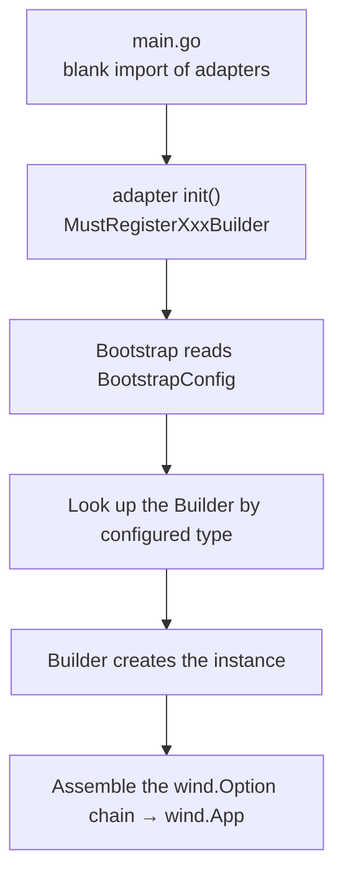
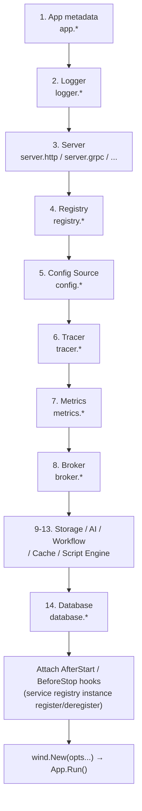

# The Bootstrap SPI Mechanism

go-wind-bootstrap implements Builder self-registration and automatic assembly through the SPI (Service Provider Interface) mechanism: each adapter subpackage registers its Builder with the global registry in `init()`, and users only need to blank-import the adapter package for the framework to assemble components automatically according to configuration.

## 1. How the SPI Works



## 2. The Builder Registry at a Glance

The registry is organized by domain, with one string-keyed map per domain. Keys are type constants (e.g. `ServerTypeHTTP = "http"`, `LoggerTypeZap = "zap"`) that match the type values in configuration:

| Domain | Builder Signature | Registration Function |
|----|-------------|---------|
| Server | `func(cfg *v1.Server) (transport.Server, error)` | `MustRegisterServerBuilder` |
| Log | `func(cfg *v1.Logger) (log.Logger, func(), error)` | `MustRegisterLogBuilder` |
| Registry | `func(ctx, cfg *v1.Registry) (Registry, func(), error)` | `MustRegisterRegistryAction` |
| Config | `func(ctx, cfg *v1.Config) (func(), error)` | `MustRegisterConfigAction` |
| Tracer | `func(cfg *v1.Tracer) (interface{}, func(), error)` | `MustRegisterTracerBuilder` |
| Metrics | `func(cfg *v1.Metrics) (func(), error)` | `MustRegisterMetricsBuilder` |
| Broker | `func(ctx, cfg *v1.Broker) (any, func(), error)` | `MustRegisterBrokerBuilder` |
| Storage | `func(ctx, cfg *v1.Storage) (any, func(), error)` | `MustRegisterStorageBuilder` |
| Ai | `func(ctx, cfg *v1.Ai) (any, func(), error)` | `MustRegisterAiBuilder` |
| Workflow | `func(ctx, cfg *v1.Workflow) (any, func(), error)` | `MustRegisterWorkflowBuilder` |
| Cache | `func(ctx, cfg *v1.Cache) (any, func(), error)` | `MustRegisterCacheBuilder` |
| ScriptEngine | `func(ctx, cfg *v1.Script) (any, func(), error)` | `MustRegisterScriptEngineBuilder` |
| Database | `func(ctx, cfg *v1.Database) (any, func(), error)` | `MustRegisterDatabaseBuilder` |

Each domain also provides `RegisterXxx` (returns an error) and `MustRegisterXxx` (panics on error, intended for `init()`), plus a `ListXxxBuilders()` diagnostic function.

## 3. SPI Registration Examples

### 3.1 Adapter Self-Registration

The `init()` of each adapter subpackage is a single line:

```go
// transport/http/http.go
package http

func init() {
    bootstrap.MustRegisterServerBuilder(bootstrap.ServerTypeHTTP, newBuilder)
}
```

```go
// log/zap/zap.go
func init() {
    bootstrap.MustRegisterLogBuilder(bootstrap.LoggerTypeZap, newBuilder)
}
```

```go
// database/gorm/client.go
func init() {
    bootstrap.MustRegisterDatabaseBuilder(bootstrap.DatabaseTypeGorm, newBuilder)
}
```

Blank-importing the adapter packages in main.go runs their `init()` automatically:

```go
import (
    _ "github.com/tx7do/go-wind-bootstrap/log/zap"       // Registers the Zap Logger Builder
    _ "github.com/tx7do/go-wind-bootstrap/transport/http" // Registers the HTTP Server Builder
)
```

### 3.2 Automatic Assembly by the Bootstrap

When parsing configuration, the Bootstrap checks each proto optional field one by one; on a hit, it looks up the table and invokes the corresponding Builder:

```yaml
server:
  http:          # ServerTypeHTTP → serverBuilders["http"]
    addr: ":8080"

logger:
  type: zap      # LoggerTypeZap → logBuilders["zap"]
  zap:
    level: info
```

Taking HTTP as an example, `newBuilder` reads `cfg.GetHttp()`, creates the Server, mounts middleware according to configuration, and then invokes the route registration callbacks registered via `RegisterServerSetup` in order.

## 4. SPI Assembly Order

`Bootstrap` parses the configuration of each domain in a fixed order:



## 5. Custom Builders

When the built-in adapters do not meet your needs, register custom Builders using the same APIs as the built-in adapters:

```go
// Register a custom Registry Action (signature in builder.go: takes the Registry
// configuration and returns a Registry instance + cleanup)
bootstrap.MustRegisterRegistryAction(bootstrap.RegistryTypeConsul,
    func(ctx context.Context, cfg *v1.Registry) (bootstrap.Registry, func(), error) {
        // Create the Consul service registry client...
        return reg, func() { /* cleanup */ }, nil
    },
)

// Register a custom Broker Builder
bootstrap.MustRegisterBrokerBuilder(bootstrap.BrokerTypeKafka,
    func(ctx context.Context, cfg *v1.Broker) (any, func(), error) {
        // Create the Kafka broker...
        return broker, func() { /* cleanup */ }, nil
    },
)
```

## 6. Instance Lifecycle

Each Builder may return an optional `cleanup` function. The Bootstrap aggregates the cleanups of all domains into a single cleanup chain that runs uniformly after the application stops (releasing connections, deregistering instances, flushing the tracer, etc.):

- **Semi-sealed mode**: triggered by `bctx.Cleanup()`;
- **Fully sealed mode**: `RunApp` internally runs `defer cleanup()` automatically.

Service registry instance registration/deregistration is wired uniformly at the bootstrap layer: after the application starts (`wind.WithAfterStart`), instances are registered with all configured service registries using real listening endpoints; at graceful shutdown (`wind.WithBeforeStop`), they are deregistered before the servers stop — the Builder is only responsible for creating the service registry client itself.

## 7. SPI vs. Google Wire

| Aspect | Bootstrap SPI | Google Wire |
|--------|--------------|-------------|
| Dependency approach | Runtime registration | Compile-time generation |
| Flexibility | High (configuration-driven implementation selection) | Medium (fixed at compile time) |
| Type safety | Checked at runtime | Checked at compile time |
| Configuration-driven | YAML-driven | Code-driven |
| Learning cost | Low | Medium |

## Related Documentation

- [Bootstrap Introduction](./bootstrap-intro.md)
- [The Bootstrap Configuration System](./bootstrap-config.md)
- [The Plugin Registration Mechanism](./plugins-registry.md)
- [Custom Plugin Development Tutorial](./tutorial-custom-plugin.md)
