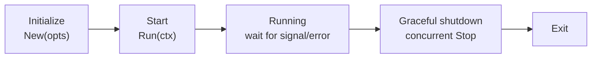
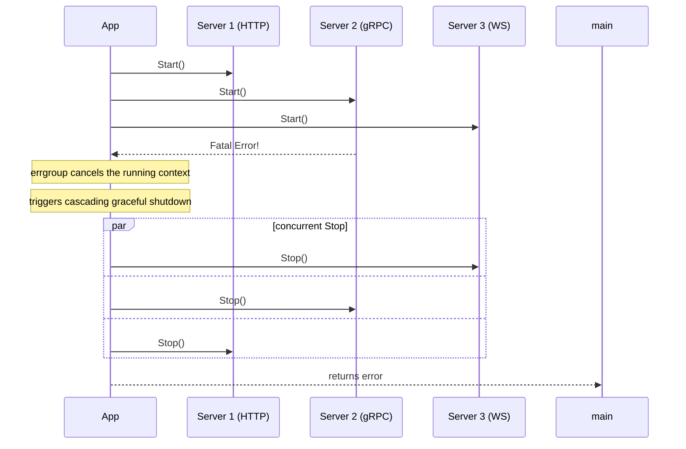

# App Lifecycle Management

The App is the engine core of go-wind, responsible for managing the startup, running, and graceful shutdown of all Servers.

## 1. Lifecycle Phases



## 2. Startup Flow

`Run(ctx)` is orchestrated on top of errgroup. The actual execution order (pseudocode):

```go
func (a *App) Run(ctx context.Context) error {
    // Phase 0: beforeStart hooks —— executed synchronously, before any Server starts;
    //          returning an error aborts startup
    runHooks(a.opts.beforeStart)

    // Phase 1: all Servers start concurrently via errgroup
    eg, egCtx := errgroup.WithContext(ctx)
    for _, srv := range a.servers {
        eg.Go(func() error { return srv.Start(egCtx) })
        // any Server crashes/exits → errgroup cancels egCtx
    }

    // Phase 1.5: afterStart hooks —— executed synchronously after all Servers have started;
    //            returning an error triggers graceful shutdown
    runHooks(a.opts.afterStart)

    // wait for: signal arrival / ctx cancellation / Server crash
    <-egCtx.Done()

    // Phase 2: beforeStop hooks —— executed synchronously, before Server.Stop
    runHooks(a.opts.beforeStop)

    // Phase 3: all Servers stop concurrently, each with its own timeout context
    stopAll()

    // Phase 4: afterStop hooks —— executed synchronously, after Server.Stop
    runHooks(a.opts.afterStop)

    return runErr
}
```

## 3. Startup Phase Extension Points (beforeStart / afterStart)

go-wind provides two lifecycle hooks, `beforeStart` / `afterStart`, as extension points **before and after application startup**, registered via options:

```go
app := wind.New(
    wind.WithBeforeStart(func(ctx context.Context) error {
        // Executed before any Server starts: initialize connection pools, warm up caches, etc.
        return nil
    }),
    wind.WithAfterStart(func(ctx context.Context) error {
        // Executed after all Servers have started: register the service with real
        // listening endpoints, mark the readiness probe, etc.
        return nil
    }),
)
```

Failure semantics:

- **beforeStart returns an error** → startup is aborted and the App returns the error immediately;
- **afterStart returns an error** → a full graceful shutdown is triggered.

Beyond Server Start/Stop, these two hooks are extension points aimed at the application-wide startup phase. Together with the `WithBeforeStop` / `WithAfterStop` shutdown hooks, signal handling, cascade crash handling, and other mechanisms, they form the complete set of App lifecycle events.

## 4. Graceful Shutdown

### 4.1 Concurrent Stop

Upon receiving the shutdown signal, all Servers execute Stop **concurrently**, without depending on registration order:

```text
Phase 2: beforeStop hooks (synchronous, before Stop)
Phase 3: srv1.Stop / srv2.Stop / srv3.Stop  ← concurrent, each with an independent timeout context
Phase 4: afterStop hooks (synchronous, after Stop)
```

Design points: the Stop context is derived from `context.Background()` and **not** from the running context, ensuring the shutdown timeout window is genuinely effective; `App.Stop()` only triggers the cancellation signal and does not call `Server.Stop()` directly — shutdown logic is funneled through a single path.

### 4.2 Timeout Control

```go
app := wind.New(
    wind.WithStopTimeout(30 * time.Second),
)

// On shutdown, each Server has 30 seconds to complete cleanup
```

## 5. Signal Handling

By default, the App automatically listens on `SIGTERM` / `SIGINT` / `SIGQUIT` and triggers graceful shutdown upon receiving a signal, which fits container lifecycle management in Docker/K8s environments. To customize, use `WithSignal`:

```go
app := wind.New(
    wind.WithSignal(syscall.SIGTERM), // Overrides the default signal set
)
```

## 6. Cascade Crash Handling

When any Server returns a fatal error, errgroup automatically cancels the running context and the remaining Servers shut down gracefully:



## 7. Multi-Server Example

```go
func main() {
    app := wind.New(
        wind.WithName("multi-server"),
        wind.WithServer(httpServer, grpcServer, wsServer),
        wind.WithStopTimeout(15 * time.Second),
    )

    if err := app.Run(context.Background()); err != nil {
        log.Fatal(err)
    }
}
```

## Related Documentation

- [Core Framework Introduction](./core-intro.md)
- [Context Propagation](./core-context.md)
- [Transport Abstraction](./core-transport.md)
- [Declarative Bootstrap Introduction](./bootstrap-intro.md)
