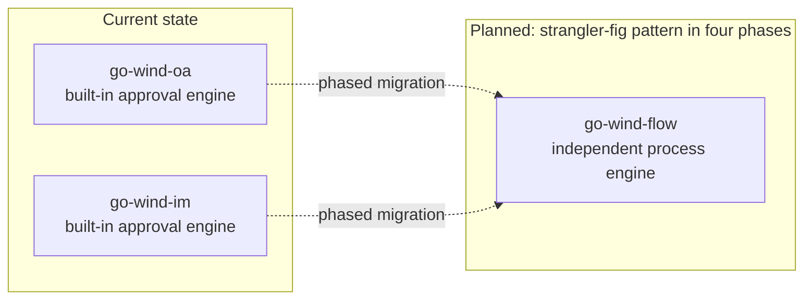
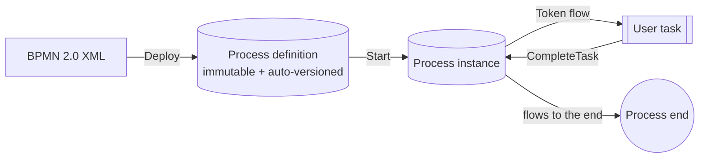

# GoWind Flow Process Engine

GoWind Flow (**Chuan Liu**) is the **lightweight workflow engine** of the go-wind family: BPMN 2.0 compatible, a persistent Token state machine, a zero-dependency core, and pluggable script engines. It aligns with the commonly used subset of Flowable / Camunda / Activiti and, as a pure Go library, embeds mature process orchestration capabilities into any service. The project is open source under the MIT license; the current version is **v0.2.0**.

> **Design philosophy**: the engine manages process flow; scripts manage everything beyond the flow.

- **BPMN 2.0 compatible subset** — aligned with the commonly used subset of Flowable / Camunda / Activiti; the repository provides a full compatibility matrix (`docs/bpmn_compat`)
- **Persistent Token state machine** — process instance state is persisted as Tokens, so execution can continue after a service restart
- **Zero-dependency core** — the core introduces no third-party dependencies; storage and script engines are both pluggable and replaceable
- **Pluggable script engines** — business logic lives in scripts, integrated with the 9 script engines of go-scripts through contrib

## 1. Origin and Current Status

GoWind Flow was extracted and generalized from the **approval flow engines of go-wind-oa / go-wind-im**, distilling the approval workflow capabilities repeatedly refined in those two business products into an independent engine.

Note the distinction from the workflow engine adapters in go-wind-plugins (Temporal / Argo / Conductor / GoWorkflows): those are adapter plugins for third-party engines, while flow is the family's own lightweight engine.

The relationship with the host products, stated as it is:

- **Migration is still being planned** — the plan is to migrate OA / IM to flow in four phases using the "strangler-fig pattern"; see `docs/oa_im_migration` in the repository for the migration roadmap
- **No host product references it yet** — OA / IM still use their respective built-in approval engines; flow has not yet been adopted by any product



**Version trajectory**: the project debuted with v0.1.0 (M0 core skeleton) on 2026-10-30; the current version is v0.2.0, in a period of rapid iteration.

## 2. Quick Start

Use it as an embedded Go library — after `go get`, three steps complete a full flow execution:

```bash
go get github.com/tx7do/go-wind-flow
```

### 2.1 The Three-Step Usage

1. **Create the engine** — `flow.New(WithStore(...), WithImporters(bpmn.Importer{}))`: choose the storage implementation and register the BPMN importer
2. **Deploy the process definition** — `Deploy` deploys a BPMN process definition; definitions are immutable and automatically versioned
3. **Start and drive** — `Start` starts a process instance; `CompleteTask` completes tasks to advance the flow

### 2.2 Example Code (Illustrative)

```go
package main

// Illustrative: consult the repository README for the exact import paths and option signatures
import "github.com/tx7do/go-wind-flow"

func main() {
    // ① Create the engine: choose a storage implementation (ent / gorm / memory) and register the BPMN importer
    engine := flow.New(
        WithStore(/* ... */),
        WithImporters(bpmn.Importer{}),
    )

    // ② Deploy the process definition (immutable, automatically versioned)
    engine.Deploy(ctx, leaveApproval)

    // ③ Start a process instance / complete tasks
    instance, _ := engine.Start(ctx, "leave-approval", variables)
    _ = engine.CompleteTask(ctx, taskID, taskVars)
}
```

> The above is illustrative code for the three-step usage; for complete runnable examples, see the repository's `examples/` and README.



## 3. Architecture Components

| Module | Description |
|------|------|
| `api/` | Pure gRPC contracts, published to buf.build (BSR); clients can reference them remotely |
| `server/` | gRPC service implementation exposing the engine's capabilities as a service |
| `store/` | Three storage implementations: ent / gorm / memory |
| `contrib/goscripts` | Integration with the 9 script engines of go-scripts |
| `frontend/` | npm workspace: @go-wind/flow-designer-core / -vue / -react (v0.2.0), bpmn-js wrapper + approval configuration panel + DingTalk-style vertical approval tree |

The engine can either be called directly as an embedded library or deployed independently as a gRPC service via `server/`, depending on your architectural preference.

## 4. Capabilities

| Capability | Description |
|------|------|
| Countersigning / any-approve | Multi-approver nodes: flow proceeds when everyone approves, or when any one approves |
| Candidate group tasks | Tasks are assigned to candidate groups; members within the group claim and handle them |
| Error events | Catch process errors and branch into exception handling |
| Collection multi-instance | Generate multi-instance tasks item by item from a collection |
| Boundary timer events | Timer boundary events attached to nodes |
| Intermediate message events | Intermediate process nodes wait for / receive messages |
| Auto-approve / reject on timeout | Tasks are approved or rejected automatically after timeout |
| Timer scheduling reference implementation | `examples/scheduler` |
| Example processes | `leave-approval.bpmn.xml`, `timer-approval.bpmn.xml` |

> **Version status**: iterating rapidly after v0.2.0; some capabilities remain in an Unreleased state — refer to the repository CHANGELOG.

## 5. Performance Baseline

The following are benchmark figures from the repository:

| Scenario | Duration |
|------|------|
| Linear-flow approval | ~104µs |
| Linear-flow approval (ent + sqlite storage) | ~1.1ms |

Actual performance depends on the storage medium and process complexity; we recommend benchmarking against your own business processes.

## 6. Repository and Documentation

- Repository: [tx7do/go-wind-flow](https://github.com/tx7do/go-wind-flow) (MIT)
- The tutorial section is under construction; for now, refer to the repository's topical documents:

| Topic Document | Content |
|---------|------|
| `docs/architecture_design` | Architecture design |
| `docs/bpmn_compat` | BPMN 2.0 compatibility matrix |
| `docs/designer_contract` | Designer contract |
| `docs/oa_im_migration` | OA / IM migration roadmap |
| `docs/roadmap` | Roadmap |

## Related Documentation

- [GoWind Framework Overview](/en/framework/intro.md)
