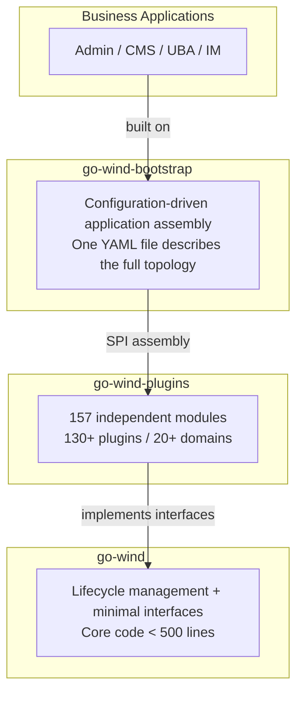
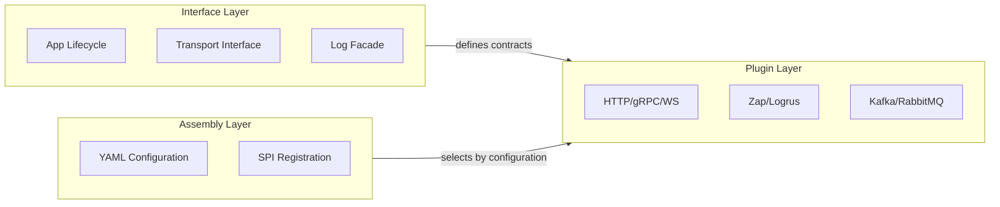

# GoWind Framework

The GoWind framework is a **building-block Go microservices framework** consisting of three layers: the core framework go-wind, the plugin ecosystem go-wind-plugins, and the declarative bootstrap go-wind-bootstrap. It provides complete infrastructure ranging from low-level lifecycle management to declarative, configuration-driven startup.



## 1. The Three Projects

| Project | Repository | Positioning | Core Code |
|------|------|------|---------|
| **go-wind** | [tx7do/go-wind](https://github.com/tx7do/go-wind) | Core framework: lifecycle + minimal interfaces | < 500 lines |
| **go-wind-plugins** | [tx7do/go-wind-plugins](https://github.com/tx7do/go-wind-plugins) | Plugin ecosystem: 130+ plugins across 20+ domains (157 independent go.mod modules) | Independent versioning per submodule |
| **go-wind-bootstrap** | [tx7do/go-wind-bootstrap](https://github.com/tx7do/go-wind-bootstrap) | Declarative bootstrap: YAML-configuration-driven assembly | — |

> **Recent additions**: the go-wind core now provides two lifecycle hooks, `beforeStart` and `afterStart`, offering extension points before and after application startup (see [App Lifecycle Management](./core-lifecycle.md)); the `CodeToHTTP` function in the `errors` package supports explicitly passing error codes 400–599 through as HTTP status codes.

## 2. Design Philosophy

### 2.1 Building-Block Architecture

> Not an all-in-one full-stack framework, but a box of building blocks.

- **Composition over inheritance** — each plugin only implements standard interfaces; business code depends on interfaces rather than implementations
- **Interfaces over implementations** — the core only defines minimal interfaces; concrete implementations are provided by plugins
- **Zero hidden magic** — all behavior is explicit, with no implicit initialization or global state

### 2.2 Layered Responsibilities



### 2.3 Zero External Dependencies

The core framework depends only on `golang.org/x/sync` and introduces no third-party libraries.

## 3. Plugin Domain Overview

Built on unified abstractions across eight major domains with multi-engine adaptation, go-wind-plugins currently contains **157 independent go.mod modules**, roughly **130+ plugins**, covering **20+ domains**:

| Domain | Interface | Plugin Count | Examples |
|------|------|-----------|------|
| Configuration center | Config | 14 | Apollo, Consul, Etcd, Nacos, Polaris, Vault, K8s, ZooKeeper, Redis, OSS, HTTP, Env, File, FS |
| Service registry | Registry | 8 + selector/resolver | Consul, Etcd, Nacos, Eureka, Zookeeper |
| Logging | Logger | 13 | Zap, Zerolog, Logrus, Loki, SLS, CLS, CloudWatch, Sentry |
| Transport protocols | Transport | 31 | HTTP (4 drivers), HTTP/3, gRPC, WebSocket, SSE, Socket.IO, SignalR, KCP, WebRTC, WebTransport, GraphQL, Thrift, tRPC, Cron, Asynq, Machinery, MCP |
| Message queues | Broker | 12 | Kafka, RabbitMQ, NATS, MQTT, Pulsar, RocketMQ, NSQ, SQS, Redis, STOMP, Azure Service Bus, Google Pub/Sub |
| Encoding | Encoding | 12 | JSON, Protobuf, YAML, TOML, MsgPack |
| CRUD | Database | 19 | GORM, Ent, MongoDB, ClickHouse, Doris, ES, OpenSearch, InfluxDB, Cassandra, qdrant, milvus, neo4j, weaviate + api/pagination/cache/audit/viewer |
| Security | Authn/Authz | 20 | 10 authentication suites (JWT/OAuth2 etc.), 9 authorization suites (Casbin, Cedar, Cerbos, OPA, Zanzibar etc.), crypto |

In addition, it covers domains such as circuit breaking (4), rate limiting (3), workflow engines (Temporal/Argo/Conductor/GoWorkflows), object storage (2), AI integration (OpenAI/LangChainGo/Eino), metrics monitoring (Prometheus etc.), distributed tracing (OTLP), and utilities (4) — 20+ domains in total.

Recent developments: the MCP transport now passes through StreamableHTTP/SSE server options; a new vector abstraction connects to four vector/graph databases — qdrant/milvus/neo4j/weaviate; selector client-side load balancing plus a resolver gRPC adapter; and the transaction local-transaction quartet (outbox/saga/tcc/xa).

## 4. Quick Start

### 4.1 Installation

```bash
go get github.com/tx7do/go-wind
go get github.com/tx7do/go-wind-bootstrap
```

### 4.2 Minimal Example

```go
package main

import (
    "github.com/tx7do/go-wind"
    _ "github.com/tx7do/go-wind-plugins/transport/http"    // Import the HTTP plugin
    _ "github.com/tx7do/go-wind-plugins/log/zap"           // Import the Zap logging plugin
    "github.com/tx7do/go-wind-bootstrap"
)

func main() {
    // One-line startup: read YAML configuration and assemble all components
    bootstrap.RunApp()
}
```

### 4.3 Configuration File

```yaml
# app.yaml
name: my-service

servers:
  - name: http
    type: http
    addr: ":8080"

log:
  level: info
  format: json

registry:
  type: etcd
  config:
    endpoints: ["localhost:2379"]
```

## 5. Relationship with Business Applications

| Layer | Project | Description |
|------|------|------|
| Framework infrastructure | go-wind + plugins + bootstrap | Provides the microservices runtime |
| Development tools | [GoWind Toolkit](/en/toolkit/intro.md) | CLI code generation + desktop client |
| Business applications | [Admin](/en/admin/intro.md) / [CMS](/en/cms/intro.md) / [UBA](/en/uba/intro.md) / IM | Out-of-the-box products |

## 6. Related Documentation

### Fundamentals

- [Framework Architecture](./architecture.md)

### go-wind Core

- [Core Framework Introduction](./core-intro.md)
- [App Lifecycle Management](./core-lifecycle.md)
- [Context Propagation](./core-context.md)
- [Transport Abstraction](./core-transport.md)
- [Log Facade Interface](./core-logging.md)

### go-wind-plugins

- [Plugin Ecosystem Overview](./plugins-intro.md)
- [Configuration Center](./plugins-config.md)
- [Service Registry](./plugins-registry.md)
- [Log Adapters](./plugins-log.md)
- [Transport Protocols](./plugins-transport.md)
- [Message Queues](./plugins-broker.md)
- [Encoding](./plugins-encoding.md)
- [Security](./plugins-security.md)
- [Distributed Tracing](./plugins-tracer.md)
- [Cache](./plugins-cache.md)
- [Object Storage](./plugins-oss.md)
- [Rate Limiting and Circuit Breaking](./plugins-ratelimit.md)
- [Metrics Monitoring](./plugins-metrics.md)
- [AI Integration](./plugins-ai.md)
- [Workflow Engines](./plugins-workflow.md)

### go-wind-bootstrap

- [Declarative Bootstrap Introduction](./bootstrap-intro.md)
- [BootstrapConfig Definition](./bootstrap-config.md)
- [SPI Plugin Registration Mechanism](./bootstrap-spi.md)
- [Declarative Middleware Orchestration](./bootstrap-middleware.md)
- [Cobra CLI Integration](./bootstrap-cli.md)
- [Complete Examples](./bootstrap-examples.md)

### Tutorials

| Stage | Tutorial | Description |
|------|------|------|
| Beginner | [Building a Microservice from Scratch](./tutorial-quick-start.md) | Quick setup with the bootstrap |
| Core | [Custom Plugin Development](./tutorial-custom-plugin.md) | Implementing go-wind interfaces |
| Core | [Listening on Multiple Protocols Simultaneously](./tutorial-multi-transport.md) | HTTP + gRPC + WebSocket |
| Advanced | [Migrating from Kratos](./tutorial-migration.md) | Migration guide |
