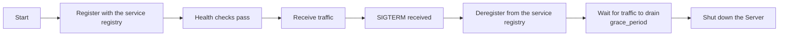

# Bootstrap Integration and Gateway Plugins

::: warning Family Status Note (defer to the repository)
The go-wind-plugins repository **no longer contains a `gateway/` plugin family** (no corresponding directory, module, or README matrix entry). The capabilities described below under "API Gateway" and "Webhook Callbacks" have no corresponding implementation in the current state of the repository, and their whereabouts are not officially documented — defer to the actual repository state.

Capabilities in the current repository that correspond to these needs:

- **gRPC service clients**: provided by the `transport/grpc/client` module (see Section 2.1, updated to match the current state);
- **Health checks**: the top-level `health/` module provides HTTP health check endpoints (see Section 3);
- **Scheduled jobs**: `transport/cron` (robfig/cron);
- **Load balancing**: the top-level `selector/` module (RoundRobin/Random/First + Watch Balancer).
:::

go-wind-plugins also provides advanced plugins such as service clients and health checks, deeply integrated with Bootstrap.

## 1. API Gateway

### 1.1 Gateway Routes

```go
import gatewayPlugin "github.com/tx7do/go-wind-plugins/gateway"

gw := gatewayPlugin.New(
    gatewayPlugin.WithAddr(":8080"),
    gatewayPlugin.WithRoutes([]gatewayPlugin.Route{
        {Prefix: "/api/users", Service: "user-service", StripPrefix: true},
        {Prefix: "/api/orders", Service: "order-service", StripPrefix: true},
        {Prefix: "/api/products", Service: "product-service", StripPrefix: false},
    }),
    gatewayPlugin.WithLoadBalancer("round_robin"),
)
```

### YAML Configuration

```yaml
gateway:
  addr: ":8080"
  load_balancer: round_robin        # round_robin | random | weighted | least_conn
  routes:
    - prefix: /api/users
      service: user-service
      strip_prefix: true
      timeout: 10s
      retry: 3
    - prefix: /api/orders
      service: order-service
      strip_prefix: true
  middleware:
    - rate_limit
    - jwt_auth
    - cors
    - tracing
```

### 1.2 Load Balancing Strategies

| Strategy | Description |
|----------|-------------|
| `round_robin` | Round robin (default) |
| `random` | Random |
| `weighted` | Weighted (based on service instance weights) |
| `least_conn` | Least connections |
| `consistent_hash` | Consistent hashing (session affinity) |

## 2. Service Clients

### 2.1 gRPC Client

The gRPC client wrapper lives in `transport/grpc/client`:

```go
import grpcClientPlugin "github.com/tx7do/go-wind-plugins/transport/grpc/client"

conn := grpcClientPlugin.NewClient("user-service",
    grpcClientPlugin.WithInsecure(),                     // or WithTransportCredentials(creds)
    grpcClientPlugin.WithDialOption(grpc.WithResolvers(resolver)),
    grpcClientPlugin.WithMiddleware(retryMiddleware),
)

userClient := pb.NewUserServiceClient(conn)
resp, _ := userClient.GetUser(ctx, &pb.GetUserRequest{Id: "123"})
```

Combined with the top-level `resolver/` module, addressing through the service registry is possible: `grpc.NewClient("wind:///svc", grpc.WithResolvers(...))`.

### 2.2 HTTP Client

::: warning
The current repository has no standalone HTTP service client module (`client/http` does not exist).
:::

```go
import httpClientPlugin "github.com/tx7do/go-wind-plugins/client/http"

client := httpClientPlugin.New(
    httpClientPlugin.WithBaseURL("http://user-service"),
    httpClientPlugin.WithTimeout(5*time.Second),
    httpClientPlugin.WithRetry(3, 100*time.Millisecond),
    httpClientPlugin.WithTracing(true),
)
```

## 3. Health Checks

```go
import healthPlugin "github.com/tx7do/go-wind-plugins/health"

healthChecker := healthPlugin.New(
    healthPlugin.WithCheck("database", func(ctx context.Context) error {
        return dbClient.Ping(ctx)
    }),
    healthPlugin.WithCheck("redis", func(ctx context.Context) error {
        _, err := redisCache.Ping(ctx)
        return err
    }),
    healthPlugin.WithCheck("kafka", func(ctx context.Context) error {
        return kafkaBroker.Ping(ctx)
    }),
)
```

### HTTP Endpoints

```go
// Automatically registers the /health and /ready endpoints
// GET /health → liveness check (is the process alive)
// GET /ready  → readiness check (are dependencies ready)
```

```yaml
health:
  enabled: true
  liveness_path: /health
  readiness_path: /ready
  checks:
    database:
      interval: 10s
      timeout: 3s
      failures: 3        # marked unhealthy after 3 consecutive failures
    redis:
      interval: 5s
      timeout: 1s
```

## 4. Graceful Online/Offline

Achieved by combining service registration with health checks:



```yaml
registry:
  consul:
    addr: "localhost:8500"
    deregister:
      critical_timeout: 60s       # auto-deregister 60s after becoming unhealthy
    health_check:
      interval: 10s
      deregister_after: 30s

lifecycle:
  grace_period: 15s               # wait 15s after receiving the signal
  shutdown_timeout: 30s           # graceful shutdown timeout
```

## 5. Event-Driven Architecture

### Webhook Callbacks

```go
import webhookPlugin "github.com/tx7do/go-wind-plugins/webhook"

wh := webhookPlugin.New(
    webhookPlugin.WithRetry(3, 5*time.Second),
    webhookPlugin.WithTimeout(10*time.Second),
    webhookPlugin.WithHMACKey("webhook-secret"),
)

wh.Subscribe("order.created", "https://partner.com/webhooks/order")
wh.Publish(ctx, "order.created", orderData)
```

## 6. Scheduled Job Orchestration

Orchestrate scheduled jobs in Bootstrap via annotations/configuration:

```yaml
tasks:
  - name: daily-report
    schedule: "0 9 * * *"          # every day at 9 AM
    handler: report.DailyReport
    queue: low

  - name: cleanup-tokens
    schedule: "0 0 * * 0"          # every Sunday
    handler: auth.CleanupExpiredTokens
    queue: default
```

## Related Documents

- [Plugin Overview](./plugins-intro.md)
- [Plugin Configuration System](./plugins-config.md)
- [Declarative Bootstrap Introduction](./bootstrap-intro.md)
- [Declarative Middleware Orchestration](./bootstrap-middleware.md)
