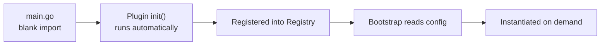

# Plugin Registration Mechanism (SPI)

go-wind-plugins uses Go's `init()` + blank import mechanism to implement SPI (Service Provider Interface) auto-registration, with no manual wiring required.

## 1. How SPI Works



## 2. Registry Design

```go
// bootstrap/registry/registry.go
package registry

// Transport registry
var transportFactories = map[string]TransportFactory{}

type TransportFactory func(opts ...transport.Option) transport.Server

func RegisterTransport(name string, factory TransportFactory) {
    transportFactories[name] = factory
}

func NewTransport(name string, opts ...transport.Option) (transport.Server, error) {
    factory, ok := transportFactories[name]
    if !ok {
        return nil, fmt.Errorf("unknown transport: %s", name)
    }
    return factory(opts...), nil
}
```

Similarly there are `RegisterDatabase`, `RegisterCache`, `RegisterBroker`, `RegisterLog`, `RegisterConfig`, `RegisterRegistry`, and so on.

## 3. Plugin Registration Examples

### 3.1 HTTP Transport

```go
// plugins/transport/http/register.go
package http

import "github.com/tx7do/go-wind-bootstrap/registry"

func init() {
    registry.RegisterTransport("http", func(opts ...transport.Option) transport.Server {
        return NewServer(opts...)
    })
}
```

### 3.2 Redis Cache

```go
// plugins/cache/redis/register.go
package redis

import "github.com/tx7do/go-wind-bootstrap/registry"

func init() {
    registry.RegisterCache("redis", func(opts ...Option) cache.Cache {
        return NewClient(opts...)
    })
}
```

### 3.3 Data-Access Client (GORM)

```go
// plugins/crud/gorm/register.go
package gorm

import "github.com/tx7do/go-wind-bootstrap/registry"

func init() {
    registry.RegisterDatabase("gorm", func(opts ...Option) (*Repository[any, any], error) {
        return NewRepository(opts...)
    })
}
```

## 4. Blank Import

In main.go, blank imports (underscore imports) trigger `init()`:

```go
package main

import (
    // Transport
    _ "github.com/tx7do/go-wind-plugins/transport/http"
    _ "github.com/tx7do/go-wind-plugins/transport/grpc"

    // Log
    _ "github.com/tx7do/go-wind-plugins/log/zap"

    // Database
    _ "github.com/tx7do/go-wind-plugins/crud/gorm"

    // Cache
    _ "github.com/tx7do/go-wind-plugins/cache/redis"

    // Broker
    _ "github.com/tx7do/go-wind-plugins/broker/kafka"

    // Bootstrap
    "github.com/tx7do/go-wind-bootstrap"
)

func main() {
    app := bootstrap.New("config.yaml")
    app.Run()
}
```

If you don't import it, it won't be registered, and it won't add to the binary size.

## 5. On-Demand Loading

Go does not have Java-style lazy class loading, but blank imports bring these benefits:

| Feature | Description |
|---------|-------------|
| Determined at compile time | You know at build time which plugins are depended on |
| No reflection | No reliance on reflection, high performance |
| Binary trimming | Plugins that are not imported are not compiled into the binary |
| Explicit declaration | A glance at the imports tells you which plugins are in use |

## 6. Registering Custom Plugins

Develop your own plugin and register it into the Registry:

```go
package mycache

import (
    "github.com/tx7do/go-wind/cache"
    "github.com/tx7do/go-wind-bootstrap/registry"
)

type Cache struct { ... }

func NewCache(opts ...Option) cache.Cache {
    c := &Cache{}
    for _, opt := range opts { opt(c) }
    return c
}

// Registration
func init() {
    registry.RegisterCache("mycache", func(opts ...Option) cache.Cache {
        return NewCache(opts...)
    })
}
```

In main.go:

```go
import _ "myproject/plugins/mycache"
```

## 7. Registry Functions at a Glance

| Registry Function | Registers | Config Prefix |
|------------------|-----------|---------------|
| `RegisterTransport` | Transport Server | `server.*` |
| `RegisterLog` | Logger | `log.*` |
| `RegisterDatabase` | Data-access client | `database.*` |
| `RegisterCache` | Cache | `cache.*` |
| `RegisterBroker` | Broker | `broker.*` |
| `RegisterConfig` | Config Source | `config.*` |
| `RegisterRegistry` | Service Registry | `registry.*` |
| `RegisterTracer` | Tracer | `tracer.*` |
| `RegisterOSS` | Object Storage | `oss.*` |
| `RegisterMetrics` | Metrics | `metrics.*` |
| `RegisterAuth` | Authenticator | `auth.*` |

## 8. Service Registration & Discovery Plugins (Registry)

Note the distinction between two concepts: the "registration mechanism" discussed above refers to the SPI auto-wiring of plugins; this section covers the **service registration & discovery** plugin family (`registry/`), which implements the `registry.Registry` (Registrar / Discovery / Watcher) interfaces, with 8 plugins in total:

| Plugin | Import Path | Engine |
|--------|------------|--------|
| Consul | `plugins/registry/consul` | HashiCorp Consul |
| Etcd | `plugins/registry/etcd` | CoreOS etcd |
| Eureka | `plugins/registry/eureka` | Netflix Eureka |
| Kubernetes | `plugins/registry/kubernetes` | K8s Endpoints |
| Nacos | `plugins/registry/nacos` | Alibaba Cloud Nacos |
| Polaris | `plugins/registry/polaris` | Tencent Cloud Polaris |
| ServiceComb | `plugins/registry/servicecomb` | Apache ServiceComb |
| Zookeeper | `plugins/registry/zookeeper` | Apache ZooKeeper |

**Where selector / resolver belong**: `selector` (client-side load balancing strategies RoundRobin/Random/First plus a Watch-based real-time Balancer) and `resolver` (a gRPC `resolver.Builder`, supporting addressing through the service registry via `grpc.NewClient("wind:///svc", grpc.WithResolvers(...))`) are two standalone modules at the repository root. They are **not part of the registry family**, but work alongside service registration & discovery: Discovery provides the instance list, selector picks one, and resolver plugs it into gRPC addressing.

## Recent Updates

- **etcd** (`registry/etcd`): heartbeats are now driven by a registry-level long-lived context; after a lease expires, re-registration is **never abandoned** (retry burst interval with a 30s cooldown), so registrations are no longer permanently lost due to transient failures.
- **eureka** (`registry/eureka`): added a `MaxRetry` client option to configure the number of request retries against the Eureka Server.

## Related Documents

- [Plugin Configuration System](./plugins-config.md)
- [Plugin Overview](./plugins-intro.md)
- [Bootstrap SPI Mechanism](./bootstrap-spi.md)
- [Custom Plugin Development Tutorial](./tutorial-custom-plugin.md)
