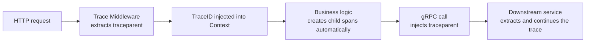

# Distributed Tracing Plugins

go-wind-plugins provides distributed tracing adapters following the OpenTelemetry standard. The tracing family has only **one plugin, OTLP**: all mainstream backends are reached through an OTLP endpoint, with no need to swap plugins.

## 1. The Tracer Interface

```go
type Tracer interface {
    StartSpan(ctx context.Context, name string, opts ...SpanOption) (context.Context, Span)
    Inject(ctx context.Context, carrier propagator.TextMapCarrier)
    Extract(ctx context.Context, carrier propagator.TextMapCarrier) context.Context
    Close(ctx context.Context) error
}

type Span interface {
    End()
    SetAttributes(kv ...KeyValue)
    AddEvent(name string, ...EventOption)
    RecordError(err error)
    SetStatus(code StatusCode, msg string)
}
```

## 2. Adapter List

| Adapter | Import Path | Backend |
|---------|------------|---------|
| OTLP | `plugins/tracer/otlp` | OpenTelemetry Protocol (universal) |

OTLP is the standard protocol of OpenTelemetry and supports all mainstream backends: Jaeger, Zipkin, SkyWalking, Tempo (Grafana), Datadog, Alibaba Cloud ARMS, Tencent Cloud APM, and more. Switching backends only requires changing the endpoint — no plugin swap needed.

## 3. OTLP (Recommended)

```go
import "github.com/tx7do/go-wind-plugins/tracer/otlp"

// Returns the native *sdktrace.TracerProvider, and sets the global TracerProvider
// and W3C propagator
tp, _ := otlp.New(
    otlp.WithEndpoint("localhost:4317"),
    otlp.WithServiceName("my-service"),
    otlp.WithSampleRatio(1.0),
    // otlp.WithHTTP(),                 // switch to OTLP HTTP export
    // otlp.WithServiceVersion("v1.0.0"),
    // otlp.WithHeaders(map[string]string{"authorization": "..."}),
)
defer tp.Shutdown(context.Background())

// After initialization, use the standard OpenTelemetry API
tracer := tp.Tracer("my-service")
```

### YAML Configuration

```yaml
tracer:
  otlp:
    endpoint: "localhost:4317"        # OTLP gRPC endpoint
    insecure: true
    sample_ratio: 1.0                 # sampling rate (0~1)
    service_name: my-service
    resource:
      deployment.environment: production
      host.name: ${HOSTNAME}
```

## 4. Backend Integration (Jaeger / Zipkin / SkyWalking, etc.)

There are no separate Jaeger / Zipkin plugins — they connect as downstreams of OTLP:

```yaml
# Jaeger (native OTLP, default port 4317)
tracer:
  otlp:
    endpoint: "jaeger:4317"

# Grafana Tempo
tracer:
  otlp:
    endpoint: "tempo:4317"
```

The same applies to backends such as SkyWalking, Alibaba Cloud ARMS, and Tencent Cloud APM that support OTLP ingestion: just replace the endpoint (passing auth information via `headers` if necessary).

## 5. Using Tracing in Code

### 5.1 Creating Spans

```go
import "github.com/tx7do/go-wind/tracer"

func handleOrder(ctx context.Context, order *Order) error {
    ctx, span := tracer.StartSpan(ctx, "handleOrder")
    defer span.End()

    span.SetAttributes(
        tracer.String("order.id", order.ID),
        tracer.Int("item.count", len(order.Items)),
    )

    if err := validate(ctx, order); err != nil {
        span.RecordError(err)
        span.SetStatus(tracer.StatusError, err.Error())
        return err
    }

    return nil
}
```

### 5.2 Cross-Service Propagation

Trace context is propagated automatically via HTTP headers / gRPC metadata:

```go
// HTTP: the traceparent header is injected automatically
// gRPC: x-trace-* metadata is injected automatically
// No manual propagation is needed when calling other services
```

### 5.3 Adding Events

```go
ctx, span := tracer.StartSpan(ctx, "process-payment")
defer span.End()

span.AddEvent("payment.started")
// ... process the payment
span.AddEvent("payment.completed",
    tracer.String("transaction.id", txID),
)
```

## 6. Sampling Strategies

| Strategy | Description | Typical Use |
|----------|-------------|-------------|
| `const(1)` | Sample everything | Development/testing |
| `probabilistic(0.1)` | 10% sampling | Production |
| `ratelimiting(100)` | 100 spans/s | Rate-limited sampling |
| `remote` | Dynamically configured | Large clusters |

## 7. Context Integration



The TraceID is also written into the go-wind Context, so it can be correlated in logs:

```go
ctx, span := tracer.StartSpan(ctx, "operation")
traceID := wind.TraceID(ctx)

log.Info("processing", log.String("trace_id", traceID))
// Logs automatically carry trace_id, which links to the Jaeger UI
```

## Related Documents

- [Context Propagation](./core-context.md)
- [Plugin Configuration System](./plugins-config.md)
- [Metrics Plugins](./plugins-metrics.md)
