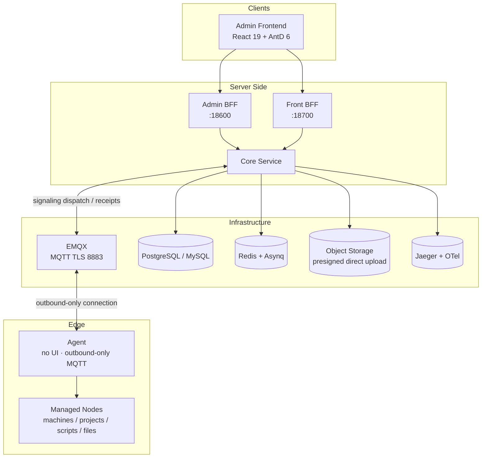

# GoWind Ops Product Overview

GoWind Ops is an out-of-the-box multi-node operations platform, implemented full-stack in Go and open-sourced under the MIT license. Managing machines, running projects, dispatching scripts, and building & distributing artifacts are all done in one place, with foundation capabilities such as organization & permissions, auditing, and dictionaries built in — it can serve directly as an enterprise internal operations middle platform.

> Current version: v1.0.0 being finalized (Phases 1-10 all complete) · License: MIT License · Repository: [github.com/tx7do/go-wind-ops](https://github.com/tx7do/go-wind-ops)

## 1. Product Positioning

Day-to-day operations across multiple machines is scattered across SSH terminals, script folders, cron jobs, and chat logs — hard to audit and hard to collaborate on. GoWind Ops consolidates these actions into one platform:

- **Manage machines**: machine fingerprint admission, heartbeat metrics, online status, and resource trends — full lifecycle control over nodes
- **Run projects**: a project consists of a node + directory + start/stop commands — start/stop has a basis and changes have a timeline
- **Dispatch scripts**: versioned script management, batch dispatch to multiple hosts, the whole process on record
- **Build and distribute**: from source build to gray-release artifact distribution, orchestrated in one pipeline
- **Foundation built in**: platform-foundation capabilities such as organization & permissions, audit logs, and dictionaries work out of the box

::: tip
The Agent is an edge proxy: no UI, outbound-only MQTT connection. A managed node only needs outbound access to EMQX to join — no inbound ports need to be opened on the node.
:::

## 2. Core Highlights

- **Secure admission**: TOFU (Trust On First Use) machine fingerprint admission, combined with heartbeat online status, keeps unknown nodes out
- **Full auditing**: the command ledger records receipts, exit codes, durations, and idempotent request_id; web terminal sessions are fully audited with read-only replay
- **Trustworthy signaling**: command envelopes are signed with HMAC-SHA256; MQTT QoS1 + idempotent deduplication; encrypted transport over TLS 8883
- **Closed-loop governance**: alerts auto-flagged RECOVERY on recovery, operation approvals (create a ticket first for sensitive operations), and maintenance-window muting
- **Multi-cloud view**: Alibaba Cloud / Tencent Cloud / Huawei Cloud / AWS account onboarding — resource inventory, cost ledger, and bill import on one screen
- **Platform foundation**: MFA TOTP + backup codes, OIDC SSO, six categories of audit logs + hash chain + ECDSA signatures with verification tools

## 3. Feature Overview

### 1. Nodes and Projects

| Feature | Description |
|------|------|
| Node admission | TOFU (Trust On First Use) machine fingerprint admission; admit / revoke / restore |
| Heartbeat metrics | Metrics reported with every 30s heartbeat; online status; CPU / memory / disk trends |
| Project management | A project is node + directory + start/stop commands; change timeline |
| Command ledger | Full auditing: receipts / exit codes / durations / idempotent request_id |
| Run logs | Live tailing via WebSocket |

### 2. Terminal and Files

| Feature | Description |
|------|------|
| Web terminal | Based on xterm.js; full session auditing + read-only replay; one-time tickets; idle auto-disconnect |
| File manager | Online editing; drag-and-drop upload; presigned direct upload to object storage |
| Batch commands | Multi-host matrix execution |
| Batch upload | Batch file upload across multiple nodes |

### 3. Scripts, Build and Distribution

| Feature | Description |
|------|------|
| Script management | Versioned; timeouts automatically kill the process tree |
| Source repositories | Git repositories stored AES-encrypted |
| Builds | Artifacts stored in object storage; build logs live-tailed; artifact retention policies |
| Distribution | zip hardened against Zip Slip attacks; batched gray release; Docker image tag injection |
| Build pipeline | BUILD-SCRIPT-DISTRIBUTION three-stage orchestration |
| Scheduled tasks | Scheduled execution of scripts / commands |
| Configuration center | Template-rendered dispatch; configuration drift detection |

### 4. Observability and Governance

| Feature | Description |
|------|------|
| Monitoring & alerts | Four types: project liveness / node thresholds / lost contact / process guard; automatic RECOVERY flag on recovery |
| Notification channels | DingTalk, Feishu (with signature), WeCom, email |
| Certificate ledger | Certificate inventory with expiry alerts |
| Backup & restore | Backup tasks + one-click restore to a node |
| Inspection reports | One-click aggregation; scheduled inspections supported |
| Log snapshots | Cross-project search |
| Operations dashboard | Global operations overview |
| Operation approvals | Sensitive operations create a ticket first; approval tickets expire on timeout |
| Maintenance windows | Alert suppression during quiet periods |

### 5. Cloud Management

| Feature | Description |
|------|------|
| Multi-cloud accounts | Alibaba Cloud / Tencent Cloud / Huawei Cloud / AWS |
| Resource inventory | ECS / CVM / EC2 inventory across all regions; node IP reconciliation |
| Cost ledger | Monthly trends; multi-currency |
| Bill fetching | One-click import into the ledger |
| Budget alerts | Budget and spike-detection alerts |

### 6. Platformization

| Feature | Description |
|------|------|
| OpenAPI | API Key authentication; build / distribution pipeline trigger endpoints |
| Git Webhook | Triggered by GitHub / GitLab / Gitea webhooks |
| Release console | Environment promotion pipeline: the same artifact promoted stage by stage across environments |
| Plugin commands | Plugin-based command extension |
| Agent upgrade | Remote upgrade with self-replacement + relayed restart |

### 7. Security Foundation

| Feature | Description |
|------|------|
| MFA | TOTP + backup codes |
| SSO | OIDC single sign-on |
| Session management | Session viewing and forced sign-out |
| Auditing | Six categories of audit logs; hash chain + ECDSA signatures; verification tools |

## 4. Client Forms

| Client | Form | Description |
|------|------|------|
| Admin frontend | Web (React 19 + AntD 6) | The single operations entry for ops staff |
| Agent | Edge proxy (no UI) | Deployed on managed nodes; connects to the platform over outbound-only MQTT |

## 5. Technical Architecture

### Backend Tech Stack

| Layer | Technology | Description |
|------|------|------|
| Language | Go 1.26+ | A single language for the whole stack |
| Microservice framework | go-kratos | Four-service architecture |
| Signaling channel | EMQX (MQTT) | Shared subscriptions / QoS1 + idempotency / TLS 8883 / broker authentication callback |
| Object storage | MinIO | Presigned direct upload |
| ORM / database | Ent + PostgreSQL / MySQL | Relational storage |
| Task queue | Redis + Asynq | Asynchronous task scheduling |
| Command security | HMAC-SHA256-signed command envelopes | Tamper-proof and replay-proof (idempotent) |
| Observability | Jaeger + OpenTelemetry | Distributed tracing |

### System Architecture

### Four-Service Responsibilities

| Service | Port | Responsibilities |
|------|------|------|
| Core | internal gRPC | Core business logic and data layer |
| Admin BFF | :18600 | Admin console HTTP API |
| Front BFF | :18700 | Frontend HTTP API |
| Agent | — | Edge proxy, no UI, connects over outbound-only MQTT |

> The platform and the Agent exchange signaling through EMQX: shared subscriptions enable horizontal scaling, QoS1 + idempotency guarantee at-least-once delivery without duplicate execution, TLS 8883 encrypts the channel, and the broker authentication callback hooks into platform admission.

## 6. UI Preview

|  |  |
| :---: | :---: |
| Operations dashboard | Node management (machine fingerprint admission) |

|  |  |
| :---: | :---: |
| Project management (start/stop commands + change timeline) | Web terminal (full auditing + read-only replay) |

|  |  |
| :---: | :---: |
| File manager (online editing + presigned direct upload) | Batch commands (multi-host matrix) |

|  |  |
| :---: | :---: |
| Command ledger (full auditing) | Alert records (four types of monitoring alerts) |

|  | |
| :---: | :---: |
| Build history (artifacts + log tail) | |

## 7. Repository and Contact

- **Source repository**: [github.com/tx7do/go-wind-ops](https://github.com/tx7do/go-wind-ops)
- **Quick start**: [GoWind Ops Quick Start](/en/ops/quick-start.md)
- **Business contact**: WeChat `yang_lin_bo` | Email <yanglinbo@gmail.com>
