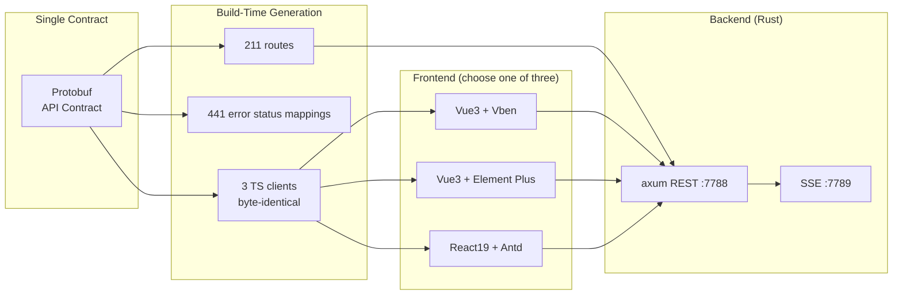

# RushWind Admin Product Overview

RushWind Admin is a **contract-driven Rust enterprise admin console**: Protobuf is the sole API contract, with routes, error mappings, and TypeScript clients all deterministically generated at build time. It replicates the capability surface of go-wind-admin in Rust and is positioned as a "production-ready base", open-sourced under the MIT license.



## 1. Core Highlights

| # | Highlight | Description |
|---|------|------|
| 1 | Contract generation chain | 211 routes, 441 error status mappings, 206 service interfaces with zero hand-writing; three TS clients byte-identical |
| 2 | Three mainstream frontends with zero changes | Vue3 Vben / Element Plus and React19 Antd plug in directly, without changing a line of frontend code |
| 3 | Multi-tenant RBAC | Menu / button / five-tier data / field blacklist — four levels of permission granularity |
| 4 | MLPS 2.0 (China's Multi-Level Protection Scheme) built in | Six audit log categories, 180-day retention and archiving (JSONL), the password policy trio, TOTP MFA, AES password transport encryption |
| 5 | Authentication system | JWT RS256 + HttpOnly Cookie refresh tokens + AK/SK machine credentials |
| 6 | Multi-tenant row-level isolation | Tenant conditions injected automatically on reads, forgery prevention on writes, fail-closed by default |
| 7 | Differential regression testbed | Automatic sweep of all 211 routes against the Go reference stack, compared byte by byte |
| 8 | 30+ feature modules | Users / tenants / plans / roles / organizations / menus / dictionaries / tasks / files / notification channels / script system (hot-pluggable Lua + JS) / six log categories / Redis monitoring, and more |
| 9 | List export | Aggregated CSV / XLSX export with a default cap of 10,000 rows |
| 10 | API documentation | Swagger UI + ReDoc built in, available as soon as the service starts |

### 1.1 What the contract generation chain means

In traditional development, route registration, error-code tables, and frontend SDKs are three pieces of duplicated work — and the places most prone to drifting apart. RushWind Admin converges all three onto a single Protobuf contract:

- **Backend routes**: 211 routes generated at build time — there is no endpoint that exists "in the contract but not in the code"
- **Error mappings**: 441 error status mappings generated along with the contract; frontend and backend share one error-code table
- **Frontend clients**: each of the three frontends receives a TS client, and the three files are byte-identical — when the contract changes, all three change in sync, so no client can miss an update

### 1.2 Differential regression against the Go reference stack

The Go–Rust differential testbed provided by rushwind-toolkit is practiced in this project as a routine regression measure: with go-wind-admin as the reference stack, all 211 routes are swept automatically and the responses of both sides are compared byte by byte. Whether the Rust version truly matches the Go version's behavior has a machine-generated answer at every regression.

## 2. UI Preview

The screenshots below come from the demo environment and convey the overall interface style at a glance.

**Login / workbench**

| Login page (captcha + tenant ID) | Console dashboard |
| --- | --- |
|  |  |

**Organization and permissions**

| User management (org tree + advanced query) | Menu management |
| --- | --- |
|  |  |

**Auditing and sessions**

| Operation audit | Online users (forced offline) |
| --- | --- |
|  |  |

**API documentation**

| Swagger UI | ReDoc |
| --- | --- |
|  |  |

## 3. Online Demo

No local deployment required — visit the three demo sites directly:

| Demo client | Address |
|--------|------|
| Vue Vben edition | <https://vben.admin.gowind.cloud> |
| Vue Element edition | <https://ele.admin.gowind.cloud> |
| React edition | <https://react.admin.gowind.cloud> |
| Swagger API docs | <https://api.demo.admin.gowind.cloud/docs/> |

::: tip
The three frontends share the same interface assets as the GoWind Admin demo sites and look identical; what differs is the backend language and runtime characteristics.
:::

## 4. Tech Stack and Local Run

### 4.1 Tech Stack

| Dimension | Core technologies |
|------|---------|
| Language & framework | Rust + axum 0.8 |
| ORM | SeaORM |
| Database | PostgreSQL |
| Cache | Redis |
| API contract | Protobuf (sole contract; routes / error mappings / TS clients generated at build time) |

### 4.2 Start the Backend

```bash
# Start the two services: REST(:7788) + SSE(:7789)
cargo run -p admin-api
```

### 4.3 Start the Frontend (choose one of three)

| Frontend | dev port |
|------|---------|
| React | 5888 |
| Element Plus | 5777 |
| Vben | 5666 |

### 4.4 Learning Path

The repository's docs/ provides two companion resources:

- **8-chapter progressive tutorial**: the complete path from environment preparation to module-level secondary development
- **Two-layer documentation index**: overview first, then details; go deeper as needed

::: warning Implementation progress
Some modules are fully implemented while other endpoints are stubs for now; refer to the repository's development-plan.md for the current progress.
:::

## 5. Repository and Contact

- GitHub: <https://github.com/tx7do/rushwind-admin>
- WeChat: `yang_lin_bo` (please note: Company-Name-Need when adding)
- Email: <yanglinbo@gmail.com>

## 6. Related Documents

- [RushWind Family Overview](/en/rushwind/intro.md)
- [GoWind Admin Product Overview](/en/admin/intro.md): full feature documentation of the Go reference stack
