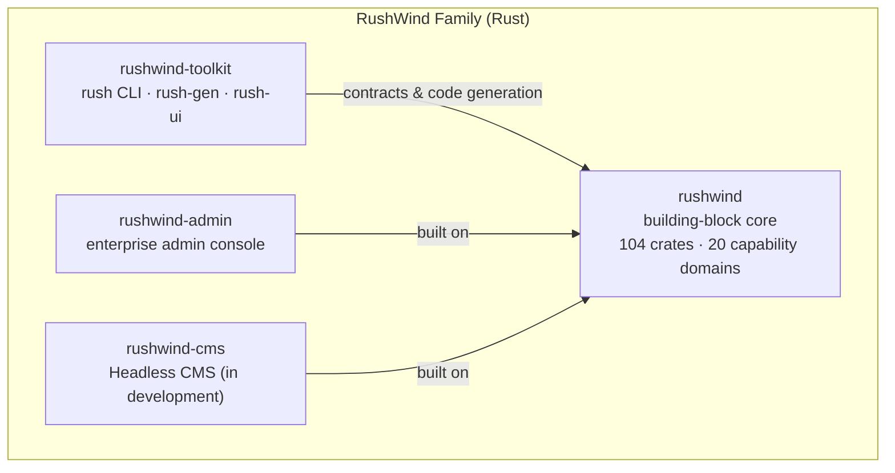

# RushWind (Rust Ecosystem)

RushWind is the GoWind engineering philosophy put into practice in **Rust**: the second implementation of the same "building-block framework + contract-driven + full-chain code generation" methodology, aimed at scenarios with demands for **extreme performance, memory safety, and new protocols** (QUIC / WebTransport / HTTP/3).

RushWind and GoWind are **parallel, complementary** product lines, not replacements for each other: the Go side emphasizes lightness and AI-generation friendliness, while the Rust side emphasizes performance and memory safety. The two lines share the same methodology — the core does only minimal orchestration, and every capability is a pluggable "building block"; the interface contract is the single source of truth, with routes, clients, and documentation all deterministically generated at build time.

## 1. Methodology: Three Keywords

"Building-block framework + contract-driven + full-chain code generation" — this trio of phrases is the shared methodological core of GoWind and RushWind, implemented on each side following its language's conventions:

| Keyword | Meaning | How RushWind implements it |
|--------|------|------------------|
| Building-block framework | The core does only minimal orchestration; all capabilities are pluggable | rushwind does only lifecycle orchestration; the 104 crates are used as needed |
| Contract-driven | The interface contract is the single source of truth | Protobuf contracts; routes / error mappings / TS clients generated at build time |
| Full-chain code generation | The entire chain from entities to frontend pages is generated | rush CLI's `gen entity` / `gen pages` generate the three stacks in one pass |

The direct benefit of this shared methodology is that **experience transfers between the two sides**. Contract designs, permission models, and frontend assets accumulated on either side apply equally on the other.

## 2. The Four Family Repositories

The RushWind family consists of four repositories, structurally mirroring the GoWind family one to one:

| Repository | Role | Description |
|------|------|------|
| [rushwind](https://github.com/tx7do/rushwind) | Building-block core | Multi-server lifecycle orchestration + the full set of contract definitions; protocol stacks and storage engines are independent crates |
| [rushwind-toolkit](https://github.com/tx7do/rushwind-toolkit) | Toolbox | rush CLI + rush-gen code generation library + rush-ui desktop shell |
| [rushwind-admin](https://github.com/tx7do/rushwind-admin) | Enterprise admin console | Contract-driven Rust admin console; see [RushWind Admin](/en/rushwind/admin.md) |
| [rushwind-cms](https://github.com/tx7do/rushwind-cms) | Headless CMS | In development: one contract generating both REST + gRPC |

### 1.1 rushwind: the building-block core

> Not an all-in-one bundle, but a box of building blocks.

The core does exactly one thing: **multi-server lifecycle orchestration** — concurrent startup, cascading shutdown, and staged, time-limited execution. Every other capability is split into contracts and independent crates to be used as needed; protocol stacks and storage engines are not part of the core.

| Dimension | Status |
|------|------|
| Crate scale | 104 crates; all 20 capability domains delivered |
| Memory safety | `#![forbid(unsafe_code)]` across the entire workspace, 100% safe code |
| Transport matrix | axum / WebSocket / QUIC (quinn) / WebTransport (wtransport) / HTTP/3 / MQTT / SSE |
| Storage abstraction | One Repository contract adapting 12 storage engines |
| Authentication | 8 authentication engines |
| Service registration | 8 registry engines |
| Messaging | 8 messaging engines |
| Scripting | 5 script engines: Wasm / CEL / Lua / JS / Starlark |
| Quality assurance | testkit consistency suite, CI-enforced compliance |
| Built-in documentation | docs/ contains 6 in-depth articles + a 13-chapter progressive tutorial |

`#![forbid(unsafe_code)]` is the Rust compiler's strictest prohibition: unsafe code is not allowed anywhere in the workspace, and safety boundaries are delegated entirely to audited low-level libraries. For teams with hard audit and compliance requirements, this single rule keeps an entire class of risk out before code review even starts.

::: tip Native support for new protocols
QUIC / WebTransport / HTTP/3 are provided via quinn and wtransport as independent transport crates and integrate through the same contract set as axum / WebSocket. Scenarios that need weak-network traversal, low-latency push, or browser-side bidirectional streaming can enable them directly, with no architecture change required.
:::

### 1.2 rushwind-toolkit: the toolbox

| Component | Capability |
|------|------|
| **rush CLI** | The family's unified command-line entry point; subcommands listed below |
| **rush-gen** | Code generation library: the CLI and custom pipelines share the same generation kernel |
| **rush-ui** | Tauri 2 desktop shell: the graphical form of the toolchain |

rush CLI subcommands at a glance:

| Subcommand | Purpose |
|--------|------|
| `rush adopt` | Downstream takeover: bring an existing project under RushWind engineering management |
| `rush manifest` | Manifest management: inventory a project's modules and dependencies |
| `rush gen entity` | Full-chain entity generation: from entity definitions straight to APIs, storage, and frontend |
| `rush gen pages` | Three-stack frontend page groups: generate three sets of ready-to-use frontend page groups in one pass |
| `rush new` | Scaffolding: create a new project |
| `rush testbed` | Go–Rust differential testbed: compare behavior against the Go reference stack |

### 1.3 rushwind-admin: the enterprise admin console

A contract-driven Rust enterprise admin console whose capability surface is aligned with go-wind-admin:

- **Contract-driven**: Protobuf is the sole API contract; all 211 routes are generated at build time with zero hand-writing
- **Three frontends with zero changes**: Vue3 Vben / Element Plus and React19 Antd plug in directly
- **MLPS 2.0 (China's Multi-Level Protection Scheme) built in**: six audit log categories with 180-day retention, TOTP MFA, and the password policy trio
- **Online demo**: a publicly accessible demo site is already open

See [RushWind Admin](/en/rushwind/admin.md) for the full feature overview, UI preview, and local run instructions.

### 1.4 rushwind-cms: Headless CMS (in development)

- **One contract, dual-face generation**: REST and tonic gRPC are generated from the same contract, covering 38 domain services
- **Three-service topology**: a self-contained core + two thin BFF proxies
- **Five frontends with zero changes**: reusing the family's unified frontend assets
- **E2E: all 44 assertions green**
- **Current status**: early rapid evolution; interfaces and structure may continue to change

## 3. Relationship with GoWind

RushWind is not a separately conceived system but an isomorphic implementation of the GoWind engineering philosophy in Rust, with the four repositories mapped one to one:

| Layer | GoWind (Go) | RushWind (Rust) |
|----|--------------|------------------|
| Building-block core | go-wind + go-wind-plugins | rushwind |
| Toolchain | go-wind-toolkit | rushwind-toolkit |
| Enterprise admin console | go-wind-admin | rushwind-admin |
| Headless CMS | go-wind-cms | rushwind-cms |

The repository naming itself encodes the correspondence: swap the `go-wind` prefix for `rushwind`, and the family map is identical.

This correspondence goes beyond structure; it is also enforced in quality standards:

- **Differential regression**: rushwind-admin takes the Go reference stack as the baseline, automatically sweeps all 211 routes, and runs byte-by-byte differential regression on 93 HEAD requests — whether the two sides behave identically is verified by machines, not verbal assurances
- **Frontend assets from the same source**: the RushWind-side frontend repositories are snapshots of the GoWind-side frontends, keeping the UI, interactions, and permission model consistent

For teams, this means: teams already on GoWind can migrate performance-sensitive services to the Rust side, or run them in parallel there as needed, with contracts and frontend assets remaining universal; teams entering through RushWind can, by the same logic, hand delivery-efficiency-sensitive parts to the Go side.

## 4. How to Choose

The two product lines serve different priorities; choose according to your team's current needs:

| Your need | Recommendation |
|---------|------|
| Need AI-assisted generation for productivity and fast delivery of business systems | Choose GoWind |
| Need extreme performance and memory safety, or new protocols such as QUIC / WebTransport | Choose RushWind |
| Contracts and frontend assets | Both sides share the same contract and frontend-asset approach; they can be mixed module by module |

::: tip The two lines can be mixed too
Shared contracts and frontend assets mean you can deliver business features on the Go side while the Rust side takes the performance hotspots — dividing the work at service granularity rather than picking one or the other.
:::

::: tip
Not sure how to choose? Try the admin product on both sides' demo sites first — the interfaces are identical; what differs is the underlying language and runtime characteristics.
:::

## 5. Contact and Support

- WeChat: `yang_lin_bo` (please note: Company-Name-Need when adding)
- Email: <yanglinbo@gmail.com>
- GitHub organization: <https://github.com/tx7do>

## 6. Related Documents

- [RushWind Admin](/en/rushwind/admin.md): the family's flagship product, a contract-driven Rust enterprise admin console
- [GoWind Framework](/en/framework/intro.md): the same methodology implemented on the Go side
- [GoWind Toolkit](/en/toolkit/intro.md): the Go-side toolchain — best read side by side with the rush CLI
