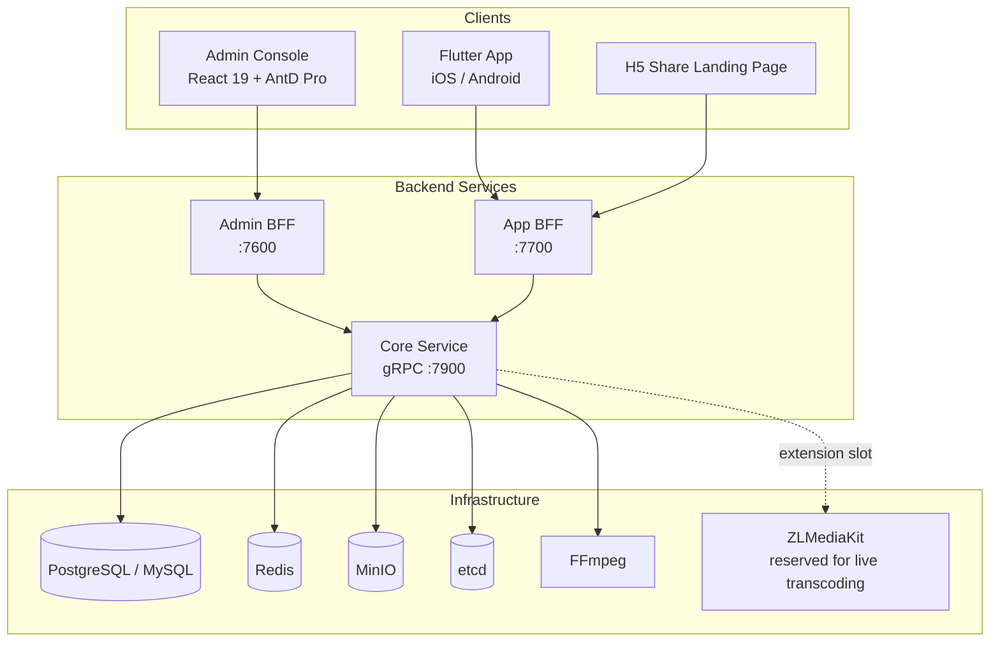

# GoWind ShortPlay Product Overview

GoWind ShortPlay is an open-source, enterprise-grade short-video / short-drama community starter edition (MVP) built on the GoWind ecosystem, licensed under MIT. It covers the complete business loop — vertical-swipe immersive video feed, shooting and publishing, interactive community, and back-office moderation — ready to run out of the box, and low-traffic internal enterprise scenarios can go live directly.

> Current version: v0.1.0 (first released 2026-10-17) · License: MIT License · Repository: [github.com/tx7do/go-wind-shortplay](https://github.com/tx7do/go-wind-shortplay)

## 1. Product Positioning

The barrier in the short-video / short-drama business lies in the "closed loop", not in any single point: upload, moderation, distribution, interaction, and operations are all indispensable. GoWind ShortPlay turns the most fundamental part of this chain into a complete, self-deployable product:

- **Out of the box**: from upload and publishing to moderation and takedown, from Feed distribution to comments and danmaku, the starter edition covers the complete business loop and is operational right after deployment
- **Friendly to internal enterprise scenarios**: low-traffic scenarios (internal short dramas, marketing, training communities) can go live directly, with no need to build an in-house streaming media team
- **Consistent with the GoWind ecosystem**: trimmed from the go-wind-cms base platform, sharing foundation capabilities such as organization & permissions, auditing, and dictionaries with GoWind Admin / CMS
- **Clear contract boundary**: the boundary between the open-source edition and the commercial value-added pack is defined at the API contract level, so future upgrades will not break secondary-development code

::: tip
The open-source edition is positioned as a "starter-edition MVP". Capabilities such as multi-bitrate transcoding clusters, AI recommendation, content safety moderation, SaaS multi-tenancy, live streaming, and paid content belong to the commercial value-added pack; see [Commercial Value-Added Boundary](#6-commercial-value-added-boundary).
:::

## 2. Core Highlights

- **Immersive experience**: vertical-swipe immersive video feed with three-way recall (latest from follows + popularity-weighted + latest fallback), already-watched deduplication, “not interested” negative feedback, and resume playback
- **Complete moderation loop**: draft → review → published / rejected / taken-down state machine, scheduled publishing and scheduled takedown, with batch moderation in the back office
- **Full interactive community**: likes and favorites, following and followers, nested comment threads, danmaku (bullet comments with sensitive-word filtering + report-linked hiding), 1:1 direct messages (SSE real-time + read-only supervision), and a closed report-handling loop
- **Series-following experience**: multi-episode containers, episode picker with continuous playback, series subscription, and update notifications
- **Creator perspective**: likes/follower statistics, trends over the last 7/14/30 days, per-video analytics, a shareable H5 landing page, and share posters with QR codes
- **Complete operations back office**: data dashboard, video TOP10, CSV export of five categories of audit logs, and users & permissions (role / menu / API / department permission groups)
- **i18n and teen mode**: both the app and the admin console support Chinese / English / Japanese, with a built-in teen-mode usage-time reminder

## 3. Feature Overview

### 1. Videos and Feed

| Feature | Description |
|------|------|
| Upload | Chunked upload with resumable transfers; FFmpeg auto-extracts frames for covers; draft box |
| State machine | Draft → review → published / rejected / taken down; scheduled publishing and scheduled takedown |
| Immersive Feed | Vertical-swipe three-way recall: latest from follows + popularity-weighted + latest fallback; already-watched deduplication; “not interested” negative feedback |
| Resume playback | Continues from the last playback position |
| Series | Multi-episode containers, episode picker with continuous playback, series subscription, update notifications |
| Search | Fuzzy title match + exact tag match; real trending terms, search suggestions, local search history |
| Tags | Tag aggregation pages |

### 2. Interactive Community

| Feature | Description |
|------|------|
| Likes & favorites | Video likes and favorites |
| Following | Following / follower system with personal profiles |
| Comments | Nested comment threads with author pinning |
| Danmaku | Timeline danmaku; sensitive-word filtering; report-linked hiding |
| Direct messages | 1:1 direct messages with SSE real-time push and unread badges; read-only viewing on the supervision side |
| Notifications | In-app messages + SSE real-time notifications |
| Reports | Closed-loop report handling: video takedown, comment deletion, danmaku hiding |
| Behavior tracking | UBA event tracking: views, watch-throughs, swipe-aways |

### 3. Creators

- **Analytics**: likes received and follower statistics, trends over the last 7/14/30 days, per-video analytics
- **Sharing**: H5 share landing page; share posters (with QR code)

### 4. Operations Back Office

| Feature | Description |
|------|------|
| Video moderation | Single and batch moderation |
| Comment management | Comment query and handling |
| Report tickets | Report ticket flow and closed-loop handling |
| Danmaku management | Danmaku query and hiding |
| DM supervision | Read-only supervisory viewing |
| Audit logs | Five categories of audit logs with CSV export |
| Users & permissions | Role, menu, API, and department permission groups |
| Data dashboard | Core metrics + video TOP10 + 7-day trends |
| System settings | Upload limits, manual-review switch, registration switch, sensitive-word library, danmaku/DM switches, announcement slots |

### 5. i18n and Teen Mode

- **i18n**: the app supports Chinese / English / Japanese; the admin console supports Chinese / English / Japanese
- **Teen mode**: built-in usage-time reminder

## 4. UI Preview

Admin console (React 19 + AntD Pro):

|  |  |
| :---: | :---: |
| Back-office data dashboard (dark theme) | Back-office login page |

|  |  |
| :---: | :---: |
| Video management (moderation state machine) | Report tickets |

Mobile app (Flutter):

|  |  |
| :---: | :---: |
| Vertical-swipe immersive Feed | Shooting & publishing page |

|  |  |
| :---: | :---: |
| Profile page (creator analytics) | Settings (i18n / teen mode) |

## 5. Technical Architecture

### 1. Client Forms

| Client | Technology | Description |
|------|------|------|
| Admin console | React 19 + Ant Design Pro + Vite | Operations / moderation / system administration back office |
| Mobile app | Flutter 3 + BLoC + media_kit | iOS / Android |
| Share landing page | H5 | Landing for share posters with QR codes |

### 2. Backend Tech Stack

| Layer | Technology | Description |
|------|------|------|
| Language | Go 1.26+ | High-performance compiled language |
| Microservice framework | go-kratos v2.9 | Three-service architecture |
| ORM | Ent | Go entity framework |
| Database | PostgreSQL / MySQL | Relational storage |
| Cache | Redis | Caching and sessions |
| Object storage | MinIO | Video and cover storage |
| Media processing | FFmpeg | Frame-extraction covers and other media processing |
| Streaming | ZLMediaKit | Reserved for the live transcoding extension |
| API contract | Protobuf contract-first + OpenAPI | Contract-first interfaces |
| Authentication | JWT | Authentication for both clients |

### 3. System Architecture

### 4. Three-Service Responsibilities

| Service | Port | Responsibilities |
|------|------|------|
| Admin BFF | :7600 | Admin console HTTP API, serving the admin frontend |
| App BFF | :7700 | Frontend HTTP API, serving the Flutter app and H5 |
| Core | gRPC :7900 | Core business logic and data layer |

> The Admin BFF and App BFF receive HTTP requests and call the Core service over gRPC for business processing, decoupling interfaces from business logic.

### 5. Built-in Roles

| Role | Description |
|------|------|
| platform:admin | Platform administrator |
| Tenant administrator | In-tenant management and moderation |
| appuser | Regular app-side user |

::: tip
GoWind ShortPlay is trimmed from the [go-wind-cms](/en/cms/intro.md) base platform; foundation capabilities such as organization & permissions, audit logs, and dictionaries run in the same lineage as GoWind CMS / Admin, so secondary-development experience carries over directly.
:::

## 6. Commercial Value-Added Boundary

The boundary between the open-source edition (MIT) and the commercial value-added pack is defined at the API contract level; the open-source edition runs independently, without depending on the value-added pack:

| Capability | Open-source starter edition | Commercial value-added pack |
|------|:---------:|:---------:|
| Video upload / state machine / Feed / interactive community / operations back office | ✅ | — |
| Multi-bitrate transcoding cluster | ❌ | ✅ |
| AI recommendation | ❌ | ✅ |
| Content safety moderation | ❌ | ✅ |
| SaaS multi-tenancy | ❌ | ✅ |
| Live streaming and paid content | ❌ | ✅ (ZLMediaKit extension slot reserved) |

Value-added capabilities plug in according to the established contracts, without affecting secondary-development code based on the open-source edition.

## 7. Repository and Contact

- **Source repository**: [github.com/tx7do/go-wind-shortplay](https://github.com/tx7do/go-wind-shortplay)
- **Repository docs**: the `docs/` directory provides `API.md` (API documentation) and `ROADMAP.md` (product roadmap)
- **Quick start**: [GoWind ShortPlay Quick Start](/en/shortplay/quick-start.md)
- **Business contact**: WeChat `yang_lin_bo` | Email <yanglinbo@gmail.com>
