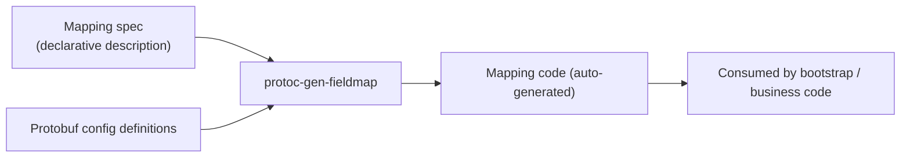

# protoc-gen-fieldmap Field Mapping Generator

`protoc-gen-fieldmap` is one of the 7 protoc plugins bundled with GoWind Toolkit. It **declaratively generates the mapping code from config fields to upstream library options** and uses CI to prevent mapping drift. The entire configuration surface of go-wind-bootstrap is already generated by it.

## 1. The Problem It Solves

In an architecture of "declarative configuration + functional options", there is a typical class of glue code:

- The config surface has a field (e.g. a timeout, a connection pool size)
- The upstream library's functional option takes a different shape (e.g. `WithTimeout(...)`, `WithPoolSize(...)`)
- A hand-written mapping snippet in between translates the config value into option calls

When this mapping code is maintained entirely by hand, the problems are obvious:

| Problem | Symptom |
|------|------|
| **Prone to drift** | When the upstream library adds fields or renames options and the mapping is not updated in sync, the config silently stops working |
| **Repetitive work** | Every newly adopted plugin means rewriting another round of "read config → call option" boilerplate |
| **Hard to review** | Mappings are scattered across hand-written code, making it hard in code review to confirm that "every config field has a home" |

The idea behind `protoc-gen-fieldmap`: **declare the mapping itself and let a code generator write the glue code**, then use CI to guarantee that the declaration and the generated result always agree.

## 2. How It Works

The overall flow has three steps:

### 2.1 Declare the Spec

Developers describe the mapping in a **declarative spec**: which config field, which upstream library option it maps to, and how default values are handled. The spec describes the "mapping intent" rather than the implementation — how values are read from the config object and how the option functions are called is all handled by the generator.

### 2.2 Generate the Mapping Functions

When protoc runs, the plugin generates a set of consistently named mapping functions from the spec. Naming follows the conventions of the bootstrap maintenance manual:

| Generated Function | Responsibility |
|----------|------|
| `Map<Name>Options` | Converts a config object into the upstream library's functional options list |
| `New<Name>Config` | Builds an upstream library config instance from a config object |
| `Fill<Name>Config` | Fills fields into an existing upstream config instance |

`<Name>` is the name of the mapping target and corresponds one-to-one with the config object. Business and assembly code depends only on these generated functions; no field-shuffling logic is ever written by hand again.

### 2.3 Integration

Like any other protoc plugin, `protoc-gen-fieldmap` is invoked through protoc's plugin mechanism and can be folded into the project's regular code generation flow (e.g. Makefile scripts or the `gow` generation command chain); the generated results are committed along with the source.

## 3. Warnings for Unmentioned Fields

During generation, the plugin checks whether every field of the config object is covered by the spec:

- **Fields not mentioned in the spec** produce a warning at generation time, telling the maintainer "this field has no mapping destination yet"
- The maintainer then decides: add the mapping, or explicitly ignore the field in the spec

This mechanically eliminates the silent defect class of "adding a config field and forgetting to wire it up" — a missing mapping surfaces at generation time, instead of being discovered at runtime when the config silently has no effect.

## 4. CI Drift Prevention

Relying on people to remember to regenerate is not enough, so GoWind adds a mechanical safety net in CI:

1. CI **re-runs generation** from the spec
2. The generated result is **compared byte-by-byte** against the code committed in the repository
3. Any mismatch fails CI outright

This check catches two kinds of drift:

| Drift Scenario | CI Response |
|----------|---------|
| The spec changed and generation was not re-run | The regenerated result differs from the committed code; CI fails |
| Someone hand-edited the generated code, bypassing the generator | The hand edits cannot be reproduced from the spec; the comparison fails |

In other words: **the generated code always stays byte-level identical to the spec**, making the spec the single source of truth for the mappings.

## 5. Relationship with go-wind-bootstrap

go-wind-bootstrap is the biggest beneficiary of `protoc-gen-fieldmap`, and also the origin of its generated-function naming conventions:

- Bootstrap organizes its configuration surface by family (server, logging, database, cache, etc.); each family must assemble the YAML config into the corresponding plugin's functional options
- These field mappings are now **generated entirely by `protoc-gen-fieldmap`**; the bootstrap side no longer maintains mapping code by hand
- When options evolve in the upstream plugin library (go-wind-plugins), you simply update the spec and regenerate; the CI drift check guarantees the bootstrap config surface never quietly falls behind

See the "Field mapping code generation" section of [go-wind-bootstrap: The Declarative Launcher](/en/framework/bootstrap-intro.md) for details.

## 6. Usage Recommendations

- **Plugin/middleware authors**: if your library uses the functional options pattern and needs to accept declarative configuration, declare the mapping in a spec and generate the code — no more boilerplate glue
- **Business projects**: repetitive "config struct → third-party client options" conversion code can likewise be consolidated into a single spec
- **Upgrade strategy**: when an upstream library changes, edit the spec first, regenerate, then run the CI comparison — a three-step closed loop that replaces manual troubleshooting

## Related Documents

- [Introduction to GoWind Toolkit](/en/toolkit/intro.md) (list of protoc plugins)
- [go-wind-bootstrap: The Declarative Launcher](/en/framework/bootstrap-intro.md)
- [Backend Code Generation](/en/toolkit/backend-code-generation.md)
