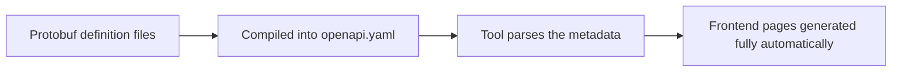

# Frontend Code Generation

The GoWind Toolkit frontend code generator uses OpenAPI metadata to **fully automatically** generate complete admin dashboard page code, supporting three mainstream templates: Vue3 (Element Plus / Vben Admin) and React (Ant Design Pro).

## How It Works

Unlike typical frontend code generators, GoWind Toolkit **does not support manually fine-tuning fields or page features** — all page structure is derived automatically from OpenAPI metadata:



**Core idea**: the backend defines everything; the frontend simply consumes it.

- The backend defines interfaces, field types, inputs, and outputs in Protobuf
- The tool automatically compiles the Protobuf into a standard OpenAPI description file
- The frontend reads the built-in OpenAPI metadata directly, automatically assigning table columns, search fields, and form fields

**Key advantage**: no manual frontend configuration at any point, eliminating human configuration errors and keeping frontend and backend structures 100% consistent.

## Three Official Built-in Templates

| Template                     | Tech Stack                           | Best For                   |
|------------------------|----------------------------------|--------------------------|
| Vue3 + Element Plus     | Vue Query, ElTable, ElDrawer     | Personal projects, small dashboards, early-stage products |
| Vue3 + Vben Admin       | VxeGrid, useVbenDrawer           | Large complex systems; the enterprise first choice   |
| React + Ant Design Pro  | React Query, ProTable, DrawerForm | Teams on the React stack         |

### Generated Content Comparison

Each template generates the following complete code:

| Generated Content       | Vue3 Element Plus | Vue3 Vben Admin | React Ant Design |
|------------|:-----------------:|:---------------:|:----------------:|
| API layer  | ✅                | ✅              | ✅               |
| Query Hooks | ✅ (Vue Query)    | ✅ (Vue Query)  | ✅ (React Query) |
| List pages      | ✅ (ElTable)      | ✅ (VxeGrid)    | ✅ (ProTable)    |
| Edit drawers    | ✅ (ElDrawer)     | ✅ (VbenDrawer) | ✅ (DrawerForm)  |
| Route configuration    | ✅                | ✅              | ✅               |
| i18n | ✅                | ✅              | ✅               |

## Prerequisites

1. Install the latest GoWind Toolkit desktop client
2. Have a complete Go backend project and successfully export **openapi.yaml** compiled from Protobuf
3. Install Node.js locally, to run and debug the generated frontend project

::: tip
Frontend code generation is available only in the **desktop client**; the CLI does not support it.
:::

## Hands-On Workflow

### Open the Frontend Code Generation Module


Open the client and click **[Frontend Code Generation]** in the left sidebar to enter the panel.

### Load the OpenAPI Data Source


1. In the OpenAPI data source area at the top of the page, click the import button
2. Select the `openapi.yaml` file compiled from your backend
3. After a successful import, the tool automatically parses all interfaces, structs, and field attributes

::: warning
The tool does not support connecting directly to a database to generate frontend code — all pages depend entirely on OpenAPI metadata.
:::

### Choose the Frontend Template

In the template dropdown, pick the one that matches your team's stack: Vue3 Element Plus / Vue3 Vben Admin / React Ant Design.

### Fill In the Project Info

Only the output directory is required — the folder where the frontend project will be saved. Paths must **not** contain Chinese characters, spaces, or special symbols.

### Preview the Generated Code

The tool can preview every code file it is about to generate:

**React + Ant Design pages:**


**Vue3 + Element Plus pages:**


**Vue3 + Vben Admin pages:**


**API layer:**


**Query Hooks:**


**i18n:**


### Generate the Code in One Click

Once the template and output directory are confirmed, click **[Generate Code]**. After about 2 seconds, a complete frontend project is generated automatically.

The output includes:
- Route configuration and sidebar menus
- The API request layer
- A full set of CRUD pages (list, search, create, edit, delete, export)
- i18n files

## Run the Frontend Project

Enter the root of the generated frontend project and run:

```bash
# Install dependencies
pnpm install
```

Then start it according to the template you chose:

```bash
# React version
cd frontend/admin/react
pnpm dev

# Vue3 Element Plus version
cd frontend/admin/vue-element
pnpm dev

# Vue3 Vben Admin version
cd frontend/admin/vue-vben
pnpm dev:antd
```

Once the project is running, all pages, menus, search filters, modal forms, and create/delete/export features work out of the box, with API calls wired automatically to the backend BFF service.

## Troubleshooting

| Problem                  | Solution                                          |
|---------------------|-------------------------------------------------|
| OpenAPI import fails    | Check whether the yaml file is corrupted; confirm the backend Protobuf compiled successfully |
| Page fields need adjusting      | Change the Protobuf on the backend and regenerate the OpenAPI file         |
| Code generation fails         | Switch to a pure-English output path                                |
| API returns 404             | Update the frontend environment config to point at the backend BFF service address            |
| Dependency installation fails         | Switch to a mirror registry, clear the npm cache, and reinstall                |

---

**Related documents**:

- [Introduction to GoWind Toolkit](/en/toolkit/intro.md)
- [Backend Code Generation](/en/toolkit/backend-code-generation.md)
