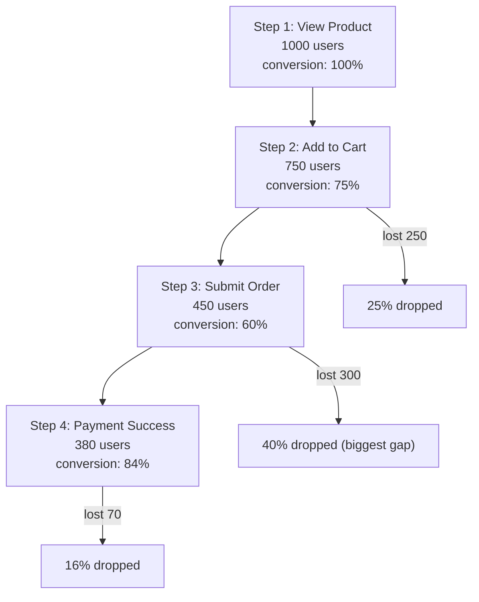

# Funnel Analysis

Funnel Analysis measures the **conversion rate** and **drop-off rate** at each step of a key conversion path, making it the core analysis model for e-commerce, registration, payment, and similar scenarios. It corresponds to the backend `AnalyticsService.Funnel`.

---

## 1. What Questions It Answers

- From "browse product" to "payment success", what is the overall conversion rate?
- Which step loses the most users?
- How does the conversion rate differ across time windows (30 minutes vs 24 hours)?

---

## 2. How Funnels Work



### Key Metrics

| Metric | Meaning |
|------|------|
| Step user count | Distinct users at that step (`count(DISTINCT user_id)`) |
| Step conversion rate | Current step users / previous step users |
| Overall conversion rate | Final step users / first step users |
| Drop-off rate | 1 − step conversion rate |

---

## 3. Backend API

### gRPC: `AnalyticsService.Funnel`

| Field | Type | Description |
|------|------|------|
| `time_range` | `TimeRange` | Analysis time range |
| `steps` | `repeated string` | **≥2**, ordered event names, e.g. `["view_product", "add_to_cart", "submit_order", "payment_success"]` |
| `app_id` | uint32 (optional) | Filter by app |
| `window_ms` | int64 (optional) | Time window to complete the funnel, default **30 minutes** |

Response `FunnelResponse`: `steps[]` (each `FunnelStep` contains `step_index` / `event_name` / `count` / `conversion_rate` / `overall_rate`), `completed_users` / `entered_users` / `overall_conversion`.

### HTTP (admin proxy)

```http
POST /admin/v1/analytics/funnel
Content-Type: application/json

{
  "timeRange": { "startMs": 1718169600000, "endMs": 1718774399000 },
  "steps": ["view_product", "add_to_cart", "submit_order", "payment_success"],
  "windowMs": 1800000
}
```

> The backend validates that `steps` contains at least 2 entries, otherwise it returns `ErrorBadRequest`.

---

## 4. Underlying SQL

The core of a funnel is "within a limited time window, find each user's maximum progress through the consecutive steps".

### Doris implementation (approximate: per-step distinct user counts)

The backend Doris implementation independently counts `count(DISTINCT user_id)` for each step, then computes conversion rates between adjacent steps:

```sql
SELECT event_name, count(DISTINCT user_id) AS user_count
FROM events_fact
WHERE event_time BETWEEN :start AND :end
  AND event_name IN ('view_product','add_to_cart','submit_order','payment_success')
GROUP BY event_name;
```

The application layer then computes `conversion_rate` (this step / previous step) and `overall_rate` (this step / first step) following the `steps` order.

### ClickHouse implementation (windowFunnel)

ClickHouse has a native `windowFunnel` function that strictly checks consecutive steps within a window:

```sql
WITH funnel_steps AS (
    SELECT
        user_id,
        windowFunnel(1800)(   -- 30-minute window (seconds)
            event_ts,
            event_name = 'view_product',
            event_name = 'add_to_cart',
            event_name = 'submit_order',
            event_name = 'payment_success'
        ) AS step_reached
    FROM events_fact
    WHERE event_ts BETWEEN :start_ms AND :end_ms
      AND event_name IN ('view_product','add_to_cart','submit_order','payment_success')
    GROUP BY user_id
)
SELECT
    step_reached,
    count() AS user_count
FROM funnel_steps
GROUP BY step_reached
ORDER BY step_reached;
```

`step_reached = N` means the user consecutively completed N steps. Retention and conversion per step can be derived from this.

> The current Funnel implementation in the backend `analytics_repo.go` independently counts `count(DISTINCT user_id)` per step (not strictly window-consecutive). For a strict window funnel, query ClickHouse yourself with `windowFunnel`. See the [OLAP Cookbook](/en/uba/analyst-olap-cookbook.md) for dialect differences.

---

## 5. Typical Scenarios

### E-commerce purchase conversion funnel

Steps: `view_product → add_to_cart → submit_order → payment_success`, 30-minute window. Find the step with the biggest drop-off (usually "add to cart → submit order") and optimize it.

### New user registration conversion funnel

Steps: `open_app → view_signup → submit_signup → signup_success`; the window can be relaxed to 24 hours (`windowMs = 86400000`).

### Content consumption funnel

Steps: `page_view → read_article → share → comment`, measuring content stickiness and engagement conversion.

---

## 6. Notes and Caveats

- **At least 2 steps** are required, otherwise the API returns an error.
- **Default window is 30 minutes**: for long flows (registration, finance), increase `window_ms`.
- **Conversion rate definition**: the current implementation counts distinct users independently per step, without a strict "same user consecutively completing steps within the window" constraint. For a strict funnel, use ClickHouse `windowFunnel`.
- **Cross-day funnels**: a user may complete step 1 on day one and step 2 on the next — both count as long as they are within `window_ms`. Make sure `time_range` covers the whole possible span.
- **Empty data / zero conversion**: first confirm events have been stored (see [Getting Started · Current State of Data Storage](/en/uba/analyst-getting-started.md)).

---

## 7. Related Documents

- [Data Analyst Getting Started Guide](/en/uba/analyst-getting-started.md)
- [Event Trend Analysis](/en/uba/analyst-event-trend.md)
- [Retention Analysis](/en/uba/analyst-retention.md)
- [OLAP Cookbook](/en/uba/analyst-olap-cookbook.md)
- [Backend API Contract](/en/uba/backend-api.md)
