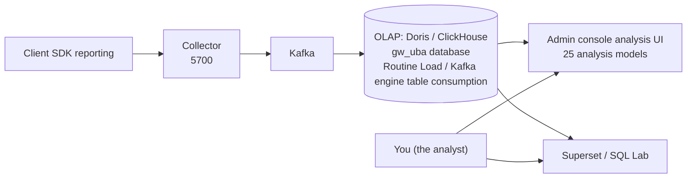

# Data Analyst Getting Started Guide

This guide is for data analysts. It walks you through where GoWind UBA's data comes from, where it is stored, how to query it, and how to analyze it.

> No Go code required. You need a bit of SQL and an understanding of UBA's data model.

---

## 1. Your Workflow at a Glance

As an analyst, you mainly do two things in UBA:

1. **Use the admin console's analysis UI**: 25 out-of-the-box analysis models (Event Trend, Funnel, Retention, Attribution, Distribution, heatmaps, Lifecycle, Revenue, LTV, Level Analysis, Server Retention, Economy, ...) plus session/path/profile queries and a real-time dashboard.
2. **Write SQL with Superset / direct OLAP connections**: for more flexible custom analysis, reports, and dashboards.



---

## 2. Where Data Comes From: Create an App and Get Credentials

The first step of data collection is to create a "UBA app" in the admin console and obtain `appId` + `appSecret`, which developers use to integrate the SDK and report events.

1. **Log in to the admin console** (Admin frontend, `http://localhost:5600` in the dev environment).
2. Go to **App Management** (menu: "Data Collection / App Management") and create a new app.
3. Fill in the app name, type, and supported platforms, then save.
4. The system generates three sets of credentials:
   - `appId`: unique app identifier (for business use, e.g. `game_001`)
   - `appKey`: app key
   - `appSecret`: **the reporting auth secret — keep it safe**
5. Set the app status to `ON` (enabled).

> `tenantId` (tenant ID) is authoritatively resolved by the server from the `appId` — clients do **not** need to report it, giving natural multi-tenant isolation.

---

## 3. Where Data Lives: OLAP Tables and Field Map

UBA's analytical data lives in the `gw_uba` database of the OLAP engine (Doris by default). Core tables:

### Fact Tables

| Table | Content | Key Fields |
|----|------|---------|
| **`events_fact`** | Behavioral event details (core) | `event_id`, `user_id`, `device_id`, `event_name`, `event_category`, `event_time/event_ts`, `platform`, `channel`, `country`, `amount`, `properties` (map), `metrics` (map), **`server_id`/`level` (game-specific)** |
| **`sessions_fact`** | Session-level summary | `session_id`, `user_id`, `start_time/end_time`, `duration_ms`, `event_count`, `is_bounce`, `entry_page/exit_page`, `total_amount` |
| **`risk_events`** | Risk events | `risk_type`, `risk_level`, `risk_score`, `rule_id/rule_name`, `status`, `occur_time` |
| **`path_features`** | User path features | `first_event/last_event`, `first_3_events/last_3_events` (arrays), `is_converted`, `conversion_event` |

### Dimension Tables

| Table | Content | Key Fields |
|----|------|---------|
| **`users_dim`** | User profile dimension | `user_id`, `register_time`, `register_channel`, `user_level/vip_level`, `total_events`, `total_pay_amount`, `country`, `risk_score` |
| **`objects_dim`** | Behavior object dimension | `object_id/object_type/object_name`, `category_path`, `price` |
| **`id_mapping`** | Cross-device ID mapping | `global_user_id`, `id_type/id_value`, `confidence` |
| **`user_tags`** | User tag association | `user_id`, `tag_id/tag_value`, `confidence`, `source` |

### Event Field Naming Rules

- All **camelCase** (aligned with the backend proto contract, protojson encoding).
- `properties` / `context` are `map<string,string>`, `metrics` is `map<string,double>` — all business-defined attributes go here.
- Time fields: `event_time` (Timestamp), `event_ts` (millisecond int64), `event_date` (date, partition key).

> For the complete field definitions, see [Backend API Contract · BehaviorEvent](/en/uba/backend-api.md) and `sql/{doris,clickhouse}/1_base_tables.sql`.

---

## 4. The 25 Out-of-the-Box Analysis Models

Under the admin console's "Data Analysis" menu there are 25 analysis models backed by the `AnalyticsService`, grouped by scenario:

| Scenario | Model | What Question It Answers |
|------|------|------------|
| **Basic Aggregation** | Event Trend `EventTrend` | What is the volume and trend of an event? |
| | Group By `GroupBy` | Metric comparison grouped by channel/platform/version? |
| | Active Users `ActiveUsers` | DAU / WAU / MAU? |
| **Conversion & Paths** | Funnel `Funnel` | Conversion and drop-off from step A to B? |
| | Retention `Retention` | Day-N retention of new users? |
| | Path Sankey `PathSankey` | Mainstream conversion paths of users? |
| | Behavior Sequence `BehaviorSequence` | The order of user behaviors? |
| **User Depth** | Attribution `Attribution` | Which channel drove the conversion (first-touch / last-touch)? |
| | Distribution `Distribution` | Distribution and percentiles of a metric? |
| | Segmentation `Segmentation` | Selecting user groups with specific behavioral traits? |
| | Click Analysis `Click` | Where on the page gets clicked the most? |
| | Interval `Interval` | Time interval between two behaviors? |
| **Lifecycle** | Lifecycle `Lifecycle` | Which lifecycle stage is a user in? |
| | Churn `Churn` | Who churned and who came back? |
| | New vs Returning `NewVsOld` | Behavioral differences between new and returning users? |
| | Matrix `Matrix` | Distribution of users/behaviors across quadrants? |
| **Revenue & Value** | Revenue `Revenue` | ARPU / ARPPU / GMV? |
| | Whale Tier `WhaleTier` | Whale/dolphin/minnow user distribution? |
| | LTV `LTV` | User lifetime value? |
| **Sessions & Anomalies** | Session Analysis `SessionAnalysis` | Bounce rate / session depth? |
| | Anomaly `Anomaly` | Abnormal fluctuations period-over-period? |
| **Game-Specific** | Level Analysis `LevelAnalysis` | Level pass rate / numeric balance? |
| | Server Retention `ServerRetention` | Retention by game server? |
| | Online Stats `OnlineStats` | PCU / ACU? |
| | Economy `Economy` | Token/item production and consumption flows? |

There are also three fact-table query UIs for **sessions, event paths, and user behavior profiles**, plus a **real-time dashboard** (based on fact records already stored).

> Deep dives into each model: [Event Trend](/en/uba/analyst-event-trend.md), [Funnel](/en/uba/analyst-funnel.md), [Retention](/en/uba/analyst-retention.md), [OLAP Cookbook](/en/uba/analyst-olap-cookbook.md). For the full RPC and field definitions, see [Backend API](/en/uba/backend-api.md).

---

## 5. Admin Console vs Superset: Which to Choose?

| Scenario | Admin Console | Superset |
|------|:---------:|:----------:|
| Query the 25 standard models | ✅ | — |
| Custom SQL / multi-table joins | — | ✅ |
| Drag-and-drop dashboards, scheduled reports | — | ✅ |
| Risk/tag configuration management | ✅ | — |
| Team-shared BI reports | — | ✅ |

The two are complementary: the admin console handles configuration and standard analysis, while Superset handles deep BI. For Superset deployment, see [Superset Deployment](/en/uba/deploy-superset.md).

---

## 6. Current State of Data Storage

> **Reported data is stored automatically**: after the Collector writes data to Kafka, it is consumed directly by the OLAP engine's virtual tables — ClickHouse uses Kafka engine tables + materialized views, Doris uses Routine Load — continuously writing into fact tables such as `events_fact`. Under normal conditions data is visible within seconds, and both the analysis UI and Superset can query the new data.
>
> **If you cannot find new data**, troubleshoot in this order:
> 1. Confirm that the OLAP engine's Kafka consumption job is running normally (Doris: use `SHOW ROUTINE LOAD` to check job status; ClickHouse: check the Kafka engine tables and materialized views);
> 2. Confirm the collector's Kafka address is configured correctly (it should be `kafka:9092` inside the container);
> 3. If the consumption job has not been set up in your environment yet, you can first run the corresponding engine's table creation scripts (Doris: `sql/doris/02_kafka_tables.sql`; ClickHouse: `sql/clickhouse/02_kafka_tables.sql`), or load the demo data from `sql/{doris,clickhouse}/demo-data.sql` for practice.

For details, see [System Architecture · Kafka Consumption Pipeline](/en/uba/architecture.md).

---

## 7. Your First Analysis: Connect to Doris and Take a Look

If you have Doris access (FE port 9030, MySQL protocol):

```bash
mysql -h localhost -P 9030 -u root -D gw_uba
```

```sql
-- See how much data events_fact has
SELECT count() FROM events_fact;

-- Event volume per channel over the last 7 days
SELECT channel, event_date, count() AS events
FROM events_fact
WHERE event_date >= DATE_SUB(CURDATE(), INTERVAL 7 DAY)
GROUP BY channel, event_date
ORDER BY event_date, events DESC;
```

> Doris uses the MySQL dialect; the ClickHouse dialect differs slightly (see the [OLAP Cookbook](/en/uba/analyst-olap-cookbook.md)).

---

## 8. Next Steps

- [Event Trend Analysis](/en/uba/analyst-event-trend.md)
- [Funnel Analysis](/en/uba/analyst-funnel.md)
- [Retention Analysis](/en/uba/analyst-retention.md)
- [OLAP Cookbook (dual-engine SQL, whitelisted dimensions)](/en/uba/analyst-olap-cookbook.md)
- [Superset Deployment](/en/uba/deploy-superset.md)

---

## 9. Related Documents

- [Product Introduction](/en/uba/intro.md)
- [System Architecture](/en/uba/architecture.md)
- [Backend API Contract](/en/uba/backend-api.md)
