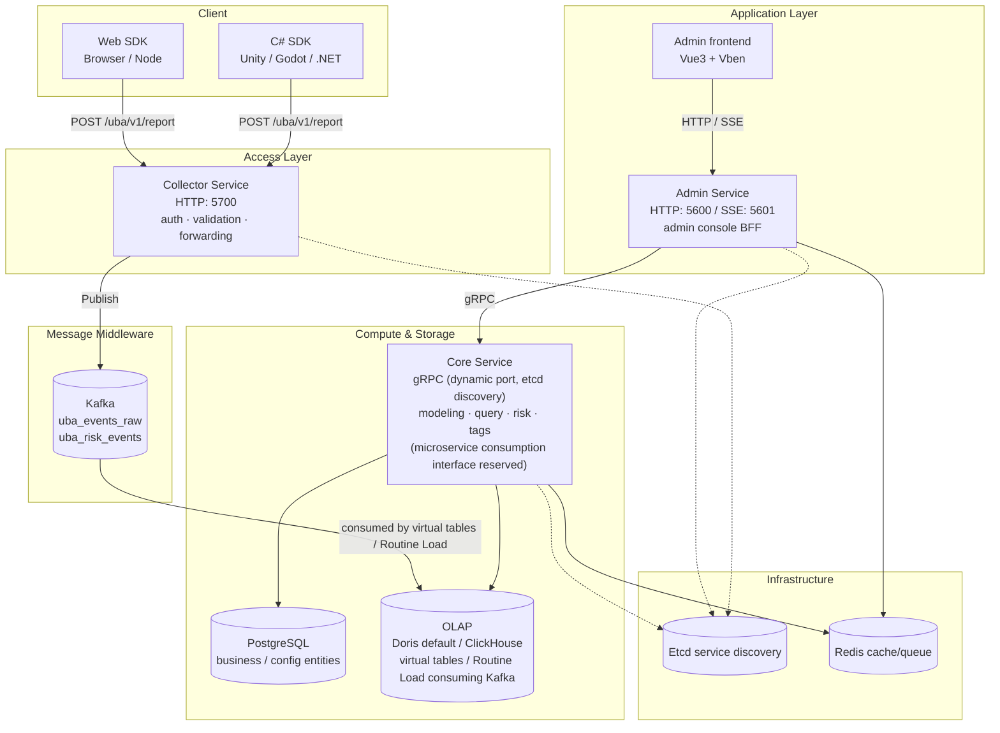

# UBA System Architecture

This document describes the overall architecture of GoWind UBA, the responsibilities of the three services, data flows, storage layers, and key design patterns. Secondary developers and operations engineers are advised to read this page in full before getting started.

---

## 1. Overall Architecture

UBA is a user behavior analytics platform built on the **go-kratos** microservice framework, adopting the classic streaming data warehouse architecture of "collect → enqueue → compute/store → query/display", composed of three microservices:



---

## 2. Responsibilities of the Three Services

### 1. Collector Service (event tracking ingestion BFF)

| Item | Description |
|----|------|
| Directory | `backend/app/collector/service/` |
| Listening port | HTTP **5700** |
| Responsibilities | Receives SDK reports, application authentication (appId + appSecret), field validation and completion, forwards to Kafka |
| Entry point | `POST /uba/v1/report` (batch events, mixed behavior/risk) |
| Output | Publishes to Kafka topics: `uba_events_raw` (behavior) / `uba_risk_events` (risk) |
| Characteristics | **Stateless**, horizontally scalable; does not persist data itself, only handles "receive + forward" |

### 2. Core Service (core business service)

| Item | Description |
|----|------|
| Directory | `backend/app/core/service/` |
| Listening port | gRPC **dynamic port** (`0.0.0.0:0`, registered to etcd at startup, not fixed) |
| Responsibilities | Analytics modeling, risk detection, tag management, user profiles, data sync (**does not handle event ingestion by default**; events are consumed from Kafka directly by the OLAP engine's virtual tables and loaded into storage; a broker subscriber entry is reserved on the Core side for enabling microservice consumption on demand later) |
| Data sources | PostgreSQL (business entities, via Ent ORM) + OLAP engine (analytics data) |
| External protocol | gRPC (called by admin/collector) |
| Characteristics | Carries all "heavy" business logic; selects between ClickHouse / Doris via the compile-time constant `data.UseClickHouse` |

### 3. Admin Service (admin console BFF)

| Item | Description |
|----|------|
| Directory | `backend/app/admin/service/` |
| Listening port | HTTP **5600** / SSE **5601** |
| Responsibilities | HTTP gateway for the admin console, forwards requests to Core, aggregates permissions/menus/configuration |
| Pattern | **Thin forwarding layer**: implements `adminV1.XxxHTTPServer`, holds `ubaV1.XxxClient`, method bodies forward directly |
| Highlights | SSE push (real-time in-app message notification), Swagger docs, CORS |

> All three services register and discover each other through **etcd**, and cross-service calls go over gRPC.

---

## 3. Data Flows

### Event Reporting Path (write)

```
SDK report
  └─> Collector (5700)
        ├─ 1. appId/appSecret authentication (application level, in request body)
        ├─ 2. Field validation + completion (eventId/eventTime/deviceId etc.)
        ├─ 3. Authoritative tenantId override (tenant identified by appId)
        └─ 4. Publish → Kafka topic
              ├─ uba_events_raw   (behavior events)
              └─ uba_risk_events  (risk events)
                    └─> Consumed directly by the OLAP engine's virtual tables / Routine Load, loaded into events_fact / risk_events and other fact tables
```

### Kafka Consumption Mechanism (important)

> **Default consumption method = the OLAP engine natively consuming Kafka**, with no need to write consumers inside the Core service:
>
> - **ClickHouse**: a **Kafka engine virtual table** consumes `uba_events_raw`, then materialized views write into storage tables such as `events_fact`; see the table creation scripts in `sql/clickhouse/02_kafka_tables.sql`;
> - **Doris**: a **Routine Load** job continuously pulls from Kafka and writes into fact tables; see the table creation scripts in `sql/doris/02_kafka_tables.sql`.
>
> Therefore, after the Collector `Publishes` to Kafka, **the OLAP engine itself continuously pulls the data and loads it into storage**; the Core service does not participate in this write path by default.
>
> **A microservice consumption interface is reserved on the Core side** (broker subscriber, able to call `BehaviorEventService.BatchCreate` to load events). When the OLAP virtual tables' throughput/transformation capability is insufficient, it can serve as a supplementary option enabled on demand; refer to kratos broker usage. Choose one of the two approaches — do not enable both to avoid duplicate ingestion.

### Query Path (read)

```
Admin frontend
  └─> Admin Service (5600, HTTP)
        └─> gRPC forwarding ─> Core Service
              ├─ Business entities ─> PostgreSQL (Ent ORM)
              └─ Analytics aggregations ─> OLAP (native SQL GROUP BY / pagination)
```

---

## 4. Data Storage Layers

| Storage | Purpose | Access method |
|------|------|---------|
| **PostgreSQL** | Business/config entities (apps, users, roles, permissions, dictionaries, menus, event schemas, risk rules, tag definitions, etc.) | Ent ORM; table structures generated from schema annotations (no hand-written schema.sql) |
| **OLAP (Doris default / ClickHouse)** | Analytics data (`events_fact` / `sessions_fact` / `risk_events` / `users_dim` and other fact tables) | Native SQL + repo wrappers |
| **Redis** | Caching, asynchronous task queue (Asynq) | kratos cache + asynq |
| **Kafka** | Event stream buffering (decoupling pipeline from collector → OLAP engine; consumed by OLAP virtual tables / Routine Load) | kratos broker |
| **MinIO** | Object storage (file upload) | S3 compatible |

### Dual-Engine OLAP Design

- ClickHouse and Doris are **mutually exclusive**, switched by a compile-time constant:

  ```go
  // backend/app/core/service/internal/data/data.go
  // UseClickHouse determines whether ClickHouse is used as the data store, otherwise Doris.
  const UseClickHouse bool = false   // currently defaults to false → Doris is used
  ```

- **The same business model**: fields, partitions, indexes, and primary key definitions stay consistent between the two engines (schemas are mirrored in `internal/data/{clickhouse,doris}/schema/`).
- The repo layer branches by engine: `if data.UseClickHouse { ckRepo } else { dorisRepo }`.
- Switching engines requires modifying this constant and recompiling — **it is not a runtime configuration**.

---

## 5. Key Design Patterns

### 1. Interface Contract First (Protobuf)

All service interfaces are defined in `.proto` files, with multi-language code generated via **buf**:

- Go: `protoc-gen-go` + `protoc-gen-go-grpc` (gRPC stubs) + `protoc-gen-go-http` (kratos REST)
- TypeScript: `protoc-gen-typescript-http` (admin frontend client, **only admin protos as input**)
- OpenAPI: `protoc-gen-openapi` (Swagger docs)

> See [Code Generation Pipeline](./tutorial-codegen.md) for details.

### 2. Three-Layer Service Architecture (admin forwarding pattern)

When adding a new admin-facing capability, the typical layering is:

```
admin/service/v1/i_xxx.proto        # HTTP gateway interface (with google.api.http annotations)
uba/service/v1/xxx.proto            # Domain messages + gRPC service contract
core/service/internal/service/      # Business implementation (implements the uba gRPC server)
admin/service/internal/service/     # Forwarding implementation (implements the admin HTTP server → calls the uba client)
```

The admin layer is **pure forwarding** with no business logic; business logic is concentrated in Core.

### 3. Ent + go-crud Data Layer

Business entities (PostgreSQL) use the Ent ORM, combined with `go-crud`'s generic `Repository` wrapper, uniformly handling pagination (`PagingRequest`), filtering (`FilterExpr`), sorting, and FieldMask. OLAP data goes through native SQL repos.

### 4. Service Discovery + Dynamic Ports

The Core service's gRPC listens on `0.0.0.0:0` (random port) and registers with etcd at startup; admin/collector discover core through etcd and establish gRPC connections. This allows Core to be deployed with multiple instances and updated in a rolling fashion.

---

## 6. Security & Multi-Tenancy

| Dimension | Mechanism |
|------|------|
| Admin console authentication | JWT (Core's `authenticator.yaml`, HS256, dual profiles: admin / collector) |
| SDK report authentication | appId + appSecret (application level, in request body, not headers) |
| Permission engine | Casbin / OPA, three-level permissions for menus/APIs/data |
| Multi-tenant isolation | `tenantId` field throughout; SDKs do not report it, the server authoritatively identifies and overrides it by appId |
| Transport | CORS configuration; TLS recommended in production |

> ⚠️ Default passwords/secrets (JWT key `some_api_key`, AES key, middleware passwords `*Abcd123456`) are all development defaults and **must be rotated before production deployment**. See [Configuration Reference · Security Checklist](./deploy-config.md) for details.

---

## 7. Related Documentation

- [Backend Module Overview](./backend-modules.md)
- [Backend API Contract](./backend-api.md)
- [Frontend Architecture](./frontend-architecture.md)
- [Installation Guide](./installation.md)
- [Configuration Reference](./deploy-config.md)
