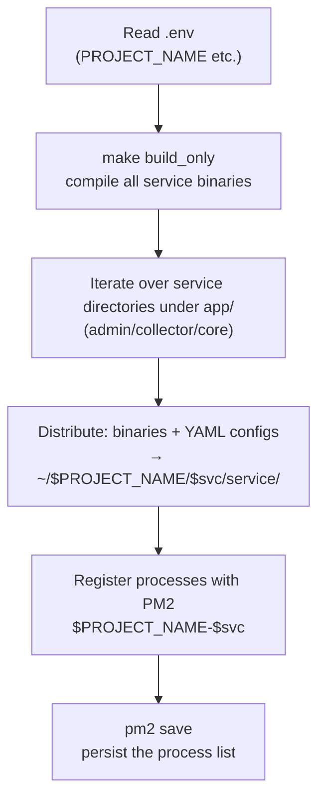

# UBA PM2 Deployment Guide

This document is aimed at operations engineers, describing the process of deploying the three GoWind UBA services on bare metal/virtual machines with PM2 (`scripts/deploy/pm2_service.sh`). Suitable for scenarios without Docker or requiring PM2 process management.

> Read [System Architecture](./architecture.md) and the [Configuration Reference](./deploy-config.md) first. In PM2 mode, the middleware (PG/Redis/Kafka/Doris/Etcd/MinIO/Jaeger) must be prepared by yourself.

---

## 1. PM2 Deployment Script Overview

Script: `backend/scripts/deploy/pm2_service.sh`

Workflow:



### Key Behaviors

- **Reads `.env`** (project root, automatically strips CRLF and exports), taking `PROJECT_NAME` from it (default `gwua`).
- **Compiles**: `make build_only` (compile only, no code generation).
- **Installation root**: `~/$PROJECT_NAME/` (default `~/gwua/`).
- **Service discovery**: iterates over the first-level subdirectories of `app/` (i.e. `admin`, `collector`, `core`).
- **Distribution**: copies `<svc>/service/bin/server` to `~/gwua/<svc>/service/bin/server`, and the `*.yaml` configs to `~/gwua/<svc>/service/configs/`.
- **PM2 registration**: process name `${PROJECT_NAME}-${svc}`, namespace `$PROJECT_NAME`; runs `pm2 delete` before starting to replace old instances, and finishes with `pm2 save`.

---

## 2. Process Naming

| Service | Process name | Namespace |
|------|--------|---------|
| Admin | `gwua-admin` | `gwua` |
| Collector | `gwua-collector` | `gwua` |
| Core | `gwua-core` | `gwua` |

> No `ecosystem.config.js` is used — PM2 is driven entirely by CLI flags inside the script (`--name`, `--namespace`, `--cwd`, `--output`, `--error`, `--update-env`). Each process has its own stdout/stderr logs.

---

## 3. Running the Deployment

```bash
cd backend

# 1. Prepare .env (project root)
cat > .env <<'EOF'
PROJECT_NAME=gwua
# add other environment variables as needed
EOF

# 2. One-click PM2 deployment (the script runs make build_only first)
make pm2-deploy
# or directly: ./scripts/deploy/pm2_service.sh
```

After deployment completes, check with:

```bash
pm2 list                    # view the status of the three processes
pm2 logs gwua-core          # view core logs
pm2 monit                   # live monitoring
```

The services start with the argument `-c <configs relative path>`, i.e. loading `../configs/*.yaml` from the bin directory.

---

## 4. Prerequisites (bring your own middleware)

The PM2 mode only manages the three application services; the middleware must be deployed by yourself (bare metal or separate containers both work):

| Middleware | Purpose | Default address |
|--------|------|---------|
| PostgreSQL | Business/config entities | `data.yaml`'s database.dsn |
| Redis | Cache + Asynq queue | `redis:6379` |
| Kafka | Event buffering | collector `data.yaml`'s kafka.endpoints |
| Apache Doris (or ClickHouse) | OLAP analytics engine | core `data.yaml` |
| Etcd | Service discovery | `registry.yaml` |
| MinIO | Object storage | `oss.yaml` |
| Jaeger | Distributed tracing (optional) | `trace.yaml` |

> Before deployment, make sure each service's `data.yaml` / `registry.yaml` / `oss.yaml` point to real addresses.

---

## 5. Configuration Center (etcd export)

The project supports exporting configuration to etcd (`make export`, powered by `cfgexp` under the hood):

```bash
cd backend
make export   # cfgexp --type=etcd --addr=localhost:2379 --proj=$PROJECT_NAME
```

Combined with kratos's hot config reload, some configuration can be updated without restarting processes.

---

## 6. Daily Operations

```bash
pm2 restart gwua-core        # restart a single service
pm2 reload gwua-admin        # zero-downtime reload (if supported)
pm2 stop gwua-collector      # stop
pm2 delete gwua-core         # delete
pm2 save                     # persist the process list (prerequisite for start on boot)
pm2 startup                  # configure start on boot (run the command it prints)
```

### Log Locations

PM2 logs are by default in `~/.pm2/logs/`:

- `gwua-admin-out.log` / `gwua-admin-error.log`
- `gwua-collector-out.log` / `gwua-collector-error.log`
- `gwua-core-out.log` / `gwua-core-error.log`

---

## 7. Updating Releases

```bash
cd backend
git pull                     # pull the latest code
make build_only              # recompile
./scripts/deploy/pm2_service.sh   # redistribute and restart (the script runs pm2 delete before starting)
```

> Script deployment is "replacement-style": every run deletes the old instances with `pm2 delete` before starting new ones, with no blue-green/canary releases. For canary deployments, Docker multi-instance + etcd discovery is recommended instead.

---

## 8. Related Documentation

- [System Architecture](./architecture.md)
- [Docker Deployment](./deploy-docker.md)
- [Configuration Reference](./deploy-config.md)
- [Appendix · Port Reference](./appendix.md)
