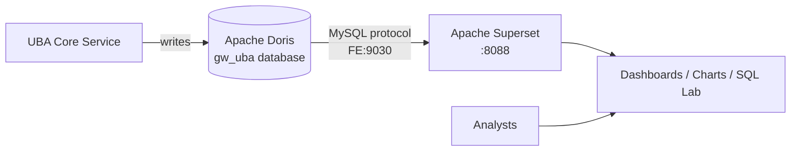

# UBA Superset BI Deployment Guide

This document is aimed at operations engineers and data analysts, describing how to deploy Apache Superset and connect it to GoWind UBA's OLAP engine (Doris by default), building visual dashboards on the fact tables.

> Read [System Architecture](./architecture.md) first. UBA and Superset are **loosely coupled**: Superset runs as an independent BI container, connecting directly to the Doris FE via the MySQL protocol to query the fact tables of the `gw_uba` database.

---

## 1. Deployment Architecture



- UBA writes analytics data into Doris's `gw_uba` database (`events_fact` / `sessions_fact` / `risk_events` / `users_dim` etc.).
- Superset connects to Doris FE's port 9030 via the `pydoris` (or `pymysql`) driver, modeling these tables as Datasets.

---

## 2. One-Click Docker Deployment

Superset is preconfigured in `docker-compose.yaml` (`apache/superset:latest`, port 8088). The container **automatically completes initialization** at startup:

1. Switches the apt sources to Aliyun mirrors and installs build dependencies (`gcc python3-dev default-libmysqlclient-dev pkg-config`).
2. Enters Superset's real venv `/app/.venv` and installs `pymysql` and **`pydoris`** (the Doris driver).
3. Runs `superset db upgrade` → `superset fab create-admin` (admin/admin) → `superset init`.
4. Starts `run-server.sh`.

```bash
cd backend
./scripts/docker/full_deploy.sh   # full-stack deployment (includes superset)
# or dependencies only: ./scripts/docker/libs_only.sh (the libs compose also includes superset)
```

Visit: `http://localhost:8088/login/`, default account `admin / admin`.

> ⚠️ For production, make sure to: change the admin password, replace `SUPERSET_SECRET_KEY`, and restrict access origins.

---

## 3. Connecting to UBA's Doris

In the Superset UI → **Settings → Database Connectors → add Apache Doris**, fill in the connection string (pointing to the Doris FE query port 9030, database `gw_uba`):

| Driver | Connection string |
|------|--------|
| Doris (`pydoris`, recommended) | `pydoris://root:@host.docker.internal:9030/internal.gw_uba` |
| MySQL (`pymysql`) | `mysql+pymysql://root:@host.docker.internal:9030/gw_uba` |

Key points:

- Superset runs inside a container; use `host.docker.internal` to reach Doris on the host (or `doris-fe:9030` within the same compose network).
- The database name is uniformly `gw_uba` (consistent with UBA Core's `data.yaml` `doris.database`).
- Enable options such as "Allow SQL Lab data upload" as needed when connecting.

> Source reference: `backend/docs/deploy_superset.md`.

---

## 4. Creating Datasets & Dashboards

### 1. Add Datasets

In Superset → **Data → Datasets**, add UBA's fact/dimension tables as datasets:

| Table | Type | Use |
|----|------|------|
| `events_fact` | Fact table | Event details; trends/funnels/group analysis |
| `sessions_fact` | Fact table | Session analysis, bounce rate |
| `risk_events` | Fact table | Risk event monitoring |
| `users_dim` | Dimension table | User profile distributions |
| `objects_dim` | Dimension table | Behavior object analysis |
| `id_mapping` | Mapping table | Cross-platform ID association |
| `user_tags` | Association table | User tag distributions |

### 2. Configure Field Metadata

For each Dataset, annotate field types, whether it is a time dimension (e.g. `event_time` / `event_date`), and whether it is aggregatable on the Columns page, so charts recognize them correctly.

### 3. Build Charts & Dashboards

Build charts on the Datasets (line trends, funnel steps, retention heatmaps, etc.) and combine them into dashboards. Typical dashboards:

- **Operations overview**: DAU/MAU trends, channel distribution (`channel`), platform distribution (`platform`).
- **Conversion funnel**: based on `event_name` sequences from `events_fact`.
- **Risk monitoring**: risk type/level distributions and trends from `risk_events`.
- **User profiles**: region/level/VIP distributions from `users_dim`.

> The UBA admin console ships with 25 analysis models built in (covering general Web/APP and game scenarios; see the [Product Introduction](./intro.md) for details); Superset is for more flexible custom BI and reports. The two complement each other.

---

## 5. Direct Queries in SQL Lab

You can query directly without creating Datasets. In Superset → **SQL Lab → SQL Editor**, pick the Doris connection and write SQL directly:

```sql
-- DAU per channel over the last 7 days
SELECT channel, event_date, count(DISTINCT user_id) AS dau
FROM gw_uba.events_fact
WHERE event_date >= DATE_SUB(CURDATE(), INTERVAL 7 DAY)
GROUP BY channel, event_date
ORDER BY event_date, dau DESC;
```

> For the dual-engine SQL dialect differences (Doris `DATE_FORMAT` vs ClickHouse `toStartOfHour`), see the [OLAP Query Cookbook](./analyst-olap-cookbook.md).

---

## 6. Common Issues

| Symptom | Troubleshooting direction |
|------|---------|
| Cannot connect to Doris | Use `doris-fe:9030` inside containers or `host.docker.internal:9030` on the host; confirm FE is ready (`http://localhost:8030`) |
| Missing driver | `pydoris` should already be installed by the container's init script; to install manually: enter the container and run `/app/.venv/bin/pip install pydoris pymysql` |
| Queries return no data | Confirm the OLAP engine's Kafka consumption job is working (whether `events_fact` has data) — see [System Architecture · Kafka Consumption Mechanism](./architecture.md); you can load test data first |
| Dashboards load slowly | Check Doris partitions/indexes; add time filters for large tables; adjust the Superset cache (`CACHE_DEFAULT_TIMEOUT`) |

---

## 7. Related Documentation

- [System Architecture](./architecture.md)
- [Docker Deployment](./deploy-docker.md)
- [Configuration Reference](./deploy-config.md)
- [OLAP Query Cookbook](./analyst-olap-cookbook.md)
- [Data Analyst Getting Started](./analyst-getting-started.md)
