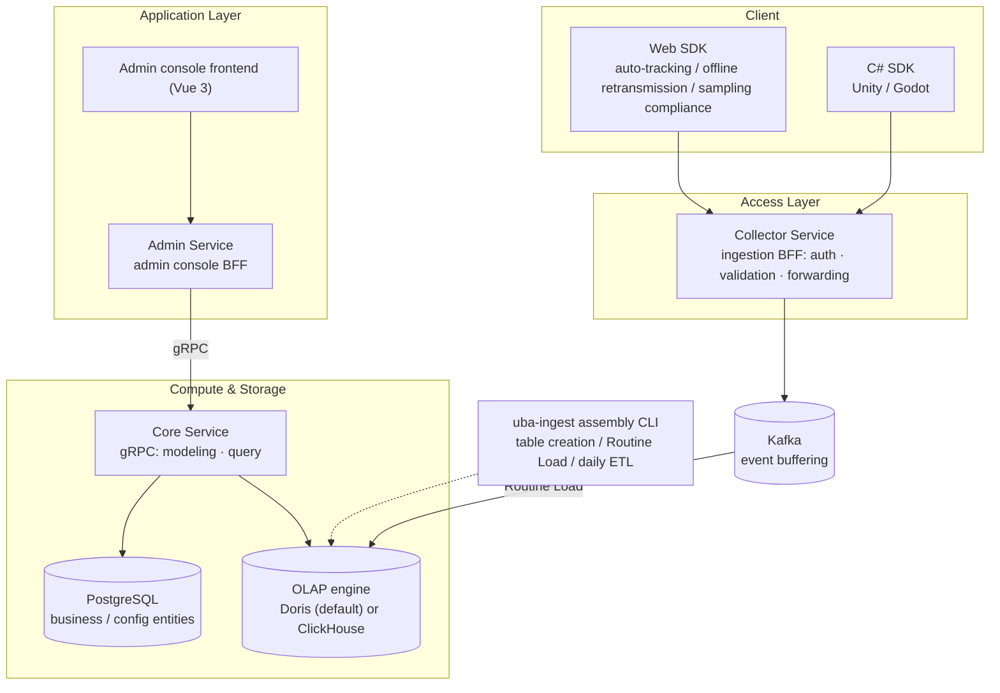

# GoWind UBA Product Introduction

**GoWind UBA** (User Behavior Analytics, Chinese name "风行用户行为分析平台") is a multi-tenant user behavior analytics system built on **Go (the go-kratos microservice framework) + Vue 3 + ClickHouse/Doris dual-engine OLAP**. **v1.0.0 has been officially released**.

- **25+ analysis models**: 10 general analytics + 9 in-depth user insights + 6 game-specific
- **Growth loop**: covers the full chain of "collect → analyze → archive → reach", with a built-in AI assistant
- **Dual-engine OLAP**: Apache Doris (default) or ClickHouse, sharing the same business model
- **Multi-platform SDKs**: Web SDK (auto-tracking / offline retransmission / sampling compliance) + C# SDK (Unity/Godot)
- **Open source and free**: MIT license

> Make every user behavior traceable, and every data insight within reach.

This page is the entry point for all UBA documentation. Whether you are a secondary developer, an operations engineer, or a data analyst, we recommend reading the "Reader Navigation" section first to find the reading path that suits you.

---

## 1. What Is UBA

UBA (User Behavior Analytics) is a data analysis technique for collecting, analyzing, and reporting user behavior on digital products such as websites, apps, and games. It helps enterprises understand user preferences, habits, and behavior patterns, so as to optimize product experience, improve conversion rates, enable precision marketing, and identify potential business and security risks.

The core data pipeline of GoWind UBA is a classic streaming data warehouse:

```
Client SDK  →  Collector (ingestion)  →  Kafka (buffering)  →  OLAP engine (Doris / ClickHouse, consumed and loaded via Routine Load)

Admin console  →  Admin Service (BFF)  →  Core (gRPC: modeling / query)  →  OLAP engine + PostgreSQL (business entities)

uba-ingest (assembly CLI) → table creation / Routine Load assembly / daily ETL (intraday looping supported)
```

> On the write path, **Core does not handle event ingestion by default** — after the Collector sends events to Kafka, Doris Routine Load loads them directly; Core is responsible for read-side modeling and queries. See [System Architecture](./architecture.md) for details.

---

## 2. Feature Overview

### 25+ Analysis Models

`AnalyticsService` provides 25+ analysis models, grouped into three categories by scenario: **10 general analytics, 9 in-depth user insights, and 6 game-specific**, covering event trends, active users, funnels, retention, conversion paths, user segmentation, revenue/LTV, level analysis, merged-server retention, concurrent online users (PCU/ACU), in-game economy, and more.

The documentation site provides a dedicated page for each model (including definition notes and usage guides); see [Data Analyst Getting Started](/en/uba/analyst-getting-started.md) for the entry point.

### Growth Loop

Built around "collect → analyze → archive → reach", UBA offers a complete set of closed-loop capabilities:

| Capability | Description |
|------|------|
| Persistent segments | User segments are stored persistently for reuse by downstream analysis and reach |
| Custom dashboards | Freely combine charts to build your own dashboards |
| Threshold alerts | Alerts are triggered when a metric crosses a threshold |
| Scheduled reports | Generate and push analysis reports on schedule |
| Feature flags & A/B testing | Feature flag control + A/B experiment comparison |
| Marketing reach | Marketing outreach targeting segmented users |
| Self-service SQL | Write SQL directly to query OLAP data |
| User 360 | A full-dimensional behavior profile of a single user |
| ID-Mapping | Identity unification across platforms and sources |
| Dynamic tags | Automatically maintain user tags based on rules |
| Visual tracking | Event tracking configuration without code changes |
| rrweb session replay | User session replay based on rrweb |

### Real-time Dashboards & Export

- **Real-time dashboards**: based on SSE push, supporting two display modes;
- **Server-side full export**: XLSX / CSV formats, covering 7 resource types.

### Intraday Loop ETL

`uba-ingest` supports intraday looping ETL (`--loop --every`), so you can see the current day's data during the day instead of waiting until the next day.

### Notification Domain

| Capability | Description |
|------|------|
| Multiple channels | In-app messages / Email / SMS / Webhook |
| Event routing | Configure routing rules per event |
| Message templates | Templated notification content |
| Delivery ledger | Full delivery records are queryable |

### Risk Engine

Risk rule configuration and risk event management. The reporting channel supports mixed reporting of behavior events and risk events to identify abnormal behavior.

### AI Module

| Capability | Description |
|------|------|
| Chat | AI chat assistant |
| RAG | Knowledge retrieval augmented Q&A |
| NL2SQL data Q&A | Natural-language data querying via NL2SQL, read-only execution |
| Q&A audit | Execution audit records of NL2SQL data Q&A |
| Report AI summary | Automatically generate AI summaries for reports |
| Tenant token quota | Per-tenant control of AI token usage |

---

## 3. System Architecture



### Service Composition

| Service | Positioning | Responsibilities |
|------|------|------|
| admin-service | Admin console BFF | Serves the admin console HTTP API and SSE push |
| collector-service | Ingestion BFF | Receives SDK reports, applies authentication, field validation and completion, forwards to Kafka; stateless, horizontally scalable |
| core-service | Core service | Heavy business logic such as analytics modeling, queries, segments, tags, notifications, and AI |
| uba-ingest | Assembly CLI | Table creation, Routine Load configuration, daily ETL (supports `--loop --every` intraday looping) |

### Data Collection SDKs

| SDK | Platforms | Features |
|-----|---------|------|
| Web SDK (TypeScript) | Browser / Node | Auto-tracking, offline retransmission, sampling compliance |
| C# SDK (.NET Standard 2.0) | Unity (native + WebGL) / Godot 4 / .NET | Game-specific dimensions `serverId` / `level` |

---

## 4. Interface Preview

| Analytics dashboard | Event analysis |
| :---: | :---: |
|  |  |

---

## 5. Deployment & Experience

- **One-click deployment with Docker Compose**: the OLAP engine uses Doris (FE/BE) by default, switchable to ClickHouse; see [Docker Deployment](./deploy-docker.md)
- **Data loading**: Kafka + Routine Load consumption, assembled by `uba-ingest`
- **Optional BI**: Apache Superset container connects directly to the engine to build dashboards on fact tables; see [Superset Deployment](./deploy-superset.md)
- **Demo data**: the repository provides `sql/postgresql/demo-data.sql`; import it to get out-of-the-box analyzable data

::: tip About the online demo
UBA has no public demo site yet. Local experience path: follow [Docker Deployment](./deploy-docker.md) to start the three services and dependency components, import the demo data `sql/postgresql/demo-data.sql`, then log in to the admin console and start analyzing.

Business cooperation and technical support WeChat: `yang_lin_bo`
:::

---

## 6. Reader Navigation

This documentation set is **organized by role**. Choose your reading path based on who you are:

### Secondary Developers

Care about "how to do secondary development on UBA: adding APIs, pages, and entities".

1. First read the [Installation Guide](./installation.md) to get the three services running
2. Read [System Architecture](./architecture.md) and [Backend Module Overview](./backend-modules.md) to build a global picture
3. Read [Backend API Contract](./backend-api.md) to understand the proto-first development model
4. Follow the hands-on tutorials: [Code Generation Pipeline](./tutorial-codegen.md), [Adding an External Service](./tutorial-new-service.md), [Adding a Business Entity](./tutorial-new-entity.md), [Adding a Frontend Page](./tutorial-new-page.md)
5. When integrating SDKs, read [Web SDK Integration](./sdk-web.md) / [C# SDK Integration](./sdk-csharp.md)

### Operations Engineers

Care about "how to deploy, configure, monitor, and ensure stability".

1. Read [System Architecture](./architecture.md) to learn about the three services and dependencies
2. Deployment: [Docker Deployment](./deploy-docker.md), [Configuration Reference](./deploy-config.md) (**includes a default password/secret security checklist — rotate them**), [PM2 Deployment](./deploy-pm2.md)
3. BI integration: [Superset Deployment](./deploy-superset.md)
4. Troubleshooting and port reference: [Appendix](./appendix.md)

### Data Analysts

Care about "where data comes from, where it is stored, how to query it, and how to analyze it".

1. Read [Data Analyst Getting Started](/en/uba/analyst-getting-started.md) (includes entries to the 25 analysis model pages and a map of OLAP table fields)
2. Master the core analytics: [Event Trend Analysis](./analyst-event-trend.md), [Funnel Analysis](./analyst-funnel.md), [Retention Analysis](./analyst-retention.md)
3. Advanced queries: [OLAP Query Cookbook](./analyst-olap-cookbook.md)
4. Working with BI: [Superset Deployment](./deploy-superset.md)

---

## 7. Related Documentation & Getting Help

- Project source code and README: [go-wind-uba](https://github.com/tx7do/go-wind-uba)
- Feedback and questions: [GitHub Issues](https://github.com/tx7do/go-wind-uba/issues)
- Technical foundation: [GoWind Admin documentation](/en/admin/intro.md) (UBA shares the same go-kratos + Ent + permission foundation with Admin/CMS)
- General guide: [Quick Start](/en/guide/getting-started.md)
- Business cooperation and technical support WeChat: `yang_lin_bo`
- Business cooperation and technical support email: <yanglinbo@gmail.com>
- Open source license: **MIT**
