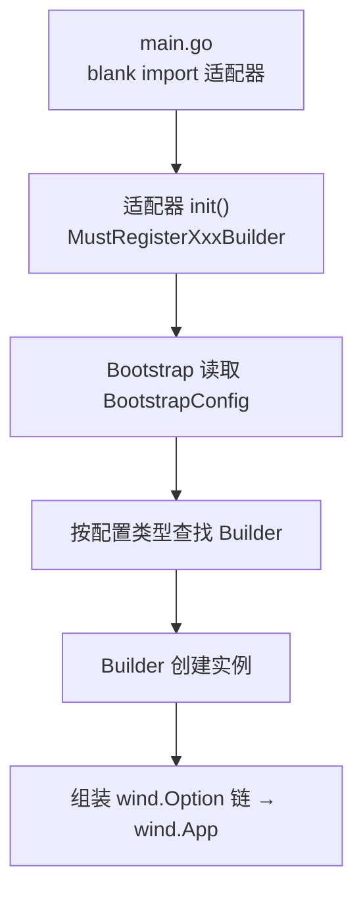
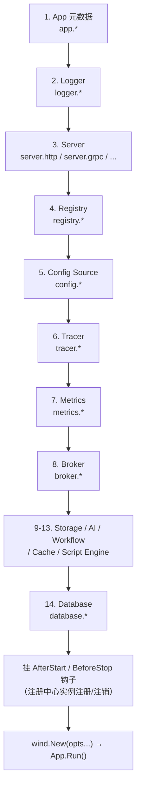

# Bootstrap SPI 机制

go-wind-bootstrap 通过 SPI（Service Provider Interface）机制实现 Builder 自注册与自动装配：每个适配器子包在 `init()` 中把 Builder 注册到全局注册表，用户只需空导入（blank import）适配器包，框架即可按配置自动组装组件。

## 一、SPI 工作流程



## 二、Builder 注册表全貌

注册表按域（domain）组织，每个域一张字符串键控的 map，键是类型常量（如 `ServerTypeHTTP = "http"`、`LoggerTypeZap = "zap"`），与配置中的类型值一致：

| 域 | Builder 签名 | 注册函数 |
|----|-------------|---------|
| Server | `func(cfg *v1.Server) (transport.Server, error)` | `MustRegisterServerBuilder` |
| Log | `func(cfg *v1.Logger) (log.Logger, func(), error)` | `MustRegisterLogBuilder` |
| Registry | `func(ctx, cfg *v1.Registry) (Registry, func(), error)` | `MustRegisterRegistryAction` |
| Config | `func(ctx, cfg *v1.Config) (func(), error)` | `MustRegisterConfigAction` |
| Tracer | `func(cfg *v1.Tracer) (interface{}, func(), error)` | `MustRegisterTracerBuilder` |
| Metrics | `func(cfg *v1.Metrics) (func(), error)` | `MustRegisterMetricsBuilder` |
| Broker | `func(ctx, cfg *v1.Broker) (any, func(), error)` | `MustRegisterBrokerBuilder` |
| Storage | `func(ctx, cfg *v1.Storage) (any, func(), error)` | `MustRegisterStorageBuilder` |
| Ai | `func(ctx, cfg *v1.Ai) (any, func(), error)` | `MustRegisterAiBuilder` |
| Workflow | `func(ctx, cfg *v1.Workflow) (any, func(), error)` | `MustRegisterWorkflowBuilder` |
| Cache | `func(ctx, cfg *v1.Cache) (any, func(), error)` | `MustRegisterCacheBuilder` |
| ScriptEngine | `func(ctx, cfg *v1.Script) (any, func(), error)` | `MustRegisterScriptEngineBuilder` |
| Database | `func(ctx, cfg *v1.Database) (any, func(), error)` | `MustRegisterDatabaseBuilder` |

每个域同时提供 `RegisterXxx`（返回 error）与 `MustRegisterXxx`（出错 panic，专供 `init()` 使用），以及 `ListXxxBuilders()` 诊断函数。

## 三、SPI 注册示例

### 3.1 适配器自注册

每个适配器子包的 `init()` 只有一行：

```go
// transport/http/http.go
package http

func init() {
    bootstrap.MustRegisterServerBuilder(bootstrap.ServerTypeHTTP, newBuilder)
}
```

```go
// log/zap/zap.go
func init() {
    bootstrap.MustRegisterLogBuilder(bootstrap.LoggerTypeZap, newBuilder)
}
```

```go
// database/gorm/client.go
func init() {
    bootstrap.MustRegisterDatabaseBuilder(bootstrap.DatabaseTypeGorm, newBuilder)
}
```

main.go 中空导入适配器包，`init()` 即自动执行：

```go
import (
    _ "github.com/tx7do/go-wind-bootstrap/log/zap"       // 注册 Zap Logger Builder
    _ "github.com/tx7do/go-wind-bootstrap/transport/http" // 注册 HTTP Server Builder
)
```

### 3.2 Bootstrap 自动装配

Bootstrap 解析配置时按 proto 的 optional 字段逐个检查，命中即查表调用对应 Builder：

```yaml
server:
  http:          # ServerTypeHTTP → serverBuilders["http"]
    addr: ":8080"

logger:
  type: zap      # LoggerTypeZap → logBuilders["zap"]
  zap:
    level: info
```

以 HTTP 为例，`newBuilder` 读取 `cfg.GetHttp()`，创建 Server、按配置挂载中间件，再依次调用 `RegisterServerSetup` 注册的路由回调。

## 四、SPI 装配顺序

`Bootstrap` 按固定顺序解析各域配置：



## 五、自定义 Builder

当内置适配器不满足需求时，用与内置适配器相同的 API 注册自定义 Builder：

```go
// 注册自定义 Registry Action（签名见 builder.go：入参为 Registry 配置，
// 返回 Registry 实例 + cleanup）
bootstrap.MustRegisterRegistryAction(bootstrap.RegistryTypeConsul,
    func(ctx context.Context, cfg *v1.Registry) (bootstrap.Registry, func(), error) {
        // 创建 Consul 注册中心客户端...
        return reg, func() { /* cleanup */ }, nil
    },
)

// 注册自定义 Broker Builder
bootstrap.MustRegisterBrokerBuilder(bootstrap.BrokerTypeKafka,
    func(ctx context.Context, cfg *v1.Broker) (any, func(), error) {
        // 创建 Kafka Broker...
        return broker, func() { /* cleanup */ }, nil
    },
)
```

## 六、实例生命周期

每个 Builder 返回可选的 `cleanup` 函数，Bootstrap 将各域的 cleanup 聚合为一个总的清理链，在应用停止后统一执行（释放连接、注销实例、刷新 tracer 等）：

- **半密封模式**：`bctx.Cleanup()` 触发；
- **全密封模式**：`RunApp` 内部自动 `defer cleanup()`。

注册中心的实例注册/注销由 bootstrap 层统一接线：应用启动后（`wind.WithAfterStart`）以真实监听端点注册到所有已配置的注册中心，优雅停机时（`wind.WithBeforeStop`）在服务器停止前注销——Builder 只负责创建注册中心客户端本身。

## 七、SPI vs Google Wire

| 对比项 | Bootstrap SPI | Google Wire |
|--------|--------------|-------------|
| 依赖方式 | 运行时注册 | 编译时生成 |
| 灵活性 | 高（配置驱动选择实现） | 中（编译确定） |
| 类型安全 | 运行时检查 | 编译时检查 |
| 配置驱动 | YAML 驱动 | 代码驱动 |
| 学习成本 | 低 | 中 |

## 相关文档

- [Bootstrap 介绍](./bootstrap-intro.md)
- [Bootstrap 配置系统](./bootstrap-config.md)
- [插件注册机制](./plugins-registry.md)
- [自定义插件开发教程](./tutorial-custom-plugin.md)
