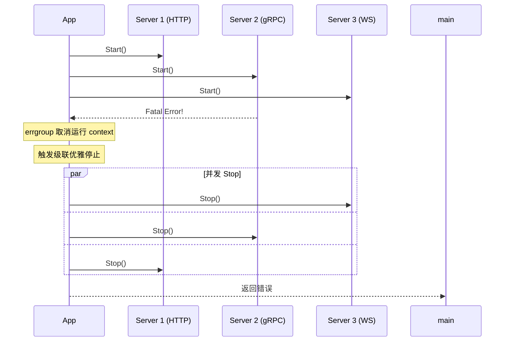

# App 生命周期管理

App 是 go-wind 的引擎核心，负责管理所有 Server 的启动、运行和优雅停止。

## 一、生命周期阶段


## 二、启动流程

`Run(ctx)` 基于 errgroup 编排，真实执行顺序（伪代码）：

```go
func (a *App) Run(ctx context.Context) error {
    // Phase 0: beforeStart 钩子 —— 同步执行，任一 Server 启动之前；
    //          返回错误则中止启动
    runHooks(a.opts.beforeStart)

    // Phase 1: 所有 Server 通过 errgroup 并发启动
    eg, egCtx := errgroup.WithContext(ctx)
    for _, srv := range a.servers {
        eg.Go(func() error { return srv.Start(egCtx) })
        // 任一 Server 崩溃/退出 → errgroup 取消 egCtx
    }

    // Phase 1.5: afterStart 钩子 —— 所有 Server 启动完成后同步执行；
    //            返回错误则触发优雅停机
    runHooks(a.opts.afterStart)

    // 等待：信号到达 / ctx 取消 / Server 崩溃
    <-egCtx.Done()

    // Phase 2: beforeStop 钩子 —— 同步执行，优先于 Server.Stop
    runHooks(a.opts.beforeStop)

    // Phase 3: 所有 Server 并发 Stop，各自持有独立超时上下文
    stopAll()

    // Phase 4: afterStop 钩子 —— 同步执行，后于 Server.Stop
    runHooks(a.opts.afterStop)

    return runErr
}
```

## 三、启动阶段扩展点（beforeStart / afterStart）

go-wind 提供 `beforeStart` / `afterStart` 两个生命周期钩子，作为**应用启动前后**的扩展点，通过选项注册：

```go
app := wind.New(
    wind.WithBeforeStart(func(ctx context.Context) error {
        // 任一 Server 启动之前执行：初始化连接池、预热缓存等
        return nil
    }),
    wind.WithAfterStart(func(ctx context.Context) error {
        // 所有 Server 启动完成之后执行：以真实监听端点注册服务、就绪探针打点等
        return nil
    }),
)
```

失败语义：

- **beforeStart 返回错误** → 启动中止，App 直接返回错误；
- **afterStart 返回错误** → 触发全量优雅停机。

这两个钩子是 Server 的 Start/Stop 之外、面向应用整体启动阶段的扩展点，与 `WithBeforeStop` / `WithAfterStop` 停机钩子、信号处理、级联崩溃等机制共同构成 App 的完整生命周期事件集。

## 四、优雅停止

### 4.1 并发停止

收到停机信号后，所有 Server **并发**执行 Stop，无需依赖注册顺序：

```text
Phase 2: beforeStop 钩子（同步，优先于 Stop）
Phase 3: srv1.Stop / srv2.Stop / srv3.Stop  ← 并发，各自独立超时上下文
Phase 4: afterStop 钩子（同步，后于 Stop）
```

设计要点：Stop 的 context 从 `context.Background()` 派生而**不是**从运行 context 派生，确保停机超时窗口真实有效；`App.Stop()` 只触发取消信号，不直接调用 `Server.Stop()`，停机逻辑统一收口。

### 4.2 超时控制

```go
app := wind.New(
    wind.WithStopTimeout(30 * time.Second),
)

// 停止时，每个 Server 有 30 秒完成清理
```

## 五、信号处理

App 默认自动监听 `SIGTERM` / `SIGINT` / `SIGQUIT`，收到信号后触发优雅停止，适用于 Docker/K8s 环境的容器生命周期管理。需要自定义时使用 `WithSignal`：

```go
app := wind.New(
    wind.WithSignal(syscall.SIGTERM), // 覆盖默认信号集
)
```

## 六、级联崩溃

任何一个 Server 发生致命错误返回时，errgroup 自动取消运行 context，其余 Server 优雅停止：



## 七、多 Server 示例

```go
func main() {
    app := wind.New(
        wind.WithName("multi-server"),
        wind.WithServer(httpServer, grpcServer, wsServer),
        wind.WithStopTimeout(15 * time.Second),
    )

    if err := app.Run(context.Background()); err != nil {
        log.Fatal(err)
    }
}
```

## 相关文档

- [核心框架介绍](./core-intro.md)
- [Context 传播](./core-context.md)
- [Transport 抽象](./core-transport.md)
- [声明式启动器介绍](./bootstrap-intro.md)
