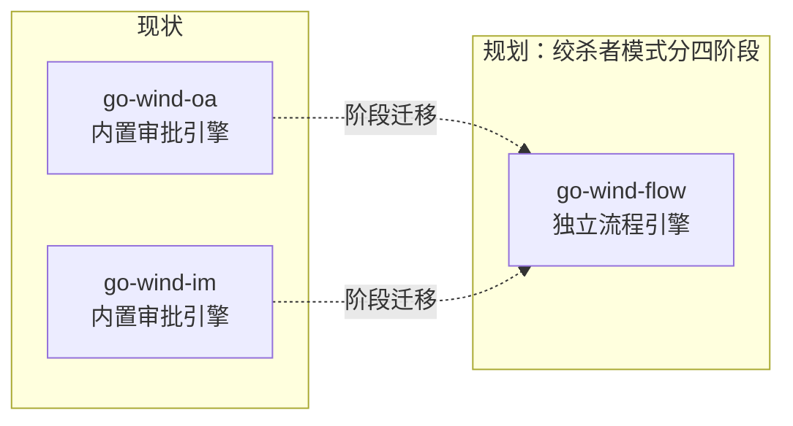
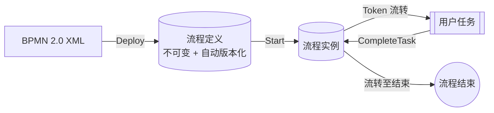

# GoWind Flow 流程引擎

GoWind Flow（**川流**）是 go-wind 家族的**轻量级工作流引擎**：BPMN 2.0 兼容、持久化 Token 状态机、零依赖核心、可插拔脚本引擎。它对齐 Flowable / Camunda / Activiti 的常用子集，以纯 Go 库的形式为任意服务内嵌成熟的流程流转能力。项目采用 MIT 协议开源，当前版本 **v0.2.0**。

> **设计理念**：引擎管流转，脚本管流转之外的所有逻辑。

- **BPMN 2.0 兼容子集** — 对齐 Flowable / Camunda / Activiti 的常用子集，仓库提供完整兼容矩阵（`docs/bpmn_compat`）
- **持久化 Token 状态机** — 流程实例状态以 Token 形式落库，服务重启后可继续流转
- **零依赖核心** — 核心不引入第三方依赖，存储与脚本引擎均可插拔替换
- **可插拔脚本引擎** — 业务逻辑写在脚本里，通过 contrib 对接 go-scripts 的 9 种脚本引擎

## 一、来源与现状

GoWind Flow 从 **go-wind-oa / go-wind-im 的审批流引擎**中提取、泛化而来，把两套业务产品中反复打磨的审批流转能力沉淀为独立引擎。

注意与 go-wind-plugins 中的工作流引擎适配（Temporal / Argo / Conductor / GoWorkflows）区分：那些是对第三方引擎的适配插件，flow 则是家族自研的轻量级引擎。

与宿主产品的关系，如实说明：

- **迁移尚在规划中** — 规划以「绞杀者模式」分四阶段将 OA / IM 迁移至 flow，迁移路线见仓库 `docs/oa_im_migration`
- **尚无宿主产品引用** — OA / IM 目前仍使用各自的内置审批引擎，flow 尚未被任何产品接入



**版本轨迹**：项目于 2026-10-30 首发 v0.1.0（M0 核心骨架），当前为 v0.2.0，处于快速迭代期。

## 二、快速上手

以 Go 库方式内嵌使用，`go get` 之后三步即可完成一次流转：

```bash
go get github.com/tx7do/go-wind-flow
```

### 2.1 三步用法

1. **创建引擎** — `flow.New(WithStore(...), WithImporters(bpmn.Importer{}))`，选择存储实现并注册 BPMN 导入器
2. **部署流程定义** — `Deploy` 部署 BPMN 流程定义，定义不可变、自动版本化
3. **启动与驱动** — `Start` 启动流程实例，`CompleteTask` 完成任务推动流转

### 2.2 示例代码（示意）

```go
package main

// 示意：具体 import 路径与选项签名以仓库 README 为准
import "github.com/tx7do/go-wind-flow"

func main() {
    // ① 创建引擎：选择存储实现（ent / gorm / memory），注册 BPMN 导入器
    engine := flow.New(
        WithStore(/* ... */),
        WithImporters(bpmn.Importer{}),
    )

    // ② 部署流程定义（不可变、自动版本化）
    engine.Deploy(ctx, leaveApproval)

    // ③ 启动流程实例 / 完成任务
    instance, _ := engine.Start(ctx, "leave-approval", variables)
    _ = engine.CompleteTask(ctx, taskID, taskVars)
}
```

> 以上为三步用法的示意代码，完整可运行示例见仓库 `examples/` 与 README。



## 三、架构组成

| 模块 | 说明 |
|------|------|
| `api/` | 纯 gRPC 契约，发布到 buf.build（BSR），客户端可直接远程引用 |
| `server/` | gRPC 服务实现，把引擎能力以服务形式对外提供 |
| `store/` | 三种存储实现：ent / gorm / memory |
| `contrib/goscripts` | 对接 go-scripts 的 9 种脚本引擎 |
| `frontend/` | npm 工作区：@go-wind/flow-designer-core / -vue / -react（v0.2.0），bpmn-js 封装 + 审批配置面板 + 钉钉式垂直审批树 |

引擎既可以作为嵌入式库直接调用，也可以通过 `server/` 以 gRPC 服务独立部署，取决于你的架构偏好。

## 四、能力特性

| 能力 | 说明 |
|------|------|
| 会签 / 或签 | 多人审批节点：全员通过或任一通过即可流转 |
| 候选组任务 | 任务按候选组分配，组内成员认领处理 |
| 错误事件 | 捕获流程错误并转入异常处理分支 |
| 集合多实例 | 按集合逐项生成多实例任务 |
| 边界定时事件 | 附加在节点上的定时边界事件 |
| 中间消息事件 | 流程中间节点等待 / 接收消息 |
| 超时自动审批 / 驳回 | 任务超时后自动通过或驳回 |
| 定时调度参考实现 | `examples/scheduler` |
| 示例流程 | `leave-approval.bpmn.xml`、`timer-approval.bpmn.xml` |

> **版本状态**：v0.2.0 后快速迭代中，部分能力处于 Unreleased 状态，请以仓库 CHANGELOG 为准。

## 五、性能基线

以下为仓库基准测试数据：

| 场景 | 耗时 |
|------|------|
| 线性流审批 | 约 104µs |
| 线性流审批（ent + sqlite 存储） | 约 1.1ms |

实际表现受存储介质与流程复杂度影响，建议以自身业务流程实测为准。

## 六、仓库与文档

- 仓库：[tx7do/go-wind-flow](https://github.com/tx7do/go-wind-flow)（MIT）
- 教程层建设中，现阶段以仓库专题文档为准：

| 专题文档 | 内容 |
|---------|------|
| `docs/architecture_design` | 架构设计 |
| `docs/bpmn_compat` | BPMN 2.0 兼容矩阵 |
| `docs/designer_contract` | 设计器契约 |
| `docs/oa_im_migration` | OA / IM 迁移路线 |
| `docs/roadmap` | 路线图 |

## 相关文档

- [GoWind 框架总览](/framework/intro.md)
