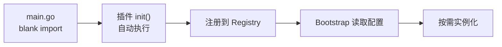

# 插件注册机制（SPI）

go-wind-plugins 使用 Go 的 `init()` + blank import 机制实现 SPI（Service Provider Interface）自动注册，无需手动装配。

## 一、SPI 工作原理



## 二、Registry 设计

```go
// bootstrap/registry/registry.go
package registry

// Transport 注册表
var transportFactories = map[string]TransportFactory{}

type TransportFactory func(opts ...transport.Option) transport.Server

func RegisterTransport(name string, factory TransportFactory) {
    transportFactories[name] = factory
}

func NewTransport(name string, opts ...transport.Option) (transport.Server, error) {
    factory, ok := transportFactories[name]
    if !ok {
        return nil, fmt.Errorf("unknown transport: %s", name)
    }
    return factory(opts...), nil
}
```

同理有 `RegisterDatabase`, `RegisterCache`, `RegisterBroker`, `RegisterLog`, `RegisterConfig`, `RegisterRegistry` 等。

## 三、插件注册示例

### 3.1 HTTP Transport

```go
// plugins/transport/http/register.go
package http

import "github.com/tx7do/go-wind-bootstrap/registry"

func init() {
    registry.RegisterTransport("http", func(opts ...transport.Option) transport.Server {
        return NewServer(opts...)
    })
}
```

### 3.2 Redis Cache

```go
// plugins/cache/redis/register.go
package redis

import "github.com/tx7do/go-wind-bootstrap/registry"

func init() {
    registry.RegisterCache("redis", func(opts ...Option) cache.Cache {
        return NewClient(opts...)
    })
}
```

### 3.3 数据访问客户端（GORM）

```go
// plugins/crud/gorm/register.go
package gorm

import "github.com/tx7do/go-wind-bootstrap/registry"

func init() {
    registry.RegisterDatabase("gorm", func(opts ...Option) (*Repository[any, any], error) {
        return NewRepository(opts...)
    })
}
```

## 四、Blank Import

在 main.go 中通过 blank import（下划线导入）触发 `init()`：

```go
package main

import (
    // Transport
    _ "github.com/tx7do/go-wind-plugins/transport/http"
    _ "github.com/tx7do/go-wind-plugins/transport/grpc"

    // Log
    _ "github.com/tx7do/go-wind-plugins/log/zap"

    // Database
    _ "github.com/tx7do/go-wind-plugins/crud/gorm"

    // Cache
    _ "github.com/tx7do/go-wind-plugins/cache/redis"

    // Broker
    _ "github.com/tx7do/go-wind-plugins/broker/kafka"

    // Bootstrap
    "github.com/tx7do/go-wind-bootstrap"
)

func main() {
    app := bootstrap.New("config.yaml")
    app.Run()
}
```

不导入就不会注册，不会增加二进制体积。

## 五、按需加载

Go 没有 Java 的类加载器延迟加载机制，但 blank import 的好处是：

| 特性 | 说明 |
|------|------|
| 编译期确定 | 编译时就知道依赖了哪些插件 |
| 无反射 | 不依赖反射，性能高 |
| 二进制裁剪 | 不 import 的插件不会编译进二进制 |
| 显式声明 | 看一眼 import 就知道用了哪些插件 |

## 六、自定义插件注册

开发自己的插件并注册到 Registry：

```go
package mycache

import (
    "github.com/tx7do/go-wind/cache"
    "github.com/tx7do/go-wind-bootstrap/registry"
)

type Cache struct { ... }

func NewCache(opts ...Option) cache.Cache {
    c := &Cache{}
    for _, opt := range opts { opt(c) }
    return c
}

// 注册
func init() {
    registry.RegisterCache("mycache", func(opts ...Option) cache.Cache {
        return NewCache(opts...)
    })
}
```

在 main.go 中：

```go
import _ "myproject/plugins/mycache"
```

## 七、注册表一览

| Registry 函数 | 注册对象 | 配置前缀 |
|--------------|---------|---------|
| `RegisterTransport` | Transport Server | `server.*` |
| `RegisterLog` | Logger | `log.*` |
| `RegisterDatabase` | 数据访问客户端 | `database.*` |
| `RegisterCache` | Cache | `cache.*` |
| `RegisterBroker` | Broker | `broker.*` |
| `RegisterConfig` | Config Source | `config.*` |
| `RegisterRegistry` | Service Registry | `registry.*` |
| `RegisterTracer` | Tracer | `tracer.*` |
| `RegisterOSS` | Object Storage | `oss.*` |
| `RegisterMetrics` | Metrics | `metrics.*` |
| `RegisterAuth` | Authenticator | `auth.*` |

## 八、服务注册发现插件（Registry）

注意区分两个概念：本页上文的「注册机制」指插件的 SPI 自动装配；这一节说的是**服务注册发现**插件家族（`registry/`），实现 `registry.Registry`（Registrar / Discovery / Watcher）接口，共 8 个插件：

| 插件 | 导入路径 | 引擎 |
|------|---------|------|
| Consul | `plugins/registry/consul` | HashiCorp Consul |
| Etcd | `plugins/registry/etcd` | CoreOS etcd |
| Eureka | `plugins/registry/eureka` | Netflix Eureka |
| Kubernetes | `plugins/registry/kubernetes` | K8s Endpoints |
| Nacos | `plugins/registry/nacos` | 阿里云 Nacos |
| Polaris | `plugins/registry/polaris` | 腾讯云 Polaris |
| ServiceComb | `plugins/registry/servicecomb` | Apache ServiceComb |
| Zookeeper | `plugins/registry/zookeeper` | Apache ZooKeeper |

**selector / resolver 的归属**：`selector`（客户端负载均衡策略 RoundRobin/Random/First + 基于 Watch 的实时 Balancer）与 `resolver`（gRPC `resolver.Builder`，支持 `grpc.NewClient("wind:///svc", grpc.WithResolvers(...))` 按注册中心寻址）是仓库顶层的两个独立模块，**不属于 registry 家族**，但与服务注册发现配合使用：Discovery 提供实例列表，selector 负责挑一个，resolver 把它接入 gRPC 寻址。

## 近期更新

- **etcd**（`registry/etcd`）：心跳改用 registry 级长生命周期 context 驱动，租约过期后**永不放弃重注册**（重试突发间隔 30s 冷却），不再因瞬时故障永久丢失注册。
- **eureka**（`registry/eureka`）：新增 `MaxRetry` 客户端选项，可配置对 Eureka Server 的请求重试次数。

## 相关文档

- [插件配置系统](./plugins-config.md)
- [插件总览](./plugins-intro.md)
- [Bootstrap SPI 机制](./bootstrap-spi.md)
- [自定义插件开发教程](./tutorial-custom-plugin.md)
